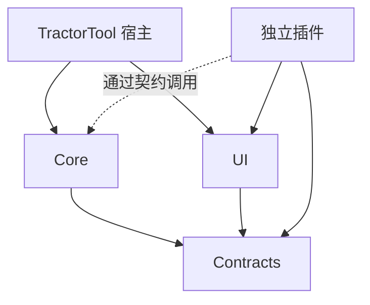

# TractorTool 软件架构

更新日期：2026-11-28。本文维护框架的模块职责、资源所有权、事务与失败边界；具体业务归插件，参数限制及 SDK 接入规则见[插件开发规范](PLUGIN_DEVELOPMENT.md)。目录导航见[项目首页](../README.md#设计与结构)，需求见[产品说明](TractorTool.md)，实现与验收状态只以[开发台账](DEVELOPMENT.md#current-status)为准。

## 1. 当前代码与目标结构

框架基于 .NET 10、Avalonia、MVVM，Windows 优先。项目清单见 [TractorTool.slnx](../TractorTool.slnx)，.NET SDK 版本见 [global.json](../global.json)。[Directory.Packages.props](../Directory.Packages.props) 统一维护框架使用的 NuGet 版本，宿主公开的 Avalonia 兼容常量取自该基线。仅供插件业务使用的库由插件在自己的工程中定版并随包交付。

| 模块 | 职责 | 项目依赖边界 |
| --- | --- | --- |
| `TractorTool` | 应用入口、服务组装、窗口/导航/托盘、公共管理页面、Windows 适配 | 直接引用 Core、UI，经两者传递引用 Contracts；不引用具体插件 |
| `TractorTool.Contracts` | 插件生命周期、任务、进程、依赖、路径、配置和日志契约 | 无 Avalonia、Win32 或业务模型 |
| `TractorTool.Core` | 插件装载/管理、公共任务、包事务、进程协调、存储与日志策略 | 仅 Contracts；平台实现由宿主注入 |
| `TractorTool.UI` | 页面/托盘注册契约、通用控件、主题和动效 | Contracts、Avalonia、FluentAvalonia；不引用宿主/Core |
| `Plugins/` | 独立业务、页面、设置及专属平台适配 | 仅公开 Contracts/UI 与私有依赖 |
| `tests/` | 对应模块的检查与独立插件夹具 | 被测模块；验证层级见开发台账 |

宿主通过公开契约连接插件，只管理公共资源和交互；业务参数、执行策略及结果校验由插件承担。新增公共接口必须有真实消费方，不预建空服务或通用业务平台。



实线是项目依赖，虚线是运行时调用；实际引用见[宿主](../TractorTool/TractorTool.csproj)、[Core](../TractorTool.Core/TractorTool.Core.csproj)、[UI](../TractorTool.UI/TractorTool.UI.csproj)及[Contracts](../TractorTool.Contracts/TractorTool.Contracts.csproj)工程。插件纳入解决方案不等于宿主静态引用它。源码/发布 SDK 两种构建模式见[插件构建规范](PLUGIN_DEVELOPMENT.md#6-开发构建与安装验证)，运行时依赖分类见[依赖表](PLUGIN_DEVELOPMENT.md#dependency-kinds)。运行时只加载 `<AppRoot>/Plugins/<PluginId>/<Version>`，与仓库的插件工程目录无关。

## 2. 插件协议与装载

### 2.1 分发单元

插件 ZIP 包含根清单 `plugin.json`、入口 DLL、私有依赖、资源和许可。清单先于代码校验；禁用、不兼容或损坏的插件只显示元数据，不执行入口。字段与版本兼容规则只维护在[清单规范](PLUGIN_DEVELOPMENT.md#2-插件清单与兼容性)。

管理状态明确选定活动版本；未管理的同 ID 多版本报冲突，不猜测最高版本。有效的外部依赖声明不要求预先安装，缺包或来源不可用在实际申请时处理，不阻止页面加载。清单值不作为 shell 命令执行。

### 2.2 公开扩展点

| 契约 | 所有权与用途 |
| --- | --- |
| `IPlugin`、`PluginContext`、`IPluginBackgroundService` | 宿主持有插件实例与生命周期；上下文提供按插件限定的服务作用域 |
| `IPluginUiModule`、`IPluginTrayModule` | UI SDK 提供页面/设置工厂及可选托盘菜单注册；宿主不解释业务字段 |
| `IBackgroundTaskService`、`IBackgroundTask` | 登记有限任务或整批、执行句柄、进度与取消 |
| `IExternalPackageService`、`IProcessRunner` | 依赖申请/租约与受管理进程执行 |
| `IAppPaths`、`IPluginSettingsStore`、`IAppLog` | 所属目录、带版本配置与结构化日志 |

Contracts 不包含控件类型；Avalonia 页面契约只在 UI 工程。宿主页由 [MainViewModel](../TractorTool/ViewModels/MainViewModel.cs) 显式创建，插件页由已注册工厂创建，无名称反射兜底，也不要求插件继承宿主 ViewModel。

### 2.3 装载顺序与版本隔离

入口为 [App](../TractorTool/App.axaml.cs)，插件协调由 [PluginHost](../TractorTool.Core/Plugins/PluginHost.cs) 承担：

1. 解析 AppRoot、固定启动配置和 DataRoot，取得启动目录、数据根及插件安装目录锁；有迁移则先恢复/完成迁移，再创建业务写入服务。目录锁持有到进程终止，隔离迟到清理。
2. 在装载 DLL 前应用待重启变更，再扫描活动版本并校验路径、标识、平台和 SDK。管理状态不可读或安装锁不可得时停止插件装载，宿主保留诊断入口。
3. 为启用插件创建加载上下文与生命周期作用域；初始化后暂存页面、设置和托盘注册，全部成功才提交，再启动常驻活动。失败回滚注册，退出后的迟到初始化不得补注册。

[PluginLoadContext](../TractorTool.Core/Plugins/PluginLoadContext.cs) 使用 `AssemblyLoadContext` / `AssemblyDependencyResolver`，按以下边界解析：

- **共享 SDK**：宿主构建时把 Contracts、UI 和本次发布提供的 Avalonia 系列、FluentAvalonia、MicroCom.Runtime 记入运行时配置。打包、安装和装载使用这份清单。共享程序集由默认上下文提供并检查版本；宿主、Core 仅供内部使用。插件可通过 UI API 1.6 携带清单外的私有 Avalonia 扩展。
- **私有依赖**：先由插件解析器和入口邻接目录解析；入口、私有托管库和已解析本机库必须位于版本包内，逐级拒绝链接/重解析点。缺失私有依赖或解析后文件消失以 `FileLoadException` 终止，防止全局 `AssemblyResolve` 补救越过隔离。系统本机库由系统解析。
- **.NET 框架**：仅构建 SDK 的 `Microsoft.NETCore.App` 平台清单内名称可回退到运行时；清单[嵌入 Core](../TractorTool.Core/TractorTool.Core.csproj)，缺失则构建失败，部署无需 SDK。不得用名称前缀或包含宿主依赖的整份 TPA 放行；实际版本与平台可用性仍由 .NET 检查。

初始化、页面工厂和任务失败分别记录并隔离普通故障；进程内插件是可信代码，加载上下文不是安全沙箱，不能抢占同步卡死或隔离进程崩溃。

### 2.4 安装、更新、禁用和卸载

[PluginManager](../TractorTool.Core/Plugins/PluginManager.cs) 串行维护 `<PluginRoot>/.management/state.json`，活动选择与待处理请求分开，采用带版本 JSON 原子替换和备份。管理状态归软件安装，不能随外观配置迁移。拖放与文件选择共用同一安装流程；界面区分当前生效状态与重启后目标。

主记录丢失而备份仍在时停止插件管理，不默认重建或自动回滚启停选择。提交前先暂停依赖清理；提交后的观察者异常不撤销已保存事务，各订阅者独立通知。引用发布失败时同时关闭工具、Python、Node 的清理资格并保留诊断。

只有管理启动与目录枚举完成后才保存本轮加载结果；目录写入探针失败不等于枚举或加载失败。已有失败记录保留原始原因，未重新执行的插件不重复改写；完整枚举后确实缺少活动版本仍记录失败。

| 操作 | 提交与恢复规则 |
| --- | --- |
| 安装/更新 | 暂存到 `.management/staging/<Token>`，不执行 DLL；校验路径、链接、体积、清单、共享副本及入口 PE，保存文件摘要。版本目录不可覆盖，更新须提高版本；下次启动复验摘要后移动目录并提交活动选择 |
| 更新备份/回退 | 在旧进程退出、新版本加载前备份完整插件数据到 `<DataRoot>/Data/.plugin-backups/<Token>`；请求绑定原数据根。新版本失败保留旧代码与快照，安排下次启动回退；恢复前校验工作副本，持久化交换阶段，保留新版数据为 `before-rollback`。中断重试核对阶段与实际数据摘要，不能只凭目录消失判成功 |
| 启用/禁用 | 保存待生效目标，未执行时可反向取消；不因切页或隐藏即时停掉运行实例 |
| 卸载 | 下次启动将代码移入 `.management/removed/<Token>` 后删除，保留数据和快照；墓碑防止旧目录被重新发现。删除失败可结束逻辑卸载，持久记录残留归属，稍后独立重试清理；原代码未移出时不能强行完成 |
| 取消请求 | 安装/更新仅清理归属明确且未激活的暂存；回退/卸载须有明确的未交换阶段和一致现场才可取消。阶段未知的旧失败记录保守保留；已交换的失败回退可改为卸载，保留数据与恢复现场，不能直接恢复运行 |

重复请求、同版或较旧版本等状态冲突在管理锁内返回拒绝原因，保留既有请求，清理本次暂存；界面记录错误而不人为构造异常。损坏包、越界和真实 I/O 故障仍按异常处理。软件目录不可写时明确失败，不改装到 DataRoot。首版不热卸载、不在同进程内回退、不自动删除恢复快照。

卸载后的恢复现场不再作为可执行回退版本验证，迁移时原样保留。插件页“打开恢复文件”定位 `.plugin-backups`，各事务的 `snapshot.json` 记录所属插件/版本；同 ID 重装不删除旧现场，卸载日志另记具体目录。

## 3. 生命周期与任务

### 3.1 所有权

| 资源 | 结束条件 |
| --- | --- |
| 页面 | 成功离页后解除 UI 订阅、释放页面资源 |
| 有限任务及执行资源 | 完成、失败或明确取消；切页/托盘隐藏不影响任务 |
| 插件实例、常驻服务、托盘注册与服务作用域 | 插件停止/应用退出；不绑定页面可见性 |

每个插件只有一个清理任务：取消 → 等待初始化 → `StopAsync` → 等待常驻活动及取消回调 → `DisposeAsync`。并发退出共享该任务，禁止工作仍在运行时并发释放实例。阶段超过 3 秒记录超时并继续观察；插件间并行清理，插件宿主最多等待 9 秒，外层退出统一限时。

生命周期锁只登记状态、实例和共享任务；插件注册与清理回调在锁外执行，保留 UI 调用上下文。退出后不再发布 Loaded 或启动后台活动，注册中返回的资源仍由唯一清理任务回收。

### 3.2 任务状态

[公共任务服务](../TractorTool.Core/Tasks/BackgroundTaskService.cs) 管理 `Queued / Running / Cancelling / Succeeded / Failed / Cancelled / Interrupted`。`QueueBatchAsync` 先持久化整批摘要再返回执行句柄；插件通过 `RunAsync` 决定顺序、并发、参数快照及批次失败策略，Core 不解析业务参数。

- 摘要包含 TaskId、PluginId、BatchId、名称、进度、时间和结果/错误，保存全部活动项及最近 100 条终态。文件损坏保留原件、阻止新执行并提供保存重试；重启把非终态标为 Interrupted，不自动续跑或删除用户输出。
- 回调在结果校验与提交后才正常返回；正常返回保留 Succeeded，迟到取消不得抹掉成功结果。清理失败仍是失败，不能伪装正常取消。
- 进度更新内存并合并 UI 通知；磁盘日志仅记录阶段及每 10% 节点。日志页汇总所有插件任务，单项/整批取消按 PluginId 与 BatchId 限定；返回入口按所属插件路由，无页面时进入插件管理。标题栏不另设任务入口。

### 3.3 结构化日志与错误提醒

[AppLog](../TractorTool.Core/Logging/AppLog.cs) 保存序号、时间、级别、来源、消息和异常详情；旧无异常调用映射 INFO，有异常映射 ERROR，WARNING 显式指定，不根据文本猜级别。

- **内容**：记录插件生命周期/管理、依赖事务、任务阶段/结果及真实故障；普通导航和窗口隐藏/恢复不记录。用户取消与正常停止记 INFO，恢复中断记 WARNING；意外取消、超时和清理失败单独报错，不修改调试器过滤掩盖异常。
- **显示**：内存保留 300 条，旧上新下；虚拟化、稳定条目身份、筛选/复制/暂停及按需详情。基于滚动与集合事件跟随底部，上翻停止、回底恢复，无刷新定时器。INFO/WARNING/ERROR 用绿/黄/红及文字级别共同表达。
- **未读**：本次启动累计 ERROR 数减已读水位，不随内存淘汰或进入日志页清零。“已读”在锁内确认当时全部错误，包含筛选/暂停隐藏项；之后的新错继续显示导航数量角标。不跨模块合并故障。
- **落盘**：[LogFileWriter](../TractorTool.Core/Logging/LogFileWriter.cs) 沿写锁滚动，10 MiB/UTC 跨日分段，保留 14 天、最多 20 文件、总量目标 100 MiB；首次写入/滚动时检查，不定时扫描。单条最多 64 KiB，按完整 UTF-8 字符截短并标记。只清理 Logs 顶层精确命名的宿主旧文件，拒绝链接，保留当前段；清理失败警告并继续写，不承诺此时已满足上限。
- **故障**：磁盘写入失败在内存报告一次并保留提示，恢复后清除，不声称漏写已补齐。磁盘保留不影响内存与已读水位。常规更新使用事件；确有轮询时仅在实际启用后记录一次优化 WARNING，说明频率和退出条件。

### 3.4 托盘和退出

[TrayService](../TractorTool/Services/TrayService.cs) 拥有原生菜单，[PluginTrayMenu](../TractorTool/Services/PluginTrayMenu.cs) 管理插件回调和状态；宿主保留显示/退出，插件按名称分成一级子菜单。插件在注册期添加稳定 ID 的动作，随后通过句柄推送文字、启用和勾选状态，宿主调度到 UI，不轮询业务状态。

动作从 UI 线程开始，异步期间禁用该项；耗时工作必须异步，有限任务仍走任务服务。成功/失败写日志，只有菜单停止令牌已取消才将取消记为正常。停止时封闭动作和更新、取消并解绑菜单，等待在途动作后释放插件；注册失败回滚，注册返回的资源由 PluginHost 持有，Core 不引用 UI 类型。

应用采用显式退出生命周期，关闭主窗口仅隐藏；托盘失效时保留可见窗口与设置内退出入口。同一配置目录再次启动通过 [WindowsRestoreSignal](../TractorTool/Platform/WindowsRestoreSignal.cs) 恢复原窗口，不扩展为通用 IPC。

显式退出遇到活动任务时，请用户确认是否停止。系统注销或关机跳过确认。决定退出后，宿主撤回显示中及排队的确认框，封闭新请求和写入，停止任务、插件与常驻服务。启动时已在处理的插件变更、设置保存及异步清理共用 10 秒等待期。同步离页回调和文件系统锁可能延长总耗时。超时写日志，目录锁保留到进程结束。

各服务独立开始停止；同步清理或界面通知失败也须等待已开始的设置、迁移及插件管理操作。托盘释放异常不阻断最终关闭。部分启动失败复用同一清理任务，只使用已经建立的日志，不在迁移前创建写入者；初始化失败清除加载状态，托盘降级提示不覆盖失败原因。

<a id="packages"></a>

## 4. 外部依赖与进程管理

### 4.1 包管理

公开接口位于 [Contracts/Packages](../TractorTool.Contracts/Packages/IExternalPackageService.cs)，实现位于 [Core/Packages](../TractorTool.Core/Packages/ExternalPackageService.cs)，管理页面归宿主。私有 .NET 库随插件打包，共享 SDK 由宿主提供，可执行工具和独立原生运行库由包服务提供版本路径及使用保护。

工具包保留版本命令验证；原生运行库通过静态 PE 和完整文件校验，不在安装时执行 DLL。Python/Node 通过各自服务接入共享的[环境事务](../TractorTool.Core/Packages/Environments/ManagedEnvironmentService.cs)，安装策略独立，确认、引用、代次提交、租约及缓存维护共用。三类扩展位于 `Dev`，未改变已发布 1.1.0；现行设计见 [7.3](#dependency-extension)，当前验收见[开发台账](DEVELOPMENT.md#dependency-extension-plan)。

**来源**：不维护自有源。默认 GitHub/PyPI/npm，用户可添加公开 GitHub Enterprise API、PyPI Simple 索引、npm registry 或 HTTPS 文件目录；配置在 `<DataRoot>/Config/dependency-sources.json`，旧记录保持可读。原生归档使用 PyPI 或 HTTPS 文件来源：默认 PyPI 只接受 `files.pythonhosted.org`，自定义索引限定同源，文件目录限定同源及目录前缀。固定 URL 不接受认证、查询串或片段，最终重定向地址仍须符合声明来源；不承诺 HTTP 网络沙箱。来源移除不删除已装包，修复再次检查来源；配置损坏保留原件并阻止覆盖。

**声明与解析**：插件清单的 id/version 指定包，`downloads` 按 RID 声明许可、类型和入口；旧 GitHub 仓库/tag/ZIP/SHA256 格式不变。API 1.11 原生包可改用 `archives`，每份固定 URL、SHA256 与精确“归档条目 → 安装相对路径”映射，格式见[接入规范](PLUGIN_DEVELOPMENT.md#native-archive-packages)。[PackageSources](../TractorTool.Core/Packages/PackageSources.cs) 仅为 GitHub 声明查询精确 Release；归档声明直接校验已配置来源，不猜 latest 或文件。组合身份包含全部来源、归档摘要及映射，同版不可修改；旧包保持原摘要比较。模块选择、传递 DLL 集合与 ABI 验证归插件，Core 不读取业务准备脚本。同身份类型与入口契约必须一致，Windows 大小写别名冲突同时暂停清理。

**申请事务**：`TryRequestAsync` → 校验声明/复用或查询 → 首次确认 → 下载校验 → 安全解压 → 按类型验证 → 写 receipt 并原子提交 → 校验已安装内容并返回租约。拒绝返回 null；旧 `AcquireAsync` 仅复用已装包，初始化不自动下载。并发同包请求合并确认/安装，调用方取消仅停止自己的等待，设置页取消才停止共享下载。

GitHub 解析缓存保留实际 API 来源，复用配方和确认后启动安装仍检查来源是否已配置；移除插件引用不能绕过这项检查。已验证的 Ready 安装继续离线复用，不改变旧收据格式。

**校验边界**：API/下载/展开均有时间或体积上限；验证精确标签、唯一已上传附件、同仓库地址及可用的 GitHub digest，拒绝跨站/降级 API 重定向。下载后独立核对声明 SHA256；拒绝 ZIP 越界、链接、特殊文件、重名及大小写冲突。工具按受限参数向量探测版本，非零退出或选定输出截断即失败。原生入口须为匹配 Windows RID 的非 CLR DLL；[NativePackageIntegrity](../TractorTool.Core/Packages/NativePackageIntegrity.cs) 为全部载荷文件生成路径、长度和 SHA256 清单，每次取得租约复验文件集合及内容。宿主不执行 DLL、shell 或安装脚本；ABI、传递依赖搜索策略及业务能力由插件负责。校验值证明内容一致，不替代来源可信性。

**记录与恢复**：工具继续使用 schema 2 收据并兼容 schema 1；单 ZIP 原生包使用 schema 3，组合归档使用 schema 4。后者保存完整归档配方及组合摘要，两类原生记录均保存独立 `.package-files.json` 的 `ManifestHash`。取得租约复验载荷，离线复用不查来源；组合包修复可直接读取收据，仍须来源允许和目录归属验证。所有归档先下载、校验，再在 `Packages/.work` 按映射组合；目标禁止重复、大小写冲突、文件/目录冲突及保留记录占位，限额按全部归档累计。完整准备后沿用原目录替换事务，失败保留旧包，启动恢复未完成切换。未知归属文件保留。Packages 仍展示一条运行库，详情列出每份来源与摘要。

**引用与清理**：引用从持久清单和管理日志重建，包括禁用/失败、待激活及可回退版本。管理提交与引用同步受锁保护；记录不可读或管理日志的活动版本未被发现时暂停清理，不能视为零引用。排队与实际移出目录前均检查引用、请求预留、安装事务和运行租约；最终复查与移动在同一服务锁内完成，递归删除在锁外进行。资格变化时拒绝清理并保留原安装状态；卸载只解除生效后的引用，不联动删除包。插件作用域限定可申请依赖，退出封闭新操作并取消/等待在途工作，插件清理完成后回收遗漏租约。

**原生加载保护**：插件在第一次可能加载前调用 `RetainUntilProcessExit()`，包括可能部分成功后失败的调用。[NativePackageRetention](../TractorTool.Core/Packages/NativePackageRetention.cs) 按安装路径保存进程期占用，租约、插件作用域或服务 Dispose 均不解除；修复和删除同时检查普通租约与此占用。页面通过 `RetainedBy` 解释退出前不可维护的原因。插件负责原生句柄和搜索路径，不修改全局 PATH；框架不保证原生热卸载或同名 DLL 的进程内隔离。

### 4.2 进程服务

[IProcessRunner](../TractorTool.Contracts/Processes/IProcessRunner.cs) 接收绝对可执行路径和参数向量，不搜索 PATH、不执行 shell，默认工作目录为工具目录。[ProcessRunner](../TractorTool.Core/Processes/ProcessRunner.cs) 快照请求、处理双流/超时/取消，平台执行通过 `IProcessSession` 注入；每个插件拥有独立作用域。

API 1.9 的 `EnvironmentVariables` 只覆盖本次子进程：null 值删除继承变量，空字符串保留；请求在异步创建前复制并验证。Windows 按大小写无关规则合并、排序，使用 Unicode 环境块传给 `CreateProcessW`，不修改宿主全局环境。

Windows 的 [WindowsProcessSession](../TractorTool/Platform/WindowsProcessSession.cs) 在 `CreateProcessW` 创建时用 `PROC_THREAD_ATTRIBUTE_JOB_LIST` 绑定私有 Job，显式限制继承句柄并设置 KILL_ON_JOB_CLOSE；CRT 命令行转义只在此适配层。根进程结束、超时或取消均清理该 Job 的残留后代，不按进程名杀进程。

正常等待用 OS 通知；仅终止进程树时关联临时 IO 完成端口，在后台等待 Job 空树通知，取消可唤醒。原生通知等待计时上限为 3 秒，不代表整个退出流程的总时限。通知不保证送达，因此开始等待、空树通知和取消/截止时核对实际活动进程数；不定时轮询，也不在正常运行期间累积通知队列。确认退出后，ProcessRunner 另行限时等待双流自然读到 EOF，清理失败或管道超时才取消读取；清理失败作为错误报告，正常调用方取消仍保持取消语义。非 Windows 适配器尚未实现，明确报告不支持。

stdin 关闭为 EOF；stdout/stderr 并发排空并有界保留，超限返回截断标记而不中断读取。可选 stdout 回调顺序接收数据块，不保证完整行，也不受最终捕获上限限制；回调须快速返回，异常进入读取失败和清理路径。业务输出解析/进度与结果校验归插件。

返回原始退出码；调用方取消、超时、读取/清理故障分别处理，不能把清理失败报成正常取消。诊断关联所属插件，不记录参数和输出正文。工具租约必须覆盖进程退出及输出排空，页面离开不释放后台执行资源。

<a id="storage"></a>

## 5. 插件目录、数据目录与迁移

### 5.1 固定启动位置与可迁移数据

迁移成功后清理旧业务数据；默认位置保留必要的 bootstrap 与锁，继续定位自定义目录。确认自定义本地目录已删除时恢复默认根；具体启动顺序见 5.3，当前实现与验收见[开发台账](DEVELOPMENT.md#current-status)。

`AppRoot` 取实际应用目录，不能取工作目录；`PluginRoot` 固定在其下。默认 `DataRoot` 为 `%LOCALAPPDATA%/TractorTool`，用户可改为专用目录；`PackageRoot` 始终从 DataRoot 解析。

```text
<AppRoot>/
  Plugins/<PluginId>/<Version>/    # 代码、资源、私有依赖
  Plugins/.management/             # 活动选择、待处理请求、代码暂存
  Plugins/.installation.lock       # 安装目录独占锁

<DataRoot>/
  Config/                          # 宿主配置、依赖来源
  Packages/<PackageId>/<Version>/<RID>/
  Packages/DLL/<PackageId>/<Version>/<RID>/  # 独立原生运行库
  Packages/uv/Environments/<PluginId>/<Identity>/ # Python 原输入与环境代次
  Data/Plugins/<PluginId>/          # 插件配置及持久数据
  Data/tasks.json                  # 公共任务摘要
  Data/.plugin-backups/<Token>/    # 更新/回退快照
  Cache/                           # 可重建缓存
  Logs/                            # 宿主日志
```

固定 `%LOCALAPPDATA%/TractorTool/bootstrap.json` 只保存数据根指针、版本与迁移/重置收尾状态，不随业务数据搬迁，也不经公开 IAppPaths 暴露。`--profile-root <绝对路径>` 隔离测试启动位置与默认数据，不改变插件代码位置。用户输入/输出不属于缓存，不由清理功能删除。

上图为通用目录布局；`Packages/DLL`、`Packages/uv`、`Packages/Node` 按需创建并标记归属。语言环境的代次与迁移重建见[扩展目录约定](#dependency-extension-storage)，不用空目录冒充已安装能力。

配置采用带 `schemaVersion` 的 JSON，[JsonFileStore](../TractorTool.Core/Storage/JsonFileStore.cs) 按完整路径串行保存，同目录临时文件落盘后原子替换并备份。读取先探测属性，文件缺失时再核对父路径，仅正常缺失返回默认值；目录占位、祖先文件占位、访问故障、损坏或未知版本均报错，不能把坏管理状态作为空状态装载插件。保存失败保留原数据。内部位置以所属根下相对路径保存，用户路径保持原语义；格式升级通过模型迁移，不对所有 JSON 作字符串替换。目录缺失与不可访问分别处理，不以 `Directory.Exists=false` 授权重置。

### 5.2 切换数据根目录

[DataRootMigration](../TractorTool.Core/Storage/DataRootMigration.cs) 承担复制、校验与恢复，宿主只负责确认和进度。只接受本机新建/空的专用目标；拒绝卷根、源目标互含、与 bootstrap/Plugins 重叠及链接/重解析路径，不合并已有目录。

1. **安排**：设置将事务 ID、源/目标、AppRoot 和状态写入固定 bootstrap，下次启动执行；当前工作继续。插件有待重启变更或待加载结果时不可安排；安排后新增插件变更则先保留原根处理插件，再由用户重试迁移。
2. **准备/复制**：唯一 MainWindow 显示启动状态，后台取得启动、数据、安装及目标锁，读取已有外观；成功前不启动业务写入服务或插件。目标标记核对事务归属，仅复制 Config/Data/Packages/Logs，跳过 Cache、Packages/.work 和锁/启动文件，保留空目录及修改时间。临时文件落盘、SHA256 校验后无覆盖提交，最终核对两端清单；遍历和分块哈希均响应取消。只回收本事务的未完成临时文件，再检查剩余空间。
3. **提交**：复制及源根回退快照预检通过后，将源清理清单（相对路径、类型、大小、修改时间及各持久文件的目标 SHA256）持久化到目标归属 marker，再原子保存新 dataRoot/previousDataRoot；更新本安装的回退记录和新目录快照元数据。目标路径复用时，只在提交后清除源清单未包含的旧目标回退引用；已列入清单的快照缺失或损坏仍停止收尾，其他数据根记录保留。旧事务无清单时不推断记录已经失效。
4. **清理**：按 marker 清单核对旧 Config/Data/Packages/Logs/Cache，拒绝新增或大小/修改时间变化。每次启动先按已提交清单复验全部持久文件，包括上次已删除源文件对应的目标。合法重绑的快照元数据摘要先落盘，再删除剩余源文件；逐文件删除前再复验并持有目标只读句柄直到源文件删除完成。当前回退记录的 snapshot.json/.bak 由插件管理器核对，只允许重绑产生的 DataRoot 差异；未引用快照仍按字节校验。Cache/Packages/.work 未复制，清理只依赖源清单，不能检测同时保留大小和修改时间的缓存改写。未知根项、固定 bootstrap 和锁保留。清理全部成功后才清除请求，失败保留剩余源与请求。提交后重启也取得仍存在的源根锁；不承诺跨文件原子删除，已清理项不会重新创建。成功后同窗绑定业务模型。

| 失败位置 | 恢复方式 |
| --- | --- |
| 指针提交前 | 保留源和已复制目标；记录失败后从原根启动，不自动反复尝试。失败会话继续写新日志但暂停旧日志修剪，避免销毁迁移证据；下一次正常启动恢复保留策略。中断可续传一致文件，旧根继续使用造成冲突时拒绝覆盖，改用新的空目标；取消只清请求，不删目标 |
| 指针提交后 | 回退重绑或源清理未完成则停止启动，下次先完成，不回旧根加载插件；取消保留新指针与请求。保存报告失败也重新读落盘状态，避免错误路径覆盖已提交指针 |
| 清理时源文件变化、出现未登记文件或权限受阻 | 保留无法安全清理的内容与迁移请求，报错后下次重试，不扩大删除范围 |
| 旧版本已提交事务缺少清理清单 | 保留旧源，不探测或锁定旧源；仍验证目标归属并完成回退元数据收尾、清除迁移请求，正常启动并记录 Warning 提示确认后自行清理，不补造删除授权 |
| 旧清单有文件记录但无目标摘要 | 全部持久源文件仍在时，逐项比对后补齐摘要。若源文件已被清理，保留事务并提示从备份恢复缺失的证据。 |
| 固定记录不可安全读写、磁盘离线、权限拒绝或迁移中的数据根缺失 | 停止并显示原因，禁止用空配置继续 |

迁移不移动插件代码，不改用户输出路径，不递归删除旧根，目标归属标记保留。不可通过手改 bootstrap 或批量替换路径绕过收尾；需重建的运行环境另按其安装机制处理。

### 5.3 自定义数据目录删除后恢复默认

[DataDirectories](../TractorTool.Core/Storage/DataDirectories.cs) 严格区分真实缺失与权限、离线、链接/文件占位，不用吞错的存在性判断授权重置。没有 Migration 且确认自定义本地目录缺失时，[AppPaths](../TractorTool.Core/Storage/AppPaths.cs) 仅返回默认根候选，不创建业务目录或提交指针；自定义根的实例锁只打开现有目录。网络目录不可用或未完迁移继续阻断，不触发恢复默认。 启动定位主文件缺失但备份还在时也停止，由用户核对原数据位置后恢复定位。迁移安排与启动执行均拒绝 UNC 路径和映射网络盘。

启动持有 bootstrap 和插件安装锁，确认旧根仍缺失后先清理默认残留业务目录；提交前再确认旧根未恢复，原子保存默认指针和 `DataReset(Source, AppRoot)` 收尾记录。此提交点之前不清除原根的插件恢复记录，清理或保存失败后仍可恢复原目录并接续回退。

提交后才处理旧根和默认根关联的数据事务、Recovery 及失效加载状态；全部完成后移除 DataReset。收尾失败或中断时，同一软件目录下次启动继续处理，跳过默认目录清理，也不因旧根恢复而切回；其他软件副本不得代为清除该记录。其他根的数据事务、安装选择、启停及已完成卸载记录保留。完成后才创建业务目录、加载插件并记录恢复默认 Warning。人工恢复 bootstrap 备份须核对事务仍未完成，不能把已完成的迁移或重置记录覆盖回主文件。

[PluginManager](../TractorTool.Core/Plugins/PluginManager.cs) 的安装清理与取消共用：先核对归属并清理未激活代码，成功后才清 Pending；移码目标回到原 token staging 后再删除，保证部分清理和状态保存失败可重试。取消、卸载及共享删除统一严格探测目录，缺失分支再确认父路径；文件/链接占位和访问错误保留请求，不能提前提交卸载完成。Uninstall 只操作安装代码，完整保留原 Pending 和错误状态，且仅卸载免除 DataRoot 一致性约束，因此重置成功或失败后恢复旧根均可接续。此流程不增加 Contracts 或插件业务接口。

<a id="ui"></a>

## 6. 统一 UI

### 6.1 样式与资源

全局只加载 FluentAvaloniaTheme，以 RequestedThemeVariant 和动态资源统一浅色/深色/系统及主题色。

<a id="ui-style-ownership"></a>

| 归属 | 唯一职责 |
| --- | --- |
| [ThemeResources](../TractorTool.UI/Styles/ThemeResources.axaml)、[SharedStyles](../TractorTool.UI/Styles/SharedStyles.axaml)、公共 Controls | 共享颜色、文字、卡片、设置行、图标与页面呈现 |
| [ShellStyles](../TractorTool/Styles/ShellStyles.axaml)、[MainWindow](../TractorTool/Views/MainWindow.axaml) | 标题栏、导航、页头/正文边距及宿主滚动适配；私有选择器不是 SDK |
| 各 View 局部样式 | 单页分栏、密度与布局；消费公共资源，不注入全局主题、不引用其他页面私有样式 |

[App.axaml](../TractorTool/App.axaml) 只组装主题与上述样式。共享外观改现有定义，出现多个真实消费者再抽控件；Core/Contracts 不含 AXAML。后台通知切到 UI 更新状态，不在 UI 线程等待进程或大文件 I/O；集合保留稳定身份，退出页面解除订阅，长驻列表有界并按需虚拟化。

[Motion](../TractorTool.UI/Motion.cs) / [MotionStyles](../TractorTool.UI/Styles/MotionStyles.axaml) 统一动画偏好；关闭时覆盖并取消普通属性过渡，开启时恢复原值。第三方已开始的展开过渡仍自行结束，插件自建 Animation/Composition 须读取偏好并自行取消；不能暂停全局时钟冻结进度。具体尺寸、颜色和时长只在 AXAML/源码维护。

### 6.2 宿主与公共 UI 的实现

- **窗口/导航**：FAAppWindow 保留系统窗口按钮和命中测试，标题区行高与实际控件同源，显式标记原生拖动区；只放图标和名称。主导航为主页/插件页面，底部为日志/插件/设置，保留键盘、焦点及无障碍名称。
- **页面切换**：[PageHost](../TractorTool.UI/Controls/PageHost.cs) 只承载当前页，不缓存历史或订阅窗口返回事件。工厂返回未挂载页面，替换前触发可取消的 NavigatingFromEvent；成功才提交选择并释放旧页，取消保留原页。同步挂载/脱离故障重建容器以显示错误页，不兜底插件任意异步或渲染异常。宿主阻止重入和退出后建页。
- **主页面页头动效**：MainWindow 的宿主页头绑定当前 PageHost.Child 的 Opacity / RenderTransform，随正文同步更新；清理或恢复时 Child 可为空，绑定用 `?.` 短路，透明度回到 1、位移为空，重新建立呈现器后继续跟随。自带页头仍在插件页面内参与原动画。复用现有呈现器的状态，不增加动画时钟、插件接口或离页转发层；内层设置/日志页签保持自身导航范围。
- **页面文字渲染**：PageHost 统一设置 `TextHintingMode.None` / `BaselinePixelAlignment.Unaligned`，减少位移动画中的文字整像素跳变；固定 `TextRenderingMode.Antialias`，使合成层内外均用灰度抗锯齿。设置沿渲染树继承，静止后不切换模式；范围不含侧栏、标题栏及独立窗口。
- **页面淡入合成**：PageHost 设置 `RenderOptions.RequiresFullOpacityHandling=true`，由 Avalonia/Skia 临时合成后统一应用子树透明度。该选项不提高最终混合目标精度，也未消除本次末段闪动；保留原过渡参数，不管理快照或页面缓存。该选项沿子树生效，半透明内容会增加合成开销。渲染依赖继续使用官方包，不维护自编译 Avalonia/Skia 后端或定制 NuGet；精度诊断及等待官方修复的状态见[开发台账](DEVELOPMENT.md#current-status)。
- **设置导航**：SettingsPage.Parent 表达层级，面包屑与分类沿父链派生；软件/插件分组独立折叠，无插件设置时隐藏整组，窄窗改顶部分类选择。内层复用 PageHost，向当前子页转发离页取消；折叠不结束右侧页面，无第二套历史栈。
- **设置保存**：UI 立即应用外观，单个后台保存任务串行写不可变快照，期间只保留最新选择；旧写入不回放旧主题。失败提供重试，退出封闭新变更并等待队列，最后失败最多再试一次，受公共退出期限约束。
- **主页与列表**：复用已发现安装记录、页面注册和图标缓存，不重复扫描或提前建插件页面；普通入口取首个已注册页，无可用页转管理。加载完成更新数据但不强制切页；卡片原位更新，失败显式恢复状态，避免重建集合打断交互。

页面创建/清理遵循 Loaded/Unloaded 与 IPluginPageLifetime，后台任务归服务生命周期。SDK 保留公开方法的二进制兼容，旧 FAFrame 专属导航事件需迁移到 PageHost；版本矩阵和插件接入只维护在插件规范。

<a id="icon-design"></a>

### 6.3 彩色标识与单色操作图标

彩色图片用于身份识别，单色 ToolIcon 用于操作并随主题变色。可选 IconPath 仅指插件包内 PNG，[NavigationIconStore](../TractorTool/Services/NavigationIconStore.cs) 校验边界/体积/尺寸后解码，成功与失败都缓存；坏图回退符号，不阻止页面。网络、绝对路径和包外资源不接受。

主页、导航与插件管理共用图片；ToolIcon/SettingRow 只呈现，不重复解码或释放。缓存直到窗口关闭后释放，隐藏或等待插件退出时不得提前释放。素材与许可见 [Artwork](../Artwork/README.md) / [第三方声明](../THIRD-PARTY-NOTICES.md)。

<a id="ui-reference"></a>

UI 选型、参考源码与历史比较归[参考调研](PROJECT_HISTORY.md#ui-reference)，不在架构中维护第二套版本和实施记录。

## 7. 发布与后续扩展

### 7.1 产品版本和应用图标

产品默认 Version 来自 [Directory.Build.props](../Directory.Build.props)，构建参数可覆盖；[AppInfo](../TractorTool/Services/AppInfo.cs) 从宿主程序集读取，同供关于页和日志。插件协议版本与 SDK 程序集身份独立，不随产品版本自动改变。应用、EXE 和托盘图标由同一母版生成，普通构建使用入库资源，不联网生成。

### 7.2 发布边界

动态插件宿主采用 Windows x64 自包含目录。本地与 [CI](../.github/workflows/distribution.yml) 共用 [Build-Distribution](../scripts/Build-Distribution.ps1)，先发布宿主，再引用该 SDK 独立构建插件、核对宿主文件哈希并组包。分发校验从随包插件的下载声明识别外部工具，按包 ID、版本和平台关联消费者，按 SHA‑256 识别下载归档。宿主数据目录、测试夹具和已下载工具均排除在分发之外。动态装载要求保留完整的运行时程序集，构建保持目录布局并关闭 Native AOT 和裁剪。

随包插件从仓库 `Plugins` 一级子目录自动发现，以同目录 `plugin.json` 和唯一 `.csproj` 识别，不维护额外名单或按名称/数量写分支；预检后从各插件清单取得身份，构建结果写入 `release.json.plugins`。产物校验和安装器消费本次快照，不依赖后来修改的源码目录；扫描边界见[脚本说明](../scripts/README.md#随包插件自动识别)。

产物包含 ZIP、哈希、版本/源码和逐文件清单。宿主第三方许可按实际还原/发布依赖收集，材料缺失即失败；插件打包仅自动补齐实际随包的 MVVM 许可并保留作者提供的 Licenses，其他私有库许可由作者维护，详见[脚本边界](../scripts/README.md#插件打包的现有适用范围)。

[Verify-Distribution](../scripts/Verify-Distribution.ps1) 静态核对路径、内容、版本及各包一致性；安装器及元数据须成对匹配源 ZIP。哈希/静态检查不等于运行验收，ZIP 仅解压到新目录。

[Build-Installer](../scripts/Build-Installer.ps1) 从已校验 ZIP 快照生成精确文件列表。安装器在写入第一个宿主文件前，记录源 ZIP 摘要及是否需要初始化 Plugins。同一安装器重跑可继续首次安装；保留 Plugins 的安装亦沿用原选择。`.plugin-seed` 在收尾前阻止宿主启动。安装器拒绝接管无关目录、链接及数字版本降级。卸载保留插件和应用数据。

[WindowsMaintenance](../TractorTool/Platform/WindowsMaintenance.cs) 与安装器共享启动/维护互斥及存活信号，应用运行时拒绝维护，不强停任务、不轮询；当前保护限同一 Windows 会话。安装器只接受匹配维护协议的宿主包，平台实现不进入 Core/Contracts。

CI 普通构建只读。标签流程校验版本、提交、干净状态及产物后，由独立写权限作业上传附件并公开 Release。预发行标签单独标记，正式版由 GitHub 选择 Latest。工具版本、命令和失败恢复见[脚本说明](../scripts/README.md)及[发布入口](../README.md#github-release)。

<a id="python-dependencies"></a>
<a id="dependency-extension"></a>

### 7.3 外部依赖扩展

`Dev` 接入独立原生运行库、uv/Python 和 pnpm/Node。保留 Core 实现、Contracts 公共契约、宿主统一交互的分层；不自研依赖求解器，不引入 Pixi/mise 或通用脚本平台。原生包事务见 [4.1](#41-包管理)，当前验收归[开发台账](DEVELOPMENT.md#dependency-extension-plan)，选型与实施证据归 [E146](PROJECT_HISTORY.md#evidence-dependency-extension-plan)、[E148](PROJECT_HISTORY.md#evidence-python-environments)、[E150](PROJECT_HISTORY.md#evidence-node-environments)。旧 `python-dependencies` 锚点保留。

**来源与安装方式分开。** GitHub Releases、PyPI/兼容索引、npm registry 是获取渠道；ZIP 校验展开、uv 环境同步、pnpm 依赖安装是不同操作。来源配置变更不改变已装版本或重写插件锁。Python 只接受单个已配置索引；默认 PyPI 允许 `files.pythonhosted.org` 文件域，自定义索引的锁定下载地址须同主机，均需 HTTPS 与 SHA256。Node 限定单个已配置 registry，锁中只接受附完整性摘要的普通 registry 包，不接受显式 tarball 或外部来源。这是输入和安装配置策略，不承诺 HTTP 重定向的网络沙箱。

| 接入 | 插件交付 | 工具与宿主的职责 |
| --- | --- | --- |
| 独立原生运行库 | 固定版本、平台、摘要、许可和完整布局的发布包 | 框架下载并验证完整交付文件集合，保存可复核清单；插件按返回路径加载，负责 ABI 与业务能力验证 |
| uv / Python | `pythonEnvironments` 声明、带 SHA256 的 `pyproject.toml` / `uv.lock` 和业务代码 | 固定 uv/CPython 创建独立环境；宿主保存原输入、确认、安装记录与占用，插件通过环境租约运行 |
| pnpm / Node | `nodeEnvironments` 声明、带 SHA256 的 `package.json` / `pnpm-lock.yaml` 和已构建运行入口 | 固定 Node/pnpm 按锁安装；宿主保存原输入并管理整体环境，插件通过环境租约运行 |

Python 当前支持 Windows x64，工具链由 [PythonEnvironmentDefinitions](../TractorTool.Core/Packages/Python/PythonEnvironmentDefinitions.cs) 固定：uv 官方 ZIP 经宿主 SHA256 校验，CPython 由该 uv 的上游下载清单与固定构建号准备。首次申请前确认，安装在私有目录，不依赖系统 Python、不注册解释器或修改全局 PATH。工具链版本及清单字段集中见[插件规范](PLUGIN_DEVELOPMENT.md#python-environments)。

**Python 准备链**：核对插件输入摘要 → 保存原始快照 → 使用受管 Python 的 `tomllib` 解析受限配置 → 检查来源与 wheel 摘要 → `uv lock --check --offline` 核对项目/锁一致 → 冻结同步 → 校验解释器、隔离配置、依赖一致性及完整文件集合 → 发布环境记录。项目本身不安装，禁用本地/VCS/直接地址依赖、构建、依赖组及安装钩子；清除影响安装的继承变量，不读取用户 uv 配置。

**调用链**：`TryRequestPythonAsync` 返回当前插件声明环境的租约；`lease.RunAsync` 只运行该环境解释器，追加 `-I -B -X utf8`、清除外部 Python/uv 配置变量，并沿用插件作用域的进程树取消/输出排空。即使调用方提前释放租约，运行中的进程仍占用环境。业务代码与输出归插件，不能写入安装目录；隔离模式的模块导入约束见接入规范。可信插件仍非安全沙箱，声明和输入校验不代表恶意代码隔离。

**Node 准备链**：使用 YamlDotNet 解析受限单项目锁、检查来源和完整性摘要 → 固定 Node Windows x64 ZIP 与 pnpm tgz 经 SHA256 校验 → Node 随附的 node-semver 校验版本及约束 → frozen 安装 → 复核原始输入未变 → 完整文件清单 → 发布代次。禁用生命周期脚本和 pnpmfile，隔离继承配置、用户 rc、包管理器自动切换和全局搜索路径。固定工具链及字段见 [Node 接入](PLUGIN_DEVELOPMENT.md#node-environments)。

**Node 调用链**：API 1.10 `TryRequestNodeAsync` 返回插件私有租约；`RunAsync` 只运行该租约的 Node，保护到所属进程树清理完成。插件代码留在插件包，显式通过环境 `package.json` 的 `createRequire` 导入包，不靠工作目录或 NODE_PATH 猜模块路径。库的业务行为及输出校验仍归插件。

<a id="dependency-extension-storage"></a>

#### 分类目录与所有权

分类名称固定为 `uv`、`Node`、`DLL`；内层布局由宿主组织，插件不得拼接或跨启动持久化绝对安装路径：

```text
<DataRoot>/
  Packages/
    <PackageId>/<Version>/<RID>/   # 既有可执行工具的兼容布局
    DLL/
      .native-packages            # 分类归属标记，与旧名为 DLL 的工具包区分
      <PackageId>/<Version>/<RID>/ # 原生载荷、receipt.json、.package-files.json
    .work/                        # 当前便携包下载及安装暂存
    uv/
      .python-packages            # 分类归属标记，与旧名为 uv 的工具包区分
      Environments/<PluginId>/<Identity>/
        .owner / environment.json # 原始输入、工具链身份与当前代次记录
        <Generation>.files.json   # 代次完整文件摘要，保留到载荷清理完成
        <Generation>/             # 最终位置创建，不在安装后改名
          inputs/                 # 原 pyproject.toml / uv.lock
          uv/ / python/ / environment/ # 自足工具链与 venv
          .owner                  # 代次归属
    Node/
      .node-packages              # 分类归属；其余代次布局与 uv 相同
      Environments/<PluginId>/<Identity>/<Generation>/
        node/ / pnpm/             # 固定工具链，原始许可随上游包保留
        environment/              # 原 package.json、锁与 node_modules
        config/                   # 宿主生成的私有安装配置
  Cache/uv/                       # uv 安装缓存；环境使用 copy 模式，不依赖缓存文件
  Cache/uv-work/                  # 空目录准备与已移出环境的清理暂存
  Cache/Node/                     # pnpm store 与元数据；copy 模式不被环境引用
  Cache/Node-work/                # 空目录准备与移出环境的清理暂存
  Config/dependency-sources.json  # 来源配置，扩展时兼容旧格式
  Data/Plugins/<PluginId>/        # 业务数据，依赖修复和清理不得删除
```

目录按接入方式而非下载网站分类：来自 GitHub 的 uv 仍归 `uv`；Python/npm 包自带的 DLL 留在其环境中，不抽走放入 `DLL`。私有托管 DLL 仍随插件代码交付。缓存、下载暂存、已安装代次和业务数据分别记录所有权；业务数据不能写入可重建环境。已装环境必须自足，或将其直接依赖的共享内容纳入安装资产保护，不能因名为缓存就允许删除仍被环境引用的文件。

既有工具路径、声明与收据保持兼容，不在升级时强行搬迁。新分类的扫描、身份和清理须与旧 `PackageId` 分离；遇到旧包或未知目录已占用 `uv`/`Node`/`DLL`（含 Windows 大小写别名），保留原件并报告冲突，不覆盖、不误判为新分类。只有需要新能力的插件声明新的最低接口版本，旧插件不因缺省新增字段被要求改写。

三类目录分别使用 `.native-packages` / `.python-packages` / `.node-packages` 标记，只接管不存在或空目录；旧同名工具和未知内容保留，标记损坏暂停维护。运行库来自 GitHub 仍归 `DLL`；没有独立 DLL 缓存功能，不预建 `Cache/DLL`。语言环境每代自带运行时和包管理器，磁盘占用较共享工具链更大，但不把未引用缓存当作正在使用的运行时删除。Node 使用 pnpm `hoisted + copy`，已装环境仍拒绝链接。

pnpm 的缓存项目登记是单独的元数据：仅在归属明确的 Node 缓存内，接受 `store/v10/projects/<路径摘要>` 指向同数据根、合法插件/身份/代次的 `environment` 目录链接；按固定 pnpm 规则核对目标路径摘要，不读取目标内容，也不要求旧代次仍存在。复用缓存时视为终端条目；清缓存、迁移提交前及默认数据重置前，先校验完整缓存树，再复核并非递归解除登记。其他链接沿用原保护。迁移失败保留业务数据和环境，但已解除的可重建登记不复原；提交后的迁移清理仍严格遵循原清单。

#### 环境身份、引用与维护

- **语言环境按插件隔离。** 身份包含插件 ID/版本、环境 ID、运行时/平台、工具链、原始输入及来源；相同身份才复用，不共享可变环境。安装缓存可复用，工具链随代次保存；修复创建新代次，失败保留旧代次。
- **重建资料随环境保留。** 宿主管理记录保存通过校验的原清单、锁文件、必要安装配置及来源/安装身份，不能只有摘要或指向插件代码的路径；修复和迁移不得借用新版插件的锁。原插件卸载后仍保留这些资料和所需工具链引用，直到用户清理环境，避免安装目录还在却无法重建。
- **公共输入与下载共用实现。** 项目和锁文件按原始字节验证大小、UTF-8 与 SHA256，保持环境身份稳定；工具链下载的期限覆盖响应头、正文及写入，超时和用户取消分别处理。
- **两类提交方式分别处理。** 便携归档使用暂存、完整校验及目录提交；Python/Node 直接在最终代次位置创建，验证成功后发布 `environment.json`，不改名已安装环境。共享 [EnvironmentStorage](../TractorTool.Core/Packages/Environments/EnvironmentStorage.cs) 保留 Python 原记录格式。完整文件清单支持离线复核；未知归属、链接或异常内容保留，不能当作零引用垃圾删除。
- **读取失败不等于需要重装。** 暂时 I/O 或访问失败保留现有代次，下次申请重新做完整校验，成功才恢复 Ready；文件缺失或摘要不符仍需修复确认。并发读取错误不能覆盖已确认的损坏诊断，不用时间戳缓存跳过摘要检查。
- **卸载可中断恢复。** 移出语言环境前持久化删除意图，记录保留到暂存目录清完；自动恢复核对剩余文件的原清单和摘要，允许已删除项，保留后来改写的内容及缺少证据的准备代次。
- **引用覆盖完整运行条件。** 持久引用包含禁用、失败、待激活及可回退插件；运行租约覆盖环境、运行时和所属进程直至退出及输出排空。卸载插件只解除引用，用户主动清理；损坏或无法确认归属的记录不能按零引用处理。
- **原生库增加进程期保护。** 第一次可能加载 DLL 前登记，部分加载失败也保留；页面关闭、插件停止或普通租约释放不能解除。修复与删除均检查，进程结束后才可处理，不承诺原生库热卸载或同名 DLL 的进程内隔离。
- **维护使用统一页面。** Packages 分外部工具、DLL、Python、Node，展示整体环境的来源、版本、占用、引用、阶段、取消、修复及安全清理；不逐包维护语言间接依赖。搜索与批量清理限定当前分类，缓存按钮也归所属分类。Python/Node 缓存维护各自与安装互斥；只处理归属明确的缓存，不影响 copy 模式环境、插件业务数据或其他语言缓存。缓存不迁移，不递归链接删除外部目标。

共享下载确认由当前等待者共同持有，最后一名等待者取消即结束本次确认；新请求等待旧准备退出后重新申请，不继承旧失败。设置直接发起的安装保持独立取消权。Python 缓存优先由已验证的 uv 清理，无可用工具链时仅删除已确认归属的下载缓存；Node 直接清理该缓存，不为此扫描全部已装载荷。

#### 迁移与故障恢复

继续在显式退出后的下次启动迁移，成功前不启动插件。当前原生运行库是自足的便携载荷，连同分类标记、收据和文件清单沿用 Packages 子树复制校验，不热迁移已加载 DLL。插件不得把运行库内路径作为跨启动有效的绝对路径持久化，重启后重新申请。

Python/Node 共用 [ManagedEnvironmentMigration](../TractorTool.Core/Packages/Environments/ManagedEnvironmentMigration.cs)，在目标最终代次按保留的原锁与固定工具链重建，全部验证后才提交新数据根；插件已卸载也能使用已存输入。源/目标清单分别保存，重建产生的新绝对路径不伪装成逐字节复制一致；其余数据仍按原复制与 hash 校验。重试时旧持久文件仍须匹配原证据；新增普通文件（包括失败启动日志）通过原无覆盖复制事务补入清单，可丢弃缓存重新取清单。重建区域不按普通复制重写，源改写/缺失或目标冲突继续阻断。中断按目标记录复验已完成代次，来源不允许、下载失败或目标异常均保留源数据；旧仅 Python 的迁移记录仍可恢复。

重建可能重新下载，不能把已安装环境可离线使用等同于迁移可离线完成。切换后清理须复验目标、源归属与源未变化，按记录恢复中断，不扩大删除范围。Python/Node 均保持无重解析点的持久布局，不放宽全局链接检查。自定义数据根确实删除后的默认初始化、权限/离线故障不重置及固定 bootstrap 规则继续遵守[第 5 节](#storage)。
