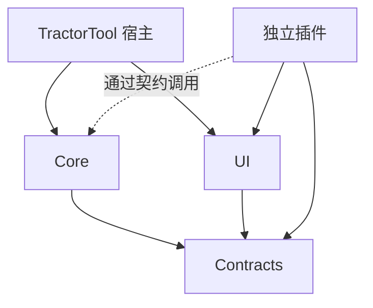

# TractorTool 软件架构

更新日期：2026-10-15。本文维护框架的模块职责、资源所有权、事务与失败边界；具体业务归插件，参数限制及 SDK 接入规则见[插件开发规范](PLUGIN_DEVELOPMENT.md)。目录导航见[项目首页](../README.md#设计与结构)，需求见[产品说明](TractorTool.md)，实现与验收状态只以[开发台账](DEVELOPMENT.md#current-status)为准。

## 1. 当前代码与目标结构

框架基于 .NET 10、Avalonia、MVVM，Windows 优先。项目清单由 [TractorTool.slnx](../TractorTool.slnx) 管理，SDK 和依赖版本以工程配置为准。

| 模块 | 职责 | 项目依赖边界 |
| --- | --- | --- |
| `TractorTool` | 应用入口、服务组装、窗口/导航/托盘、公共管理页面、Windows 适配 | 直接引用 Core、UI，经两者传递引用 Contracts；不引用具体插件 |
| `TractorTool.Contracts` | 插件生命周期、任务、进程、依赖、路径、配置和日志契约 | 无 Avalonia、Win32 或业务模型 |
| `TractorTool.Core` | 插件装载/管理、公共任务、包事务、进程协调、存储与日志策略 | 仅 Contracts；平台实现由宿主注入 |
| `TractorTool.UI` | 页面/托盘注册契约、通用控件、主题和动效 | Contracts、Avalonia、FluentAvalonia；不引用宿主/Core |
| `Plugins/` | 独立业务、页面、设置及专属平台适配 | 仅公开 Contracts/UI 与私有依赖 |
| `tests/` | 对应模块的检查与独立插件夹具 | 被测模块；验证层级见开发台账 |

宿主通过公开契约连接插件，只管理公共资源和交互；业务参数、执行策略及结果校验由插件承担。新增公共接口必须有真实消费方，不预建空服务或通用业务平台。



实线是项目依赖，虚线是运行时调用；实际引用见[宿主](../TractorTool/TractorTool.csproj)、[Core](../TractorTool.Core/TractorTool.Core.csproj)、[UI](../TractorTool.UI/TractorTool.UI.csproj)及[Contracts](../TractorTool.Contracts/TractorTool.Contracts.csproj)工程。插件纳入解决方案不等于宿主静态引用它。源码/发布 SDK 两种构建模式见[插件构建规范](PLUGIN_DEVELOPMENT.md#6-开发构建与安装验证)，运行时依赖分类见[依赖表](PLUGIN_DEVELOPMENT.md#dependency-kinds)。运行时只加载 `<AppRoot>/Plugins/<PluginId>/<Version>`，与仓库的插件工程目录无关。

## 2. 插件协议与装载

### 2.1 分发单元

插件 ZIP 包含根清单 `plugin.json`、入口 DLL、私有依赖、资源和许可。清单先于代码校验；禁用、不兼容或损坏的插件只显示元数据，不执行入口。字段与版本兼容规则只维护在[清单规范](PLUGIN_DEVELOPMENT.md#2-插件清单与兼容性)。

管理状态明确选定活动版本；未管理的同 ID 多版本报冲突，不猜测最高版本。有效的外部依赖声明不要求预先安装，缺包或来源不可用在实际申请时处理，不阻止页面加载。清单值不作为 shell 命令执行。

### 2.2 公开扩展点

| 契约 | 所有权与用途 |
| --- | --- |
| `IPlugin`、`PluginContext`、`IPluginBackgroundService` | 宿主持有插件实例与生命周期；上下文提供按插件限定的服务作用域 |
| `IPluginUiModule`、`IPluginTrayModule` | UI SDK 提供页面/设置工厂及可选托盘菜单注册；宿主不解释业务字段 |
| `IBackgroundTaskService`、`IBackgroundTask` | 登记有限任务或整批、执行句柄、进度与取消 |
| `IExternalPackageService`、`IProcessRunner` | 依赖申请/租约与受管理进程执行 |
| `IAppPaths`、`IPluginSettingsStore`、`IAppLog` | 所属目录、带版本配置与结构化日志 |

Contracts 不包含控件类型；Avalonia 页面契约只在 UI 工程。宿主页由 [MainViewModel](../TractorTool/ViewModels/MainViewModel.cs) 显式创建，插件页由已注册工厂创建，无名称反射兜底，也不要求插件继承宿主 ViewModel。

### 2.3 装载顺序与版本隔离

入口为 [App](../TractorTool/App.axaml.cs)，插件协调由 [PluginHost](../TractorTool.Core/Plugins/PluginHost.cs) 承担：

1. 解析 AppRoot、固定启动配置和 DataRoot，取得启动目录、数据根及插件安装目录锁；有迁移则先恢复/完成迁移，再创建业务写入服务。目录锁持有到进程终止，隔离迟到清理。
2. 在装载 DLL 前应用待重启变更，再扫描活动版本并校验路径、标识、平台和 SDK。管理状态不可读或安装锁不可得时停止插件装载，宿主保留诊断入口。
3. 为启用插件创建加载上下文与生命周期作用域；初始化后暂存页面、设置和托盘注册，全部成功才提交，再启动常驻活动。失败回滚注册，退出后的迟到初始化不得补注册。

[PluginLoadContext](../TractorTool.Core/Plugins/PluginLoadContext.cs) 使用 `AssemblyLoadContext` / `AssemblyDependencyResolver`，按以下边界解析：

- **共享 SDK**：Contracts、UI、Avalonia、FluentAvalonia、MicroCom.Runtime 由默认上下文提供并检查程序集版本；插件包拒绝夹带副本。禁止插件引用宿主或 Core。
- **私有依赖**：先由插件解析器和入口邻接目录解析；入口、私有托管库和已解析本机库必须位于版本包内，逐级拒绝链接/重解析点。缺失私有依赖或解析后文件消失以 `FileLoadException` 终止，防止全局 `AssemblyResolve` 补救越过隔离。系统本机库由系统解析。
- **.NET 框架**：仅构建 SDK 的 `Microsoft.NETCore.App` 平台清单内名称可回退到运行时；清单[嵌入 Core](../TractorTool.Core/TractorTool.Core.csproj)，缺失则构建失败，部署无需 SDK。不得用名称前缀或包含宿主依赖的整份 TPA 放行；实际版本与平台可用性仍由 .NET 检查。

初始化、页面工厂和任务失败分别记录并隔离普通故障；进程内插件是可信代码，加载上下文不是安全沙箱，不能抢占同步卡死或隔离进程崩溃。

### 2.4 安装、更新、禁用和卸载

[PluginManager](../TractorTool.Core/Plugins/PluginManager.cs) 串行维护 `<PluginRoot>/.management/state.json`，活动选择与待处理请求分开，采用带版本 JSON 原子替换和备份。管理状态归软件安装，不能随外观配置迁移。拖放与文件选择共用同一安装流程；界面区分当前生效状态与重启后目标。

| 操作 | 提交与恢复规则 |
| --- | --- |
| 安装/更新 | 暂存到 `.management/staging/<Token>`，不执行 DLL；校验路径、链接、体积、清单、共享副本及入口 PE，保存文件摘要。版本目录不可覆盖，更新须提高版本；下次启动复验摘要后移动目录并提交活动选择 |
| 更新备份/回退 | 在旧进程退出、新版本加载前备份完整插件数据到 `<DataRoot>/Data/.plugin-backups/<Token>`；请求绑定原数据根。新版本失败保留旧代码与快照，安排下次启动回退；恢复前保留新版数据为 `before-rollback` |
| 启用/禁用 | 保存待生效目标，未执行时可反向取消；不因切页或隐藏即时停掉运行实例 |
| 卸载 | 下次启动将代码移入 `.management/removed/<Token>` 后删除，保留数据和快照；墓碑防止旧目录被重新发现，部分完成通过日志重试 |
| 取消请求 | 未执行请求、失败的安装/更新可取消，只清理归属明确且未激活的待安装代码；清理失败保留请求，已尝试的卸载/回退必须保留恢复日志 |

重复请求、同版或较旧版本等状态冲突在管理锁内返回拒绝原因，保留既有请求，清理本次暂存；界面记录错误而不人为构造异常。损坏包、越界和真实 I/O 故障仍按异常处理。软件目录不可写时明确失败，不改装到 DataRoot。首版不热卸载、不在同进程内回退、不自动删除恢复快照。

## 3. 生命周期与任务

### 3.1 所有权

| 资源 | 结束条件 |
| --- | --- |
| 页面 | 成功离页后解除 UI 订阅、释放页面资源 |
| 有限任务及执行资源 | 完成、失败或明确取消；切页/托盘隐藏不影响任务 |
| 插件实例、常驻服务、托盘注册与服务作用域 | 插件停止/应用退出；不绑定页面可见性 |

每个插件只有一个清理任务：取消 → 等待初始化 → `StopAsync` → 等待常驻活动及取消回调 → `DisposeAsync`。并发退出共享该任务，禁止工作仍在运行时并发释放实例。阶段超过 3 秒记录超时并继续观察；插件间并行清理，插件宿主最多等待 9 秒，外层退出统一限时。

### 3.2 任务状态

[公共任务服务](../TractorTool.Core/Tasks/BackgroundTaskService.cs) 管理 `Queued / Running / Cancelling / Succeeded / Failed / Cancelled / Interrupted`。`QueueBatchAsync` 先持久化整批摘要再返回执行句柄；插件通过 `RunAsync` 决定顺序、并发、参数快照及批次失败策略，Core 不解析业务参数。

- 摘要包含 TaskId、PluginId、BatchId、名称、进度、时间和结果/错误，保存全部活动项及最近 100 条终态。文件损坏保留原件、阻止新执行并提供保存重试；重启把非终态标为 Interrupted，不自动续跑或删除用户输出。
- 回调在结果校验与提交后才正常返回；正常返回保留 Succeeded，迟到取消不得抹掉成功结果。清理失败仍是失败，不能伪装正常取消。
- 进度更新内存并合并 UI 通知；磁盘日志仅记录阶段及每 10% 节点。日志页汇总所有插件任务，单项/整批取消按 PluginId 与 BatchId 限定；返回入口按所属插件路由，无页面时进入插件管理。标题栏不另设任务入口。

### 3.3 结构化日志与错误提醒

[AppLog](../TractorTool.Core/Logging/AppLog.cs) 保存序号、时间、级别、来源、消息和异常详情；旧无异常调用映射 INFO，有异常映射 ERROR，WARNING 显式指定，不根据文本猜级别。

- **内容**：记录插件生命周期/管理、依赖事务、任务阶段/结果及真实故障；普通导航和窗口隐藏/恢复不记录。用户取消与正常停止记 INFO，恢复中断记 WARNING；意外取消、超时和清理失败单独报错，不修改调试器过滤掩盖异常。
- **显示**：内存保留 300 条，旧上新下；虚拟化、稳定条目身份、筛选/复制/暂停及按需详情。基于滚动与集合事件跟随底部，上翻停止、回底恢复，无刷新定时器。INFO/WARNING/ERROR 用绿/黄/红及文字级别共同表达。
- **未读**：本次启动累计 ERROR 数减已读水位，不随内存淘汰或进入日志页清零。“已读”在锁内确认当时全部错误，包含筛选/暂停隐藏项；之后的新错继续显示导航数量角标。不跨模块合并故障。
- **落盘**：[LogFileWriter](../TractorTool.Core/Logging/LogFileWriter.cs) 沿写锁滚动，10 MiB/UTC 跨日分段，保留 14 天、最多 20 文件、总量目标 100 MiB；首次写入/滚动时检查，不定时扫描。单条最多 64 KiB，按完整 UTF-8 字符截短并标记。只清理 Logs 顶层精确命名的宿主旧文件，拒绝链接，保留当前段；清理失败警告并继续写，不承诺此时已满足上限。
- **故障**：磁盘写入失败在内存报告一次并保留提示，恢复后清除，不声称漏写已补齐。磁盘保留不影响内存与已读水位。常规更新使用事件；确有轮询时仅在实际启用后记录一次优化 WARNING，说明频率和退出条件。

### 3.4 托盘和退出

[TrayService](../TractorTool/Services/TrayService.cs) 拥有原生菜单，[PluginTrayMenu](../TractorTool/Services/PluginTrayMenu.cs) 管理插件回调和状态；宿主保留显示/退出，插件按名称分成一级子菜单。插件在注册期添加稳定 ID 的动作，随后通过句柄推送文字、启用和勾选状态，宿主调度到 UI，不轮询业务状态。

动作从 UI 线程开始，异步期间禁用该项；耗时工作必须异步，有限任务仍走任务服务。成功/失败写日志，只有菜单停止令牌已取消才将取消记为正常。停止时封闭动作和更新、取消并解绑菜单，等待在途动作后释放插件；注册失败回滚，注册返回的资源由 PluginHost 持有，Core 不引用 UI 类型。

应用采用显式退出生命周期，关闭主窗口仅隐藏；托盘失效时保留可见窗口与设置内退出入口。同一配置目录再次启动通过 [WindowsRestoreSignal](../TractorTool/Platform/WindowsRestoreSignal.cs) 恢复原窗口，不扩展为通用 IPC。

显式退出有活动任务时允许返回或停止任务后退出；系统注销/关机跳过确认。退出封闭交互、新任务、保存和管理请求，取消任务/常驻活动，等待已有操作及清理，共用外层 **10 秒**期限；随后释放托盘并关闭。超时记录未完成工作，目录锁由进程终止释放，不强杀用户其他进程，也不承诺不合作插件的最后写入已完成。

<a id="packages"></a>

## 4. 外部工具与进程管理

### 4.1 包管理

公开接口位于 [Contracts/Packages](../TractorTool.Contracts/Packages/IExternalPackageService.cs)，实现位于 [Core/Packages](../TractorTool.Core/Packages/ExternalPackageService.cs)，管理页面归宿主。私有 .NET 库随插件打包，共享 SDK 由宿主提供，外部可执行工具由包服务提供版本路径及使用租约。

**来源**：不维护自有源。默认 GitHub，用户可添加公开 GitHub Enterprise HTTPS API；配置在 `<DataRoot>/Config/dependency-sources.json`。来源移除不删除已装包、不撤销已开始下载；配置损坏保留原件并阻止覆盖。私有认证、pip 等未接入的安装类型不提供空入口。

**声明与解析**：插件清单的 id/version 指定包，downloads 按 RID 固定仓库、tag、ZIP 附件、SHA256、许可和工具契约，格式见[接入规范](PLUGIN_DEVELOPMENT.md#package-source-maintenance)。[PackageSources](../TractorTool.Core/Packages/PackageSources.cs) 仅在缺包/修复时查精确 Release，不跟随 latest、不持久缓存远程索引。旧清单可复用已装包；缺下载资料时报告需更新声明。同身份的声明、已装摘要与工具契约必须一致，不能暗中替换同版内容；Windows 大小写别名冲突同时暂停清理。

**申请事务**：`TryRequestAsync` → 校验声明/复用或查询 → 首次确认 → 下载校验 → 安全解压 → 工具版本探测 → 写 receipt 并原子提交 → 返回租约。拒绝返回 null；旧 `AcquireAsync` 仅复用已装包，初始化不自动下载。并发同包请求合并确认/安装，调用方取消仅停止自己的等待，设置页取消才停止共享下载。

**校验边界**：API/下载/展开均有时间或体积上限；验证精确标签、唯一已上传附件、同仓库地址及可用的 GitHub digest，拒绝跨站/降级 API 重定向。下载后独立核对声明 SHA256；拒绝 ZIP 越界、链接、特殊文件、重名及大小写冲突。按受限参数向量探测工具版本，非零退出或选定输出截断即失败；不执行 shell/安装脚本。校验值证明内容一致，不替代来源可信性。

**记录与恢复**：receipt 保存完整定义及下载/工具哈希，来源移除或离线仍可管理。旧/损坏记录保留目录身份和待修复状态，合法声明可补齐，但已有可读 hash 必须一致；无匹配声明时不猜测或删除。取得租约重新校验工具；修复须确认，失败保留状态。事务位于 `Packages/.work/<GUID>`，持有数据根锁时只回收归属标记明确的遗留事务。

**引用与清理**：引用从持久清单和管理日志重建，包括禁用/失败、待激活及可回退版本。管理提交与引用同步受锁保护；任何记录不可读即暂停清理，不能视为零引用。同一服务锁内检查引用、请求预留、安装事务和运行租约，无占用才允许用户清理；卸载只解除生效后的引用，不联动删除包。插件作用域限定可申请依赖，退出封闭新操作并取消/等待在途工作，插件清理完成后回收遗漏租约。

### 4.2 进程服务

[IProcessRunner](../TractorTool.Contracts/Processes/IProcessRunner.cs) 接收绝对可执行路径和参数向量，不搜索 PATH、不执行 shell，默认工作目录为工具目录。[ProcessRunner](../TractorTool.Core/Processes/ProcessRunner.cs) 快照请求、处理双流/超时/取消，平台执行通过 `IProcessSession` 注入；每个插件拥有独立作用域。

Windows 的 [WindowsProcessSession](../TractorTool/Platform/WindowsProcessSession.cs) 在 `CreateProcessW` 创建时用 `PROC_THREAD_ATTRIBUTE_JOB_LIST` 绑定私有 Job，显式限制继承句柄并设置 KILL_ON_JOB_CLOSE；CRT 命令行转义只在此适配层。根进程结束、超时或取消均清理该 Job 的残留后代，不按进程名杀进程。

正常等待用 OS 通知；仅终止进程树时关联临时 IO 完成端口，在后台等待 Job 空树通知，取消可唤醒。原生通知等待计时上限为 3 秒，不代表整个退出流程的总时限。通知不保证送达，因此开始等待、空树通知和取消/截止时核对实际活动进程数；不定时轮询，也不在正常运行期间累积通知队列。确认退出后，ProcessRunner 另行限时等待双流自然读到 EOF，清理失败或管道超时才取消读取；清理失败作为错误报告，正常调用方取消仍保持取消语义。非 Windows 适配器尚未实现，明确报告不支持。

stdin 关闭为 EOF；stdout/stderr 并发排空并有界保留，超限返回截断标记而不中断读取。可选 stdout 回调顺序接收数据块，不保证完整行，也不受最终捕获上限限制；回调须快速返回，异常进入读取失败和清理路径。业务输出解析/进度与结果校验归插件。

返回原始退出码；调用方取消、超时、读取/清理故障分别处理，不能把清理失败报成正常取消。诊断关联所属插件，不记录参数和输出正文。工具租约必须覆盖进程退出及输出排空，页面离开不释放后台执行资源。

<a id="storage"></a>

## 5. 插件目录、数据目录与迁移

### 5.1 固定启动位置与可迁移数据

迁移成功后清理旧业务数据；默认位置保留必要的 bootstrap 与锁，继续定位自定义目录。确认自定义本地目录已删除时恢复默认根；具体启动顺序见 5.3，当前实现与验收见[开发台账](DEVELOPMENT.md#current-status)。

`AppRoot` 取实际应用目录，不能取工作目录；`PluginRoot` 固定在其下。默认 `DataRoot` 为 `%LOCALAPPDATA%/TractorTool`，用户可改为专用目录；`PackageRoot` 始终从 DataRoot 解析。

```text
<AppRoot>/
  Plugins/<PluginId>/<Version>/    # 代码、资源、私有依赖
  Plugins/.management/             # 活动选择、待处理请求、代码暂存
  Plugins/.installation.lock       # 安装目录独占锁

<DataRoot>/
  Config/                          # 宿主配置、依赖来源
  Packages/<PackageId>/<Version>/<RID>/
  Data/Plugins/<PluginId>/          # 插件配置及持久数据
  Data/tasks.json                  # 公共任务摘要
  Data/.plugin-backups/<Token>/    # 更新/回退快照
  Cache/                           # 可重建缓存
  Logs/                            # 宿主日志
```

固定 `%LOCALAPPDATA%/TractorTool/bootstrap.json` 只保存数据根指针、版本与迁移状态，不随业务数据搬迁，也不经公开 IAppPaths 暴露。`--profile-root <绝对路径>` 隔离测试启动位置与默认数据，不改变插件代码位置。用户输入/输出不属于缓存，不由清理功能删除。

配置采用带 `schemaVersion` 的 JSON，[JsonFileStore](../TractorTool.Core/Storage/JsonFileStore.cs) 按完整路径串行保存，同目录临时文件落盘后原子替换并备份；损坏、未知版本或保存失败保留原数据并报错，不重置默认值。内部位置以所属根下相对路径保存，用户路径保持原语义；格式升级通过模型迁移，不对所有 JSON 作字符串替换。目录缺失与不可访问分别处理，不以 `Directory.Exists=false` 授权重置。

### 5.2 切换数据根目录

[DataRootMigration](../TractorTool.Core/Storage/DataRootMigration.cs) 承担复制、校验与恢复，宿主只负责确认和进度。只接受本机新建/空的专用目标；拒绝卷根、源目标互含、与 bootstrap/Plugins 重叠及链接/重解析路径，不合并已有目录。

1. **安排**：设置将事务 ID、源/目标、AppRoot 和状态写入固定 bootstrap，下次启动执行；当前工作继续。插件有待重启变更或待加载结果时不可安排；安排后新增插件变更则先保留原根处理插件，再由用户重试迁移。
2. **准备/复制**：唯一 MainWindow 显示启动状态，后台取得启动、数据、安装及目标锁，读取已有外观；成功前不启动业务写入服务或插件。目标标记核对事务归属，仅复制 Config/Data/Packages/Logs，跳过 Cache、Packages/.work 和锁/启动文件，保留空目录及修改时间。临时文件落盘、SHA256 校验后无覆盖提交，最终核对两端清单；遍历和分块哈希均响应取消。只回收本事务的未完成临时文件，再检查剩余空间。
3. **提交**：复制及源根回退快照预检通过后，将源清理清单（相对路径、类型、大小、修改时间）持久化到目标归属 marker，再原子保存新 dataRoot/previousDataRoot；更新本安装的回退记录和新目录快照元数据。目标路径复用时，只在提交后清除源清单未包含的旧目标回退引用；已列入清单的快照缺失或损坏仍停止收尾，其他数据根记录保留。旧事务无清单时不推断记录已经失效。
4. **清理**：按 marker 清单核对旧 Config/Data/Packages/Logs/Cache，拒绝新增或大小/修改时间变化。先完整复验剩余持久数据的目标路径、类型与 SHA256，全部通过才开始删除；逐文件删除前再复验并持有目标只读句柄直到源文件删除完成。当前回退记录的 snapshot.json/.bak 由插件管理器核对，只允许重绑产生的 DataRoot 差异；未引用快照仍按字节校验。Cache/Packages/.work 未复制，清理只依赖源清单，不能检测同时保留大小和修改时间的缓存改写。未知根项、固定 bootstrap 和锁保留。清理全部成功后才清除请求，失败保留剩余源与请求。提交后重启也取得仍存在的源根锁；不承诺跨文件原子删除，已清理项不会重新创建。成功后同窗绑定业务模型。

| 失败位置 | 恢复方式 |
| --- | --- |
| 指针提交前 | 保留源和已复制目标；记录失败后从原根启动，不自动反复尝试。中断可续传一致文件，旧根继续使用造成冲突时拒绝覆盖，改用新的空目标；取消只清请求，不删目标 |
| 指针提交后 | 回退重绑或源清理未完成则停止启动，下次先完成，不回旧根加载插件；取消保留新指针与请求。保存报告失败也重新读落盘状态，避免错误路径覆盖已提交指针 |
| 清理时源文件变化、出现未登记文件或权限受阻 | 保留无法安全清理的内容与迁移请求，报错后下次重试，不扩大删除范围 |
| 旧版本已提交事务缺少清理清单 | 保留旧源，不探测或锁定旧源；仍验证目标归属并完成回退元数据收尾、清除迁移请求，正常启动并记录 Warning 提示确认后自行清理，不补造删除授权 |
| 固定记录不可安全读写、磁盘离线、权限拒绝或迁移中的数据根缺失 | 停止并显示原因，禁止用空配置继续 |

迁移不移动插件代码，不改用户输出路径，不递归删除旧根，目标归属标记保留。不可通过手改 bootstrap 或批量替换路径绕过收尾；需重建的运行环境另按其安装机制处理。

### 5.3 自定义数据目录删除后恢复默认

[DataDirectories](../TractorTool.Core/Storage/DataDirectories.cs) 严格区分真实缺失与权限、离线、链接/文件占位，不用吞错的存在性判断授权重置。没有 Migration 且确认自定义本地目录缺失时，[AppPaths](../TractorTool.Core/Storage/AppPaths.cs) 仅返回默认根候选，不创建业务目录或提交指针；自定义根的实例锁只打开现有目录。网络目录不可用或未完迁移继续阻断，不触发恢复默认。

启动持有 bootstrap 和插件安装锁，再次确认旧根仍缺失并检查取消；处理被丢弃的自定义根和默认根关联的数据事务、Recovery 及失效加载状态，清理默认残留业务目录，最后原子保存默认指针。其他根的数据事务、安装选择、启停及已完成卸载记录保留。完成后才创建业务目录、加载插件并记录恢复默认 Warning。目录已恢复、初始化/清理/保存失败均停止；指针提交前保留旧指针供重试。

[PluginManager](../TractorTool.Core/Plugins/PluginManager.cs) 的安装清理与取消共用：先核对归属并清理未激活代码，成功后才清 Pending；移码目标回到原 token staging 后再删除，保证部分清理和状态保存失败可重试，访问故障不得视为目录缺失。Uninstall 只操作安装代码，完整保留原 Pending 和错误状态，且仅卸载免除 DataRoot 一致性约束，因此重置成功或失败后恢复旧根均可接续。此流程不增加 Contracts 或插件业务接口。

<a id="ui"></a>

## 6. 统一 UI

### 6.1 样式与资源

全局只加载 FluentAvaloniaTheme，以 RequestedThemeVariant 和动态资源统一浅色/深色/系统及主题色。

<a id="ui-style-ownership"></a>

| 归属 | 唯一职责 |
| --- | --- |
| [ThemeResources](../TractorTool.UI/Styles/ThemeResources.axaml)、[SharedStyles](../TractorTool.UI/Styles/SharedStyles.axaml)、公共 Controls | 共享颜色、文字、卡片、设置行、图标与页面呈现 |
| [ShellStyles](../TractorTool/Styles/ShellStyles.axaml)、[MainWindow](../TractorTool/Views/MainWindow.axaml) | 标题栏、导航、页头/正文边距及宿主滚动适配；私有选择器不是 SDK |
| 各 View 局部样式 | 单页分栏、密度与布局；消费公共资源，不注入全局主题、不引用其他页面私有样式 |

[App.axaml](../TractorTool/App.axaml) 只组装主题与上述样式。共享外观改现有定义，出现多个真实消费者再抽控件；Core/Contracts 不含 AXAML。后台通知切到 UI 更新状态，不在 UI 线程等待进程或大文件 I/O；集合保留稳定身份，退出页面解除订阅，长驻列表有界并按需虚拟化。

[Motion](../TractorTool.UI/Motion.cs) / [MotionStyles](../TractorTool.UI/Styles/MotionStyles.axaml) 统一动画偏好；关闭时覆盖并取消普通属性过渡，开启时恢复原值。第三方已开始的展开过渡仍自行结束，插件自建 Animation/Composition 须读取偏好并自行取消；不能暂停全局时钟冻结进度。具体尺寸、颜色和时长只在 AXAML/源码维护。

### 6.2 宿主与公共 UI 的实现

- **窗口/导航**：FAAppWindow 保留系统窗口按钮和命中测试，标题区行高与实际控件同源，显式标记原生拖动区；只放图标和名称。主导航为主页/插件页面，底部为日志/插件/设置，保留键盘、焦点及无障碍名称。
- **页面切换**：[PageHost](../TractorTool.UI/Controls/PageHost.cs) 只承载当前页，不缓存历史或订阅窗口返回事件。工厂返回未挂载页面，替换前触发可取消的 NavigatingFromEvent；成功才提交选择并释放旧页，取消保留原页。同步挂载/脱离故障重建容器以显示错误页，不兜底插件任意异步或渲染异常。宿主阻止重入和退出后建页。
- **页面文字渲染**：PageHost 统一设置 `TextHintingMode.None` / `BaselinePixelAlignment.Unaligned`，减少位移动画中的文字整像素跳变；固定 `TextRenderingMode.Antialias`，使合成层内外均用灰度抗锯齿。设置沿渲染树继承，静止后不切换模式；范围不含侧栏、标题栏及独立窗口。
- **页面淡入合成**：PageHost 设置 `RenderOptions.RequiresFullOpacityHandling=true`，由 Avalonia/Skia 临时合成后统一应用透明度，避免逐画刷取整导致末帧亮度变化。保留原过渡参数；不管理快照或页面缓存。该选项沿子树生效，半透明内容会增加合成开销。
- **设置导航**：SettingsPage.Parent 表达层级，面包屑与分类沿父链派生；软件/插件分组独立折叠，无插件设置时隐藏整组，窄窗改顶部分类选择。内层复用 PageHost，向当前子页转发离页取消；折叠不结束右侧页面，无第二套历史栈。
- **设置保存**：UI 立即应用外观，单个后台保存任务串行写不可变快照，期间只保留最新选择；旧写入不回放旧主题。失败提供重试，退出封闭新变更并等待队列，最后失败最多再试一次，受公共退出期限约束。
- **主页与列表**：复用已发现安装记录、页面注册和图标缓存，不重复扫描或提前建插件页面；普通入口取首个已注册页，无可用页转管理。加载完成更新数据但不强制切页；卡片原位更新，失败显式恢复状态，避免重建集合打断交互。

页面创建/清理遵循 Loaded/Unloaded 与 IPluginPageLifetime，后台任务归服务生命周期。SDK 保留公开方法的二进制兼容，旧 FAFrame 专属导航事件需迁移到 PageHost；版本矩阵和插件接入只维护在插件规范。

<a id="icon-design"></a>

### 6.3 彩色标识与单色操作图标

彩色图片用于身份识别，单色 ToolIcon 用于操作并随主题变色。可选 IconPath 仅指插件包内 PNG，[NavigationIconStore](../TractorTool/Services/NavigationIconStore.cs) 校验边界/体积/尺寸后解码，成功与失败都缓存；坏图回退符号，不阻止页面。网络、绝对路径和包外资源不接受。

主页、导航与插件管理共用图片；ToolIcon/SettingRow 只呈现，不重复解码或释放。缓存直到窗口关闭后释放，隐藏或等待插件退出时不得提前释放。素材与许可见 [Artwork](../Artwork/README.md) / [第三方声明](../THIRD-PARTY-NOTICES.md)。

<a id="ui-reference"></a>

UI 选型、参考源码与历史比较归[参考调研](PROJECT_HISTORY.md#ui-reference)，不在架构中维护第二套版本和实施记录。

## 7. 发布与后续扩展

### 7.1 产品版本和应用图标

产品默认 Version 来自 [Directory.Build.props](../Directory.Build.props)，构建参数可覆盖；[AppInfo](../TractorTool/Services/AppInfo.cs) 从宿主程序集读取，同供关于页和日志。插件协议版本与 SDK 程序集身份独立，不随产品版本自动改变。应用、EXE 和托盘图标由同一母版生成，普通构建使用入库资源，不联网生成。

### 7.2 发布边界

动态插件宿主采用 Windows x64 自包含目录，不启用 Native AOT、裁剪或单文件布局。本地与 [CI](../.github/workflows/distribution.yml) 共用 [Build-Distribution](../scripts/Build-Distribution.ps1)：发布宿主 → 引用发布 SDK 独立构建插件 → 核对宿主文件未变 → 按正常插件目录组包。附带插件沿用同一装载流程，分发不带用户数据、测试夹具或已下载外部工具。

随包插件从仓库 `Plugins` 一级子目录自动发现，以同目录 `plugin.json` 和唯一 `.csproj` 识别，不维护额外名单或按名称/数量写分支；预检后从各插件清单取得身份，构建结果写入 `release.json.plugins`。产物校验和安装器消费本次快照，不依赖后来修改的源码目录；扫描边界见[脚本说明](../scripts/README.md#随包插件自动识别)。

产物包含 ZIP、哈希、版本/源码和逐文件清单。宿主第三方许可按实际还原/发布依赖收集，材料缺失即失败；插件打包仅自动补齐实际随包的 MVVM 许可并保留作者提供的 Licenses，其他私有库许可由作者维护，详见[脚本边界](../scripts/README.md#插件打包的现有适用范围)。

[Verify-Distribution](../scripts/Verify-Distribution.ps1) 静态核对路径、内容、版本及各包一致性；安装器及元数据须成对匹配源 ZIP。哈希/静态检查不等于运行验收，ZIP 仅解压到新目录。

[Build-Installer](../scripts/Build-Installer.ps1) 从已校验 ZIP 快照生成精确文件列表，默认当前用户安装，不提权、不自动运行；安装归属标记拒绝非安装版目录、链接及数字版本降级。仅 Plugins 不存在时首次附带插件，升级完整保留 Plugins 和管理状态，卸载只移除安装记录内宿主文件，保留插件和应用数据。首次插件安装中断只允许同包恢复，未完成标记阻止宿主启动。

[WindowsMaintenance](../TractorTool/Platform/WindowsMaintenance.cs) 与安装器共享启动/维护互斥及存活信号，应用运行时拒绝维护，不强停任务、不轮询；当前保护限同一 Windows 会话。安装器只接受匹配维护协议的宿主包，平台实现不进入 Core/Contracts。

CI 普通构建只读；标签流程经版本、提交、干净状态及产物校验后，独立写权限 job 仅创建 Release 草稿，不覆盖已有 Release。工具版本、命令和失败恢复见[脚本说明](../scripts/README.md)及[发布入口](../README.md#github-release-草稿)。首版不包含宿主自动更新、在线插件商店、多平台安装器或不可信插件沙箱。

<a id="python-dependencies"></a>

### 7.3 Python / pip 依赖扩展（后续计划，未实现）

用户已确认纳入后续计划，尚未排期。保留现有分层与统一依赖入口；只有实际安装能力接入时才开放来源配置、扩展协议，不预建安装器体系，也不重新解释旧 PackageReference。

- pip 负责库版本及间接依赖解析；宿主记录确定的运行时、平台、来源、版本和校验信息，通过受管理进程准备隔离环境，不允许插件追加任意安装命令。
- 冲突需求不进入可变全局环境；仅完整依赖与运行时兼容时复用环境。引用和租约覆盖环境、解释器及间接依赖，缓存与已装环境分开清理，卸载不联动删除。
- 环境归 DataRoot，插件代码仍归 AppRoot。不可搬迁环境在迁移目标重建、验证后切换，保留旧环境供恢复，不能直接套用 ZIP 复制事务。用户已有文件/外部服务只建立引用，不取得删除或终止所有权。
- 解释器来源、锁定格式、复用粒度及源码分发支持在实施时决定；本节不构成已交付能力。计划依据见 [E28](PROJECT_HISTORY.md#evidence-python-plan)。
