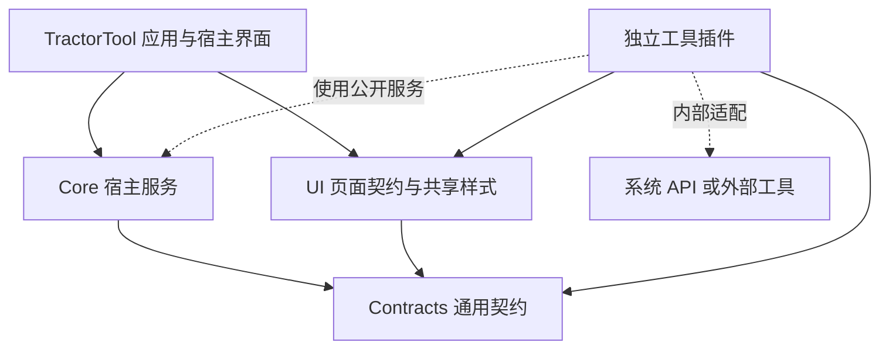

# TractorTool 软件架构

更新日期：2026-10-04。本文负责宿主和公共服务的结构设计，不包含单个插件的内部业务方案。

本文说明如何落实[产品需求](TractorTool.md)。插件作者遵循 [插件开发规范](PLUGIN_DEVELOPMENT.md)；首版业务设计分别见 [剪贴板插件](Plugins/ClipboardHistory.md) 和 [视频插件](Plugins/VideoExport.md)。文档分工见 [导航](README.md)，实现与验证状态以 [开发文档](DEVELOPMENT.md#current-status) 为准，后续阶段设计不能当作现有功能。

## 1. 当前代码与目标结构

解决方案 [TractorTool.slnx](../TractorTool.slnx) 统一包含原路径的宿主、Contracts、Core、UI，以及 Plugins 分组中的正式插件、tests 分组中的检查工程和机制夹具，共 10 个实际工程。目标框架为 `net10.0`（剪贴板相关工程使用 Windows TFM），Avalonia `12.1.2`、CommunityToolkit.Mvvm `8.4.2`，采用单一 FluentAvaloniaUI `3.1.0` 控件主题。M2 已加入插件管理代码与独立构建的 Windows 剪贴板插件；包服务和有限任务队列仍为后续设计，运行验证状态集中在开发文档。

职责结构如下。表中的任务/包管理为 M3-M4 职责，不先创建空实现：

| 项目或目录 | 职责 | 允许的项目依赖 |
| --- | --- | --- |
| `TractorTool` | 保留现有应用入口；窗口、导航、托盘、宿主设置、组装服务 | Core、Contracts、UI |
| `TractorTool.Contracts` | 插件协议、生命周期、任务、路径、设置、依赖等公开契约 | .NET 与必要的基础抽象，不依赖 Avalonia 或 Windows |
| `TractorTool.Core` | 插件发现、状态、任务管理、包管理、路径与配置实现 | Contracts |
| `TractorTool.UI` | Avalonia 页面注册接口、通用控件、样式资源、主题 | Contracts、Avalonia、FluentAvalonia |
| `Plugins/<插件工程>` | 工具业务、专属设置、页面和所需平台适配；已有剪贴板工程，视频待后续阶段 | Contracts、UI、插件私有依赖 |
| `tests/` | 核心测试、插件集成测试、必要的 UI 测试 | 对应被测项目 |

首版不为单个工具另建通用平台工程；平台专属能力留在适配层或对应插件，出现实际共用需求时再抽取。



图中实线为项目依赖，虚线为运行时服务调用（插件通过 Contracts，不引用 Core 实现）。宿主应用不通过 `ProjectReference` 引用具体插件；开发打包可以构建插件并复制产物，但不能因此把插件写死进宿主。

上表中的 `Plugins/<插件工程>` 是源代码工程路径，不参与宿主的静态项目引用。发布运行时的插件安装位置是 `<AppRoot>/Plugins/<PluginId>/<Version>`，两者不能混淆；`AppRoot` 以实际应用目录为准。

解决方案归属与程序集依赖分别管理：插件加入同一解决方案，供 VS Code 正常编辑和构建，并不建立宿主到插件的引用。日常开发通过 `ProjectReference` 使用公开 Contracts/UI；正式交付显式传入 `HostSdkDir`，改为引用已发布 DLL，正常还原后重新编译。指定路径无效时失败，不回退源码。两条路径的工程引用不依赖 `DesignTimeBuild`，避免还原、编辑器分析和实际编译得到不同依赖图。操作规则集中在 [插件开发规范](PLUGIN_DEVELOPMENT.md#6-开发构建与安装验证)。

组织参考采用 [M1 调研](PROJECT_HISTORY.md#ui-reference) 固定版本的 [WattToolkit.slnx](https://github.com/BeyondDimension/SteamTools/blob/d04213147e77a8d73277fa8b86eeecfa444df071/WattToolkit.slnx)：插件在同一解决方案的 Plugins 分组中，[GameTools 工程](https://github.com/BeyondDimension/SteamTools/blob/d04213147e77a8d73277fa8b86eeecfa444df071/src/BD.WTTS.Client.Plugins.GameTools/BD.WTTS.Client.Plugins.GameTools.csproj) 引用公共客户端/UI 工程。这里只借鉴开发组织方式，TractorTool 继续使用自身公开 SDK 边界，保留当前物理路径。

## 2. 插件协议与装载

### 2.1 分发单元

插件包是 ZIP，包含根清单 `plugin.json`、入口 DLL、私有依赖、资源和许可说明。插件根目录为 `Path.Combine(AppContext.BaseDirectory, "Plugins")`，安装目录按 `PluginId/Version` 隔离。运行时只读取已完整安装并选定的版本，不从临时解压目录或用户数据目录加载插件代码。

清单是加载前校验的元数据边界，包含稳定标识、版本、入口、平台与 SDK 兼容要求。字段、当前版本规则和示例统一维护在 [插件开发规范](PLUGIN_DEVELOPMENT.md#2-插件清单与兼容性)，本节不重复协议表。已纳入管理的插件只扫描明确选定的活动版本；未纳入管理的同 ID 多版本候选仍报冲突，不猜测最高版本。外部包需求在 M3 前仍拒绝加载。

清单只声明元数据，禁止把插件名称、类型名或包路径当作 shell 命令执行。禁用或不兼容插件仅展示清单信息，不为读取名称而执行其 DLL。

### 2.2 公开扩展点

| 契约（M1 已实现的见下文） | 作用 |
| --- | --- |
| `IPlugin` | 初始化、停止与释放插件实例 |
| `PluginContext` | 提供该插件可用的宿主服务、生命周期令牌与稳定标识 |
| `IPluginUiModule`，位于 UI 工程 | 注册导航页、设置页的工厂与元数据 |
| `IPluginBackgroundService`，可选 | 应用驻留期间的可取消常驻活动 |
| `IBackgroundTaskService` | 提交有限任务、报告进度、取消、查询状态 |
| `IAppPaths`、`IPluginSettingsStore` | 获取所属目录及保存带版本的配置 |
| `IExternalPackageService` | 查询依赖、请求安装、获取指定工具路径及使用租约 |
| `IProcessRunner` | 受管理的外部进程执行、输出读取与取消 |

M1 已实现 IPlugin、PluginContext、IPluginUiModule、IPluginBackgroundService、IAppPaths、IPluginSettingsStore 和 IAppLog。IBackgroundTaskService、IExternalPackageService、IProcessRunner 留待真实业务阶段，尚未创建空接口或实现。通用契约不包含 `Control`、窗口或媒体专属模型；UI 工程负责 Avalonia 页面工厂，插件业务内部可直接使用自己的库。

插件设置页使用同样的注册机制。宿主只知道页面描述与工厂，不知道视频码率等业务字段。插件专属设置必须由插件拥有的服务读写。

宿主页面由 [MainViewModel](../TractorTool/ViewModels/MainViewModel.cs) 显式创建，插件页面由已注册的工厂返回 Control；列表项提供显式模板。初始项目的名称反射 ViewLocator 已移除，不作为页面发现或创建的兜底路径；插件无需继承宿主工程中的 ViewModel 类。

### 2.3 装载顺序与版本隔离

1. 分别解析软件目录、插件根目录、启动配置和数据根目录。取得固定启动目录、必要的自定义数据根实例锁及实际插件安装目录独占锁；锁持有到进程终止，避免超时退出后的迟到清理与新实例写入重叠。
2. 在任何插件 DLL 装载前应用待处理变更，然后扫描 `<AppRoot>/Plugins`，校验路径、ID、平台、宿主 API 与 UI SDK。管理状态不可读取或安装目录锁不可取得时显示原因并停止此次插件装载，宿主仍可查看日志。
3. 管理记录决定活动版本和启用状态；未管理的单版本插件兼容旧 `disabledPlugins` 配置。禁用、不兼容、损坏或变更失败的插件记录状态，不加载代码。
4. 为启用插件创建加载上下文，解析其私有托管依赖与本机库。入口与解析出的私有依赖共用版本包边界校验：路径必须位于版本目录内，从文件到版本根逐级拒绝链接/重解析点。系统本机库仍由系统解析。
5. 共享宿主的 Contracts、UI 契约、Avalonia 及跨边界使用的基础抽象程序集，避免同名类型因重复加载而不能转换。
6. 创建插件上下文并初始化插件，再向暂存注册器注册页面与设置；全部成功后一次性提交，失败不留下半份导航；最后启动可选常驻活动。

使用 .NET `AssemblyLoadContext` 和 `AssemblyDependencyResolver` 的现有机制。私有依赖可按插件隔离；共享程序集不能任由每个插件携带任意版本。M1 拒绝插件根目录夹带 Contracts/UI/Avalonia/FluentAvalonia/MicroCom.Runtime 的 DLL 副本；加载器从默认上下文解析共享类型并检查程序集版本。缺失私有托管依赖报错，不依赖开发机 NuGet 缓存；禁止直接引用宿主或 Core。首版插件 SDK 使用明确的已验证版本组合，版本不匹配时给出错误而不是强行加载。[微软插件指南](https://learn.microsoft.com/en-us/dotnet/core/tutorials/creating-app-with-plugin-support)

入口初始化、页面工厂和任务调用分别记录异常。可以处理普通失败并保持其他功能可用，但进程内可信插件仍可能使整个进程崩溃；加载上下文不是安全沙箱。

### 2.4 安装、更新、禁用和卸载

宿主插件页使用 Avalonia `IDataTransfer` 原生文件拖放，只接受一个本地 ZIP；拖入与文件选择共用确认、校验、串行排队及退出保护，不另造安装路径。启停使用 `ToggleSwitch.IsCheckedChanged`，覆盖点击和拖动滑块；初始绑定不产生管理请求。开关显示待生效目标，卡片另列当前加载状态和“重启后”提示；未执行的启停请求可反向切换取消，保存失败后恢复原状态。[Avalonia 拖放](https://docs.avaloniaui.net/docs/how-to/drag-and-drop-how-to)

当前实现在 [PluginManager](../TractorTool.Core/Plugins/PluginManager.cs)、[PluginFiles](../TractorTool.Core/Plugins/PluginFiles.cs) 和 [管理状态](../TractorTool.Core/Plugins/PluginManagementState.cs)。操作串行写入 `<PluginRoot>/.management/state.json`，沿用带版本 JSON 原子替换和备份；活动版本与待处理请求独立，UI 同时显示当前生效状态和重启后状态。此状态属于具体软件安装，不存入可迁移的外观配置。

安装/更新在 `.management/staging/<Token>` 解压并校验路径、链接、大小、清单兼容性、共享程序集副本和入口 PE 元数据；此时不执行 DLL。文件摘要保存到待处理请求。版本目录不可覆盖，普通更新只接受更高版本；下次启动重新校验摘要后移动到最终目录，再提交活动选择。忽略 `.management`，从不把暂存包当作候选插件。

更新备份在**下次启动、旧进程退出后、新插件加载前**制作，覆盖该插件完整数据目录（包含配置），存于 `<DataRoot>/Data/.plugin-backups/<Token>`；不能在点击更新时备份而漏掉旧插件退出保存。请求绑定当时的数据根，使用其他 profile 启动时拒绝应用。新版本加载失败保留旧版本及快照，用户可安排下次启动回退；恢复前将新版数据移到快照旁 `before-rollback`，再恢复旧数据。没有同进程回退或热卸载，也不自动删除恢复快照。

卸载在下次启动将代码移入 `.management/removed/<Token>` 后删除，用户数据和快照保留；状态墓碑防止旧目录被隐式重新接管。文件移动与恢复标记支持部分中断后的重试，失败保留请求及错误。尚未执行的请求可取消；失败的安装/更新也可取消以恢复旧选择，只清理能确认属于该请求的代码。已尝试的卸载/回退不可丢弃恢复日志，需修复原因后重启。崩溃断点及真实 ACL/文件占用仍需运行验收，不能把实现机制当作验证结果。

安装到当前用户可写的软件目录时可直接管理插件。软件目录不可写时显示实际位置和写入失败原因，保留原安装状态，不静默改装到用户数据目录，也不要求整个宿主长期以管理员权限运行。机器级安装的授权写入方式由安装器阶段落实。修改插件根目录需要按实际安装路径互斥；文件仍被其他实例占用时保留待处理状态。

原生代码、事件、页面和后台线程会增加热卸载难度，因此首版不实现即时卸载。[.NET 卸载机制](https://learn.microsoft.com/en-us/dotnet/standard/assembly/unloadability)

## 3. 生命周期与任务

### 3.1 所有权

宿主拥有插件实例与服务作用域，导航拥有页面，任务服务拥有已提交的任务和取消令牌。后台任务的执行资源不能由页面控件或页面 ViewModel 的销毁动作直接管理。

页面离开只解除 UI 订阅或释放页面资源。任务完成、失败或明确取消后才释放其资源。常驻服务在插件初始化后按需启动，在应用退出时停止，不与页面显示状态绑定。

M1 每个插件实例持有独立的生命周期取消源与唯一清理任务；重复或并发退出共享同一宿主退出任务。清理顺序为：发出取消、等待初始化结束、调用 StopAsync、等待常驻 RunAsync 与取消回调结束、最后 DisposeAsync。各阶段超过 3 秒记录超时，但不一边运行一边释放实例；未完成的操作继续被观察。初始化在退出后才返回时不再注册 UI。插件之间并行启动清理，插件宿主最多等待 9 秒；异常回调被记录，不能阻断其他插件清理。可信插件若在构造/注册时同步卡死 UI 线程仍无法安全抢占，此机制不是进程隔离。

### 3.2 任务状态

建议有限任务状态：`Queued`、`Running`、`Cancelling`、`Succeeded`、`Failed`、`Cancelled`、`Interrupted`。状态转换必须可追踪，成功只能在输出校验及最终文件提交后写入。

任务至少包含 `TaskId`、`PluginId`、`BatchId`、显示名称、进度、时间、结果或错误摘要。任务的具体参数由插件解释，宿主不反序列化任意插件类型或把视频参数塞入通用核心。

任务的并发额度、批次失败策略和参数快照由业务插件定义；通用服务提供状态、取消和资源所有权，不硬编码某个工具的串行规则。

首版可持久化任务摘要，启动时将上次未完成任务标记为中断，供用户重新提交；不承诺从编码中间位置恢复。

### 3.3 托盘和退出

应用采用显式退出的生命周期，普通窗口关闭改为隐藏，托盘提供显示主窗口和退出命令；重新显示沿用同一宿主和任务状态。Avalonia 提供 `OnExplicitShutdown`，实现时确认当前版本的对应 API。[Avalonia 生命周期](https://docs.avaloniaui.net/api/avalonia/controls/applicationlifetimes/iclassicdesktopstyleapplicationlifetime)

主窗口左下角仅有日志、插件、设置。窗口内的显式退出位于“设置 → 关于”，复用宿主退出命令，作为托盘不可用时的退出路径；不改变关闭到托盘的产品语义。

退出开始时禁用窗口交互、新的设置保存与插件管理操作，同时等待已开始的保存、管理操作和插件清理，共用外层 10 秒等待期限；随后释放托盘并关闭。安装/数据/启动目录锁交由进程终止释放，不能提前让新进程进入仍有迟到工作的目录。超时明确记录，不能保证不合作插件或持续阻塞磁盘的最后一次写入已经完成。窗口恢复事件与实例锁使用同一绝对路径规范化规则（包含末尾分隔符处理）。

显式退出有任务时提供取消退出或停止任务后退出的选择。退出按“停止接收任务、取消任务和常驻活动、等待有界清理、关闭子进程、保存状态、退出”的顺序执行。超时处理仅针对本应用创建的进程树，不按进程名结束所有 FFmpeg。

Windows 注销或关机也应执行有界清理，不能因无限等待阻止系统退出。M1 使用 Avalonia TrayIcon；异常或无 NativeMenuExporter 时保持窗口可见并提示显式退出。Windows 适配在宿主 `Platform/WindowsRestoreSignal.cs`：同一固定配置目录的再次启动通过命名事件恢复原窗口，为系统托盘图标丢失提供恢复入口。没有扩展为通用 IPC 平台。`--no-tray` 可进行不可用分支验收。托盘对象创建成功不保证系统实际显示正常，因此真实点击/恢复需人工验收。M1 已有常驻活动取消和有界清理（宿主总等待最多 10 秒）；有限任务询问、子进程和中断恢复在后续阶段实现。

<a id="packages"></a>

## 4. 外部工具与进程管理

### 4.1 包管理

包管理不是独立插件，首版也不另建单独的包管理项目。其规划归属如下；Contracts/Core 工程已经存在，但 Packages 服务和管理 UI 在 M3 才实现：

| 位置 | 内容 |
| --- | --- |
| `TractorTool.Contracts/Packages` | `IExternalPackageService`、包描述、状态和使用租约等公开契约 |
| `TractorTool.Core/Packages` | 下载、校验、解压、版本存储、安装记录、并发请求合并和占用保护 |
| `TractorTool` 的设置页面 | 依赖列表、安装/重试/移除操作、进度与错误展示 |
| 各工具插件 | 声明所需包，通过公开服务获得工具路径，不依赖 Core 的具体实现 |

代码所属项目与包文件所在目录是两件事。包文件存放在 `<DataRoot>/Packages/<PackageId>/<Version>/<RID>`；插件 DLL 存放在 `<AppRoot>/Plugins/<PluginId>/<Version>`。

区分三类依赖：插件的私有 .NET 库随插件打包；共享 SDK 由宿主提供；FFmpeg 等外部程序由包管理服务提供版本化路径。

外部包描述包括包 ID、版本、RID、下载来源、SHA256、压缩格式、工具相对路径及许可信息。首版使用明确的固定版本和受维护来源，不能让“latest”在用户机器上悄悄改变运行结果，也不执行任意安装脚本。

状态按缺失、下载中、校验中、安装中、就绪、失败展示。流程为下载临时文件、验证校验值、在暂存目录安全解压、验证工具存在和版本、提交就绪标记。解压校验路径越界及链接，失败保留可重试状态，不破坏已安装版本。

相同包版本的并发请求合并，同一安装事务串行。任务持有包版本使用租约，直到进程退出并读取完输出才释放。移除被使用的版本时拒绝操作或排队至下次启动。

SHA256 用于核对内容，不单独证明发布者可信；包清单和来源本身也需要可信。FFmpeg 构建中的编码器和分发许可随构建选项变化，发布前记录采用的二进制来源和许可证。

### 4.2 进程服务

基于 .NET 进程 API 提供通用包装，使用 `ProcessStartInfo.ArgumentList` 与 `UseShellExecute = false`；不拼接 shell 命令处理用户文件名。

标准输出和错误输出异步读取，避免缓冲区阻塞，保留退出码和必要诊断。支持取消和超时，确保任务结束后没有遗留子进程。工具自身参数语法、输出解析和业务校验由插件处理。

工具路径由包服务解析为明确路径，不按当前目录或系统 PATH 随机选择另一个程序。日志按插件和任务关联，不记录业务正文等敏感内容；具体数据边界由插件文档补充。

<a id="storage"></a>

## 5. 插件目录、数据目录与迁移

### 5.1 固定启动位置与可迁移数据

路径服务分别提供 `AppRoot`、`PluginRoot`、`DataRoot` 和 `PackageRoot`。`AppRoot` 取实际应用目录，`PluginRoot` 固定为其下的 `Plugins`；`DataRoot` 可由用户设置，`PackageRoot` 为 `<DataRoot>/Packages`。不能以终端当前目录解析插件位置。

固定启动文件位于 `%LOCALAPPDATA%\TractorTool\bootstrap.json`，只记录数据根目录、配置版本和必要迁移状态。它始终留在固定位置，否则软件下次启动无法找到用户自定义的数据目录。

默认数据根目录与该启动目录相同。自定义后，业务数据全部从新根目录解析，固定启动指针是明确的小型例外，不把第二份业务配置继续写回默认位置。

数据根必须使用专用子目录，拒绝卷根；目录互含检查保留卷根本身的分隔符语义，避免数据与插件代码重叠。

```text
<AppRoot>/
  TractorTool.exe
  Plugins/<PluginId>/<Version>/    # 插件代码、资源与私有依赖
  Plugins/.management/             # 活动选择、待处理请求、代码暂存
  Plugins/.installation.lock       # 安装目录独占锁

<DataRoot>/
  Config/                         # 宿主外观等用户配置
  Packages/<PackageId>/<Version>/<RID>/
  Data/Plugins/<PluginId>/         # 插件配置、预设、持久数据
  Data/.plugin-backups/<Token>/    # 更新前快照与回退时保留的新版数据
  Cache/                          # 可重建缓存、下载和迁移暂存
  Logs/                           # 有保留策略的运行日志
```

M1 路径服务已按上述布局创建数据目录和扫描插件目录；Packages 目前仅为存储路径，不代表包管理已实现。用户输出文件位于其指定目录，既不属于缓存，也不能由软件清理功能删除。`bootstrap.json` 不随业务数据迁移；公开 IAppPaths 不暴露启动指针。M1 支持读取已有有效的自定义 dataRoot，设置页只展示位置并说明迁移尚未提供，不允许绕过 M5 直接切换。开发参数 `--profile-root <绝对路径>` 将启动位置和默认数据一起隔离到测试目录，生产默认仍为 LocalApplicationData/TractorTool。

设置优先采用带 `schemaVersion` 的 JSON；少量预设无需先引入数据库。真正需要大量检索的数据再采用 SQLite。M1 写文件采用同目录临时文件、Flush、File.Replace 和 `.bak`，进程内按完整路径串行写入。格式损坏、版本未知或保存失败保留原数据并报错，不自动重置为默认值。日志文件位于 Logs，界面只保留最近 300 条；磁盘日志保留策略在 M5。外部数据根目录不可用时显示恢复选项，不静默创建空配置冒充原数据。

应用管理的包、插件数据和缓存位置持久化为数据根目录下的相对路径；插件代码位置按插件根目录和 `PluginId/Version` 解析，两类基准明确区分。用户选择的输入与输出目录保留各自路径语义，不随应用数据迁移。旧配置如包含绝对内部路径，应通过配置模型迁移，不能对所有 JSON 文件做无差别字符串替换。

### 5.2 切换数据根目录

1. 检查目标路径、可写性、可用空间和目录归属；拒绝卷根、互为父子且会产生递归复制的目录，以及未经确认的混合数据目录。数据根目录不得与插件根目录互相包含，避免插件代码和数据混放。
2. 如有任务、下载或插件写入，先等待或由用户停止；迁移期间阻止新的写入操作。
3. 暂存迁移请求，退出后在下次插件加载前迁移，保证配置、数据库和依赖文件没有被运行实例占用。
4. 复制配置、下载的外部依赖、插件持久数据和需保留日志；可重建缓存不必迁移。跳过固定启动指针，保留原数据；软件目录下的 `Plugins` 不参与数据迁移。
5. 校验迁移结果后原子更新启动指针，再从新根目录启动；中途失败不切换指针。
6. 保留旧目录和迁移记录供恢复，后续清理通过明确的用户操作完成，不自动删除旧目录。

启动保护按用户与应用身份建立，不能只按数据根目录建立，否则修改根目录后两个实例可能同时操作迁移数据。出现中断时根据迁移记录恢复，而不是重复覆盖目标文件。

<a id="ui"></a>

## 6. 统一 UI

共享 UI 基于 FluentAvaloniaTheme（单一全局控件主题），使用 `RequestedThemeVariant` 与动态资源管理深浅色和主题色；公共资源覆盖宿主和插件页面。页面布局、业务校验和媒体参数仍由插件负责。[Avalonia 主题](https://docs.avaloniaui.net/docs/styling/theme-variants)

颜色集中在 [ThemeResources.axaml](../TractorTool.UI/Styles/ThemeResources.axaml)：浅色/深色分别定义窗口、侧栏、卡片、控件、文本和边框资源，叠加在统一控件主题上。深色以不同层次的灰色区分侧栏、内容和卡片；具体颜色只在资源文件中维护，主题色单独保存和动态应用。[SharedStyles.axaml](../TractorTool.UI/Styles/SharedStyles.axaml) 负责共享设置行、图标、卡片和文字样式；宿主专用导航模板适配在 `TractorTool/Styles/ShellStyles.axaml`，保留库的选中/悬停/按压与焦点状态。

后台消息通过 UI 调度更新可观察状态，不能在 UI 线程等待进程或执行大文件 I/O。页离开后解除事件订阅，日志和任务列表采用有界保留与合适的虚拟化，避免长时间驻留导致持续增长。

<a id="ui-style-ownership"></a>

**样式按使用者和职责归属，不按文件名统一搬到 UI 工程。** “共享样式集中维护”指共用外观只有一个来源，宿主和插件仍各自拥有专属布局：

| 归属 | 维护内容 | 不应包含 |
| --- | --- | --- |
| `TractorTool.UI` 的 [ThemeResources](../TractorTool.UI/Styles/ThemeResources.axaml)、[SharedStyles](../TractorTool.UI/Styles/SharedStyles.axaml) 和 Controls | 宿主、插件共用的配色、文字、卡片、设置行、图标、页面呈现和可复用动效 | 宿主导航项、具体页面名称、剪贴板或视频业务、Core 内部服务 |
| 宿主的 [ShellStyles](../TractorTool/Styles/ShellStyles.axaml) 与 [MainWindow](../TractorTool/Views/MainWindow.axaml) | 72 宽主导航、导航项模板适配、PagePresenter 的边距及宿主整页滚动适配 | 另一套公共颜色/控件主题、具体插件页面的排版或业务规则 |
| 各 View 的局部样式，例如 [剪贴板历史列表](../Plugins/TractorTool.Plugins.ClipboardHistory/ClipboardHistoryView.axaml) 的 `ListBox.Styles` | 当前页面的分栏、列表密度、预览布局；颜色及通用外观继续使用 UI SDK | 修改 Application 的全局样式、引用宿主 ShellStyles 或其他插件的私有资源 |

[App.axaml](../TractorTool/App.axaml) 是组装入口：加载单一 FluentAvalonia 主题、公共资源和宿主适配。宿主消费公共 UI，而 UI 不反向引用宿主；把 ShellStyles 移入 UI 会让公共 SDK 承担主窗口的专属规则，当前没有这种复用需要。Core/Contracts 不包含 AXAML 或控件样式。

评审新增 UI 时，先确认消费者：共用外观改 UI 的现有定义，主窗口专用改宿主，单页布局留在该页；确有多个使用者再抽取控件或样式。局部规则尽量收窄选择器作用域，不靠复制公共颜色或向全局注入样式解决单页问题。当前 ShellStyles 在应用级加载，但以 `shell`、`rail`、`PagePresenter` 等标识选择宿主元素；这些是宿主私有约定，不是插件 SDK。该约定不是运行时隔离机制，可信插件仍需遵守接入规范。

<a id="ui-reference"></a>

### 6.1 参考实现依据

M1 已核对 Watt Toolkit 固定提交的导航、Frame、设置行和图标组织，具体源码链接与版本对比归档于 [UI 参考调研](PROJECT_HISTORY.md#ui-reference)。这里只采用适合本项目的组合方式，不搬入参考项目的内部工程、旧版模板或业务功能；当前实现约定见下文。

### 6.2 宿主与公共 UI 的实现

全局只使用 `FluentAvaloniaUI 3.1.0`，不同时加载 `Avalonia.Themes.Fluent`。ColorPicker、DataGrid、Skia 显式固定为 12.1.2，避免控件库的最低依赖改变共享基线。选型和构建过程见 [开发记录 E04](PROJECT_HISTORY.md#evidence-ui)。

实现依据为 [3.1.0 固定源码](https://github.com/amwx/FluentAvalonia/tree/215ee0481e8b0e6d396cbe2a0f33dc791c5646ab)，采用 `FA*` 新版 API，没有直接搬用 Watt 的 Avalonia 11 模板或 GPL 代码。当前复用库内置的符号字体，没有引入此前备选的 FluentIcons 包。第三方 MIT 声明随发布复制，见 [THIRD-PARTY-NOTICES.md](../THIRD-PARTY-NOTICES.md)。

- **窗口与导航**：`FAAppWindow` 提供窗口边框、系统标题栏按钮和命中测试；内容扩展到 48 逻辑单位的标题区。自定义标题区显式设置 Avalonia 12 的 `WindowDecorationProperties.ElementRole="TitleBar"`，其中纯图文内容不参与命中，保留库的窗口按钮。仅设置 `ExtendsContentIntoTitleBar` 不会让覆盖默认标题栏的内容自动成为拖动区；此前遗漏造成用户反馈的无法拖动，已修正源码，实机回归待用户执行。使用框架原生拖动/双击行为，不再另写指针拖动或 Win32 Hook。[Avalonia 窗口说明](https://docs.avaloniaui.net/docs/app-development/window-management)。`FANavigationView` 固定 72 宽图文侧栏，上部为主页和插件、底部为日志/插件/设置；导航图标 28、背景最小高度 64、四周留白 4（均为逻辑单位）。导航标签单行省略，完整名称保留悬停提示和无障碍名称。尺寸适配集中在 ShellStyles 和主窗口导航模板，保留库的键盘、选择与焦点处理。Windows 托盘与实例恢复服务继续由宿主拥有。
- **页面与设置行**：日志、插件、设置及加载失败分别使用 AXAML View 与 ViewModel。宿主页头和正文使用同一左侧边距，正文随可用宽度伸缩，不再分别限宽居中；滚动页面复用 `ScrollViewer.pageScroll` / `StackPanel.pageBody`，禁止水平滚动并保留底部留白。主页/设置/插件/错误页通过 MainViewModel.HasPageScroll 使 PagePresenter 启用 edgeScroll：右侧 28 外边距移入正文，叠加原有 8 得到正文右边距 36；滚动条贴内容区右边，卡片及页头位置保持。适配集中在宿主 ShellStyles，公共 UI SDK 样式不变。只对空状态说明等局部文字限制阅读宽度，插件卡片按可用宽度换行；日志保留自己的文本滚动区，外部插件保留默认页面边距并自行组织布局。公共 `SettingRow` 包装 `FASettingsExpanderItem`：左侧图标与说明，右侧操作，小于库的 460 宽阈值时操作移到下一行。设置采用外观/存储/插件/关于分组，主题、主题色和动画选择后即时应用并自动保存；仅写入失败时显示重试。目录按钮、插件搜索、日志复制/暂停和错误重试都是实际命令。
- **公共图标与主题**：`ToolIconKind`/`ToolIcon` 提供宿主与插件同一套符号映射，导航支持本地彩色图片，未提供或加载失败时使用符号。图片保留原色，操作符号随主题调整前景色，具体所有权见第 6.3 节。应用及托盘图标从同一透明母版导出，见第 7.1 节。RequestedThemeVariant 控制浅色/深色/系统，CustomAccentColor 控制统一控件主题色，语义资源区分背景层次。主窗口 `themeTransitions` class 绑定动画选项；共享样式通过 Avalonia `BrushTransition`（220 ms，CubicEaseInOut）过渡窗口、标题区、内容区、公共卡片/设置行的背景与边框及主要文字，ShellStyles 补充侧栏背景。设置行显式跨 `/template/` 选中外层表面。关闭开关撤销过渡样式并取消在途动画；系统主题导致同一资源变化时复用该机制。不使用截图遮罩，不全面覆盖第三方控件模板或 Windows 标题栏按钮，插件可复用公共卡片与设置行样式。
- **切页与生命周期**：公共 `PageHost` 是内部 `FAFrame` 的薄包装，通过同步 `Present(Control)` 将成功、取消或异常反馈宿主，不再用单向属性绑定吞掉导航结果。只接受未挂载的页面；成功后才提交标题/选择状态并清理旧页，取消保留旧页，异常记录日志并显示错误页。若 Frame 已在异常前改变内部状态，替换该 Frame 后继续导航，不访问其私有状态。`IFANavigationPageFactory` 只接收已注册工厂返回的 Control，不反射具体插件类型。缓存大小为 0、导航历史关闭；进入使用库的轻微上移淡入过渡（位移 18），关闭页面动画时使用 Suppress 过渡。宿主阻止切换重入和退出后创建页面，常驻服务不绑定到 Frame。这里隔离的是工厂/同步导航失败，不保证捕获插件任意异步事件或渲染线程异常；快速切页及真实视觉表现仍待用户验收。
- **设置持久化**：SettingsViewModel 在 UI 线程应用外观，通过单个保存任务将不可变快照交给后台写入；期间的新选择只保留最新值，旧写入完成不再应用旧主题或覆盖新状态。正常保存不显示常驻提示，保存期间不禁用选择，应用失败与写盘失败分别提示。保存错误只存于 SaveError，HasSaveError 由其派生；错误面板统一控制重试入口可见性，无 DataContext 或无法解析绑定时默认隐藏，避免无模型的 VS Code 预览出现孤立按钮。退出阻止新变更并等待整个队列，对此前最后一次保存失败最多再试一次，仍受宿主 10 秒退出期限约束。同步主题通知重入时重新应用最终有效选择，控件临时空选择不生成配置。沿用 JSON 原子替换及备份，没有新增通用设置框架。新增可选布尔字段 `enableAnimations`，默认 true，旧 JSON 不含此字段时仍可读取，沿用当前设置 schema。该开关控制宿主颜色过渡、页面过渡及库支持的应用动画标志，不宣称关掉所有控件内部的短时反馈。
- **SDK 与加载**：UI API 为 1.2，`PluginPageOptions` 新增可选 `IconPath` 初始化属性，保留原两参数构造函数及旧注册签名。宿主接受 1.0、1.1、1.2，拒绝更高未知 UI 版本；通用 Contracts API 仍为 1.0，程序集身份不随 UI 协议升版。共享加载清单包含 `FluentAvalonia`，与 Avalonia/Contracts/UI/MicroCom 一起禁止插件夹带另一套副本；第三方控件类型不进入 Core/Contracts 服务接口。

运行效果及已知限制只在 [开发验收台账](DEVELOPMENT.md#acceptance) 记录，架构描述不代表真实 UI 或动态加载已经通过验收。

宿主 [HomeView](../TractorTool/Views/HomeView.axaml) / [HomeViewModel](../TractorTool/ViewModels/HomeViewModel.cs) 提供默认主页。主导航集合的第一项是 `home`，后续才是插件页面；底部仍为日志/插件/设置。主页复用插件页生成的安装记录与已注册导航命令，不扫描第二遍目录、不提前创建插件页面，也不跟随插件页搜索过滤。每条安装记录一张卡片，使用第一个普通页面作为默认入口；禁用、不兼容、失败或无普通页面的记录进入插件页查看状态。加载完成更新主页数据，不强制切页；加载中、空安装、目录受阻和搜索无结果使用互不矛盾的显式状态。卡片与导航共享已加载图片及公共 `Button.toolCard` / ToolIcon。MainViewModel 在 UI 线程缓存整次初始化任务，重复或并发调用不重复添加导航、设置入口和安装卡片。Home 图标枚举追加在末尾，保留已有数值。

<a id="icon-design"></a>

### 6.3 彩色标识与单色操作图标

彩色图片负责工具识别，单色符号表达操作；M1 的参考源码分析见 [图标调研](PROJECT_HISTORY.md#icon-reference)。

现有 FluentAvaloniaUI 3.1.0 提供 `FAImageIcon` / `FAImageIconSource` 与 `FASymbolIcon`，当前直接复用，没有增加图标运行库。实现分工如下：

- 宿主主页、日志、插件、设置导航使用 Microsoft Fluent Emoji 同一套 3D PNG；示例插件随包携带拼图 PNG。固定素材版本、来源及 MIT 许可见 [Artwork](../Artwork/README.md) 和 [第三方声明](../THIRD-PARTY-NOTICES.md)。应用/托盘仍用自己的多功能工具图标，没有复制 Watt 的彩色资源。
- [PluginPageOptions](../TractorTool.UI/PluginUi.cs) 的 `IconPath` 是相对插件版本目录的可选 PNG 路径。具体填写、尺寸限制和打包要求只维护在 [插件开发规范](PLUGIN_DEVELOPMENT.md#5-统一-ui-与设置)。旧插件可只用枚举；宿主不为具体插件写专属映射，也不从图片解析业务身份。
- 宿主 [NavigationIconStore](../TractorTool/Services/NavigationIconStore.cs) 负责路径边界、输入大小/尺寸校验、解码与缓存；不接受网络、绝对路径或包外资源。成功和失败都缓存，解码后关闭源文件；缺失/损坏图片记录诊断并回退符号，不阻止页面使用。
- [ToolIcon](../TractorTool.UI/Controls/ToolIcon.cs) 与 [SettingRow](../TractorTool.UI/Controls/SettingRow.cs) 仅呈现传入的 `IImage`，不重复解码、不拥有或释放图片。导航、主页和插件页复用同一缓存；图片直到窗口关闭后才释放，开始退出、等待插件停止或隐藏到托盘时都不提前释放。
- 彩色图片保持原色，设置、目录、刷新等操作继续使用单色符号；选中反馈由背景、指示条与文字表达。深浅主题、高 DPI 下的实际效果仍需真实 UI 验收，构建不能替代该结论。

## 7. 发布与后续扩展

### 7.1 产品版本和应用图标

产品版本唯一默认值位于根 [Directory.Build.props](../Directory.Build.props) 的 `Version`；本地/CI 可以用 MSBuild `-p:Version` 覆盖，[发布脚本](../scripts/Publish-Host.ps1) 的可选 `-Version` 参数仅透传同一属性。宿主 [AppInfo](../TractorTool/Services/AppInfo.cs) 从自己的程序集读取 `AssemblyInformationalVersion`，关于页和启动日志复用它，不读取入口检查程序的版本、不另存一份 UI 字符串。宿主的 AssemblyVersion/FileVersion 由 .NET SDK 根据产品版本派生，预发布后缀保留在产品版本中。[微软程序集属性说明](https://learn.microsoft.com/dotnet/standard/assembly/set-attributes-project-file)

插件兼容协议 `PluginApi.Version` / `UiApi.Version` 和已有库的 `AssemblyVersion=1.0.0.0` 保持独立；不随应用显示版本自动改变，否则会无谓破坏已编译插件的绑定。Windows manifest 的 assemblyIdentity 是固定的激活标识，不是关于页/EXE 文件属性的产品版本。当前没有增加 Git 自动版本工具或 CI 基础设施。

应用图标使用同一透明母版导出 PNG 与多尺寸 ICO。窗口标题和关于页用 PNG，EXE 与托盘用 ICO，16/20/24/32/48/64/128/256 像素覆盖小图标和高 DPI。母版及生成提示词在 [Artwork](../Artwork/README.md)，[导出脚本](../scripts/Generate-AppIcon.ps1) 仅处理尺寸/格式；普通构建直接使用已入库资源，不联网生成图标。

### 7.2 发布边界

动态 C# 插件宿主采用常规 .NET 发布。首版建议 Windows x64 自包含目录包，暂不启用 Native AOT、未验证的裁剪或单文件布局，以降低动态加载与路径兼容风险。Native AOT 不支持此类动态程序集加载。[微软说明](https://learn.microsoft.com/en-us/dotnet/core/deploying/native-aot/)

压缩包和安装程序使用同一组验证过的文件。内置工具插件按正常插件包结构部署到软件目录的 `Plugins`，与后来本地安装的插件使用相同装载流程，无需首启复制到用户数据目录。软件升级时保留用户安装的插件和已升级版本，不能整目录清空 `Plugins`。FFmpeg 按需下载到数据根目录的 `Packages`，不默认重复捆绑到每个插件中。

本地与 CI 共用发布脚本，生成 SHA256、版本和许可清单。自动更新宿主、插件在线市场、多平台安装器、不可信插件沙箱均不属于首版；不能把未来扩展预留变成当前需要实现的大型基础设施。
