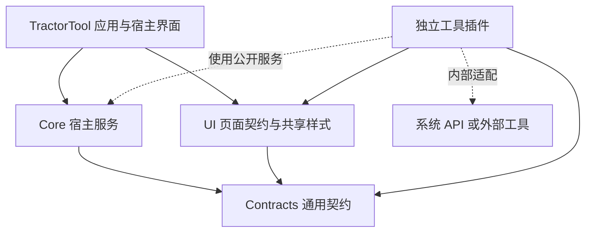

# TractorTool 软件架构

更新日期：2026-10-05。本文负责宿主和公共服务的结构设计，不包含单个插件的内部业务方案。

本文说明如何落实[产品需求](TractorTool.md)。插件作者遵循 [插件开发规范](PLUGIN_DEVELOPMENT.md)；首版业务设计分别见 [剪贴板插件](Plugins/ClipboardHistory.md) 和 [视频插件](Plugins/VideoExport.md)。文档分工见 [导航](README.md)，实现与验证状态以 [开发文档](DEVELOPMENT.md#current-status) 为准，后续阶段设计不能当作现有功能。

## 1. 当前代码与目标结构

解决方案 [TractorTool.slnx](../TractorTool.slnx) 统一包含原路径的宿主、Contracts、Core、UI，以及 Plugins 分组中的正式插件、tests 分组中的检查工程和机制夹具，共 12 个实际工程。目标框架为 `net10.0`（剪贴板相关工程使用 Windows TFM），Avalonia `12.1.2`、CommunityToolkit.Mvvm `8.4.2`，采用单一 FluentAvaloniaUI `3.1.0` 控件主题。M2 已加入插件管理代码与独立构建的 Windows 剪贴板插件；M3 已加入包服务和视频真实导出入口，M4 已接插件预设工作区、串行执行、公共有限任务和中断摘要，运行验证状态集中在开发文档。

现行职责与依赖边界如下：

| 项目或目录 | 职责 | 允许的项目依赖 |
| --- | --- | --- |
| `TractorTool` | 保留现有应用入口；窗口、导航、托盘、宿主设置、组装服务 | Core、Contracts、UI |
| `TractorTool.Contracts` | 插件协议、生命周期、任务、路径、设置、依赖等公开契约 | .NET 与必要的基础抽象，不依赖 Avalonia 或 Windows |
| `TractorTool.Core` | 插件发现、状态、任务管理、包管理、路径与配置实现 | Contracts |
| `TractorTool.UI` | Avalonia 页面注册接口、通用控件、样式资源、主题 | Contracts、Avalonia、FluentAvalonia |
| `Plugins/<插件工程>` | 工具业务、专属设置、页面和所需平台适配；剪贴板及视频工程 | Contracts、UI、插件私有依赖 |
| `tests/` | 核心测试、插件集成测试、必要的 UI 测试 | 对应被测项目 |

首版不为单个工具另建通用平台工程；平台专属能力留在适配层或对应插件，出现实际共用需求时再抽取。

框架的公共接口须有实际消费方，负责连接、管理与统一交互。模型选择、AI 推理协议、媒体参数、硬件使用策略等业务留在插件；框架不因未来 AI/Python 设想预建调度平台或空服务。业务代码不能通过“公共化”换名进入 Core。



图中实线为项目依赖，虚线为运行时服务调用（插件通过 Contracts，不引用 Core 实现）。宿主应用不通过 `ProjectReference` 引用具体插件；开发打包可以构建插件并复制产物，但不能因此把插件写死进宿主。

上表中的 `Plugins/<插件工程>` 是源代码工程路径，不参与宿主的静态项目引用。发布运行时的插件安装位置是 `<AppRoot>/Plugins/<PluginId>/<Version>`，两者不能混淆；`AppRoot` 以实际应用目录为准。

解决方案归属与程序集依赖分别管理：插件加入同一解决方案，供 VS Code 正常编辑和构建，并不建立宿主到插件的引用。日常开发通过 `ProjectReference` 使用公开 Contracts/UI；正式交付显式传入 `HostSdkDir`，改为引用已发布 DLL，正常还原后重新编译。指定路径无效时失败，不回退源码。两条路径的工程引用不依赖 `DesignTimeBuild`，避免还原、编辑器分析和实际编译得到不同依赖图。操作规则集中在 [插件开发规范](PLUGIN_DEVELOPMENT.md#6-开发构建与安装验证)。

组织参考采用 [M1 调研](PROJECT_HISTORY.md#ui-reference) 固定版本的 [WattToolkit.slnx](https://github.com/BeyondDimension/SteamTools/blob/d04213147e77a8d73277fa8b86eeecfa444df071/WattToolkit.slnx)：插件在同一解决方案的 Plugins 分组中，[GameTools 工程](https://github.com/BeyondDimension/SteamTools/blob/d04213147e77a8d73277fa8b86eeecfa444df071/src/BD.WTTS.Client.Plugins.GameTools/BD.WTTS.Client.Plugins.GameTools.csproj) 引用公共客户端/UI 工程。这里只借鉴开发组织方式，TractorTool 继续使用自身公开 SDK 边界，保留当前物理路径。

## 2. 插件协议与装载

### 2.1 分发单元

插件包是 ZIP，包含根清单 `plugin.json`、入口 DLL、私有依赖、资源和许可说明。插件根目录为 `Path.Combine(AppContext.BaseDirectory, "Plugins")`，安装目录按 `PluginId/Version` 隔离。运行时只读取已完整安装并选定的版本，不从临时解压目录或用户数据目录加载插件代码。

清单是加载前校验的元数据边界，包含稳定标识、版本、入口、平台与 SDK 兼容要求。字段、当前版本规则和示例统一维护在 [插件开发规范](PLUGIN_DEVELOPMENT.md#2-插件清单与兼容性)，本节不重复协议表。已纳入管理的插件只扫描明确选定的活动版本；未纳入管理的同 ID 多版本候选仍报冲突，不猜测最高版本。有效的外部包声明不要求提前安装，插件在实际使用时向宿主申请；源暂未提供时仍允许页面加载，申请时明确报告原因。

清单只声明元数据，禁止把插件名称、类型名或包路径当作 shell 命令执行。禁用或不兼容插件仅展示清单信息，不为读取名称而执行其 DLL。

### 2.2 公开扩展点

| 公开契约 | 作用 |
| --- | --- |
| `IPlugin` | 初始化、停止与释放插件实例 |
| `PluginContext` | 提供该插件可用的宿主服务、生命周期令牌与稳定标识 |
| `IPluginUiModule`，位于 UI 工程 | 注册导航页、设置页的工厂与元数据 |
| `IPluginBackgroundService`，可选 | 应用驻留期间的可取消常驻活动 |
| `IAppLog` | 写入带级别、来源和异常详情的重要运行记录 |
| `IBackgroundTaskService`、`IBackgroundTask` | 登记有限任务/整批、执行句柄、报告进度与取消；宿主任务页查询公共摘要 |
| `IAppPaths`、`IPluginSettingsStore` | 获取所属目录及保存带版本的配置 |
| `IExternalPackageService` | 查询依赖、请求安装、获取指定工具路径及使用租约 |
| `IProcessRunner` | 受管理的外部进程执行、输出读取与取消 |

PluginContext 按插件生命周期提供进程、依赖和有限任务作用域，保留旧构造/解构和程序集身份。当前 Contracts API 1.7 接受旧 API 1.0–1.6；接口版本要求以插件规范为准。通用契约不包含 `Control`、窗口或媒体专属模型；UI 工程负责 Avalonia 页面工厂，插件业务内部可直接使用自己的库。

插件设置页使用同样的注册机制。宿主只知道页面描述与工厂，不知道视频码率等业务字段。插件专属设置必须由插件拥有的服务读写。

宿主页面由 [MainViewModel](../TractorTool/ViewModels/MainViewModel.cs) 显式创建，插件页面由已注册的工厂返回 Control；列表项提供显式模板。初始项目的名称反射 ViewLocator 已移除，不作为页面发现或创建的兜底路径；插件无需继承宿主工程中的 ViewModel 类。

### 2.3 装载顺序与版本隔离

1. 分别解析软件目录、插件根目录、启动配置和数据根目录。取得固定启动目录、必要的自定义数据根实例锁及实际插件安装目录独占锁；如有数据迁移请求，先按 [迁移事务](#storage) 完成准备与恢复，再创建业务写入服务。锁持有到进程终止，避免超时退出后的迟到清理与新实例写入重叠。
2. 在任何插件 DLL 装载前应用待处理变更，然后扫描 `<AppRoot>/Plugins`，校验路径、ID、平台、宿主 API 与 UI SDK。管理状态不可读取或安装目录锁不可取得时显示原因并停止此次插件装载，宿主仍可查看日志。
3. 管理记录决定活动版本和启用状态；未管理的单版本插件兼容旧 `disabledPlugins` 配置。禁用、不兼容、损坏或变更失败的插件记录状态，不加载代码。
4. 为启用插件创建加载上下文，解析其私有托管依赖与本机库。入口与解析出的私有依赖共用版本包边界校验：路径必须位于版本目录内，从文件到版本根逐级拒绝链接/重解析点。系统本机库仍由系统解析。
5. 共享宿主的 Contracts、UI 契约、Avalonia 及跨边界使用的基础抽象程序集，避免同名类型因重复加载而不能转换。
6. 创建插件上下文并初始化插件，再向暂存注册器注册页面与设置；全部成功后一次性提交，失败不留下半份导航；最后启动可选常驻活动。

使用 .NET `AssemblyLoadContext` 和 `AssemblyDependencyResolver` 的现有机制。私有依赖可按插件隔离；共享程序集不能任由每个插件携带任意版本。M1 拒绝插件根目录夹带 Contracts/UI/Avalonia/FluentAvalonia/MicroCom.Runtime 的 DLL 副本；加载器从默认上下文解析共享类型并检查程序集版本。缺失私有托管依赖报错，不依赖开发机 NuGet 缓存；禁止直接引用宿主或 Core。首版插件 SDK 使用明确的已验证版本组合，版本不匹配时给出错误而不是强行加载。[微软插件指南](https://learn.microsoft.com/en-us/dotnet/core/tutorials/creating-app-with-plugin-support)

入口初始化、页面工厂和任务调用分别记录异常。可以处理普通失败并保持其他功能可用，但进程内可信插件仍可能使整个进程崩溃；加载上下文不是安全沙箱。

### 2.4 安装、更新、禁用和卸载

宿主插件页使用 Avalonia `IDataTransfer` 原生文件拖放，只接受一个本地 ZIP；拖入与文件选择共用确认、校验、串行排队及退出保护，不另造安装路径。启停使用 `ToggleSwitch.IsCheckedChanged`，覆盖点击和拖动滑块；初始绑定不产生管理请求。开关显示待生效目标，卡片另列当前加载状态和“重启后”提示；未执行的启停请求可反向切换取消，保存失败后恢复原状态。[Avalonia 拖放](https://docs.avaloniaui.net/docs/how-to/drag-and-drop-how-to)

当前实现在 [PluginManager](../TractorTool.Core/Plugins/PluginManager.cs)、[PluginFiles](../TractorTool.Core/Plugins/PluginFiles.cs) 和 [管理状态](../TractorTool.Core/Plugins/PluginManagementState.cs)。操作串行写入 `<PluginRoot>/.management/state.json`，沿用带版本 JSON 原子替换和备份；活动版本与待处理请求独立，UI 同时显示当前生效状态和重启后状态。此状态属于具体软件安装，不存入可迁移的外观配置。

安装/更新在 `.management/staging/<Token>` 解压并校验路径、链接、大小、清单兼容性、共享程序集副本和入口 PE 元数据；此时不执行 DLL。文件摘要保存到待处理请求。版本目录不可覆盖，普通更新只接受更高版本；下次启动重新校验摘要后移动到最终目录，再提交活动选择。忽略 `.management`，从不把暂存包当作候选插件。

排队安装和管理变更遇到已有待重启请求、重复/较旧版本等可预期状态冲突时，Core 在同一管理锁内返回拒绝原因，不以异常表示用户重复操作；拒绝不改既有请求，清理本次暂存。宿主显示原因并记录 ERROR，但没有人为构造的异常堆栈。损坏/越界包、实际 I/O 和内部故障仍保留异常处理，不更改调试器过滤。

更新备份在**下次启动、旧进程退出后、新插件加载前**制作，覆盖该插件完整数据目录（包含配置），存于 `<DataRoot>/Data/.plugin-backups/<Token>`；不能在点击更新时备份而漏掉旧插件退出保存。请求绑定当时的数据根，使用其他 profile 启动时拒绝应用。新版本加载失败保留旧版本及快照，用户可安排下次启动回退；恢复前将新版数据移到快照旁 `before-rollback`，再恢复旧数据。没有同进程回退或热卸载，也不自动删除恢复快照。

卸载在下次启动将代码移入 `.management/removed/<Token>` 后删除，用户数据和快照保留；状态墓碑防止旧目录被隐式重新接管。文件移动与恢复标记支持部分中断后的重试，失败保留请求及错误。尚未执行的请求可取消；失败的安装/更新也可取消以恢复旧选择，只清理能确认属于该请求的代码。已尝试的卸载/回退不可丢弃恢复日志，需修复原因后重启。崩溃断点及真实 ACL/文件占用仍需运行验收，不能把实现机制当作验证结果。

安装到当前用户可写的软件目录时可直接管理插件。软件目录不可写时显示实际位置和写入失败原因，保留原安装状态，不静默改装到用户数据目录，也不要求整个宿主长期以管理员权限运行。首版安装器采用用户级安装，机器级安装及授权写入不在当前实现中。修改插件根目录需要按实际安装路径互斥；文件仍被其他实例占用时保留待处理状态。

原生代码、事件、页面和后台线程会增加热卸载难度，因此首版不实现即时卸载。[.NET 卸载机制](https://learn.microsoft.com/en-us/dotnet/standard/assembly/unloadability)

## 3. 生命周期与任务

### 3.1 所有权

宿主拥有插件实例与服务作用域，导航拥有页面，任务服务拥有已提交的任务和取消令牌。后台任务的执行资源不能由页面控件或页面 ViewModel 的销毁动作直接管理。

页面离开只解除 UI 订阅或释放页面资源。任务完成、失败或明确取消后才释放其资源。常驻服务在插件初始化后按需启动，在应用退出时停止，不与页面显示状态绑定。

M1 每个插件实例持有独立的生命周期取消源与唯一清理任务；重复或并发退出共享同一宿主退出任务。清理顺序为：发出取消、等待初始化结束、调用 StopAsync、等待常驻 RunAsync 与取消回调结束、最后 DisposeAsync。各阶段超过 3 秒记录超时，但不一边运行一边释放实例；未完成的操作继续被观察。初始化在退出后才返回时不再注册 UI。插件之间并行启动清理，插件宿主最多等待 9 秒；异常回调被记录，不能阻断其他插件清理。可信插件若在构造/注册时同步卡死 UI 线程仍无法安全抢占，此机制不是进程隔离。

### 3.2 任务状态

有限任务状态为 `Queued`、`Running`、`Cancelling`、`Succeeded`、`Failed`、`Cancelled`、`Interrupted`。公开契约位于 [Contracts/Tasks](../TractorTool.Contracts/Tasks/BackgroundTasks.cs)，实现位于 [Core/Tasks](../TractorTool.Core/Tasks/BackgroundTaskService.cs)。QueueAsync 提交单项，QueueBatchAsync 一次登记并持久化整批摘要后返回可执行句柄，避免整批取消遗漏正在提交的后续项。调用方逐项 RunAsync 决定执行顺序；Core 不设视频队列或媒体参数。

任务至少包含 `TaskId`、`PluginId`、`BatchId`、显示名称、进度、时间、结果或错误摘要。任务的具体参数由插件解释，宿主不反序列化任意插件类型或把视频参数塞入通用核心。

任务的并发额度、批次失败策略和参数快照由业务插件定义；通用服务提供状态、取消和资源所有权，不硬编码某个工具的串行规则。

摘要位于 `<DataRoot>/Data/tasks.json`，保留全部活动项及最近 100 条终态。提交和状态保存采用带版本 JSON 原子替换与备份；损坏文件保留并阻止新任务执行，任务页提供记录保存重试。启动时将上次非终态标为 Interrupted；只保存通用摘要，不持久化业务参数、不自动重试或续转码，也不根据摘要删除崩溃遗留输出。

任务回调只在业务校验和最终结果提交后正常返回；正常返回保留 Succeeded 和实际结果，迟到取消不能事后抹掉已提交结果。取消通过令牌和执行结果表达，清理失败仍记为失败，不能假报安全取消。逐次进度更新内存，UI 合并调度通知；日志仅记录阶段变化及每 10% 进度节点，不逐帧写文件。页面不拥有任务或取消源。

宿主“日志 → 任务进度”汇总所有插件通过公共服务登记的任务，显示进度、单项/整批取消和结果。每项以 PluginId 关联所属插件，按钮显示“打开＋插件名”，打开其第一个已注册普通页面；插件不可用或没有普通页面时显示“查看插件”并进入插件管理。初始化完成后刷新恢复摘要的名称与入口状态，批次取消同时限定 PluginId 和 BatchId。此处无视频专属路由或参数。标题栏不放任务按钮，不增加底部导航或插件页脚。视频读取和依赖准备属于插件入队前预检，不建立公共任务，准备期间由插件页显示状态和取消入口；预检成功后一次登记整批导出。

### 3.3 结构化日志与错误提醒

公共 IAppLog 保留原 Write(source, message, error) 签名；API 1.7 以默认接口方法增加 AppLogLevel 重载，不要求旧日志实现新增成员。AppLog 将旧调用中无异常的记录映射为 INFO，有异常的映射为 ERROR；WARNING 由调用方显式选择。记录包含序号、时间、级别、来源、消息与异常详情，不分析文本关键词猜级别。

宿主 LogsView 用“运行记录 / 任务进度”页签复用现有任务模型。运行记录内存最多 300 条，按时间顺序在底部追加；支持级别/关键词筛选、复制、按需展开所选详情和暂停显示。列表保持虚拟化及条目身份，禁用选择项自动滚动；视图根据滚动位置、集合与布局事件跟随底部，向上翻阅停止跟随，回到底部恢复，不用定时器。嵌入列表、工具栏和详情统一沿宿主正文左右留白，不套用整页滚动的右侧扩边。日志文件仍由 AppLog 写入；写入失败在内存报告一次该故障并保留错误提示，恢复写入后清除提示，不声称丢失记录已补写。

M5 的磁盘保留由 Core 内部 [LogFileWriter](../TractorTool.Core/Logging/LogFileWriter.cs) 实现，AppLog 沿用同一写锁，不增加公开 SDK、后台线程或定时器。单文件 10 MiB，按大小及 UTC 跨日滚动；保留最近 14 天、最多 20 个文件、总量目标 100 MiB，优先保留新日志。首次写入和滚动时检查保留规则，为当前文件预留完整 10 MiB，正常追加不重复扫描目录。只识别 Logs 顶层精确命名的宿主日志（兼容旧命名），不递归、不处理其他文件或链接；目录及祖先链接拒绝写入/清理。当前文件始终保留，旧文件占用/权限失败记录一次 WARNING、继续写新记录，下次滚动重试；这时不承诺磁盘上限已经满足。

磁盘单条记录最多 64 KiB，以完整 UTF-8 字符截短并写明截断；完整记录只在最近 300 条内存窗口内保留。文件名含独立会话标识和分段编号，避免短时间重复启动撞名；AppLog.FilePath 始终指向当前段。删除旧磁盘日志不改变内存记录、未读计数或已读水位。保留说明由同一策略常量生成，在“设置 → 通用设置 → 应用数据”展示并提供打开日志目录入口。

AppLog 的事件驱动 UI 刷新，MainViewModel 合并调度，同时更新日志导航图标左上角红色数量角标。未读数是本次启动累计 ERROR 记录减已读水位，不随 300 条窗口淘汰、不因进页自动清零；“已读”在日志锁内将当前全部错误标记已读，包含暂停/筛选隐藏项，不删除记录。该时刻之后的新错误仍提醒。它表示错误记录数，不做跨模块故障去重；完整旧记录可打开日志文件查看。INFO/WARNING/ERROR 使用 UI SDK 深浅主题中的绿/黄/红语义资源，并保留文字级别。

重要记录包括插件发现、初始化、常驻服务启停、管理请求、依赖安装/清理、任务开始/阶段/取消/结果和实际失败；普通导航、窗口隐藏/恢复不记录。用户取消和宿主正常停止记 INFO，恢复中断摘要或 GPU 回退记 WARNING；意外取消、超时及清理失败不能被“正常取消”吞掉。进程桥接和任务包装通过观察已完成 Task 状态避免重复抛出已确认的取消，公开调用方取消语义不变，不改调试器异常过滤，也不保证第三方/系统代码不产生首次抛出通知。

正常进程退出使用 OS 等待通知；仅 Windows Job 终止后的活跃子进程确认仍使用 20ms 轮询，每次由 Core 限制最多 3 秒。实际进入轮询时宿主每次启动只记录一条开发优化 WARNING，后续改成 Job 事件通知的缺口保留。日志、任务刷新与剪贴板更新不采用定时轮询。

### 3.4 托盘和退出

应用采用显式退出的生命周期，普通窗口关闭改为隐藏，托盘提供显示主窗口和退出命令；重新显示沿用同一宿主和任务状态。Avalonia 提供 `OnExplicitShutdown`，实现时确认当前版本的对应 API。[Avalonia 生命周期](https://docs.avaloniaui.net/api/avalonia/controls/applicationlifetimes/iclassicdesktopstyleapplicationlifetime)

主窗口左下角仅有日志、插件、设置。窗口内的显式退出位于“设置 → 通用设置 → 关于软件”，复用宿主退出命令，作为托盘不可用时的退出路径；不改变关闭到托盘的产品语义。

退出开始时禁用窗口交互、新的设置保存与插件管理操作，同时等待已开始的保存、管理操作和插件清理，共用外层 10 秒等待期限；随后释放托盘并关闭。安装/数据/启动目录锁交由进程终止释放，不能提前让新进程进入仍有迟到工作的目录。超时明确记录，不能保证不合作插件或持续阻塞磁盘的最后一次写入已经完成。窗口恢复事件与实例锁使用同一绝对路径规范化规则（包含末尾分隔符处理）。

显式退出有任务时提供取消退出或停止任务后退出的选择。退出按“停止接收任务、取消任务和常驻活动、等待有界清理、关闭子进程、保存状态、退出”的顺序执行。超时处理仅针对本应用创建的进程树，不按进程名结束所有 FFmpeg。

Windows 注销或关机跳过交互确认并执行有界清理，不能因无限等待阻止系统退出；正常显式退出有活跃公共任务时允许继续处理或停止任务后退出。停止任务、插件和包服务共用宿主外层最多 10 秒等待，生命周期作用域停止新提交并取消所属任务，后台工作结束后再释放插件资源。M1 使用 Avalonia TrayIcon；异常或无 NativeMenuExporter 时保持窗口可见并提示显式退出。Windows 适配在宿主 `Platform/WindowsRestoreSignal.cs`：同一固定配置目录的再次启动通过命名事件恢复原窗口，为系统托盘图标丢失提供恢复入口。没有扩展为通用 IPC 平台。`--no-tray` 可进行不可用分支验收。托盘对象创建成功不保证系统实际显示正常，因此真实点击/恢复需人工验收。

<a id="packages"></a>

## 4. 外部工具与进程管理

### 4.1 包管理

包管理不是独立插件，也不另建单独的包管理项目。实现分工如下，当前运行验收状态只见开发台账：

| 位置 | 内容 |
| --- | --- |
| `TractorTool.Contracts/Packages` | `IExternalPackageService`、包描述、状态和使用租约等公开契约 |
| `TractorTool.Core/Packages` | 下载、校验、解压、版本存储、安装记录、并发请求合并和占用保护 |
| `TractorTool` 的设置页面 | 依赖列表、安装/重试/移除操作、进度与错误展示 |
| 各工具插件 | 声明所需包，通过公开服务获得工具路径，不依赖 Core 的具体实现 |

代码所属项目与包文件所在目录是两件事。包文件存放在 `<DataRoot>/Packages/<PackageId>/<Version>/<RID>`；插件 DLL 存放在 `<AppRoot>/Plugins/<PluginId>/<Version>`。

区分三类依赖：插件的私有 .NET 库随插件打包；共享 SDK 由宿主提供；FFmpeg 等外部程序由包管理服务提供版本化路径。

流程以 [产品需求第 5 节](TractorTool.md#5-外部依赖管理) 为准：插件通过 API 1.4 `TryRequestAsync` 申请 → 复用已安装版本或解析可信源 → 缺失时由宿主确认下载 → 安装 → 返回工具租约。“先不安装”正常返回空租约，调用 token 取消与实际失败仍走异常路径。原 API 1.2 `AcquireAsync` 仍只获取已安装包；API 1.3 `RequestAsync` 保留旧签名和拒绝时抛取消异常的兼容行为。来源索引、插件依赖引用、安装记录、运行租约各自承担不同职责；卸载插件仅改变引用，包仍保留，用户在设置的独立外部依赖页清理未引用包。

清理在 Core 的同一锁内检查插件引用、请求预留、运行租约和安装事务。引用从持久的插件清单及管理日志重建，不维护另一份易漂移的引用计数文件；包括禁用/失败插件、待激活版本和可回退版本。管理提交前暂停清理，提交后在管理锁内同步引用；卸载重启生效前继续保护旧版本。任何清单或管理状态不可读都暂停清理，不能推定为零引用。下载确认、安装和取得租约之间也有预留保护。

外部包描述包括包 ID、版本、RID、下载来源、SHA256、压缩格式、工具相对路径及许可信息。首版使用明确的固定版本和受维护来源，不能让“latest”在用户机器上悄悄改变运行结果，也不执行任意安装脚本。

状态按缺失、下载中、校验中、安装中、就绪、失败展示。流程为下载临时文件、验证校验值、在暂存目录安全解压、验证工具存在和版本、提交就绪标记。解压校验路径越界及链接，失败保留可重试状态，不破坏已安装版本。

相同包版本的并发请求合并，同一安装事务串行。任务持有包版本使用租约，直到进程退出并读取完输出才释放。清理时仍有引用、请求或使用租约就拒绝操作，不安排重启后自动删除。

SHA256 用于核对内容，不单独证明发布者可信；包清单和来源本身也需要可信。FFmpeg 构建中的编码器和分发许可随构建选项变化，发布前记录采用的二进制来源和许可证。

可信索引由 [PackageCatalog](../TractorTool.Core/Packages/PackageCatalog.cs) 校验，内置目录仍是软件目录 `PackageSources/default.json`（源码 [default.json](../TractorTool.Core/Packages/default.json)）。[PackageSources](../TractorTool.Core/Packages/PackageSources.cs) 读取软件维护的 `PackageSources/source.json` 中 `indexUri`，仅接受不含凭据/片段的 HTTPS URL；默认 null，表示尚未部署正式远程源，设置明确显示未配置并禁用刷新。没有用户添加源或插件指定下载源的入口。两份文件随构建/发布复制，分发静态检查要求存在。

配置远程源后，启动只读取按源 URL 隔离的 `<DataRoot>/Cache/PackageSources` 缓存；普通启动不联网。插件申请在本地没有对应可用来源且未就绪时按需刷新，设置也可手动刷新。并发刷新共用一次下载，单调用方取消只取消等待，退出取消并等待共享操作。索引下载限 15 秒/1 MiB，验证整份 schema、重复项、路径和包资料后原子替换缓存，失败保留当前目录、缓存和已装包；重定向不能改变协议/站点。远程目录叠加内置兜底，同身份可更新来源/说明；已有同 ID、固定版本、RID 的 SHA256 或标识大小写变化被拒绝，内容改变须新版本。刷新只更新可用源资料，已安装记录、运行租约、正在下载和已展示确认的定义各自保留快照；确认后安装使用用户批准的定义。

内置生产条目仍为 Gyan FFmpeg 9.0.2 essentials / win-x64；第二个真实工具 [MediaInfo 测试源](../tests/PackageSources/mediainfo.json) 和 [独立测试插件](../tests/PackageProbePlugin/ProbePlugin.cs) 只用于验收，不进入正式分发。插件仍只声明 ID/固定三段版本，Contracts API 不变；未知包或平台允许页面加载，申请时明确报错。设置只展示插件引用、实际安装或已申请的包，不把整个源目录直接当已安装列表。安装源的维护和隔离验证入口见 [插件规范](PLUGIN_DEVELOPMENT.md#package-source-maintenance)。

[包服务](../TractorTool.Core/Packages/ExternalPackageService.cs) 合并同包并发申请的确认及安装；调用方取消等待不影响其他等待者，设置页取消才停止共享下载。下载最多 256 MiB、ZIP 展开最多 1 GiB/10000 项，拒绝路径越界、重名/大小写冲突、特殊文件和重解析点。校验后按可信工具资料的 `arguments` 参数向量执行，`output` 选择 stdout/stderr，与 `versionPrefix` 做 CRLF/LF 归一后的前缀比较；非零退出或被选输出截断均失败。旧资料缺省仍是 `-version`/stdout，不执行 shell 或安装脚本。参数最多 16 项，每项 1024 字符、禁 NUL；前缀最多 512 字符，整个定义默认 UTF-8 序列化后最多 48 KiB，给 64 KiB receipt 的工具哈希留足空间。

成功才写 receipt 并原子移动目录。receipt v2 保存完整安装定义及下载/工具哈希，因此索引下架或失效后仍可复用并清理已安装包；旧 v1 在仍有对应源定义时升级，无法恢复的记录保留文件并报错。取得租约重新校验文件；损坏包可经确认重新安装，禁止运行中替换，修复使用当前可信源地址。网络/整体超时显示失败，取消可重试；修复会移除损坏副本，失败不冒充恢复成功。现阶段固定版本和安装记录已有确定性，不再维护一份重复的锁文件；语言依赖的间接解析另见后续 Python 计划。

事务暂存在 `Packages/.work/<GUID>`，归属标记最后删除。宿主持有数据根实例锁，启动时仅清理带精确标记的遗留事务，不扫描删除用户其他目录。共享服务在退出时封闭新操作并取消/等待已有操作。每个插件得到限定清单依赖的 PackageScope；插件持有租约至进程和输出结束，插件清理完成后回收遗忘的租约。占用期间拒绝移除；不同版本可并存。

### 4.2 进程服务

公共 [IProcessRunner](../TractorTool.Contracts/Processes/IProcessRunner.cs) 接收绝对可执行路径和独立参数列表，不执行 shell、不搜索 PATH，默认工作目录为工具所在目录。Core 的 [ProcessRunner](../TractorTool.Core/Processes/ProcessRunner.cs) 快照参数、并发读取 stdout/stderr、处理超时与停止；插件通过 API 1.1 的 `PluginContext.Processes` 获取按插件生命周期创建的实例。原五参数构造/解构及程序集身份保持不变，宿主仍接受 API 1.0/1.1/1.2；使用进程服务的插件声明 1.1 或更高。

Windows 专属实现位于 [WindowsProcessSession](../TractorTool/Platform/WindowsProcessSession.cs)，通过 Core 的 IProcessSession 适配边界注入，Core/Contracts 不含 Win32 API。仅靠 .NET Kill(entireProcessTree) 不能覆盖根先退出的后代：使用 Windows 10+ `CreateProcessW` 的 `PROC_THREAD_ATTRIBUTE_JOB_LIST` 在创建时绑定私有 Job，配合显式继承句柄列表与 KILL_ON_JOB_CLOSE。原生入口需要命令行，因此仅在此适配层按 Windows CRT 参数引用规则编码参数向量，不进入 cmd/PowerShell；不会先启动再附加 Job。[创建属性说明](https://learn.microsoft.com/en-us/windows/win32/api/processthreadsapi/nf-processthreadsapi-updateprocthreadattribute)

每次调用的根进程退出后终止残留后代，取消/超时也终止整组，只操作该次调用的 Job。正常等待使用 OS 进程信号；清理期间才短时查询 Job 直到活动数为零，等待有 3 秒上限，不进行后台定时轮询。停止插件时关闭新请求并取消已登记的调用，切页/托盘隐藏不触发停止。尚无非 Windows 适配器，调用时明确报告不支持；嵌套 Job/权限/父先退出等真实 Windows 行为仍需运行验收。

stdin 关闭为 EOF；UTF-8 输出两路分别有界保留（默认各 1 Mi 字符，最多 16 Mi），超出继续排空并返回截断标记，不按行等待换行。返回原始退出码，非零不伪装为成功；调用/宿主取消与执行 TimeoutException 区分，内部清理中断或失败为 IOException，不能假报普通取消。清理失败记录插件归属，不记录参数和业务输出正文。

API 1.5 在现有 ProcessRequest 上追加可选 `StandardOutputReceived`，不改原构造/解构或执行接口。worker 按顺序通知 stdout 数据块，捕获上限不限制通知内容；回调应快速返回，异常进入读取失败与进程清理流程。宿主不组装媒体进度，视频插件自己处理分块、逐行解析和 UI 调度；既有无回调调用保持原行为。当前仍非通用常驻服务/IPC 平台，旧 1.0–1.4 清单继续兼容。

包服务提供固定版本工具路径与占用租约，租约需覆盖进程退出和输出排空。有效 dependencies 不因工具未安装或源暂未提供而阻止页面加载；API 1.4 的 TryRequestAsync 在实际使用时交由宿主确认安装，拒绝返回 null，原 AcquireAsync 只复用已有包，初始化不得自动下载。不能把包安装当作 FFmpeg 导出完成。工具自身参数语法、解析和业务校验由插件处理。

<a id="storage"></a>

## 5. 插件目录、数据目录与迁移

### 5.1 固定启动位置与可迁移数据

路径服务分别提供 `AppRoot`、`PluginRoot`、`DataRoot` 和 `PackageRoot`。`AppRoot` 取实际应用目录，`PluginRoot` 固定为其下的 `Plugins`；`DataRoot` 可由用户设置，`PackageRoot` 为 `<DataRoot>/Packages`。不能以终端当前目录解析插件位置。

固定启动文件位于 `%LOCALAPPDATA%\TractorTool\bootstrap.json`，只记录数据根目录、配置版本和必要迁移状态。它始终留在固定位置，否则软件下次启动无法找到用户自定义的数据目录。

默认数据根目录与该启动目录相同。自定义后，业务数据全部从新根目录解析，固定启动指针是明确的小型例外，不把第二份业务配置继续写回默认位置。

数据根必须使用专用子目录，拒绝卷根；目录互含检查保留卷根本身的分隔符语义，避免数据与插件代码重叠。

```text
<AppRoot>/
  TractorTool.exe
  Plugins/<PluginId>/<Version>/    # 插件代码、资源与私有依赖
  Plugins/.management/             # 活动选择、待处理请求、代码暂存
  Plugins/.installation.lock       # 安装目录独占锁

<DataRoot>/
  Config/                         # 宿主外观等用户配置
  Packages/<PackageId>/<Version>/<RID>/
  Data/Plugins/<PluginId>/         # 插件配置、预设、持久数据
  Data/tasks.json                  # 活动任务及最近 100 条终态摘要
  Data/.plugin-backups/<Token>/    # 更新前快照与回退时保留的新版数据
  Cache/                          # 可重建缓存
  Logs/                           # 有保留策略的运行日志
```

M1 路径服务已按上述布局创建数据目录和扫描插件目录；M3 包服务使用 Packages，M4 任务摘要使用 Data/tasks.json，当前证据见开发台账。用户输出文件位于其指定目录，既不属于缓存，也不能由软件清理功能删除。`bootstrap.json` 不随业务数据迁移；公开 IAppPaths 不暴露启动指针。设置 → 通用设置 → 应用数据可安排下次启动迁移，不能在线直接更改路径。开发参数 `--profile-root <绝对路径>` 将启动位置和默认数据一起隔离到测试目录，生产默认仍为 LocalApplicationData/TractorTool。

设置优先采用带 `schemaVersion` 的 JSON；少量预设无需先引入数据库。真正需要大量检索的数据再采用 SQLite。M1 写文件采用同目录临时文件、Flush、File.Replace 和 `.bak`，进程内按完整路径串行写入。格式损坏、版本未知或保存失败保留原数据并报错，不自动重置为默认值。日志文件位于 Logs，界面只保留最近 300 条；磁盘滚动与保留规则见第 3.3 节。外部数据根目录不可用时显示恢复选项，不静默创建空配置冒充原数据。

应用管理的包、插件数据和缓存位置持久化为数据根目录下的相对路径；插件代码位置按插件根目录和 `PluginId/Version` 解析，两类基准明确区分。用户选择的输入与输出目录保留各自路径语义，不随应用数据迁移。旧配置如包含绝对内部路径，应通过配置模型迁移，不能对所有 JSON 文件做无差别字符串替换。

### 5.2 切换数据根目录

迁移由 Core 的 [DataRootMigration](../TractorTool.Core/Storage/DataRootMigration.cs) 实现，宿主只负责选择目录、确认、启动进度与失败提示，不增加插件 SDK 接口。首版只接受本机新建/空的专用目录，拒绝卷根、源/目标互含、与固定 bootstrap/Plugins 重叠、链接与重解析路径；不合并已有数据目录。

1. 设置页确认后，在固定 `bootstrap.json` 的 schema 1 中增加迁移记录（事务 ID、源/目标、AppRoot、失败原因），旧文件继续兼容。当前任务可继续，显式退出后的最新保存会进入迁移。插件仍有待重启变更或待加载结果时暂不安排；安排后又产生插件变更，则下次启动保留原根、先走原管理流程，处理后用户再安排重试。
2. 启动先创建唯一的 MainWindow，内容区显示启动状态，隐藏业务导航。后台取得固定 bootstrap、当前 DataRoot 租约并只读加载现有外观，再应用主题；取得插件安装目录独占锁后处理迁移，成功前不创建日志、包服务、任务服务或插件。复制在后台线程，进度推送到同窗内容区，没有轮询；关闭或点击退出停止复制/快照校验并退出，保留请求供下次启动恢复。快照预检与收尾使用同一取消令牌，目录遍历与分块哈希均检查取消，快照摘要格式保持兼容。
3. 目标取得独占锁，用 `.tractortool-migration.json` 核对事务与固定启动位置。仅复制 `Config`、`Data`、`Packages`、`Logs`，保留空目录与文件修改时间；跳过 `Cache`、`Packages/.work`、bootstrap、host.lock 及 AppRoot/Plugins。核对归属和目标内容后，仅回收本事务的固定未完成临时文件，再检查实际磁盘可用空间，避免重试被自身残留占用阻断；单文件写入该临时文件、落盘、SHA256 校验后无覆盖提交，再核对源/目标清单。
4. 所有复制及回退快照预检通过后，原子保存新的 dataRoot 和 previousDataRoot，迁移记录暂留。随后更新本安装所引用的插件回退记录及新目录快照元数据中的 DataRoot；旧目录快照不改。收尾可重复执行，完成后清除待处理记录，宿主从新根构建服务，给原 MainWindow 连接模型并原位显示主页，然后按既有流程加载插件。首次 Opened 处理器随即解绑，恢复窗口不再次初始化；失败停在同窗错误提示，不创建另一窗口。保留源/目标租约直到进程退出，避免迟到清理与另一个实例交叉写入。
5. 指针提交前失败，保留源和已复制目标，记录原因并从原根启动；失败记录存在时不自动重复尝试，设置页提供重试/取消。意外中断可以续传仍一致的文件；若旧根继续运行后改变了已复制文件，重试拒绝覆盖，须取消并选择新的空目录。取消只清除请求，不递归删除用户选择的目标。
6. 指针提交后若快照收尾/清除记录失败，停止启动并显示原因，下一次先完成收尾，不回到旧根加载插件。用户此时主动退出属于正常取消，保留新指针与请求，不包装成迁移故障，下次仍先完成收尾。即使保存指针时报告错误，也重新读取已落盘状态，避免错误路径覆盖已提交指针。固定记录无法安全读取/保存，或数据根不可用时停止，不创建空配置替代。

旧目录和目标归属标记保留；设置“更多位置”显示上次迁移的原目录。目前没有自动删除旧目录或部分目标的入口。恢复策略区分指针提交前/后，不能通过直接改 bootstrap 或无差别替换 JSON 路径绕过收尾。当前包 receipt 使用相对工具路径，任务结果路径仍指向用户输出；Python venv 等不可搬迁环境需按后续专门设计重建，不能套用本次复制事务。

<a id="ui"></a>

## 6. 统一 UI

共享 UI 基于 FluentAvaloniaTheme（单一全局控件主题），使用 `RequestedThemeVariant` 与动态资源管理深浅色和主题色；公共资源覆盖宿主和插件页面。页面布局、业务校验和媒体参数仍由插件负责。[Avalonia 主题](https://docs.avaloniaui.net/docs/styling/theme-variants)

颜色集中在 [ThemeResources.axaml](../TractorTool.UI/Styles/ThemeResources.axaml)：浅色/深色分别定义窗口、侧栏、卡片、控件、文本和边框资源，叠加在统一控件主题上。深色以不同层次的灰色区分侧栏、内容和卡片；具体颜色只在资源文件中维护，主题色单独保存和动态应用。[SharedStyles.axaml](../TractorTool.UI/Styles/SharedStyles.axaml) 负责共享设置行、图标、卡片和文字样式；宿主专用导航模板适配在 `TractorTool/Styles/ShellStyles.axaml`，保留库的选中/悬停/按压与焦点状态。

后台消息通过 UI 调度更新可观察状态，不能在 UI 线程等待进程或执行大文件 I/O。页离开后解除事件订阅，日志和任务列表采用有界保留与合适的虚拟化，避免长时间驻留导致持续增长。

<a id="ui-style-ownership"></a>

**样式按使用者和职责归属，不按文件名统一搬到 UI 工程。** “共享样式集中维护”指共用外观只有一个来源，宿主和插件仍各自拥有专属布局：

| 归属 | 维护内容 | 不应包含 |
| --- | --- | --- |
| `TractorTool.UI` 的 [ThemeResources](../TractorTool.UI/Styles/ThemeResources.axaml)、[SharedStyles](../TractorTool.UI/Styles/SharedStyles.axaml) 和 Controls | 宿主、插件共用的配色、文字、卡片、设置行、图标、页面呈现和可复用动效 | 宿主导航项、具体页面名称、剪贴板或视频业务、Core 内部服务 |
| 宿主的 [ShellStyles](../TractorTool/Styles/ShellStyles.axaml) 与 [MainWindow](../TractorTool/Views/MainWindow.axaml) | 72 宽主导航、导航项模板适配、PagePresenter 的边距及宿主整页滚动适配 | 另一套公共颜色/控件主题、具体插件页面的排版或业务规则 |
| 各 View 的局部样式，例如 [剪贴板历史列表](../Plugins/TractorTool.Plugins.ClipboardHistory/ClipboardHistoryView.axaml) 的 `ListBox.Styles` | 当前页面的分栏、列表密度、预览布局；颜色及通用外观继续使用 UI SDK | 修改 Application 的全局样式、引用宿主 ShellStyles 或其他插件的私有资源 |

[App.axaml](../TractorTool/App.axaml) 是组装入口：加载单一 FluentAvalonia 主题、公共资源和宿主适配。宿主消费公共 UI，而 UI 不反向引用宿主；把 ShellStyles 移入 UI 会让公共 SDK 承担主窗口的专属规则，当前没有这种复用需要。Core/Contracts 不包含 AXAML 或控件样式。

评审新增 UI 时，先确认消费者：共用外观改 UI 的现有定义，主窗口专用改宿主，单页布局留在该页；确有多个使用者再抽取控件或样式。局部规则尽量收窄选择器作用域，不靠复制公共颜色或向全局注入样式解决单页问题。当前 ShellStyles 在应用级加载，但以 `shell`、`rail`、`PagePresenter` 等标识选择宿主元素；这些是宿主私有约定，不是插件 SDK。该约定不是运行时隔离机制，可信插件仍需遵守接入规范。

<a id="ui-reference"></a>

### 6.1 参考实现依据

M1 已核对 Watt Toolkit 固定提交的导航、Frame、设置行和图标组织，具体源码链接与版本对比归档于 [UI 参考调研](PROJECT_HISTORY.md#ui-reference)。这里只采用适合本项目的组合方式，不搬入参考项目的内部工程、旧版模板或业务功能；当前实现约定见下文。

### 6.2 宿主与公共 UI 的实现

`SettingsView` 承担层级导航和子页生命周期：`SettingsPage.Parent` 表达包含关系，`SelectedPage` 为当前页，`SelectedCategory` 沿父级定位左侧大类，面包屑按父链生成。软件大类只有通用设置、外部依赖；通用下有外观/应用数据/关于三个子页，依赖列表点击后展示具体包详情，复用同一个可观察包模型。插件页由实际注册结果添加。宽窗口左侧按软件/插件分组，使用原生 Expander 默认展开并可独立折叠，折叠只隐藏分类列表、不触发右侧子页生命周期；无插件设置时隐藏整组。样式在 ShellStyles 中收紧，不复制控件模板；沿用统一动画偏好。内容区不足 780 DIP 时改为顶部大类选择，子页面包屑仍可返回，右侧正文保持边缘滚动。内层复用公共 PageHost 的主题和过渡，转发外层直接路由的离页取消事件，取消时恢复当前选择，工厂失败不提前释放仍显示的页面。不维护第二套导航栈或四项平级分类。

全局只使用 `FluentAvaloniaUI 3.1.0`，不同时加载 `Avalonia.Themes.Fluent`。ColorPicker、DataGrid、Skia 显式固定为 12.1.2，避免控件库的最低依赖改变共享基线。选型和构建过程见 [开发记录 E04](PROJECT_HISTORY.md#evidence-ui)。

实现依据为 [3.1.0 固定源码](https://github.com/amwx/FluentAvalonia/tree/215ee0481e8b0e6d396cbe2a0f33dc791c5646ab)，采用 `FA*` 新版 API，没有直接搬用 Watt 的 Avalonia 11 模板或 GPL 代码。当前复用库内置的符号字体，没有引入此前备选的 FluentIcons 包。第三方 MIT 声明随发布复制，见 [THIRD-PARTY-NOTICES.md](../THIRD-PARTY-NOTICES.md)。

- **窗口与导航**：`FAAppWindow` 提供窗口边框、系统标题栏按钮和命中测试；内容扩展到 32 逻辑单位的标题区，根 Grid 自动取标题区高度，TitleBar.Height 从同一控件高度赋值，避免独立固定行留下额外空白。标题区图标 16、软件名 13/常规字重、左边距 12、图文间距 8，垂直居中，不放宣传说明；这些为本项目逻辑尺寸。自定义标题区显式设置 Avalonia 12 的 `WindowDecorationProperties.ElementRole="TitleBar"`，其中纯图文内容不参与命中，保留库的窗口按钮。扩展内容覆盖默认标题栏时，仍须显式标记拖动区。使用框架原生拖动/双击行为，不再另写指针拖动或 Win32 Hook。[Avalonia 窗口说明](https://docs.avaloniaui.net/docs/app-development/window-management)。`FANavigationView` 固定 72 宽图文侧栏，上部为主页和插件、底部为日志/插件/设置；导航图标 28、背景最小高度 64、四周留白 4（均为逻辑单位）。导航标签单行省略，完整名称保留悬停提示和无障碍名称。尺寸适配集中在 ShellStyles 和主窗口导航模板，保留库的键盘、选择与焦点处理。Windows 托盘与实例恢复服务继续由宿主拥有。
- **页面与设置行**：日志、插件、设置及加载失败分别使用 AXAML View 与 ViewModel。宿主页头和正文使用同一左侧边距，正文随可用宽度伸缩，不再分别限宽居中；滚动页面复用 `ScrollViewer.pageScroll` / `StackPanel.pageBody`，禁止水平滚动并保留底部留白。主页/设置/插件/错误页通过 MainViewModel.HasPageScroll 使 PagePresenter 启用 edgeScroll：右侧 28 外边距移入正文，叠加原有 8 得到正文右边距 36；滚动条贴内容区右边，卡片及页头位置保持。适配集中在宿主 ShellStyles，公共 UI SDK 样式不变。只对空状态说明等局部文字限制阅读宽度，插件卡片按可用宽度换行；日志保留虚拟化记录列表和所选详情滚动区，外部插件保留默认页面边距并自行组织布局。公共 `SettingRow` 包装 `FASettingsExpanderItem`：左侧图标与说明，右侧操作，小于库的 460 宽阈值时操作移到下一行。设置层级遵循本节开头的包含关系；主题、主题色和动画选择后即时应用并自动保存，写入失败时显示重试。目录按钮、插件搜索、日志复制/暂停和错误重试都是实际命令。
- **公共图标与主题**：`ToolIconKind`/`ToolIcon` 提供宿主与插件同一套符号映射，导航支持本地彩色图片，未提供或加载失败时使用符号。图片保留原色，操作符号随主题调整前景色，具体所有权见第 6.3 节。应用及托盘图标从同一透明母版导出，见第 7.1 节。RequestedThemeVariant 控制浅色/深色/系统，CustomAccentColor 控制统一控件主题色，语义资源区分背景层次。
- **统一动效**：[Motion](../TractorTool.UI/Motion.cs) 与 [MotionStyles](../TractorTool.UI/Styles/MotionStyles.axaml) 属于公共 UI，由 SharedStyles 加载一次。ThemeService 在变更颜色前统一设置 AppMotionEnabled 动态资源及 FluentAvalonia 应用动画标志。普通控件和模板子元素自动读取该选项，新增页面/窗口不再绑定主窗口 class。开关滑动/按压、按钮悬停、滑杆与展开箭头沿用固定版本控件库的内置过渡，不复制模板或增加计时器。自有窗口/表面/卡片/设置行/文字的颜色过渡统一使用 220 ms、CubicEaseInOut，ShellStyles 仅消费相同时长补充侧栏。
- **关闭动效的边界**：模板内的局部 Transitions 优先于普通样式，Motion 使用可释放的 Animation 优先级空值覆盖，取消普通属性在途过渡；重新开启时释放覆盖，恢复控件自身的原值。不会覆盖写死开关拖动期间临时清空的底层 Transitions。Expander 后续展开的 ContentTransition 同样禁用；已开始的第三方展开 CrossFade 仍按库自身生命周期结束，不宣称瞬时取消所有动画。进度指示及插件自行创建的 Animation/Composition 不属于普通属性过渡，业务自定义动效须读取公共偏好并自行管理取消；不通过暂停全局时钟冻结业务进度。
- **列表更新与交互连续性**：插件管理按安装记录目录保留可观察卡片，过滤集合只增删/移动实际变化项；管理结果原位提交状态和命令，不清空重建列表打断滑块或丢弃控件。重复 ID 的不同目录仍独立呈现。写入失败显式恢复开关目标值，不依赖相同值的绑定通知必定重放。忙碌时的串行保护保留，不承诺禁用列表期间保留键盘焦点。新列表应遵循同样的稳定身份原则。
- **切页与生命周期**：公共 `PageHost` 使用原生 Border 承载单页，通过同步 `Present(Control)` 返回成功、取消或异常；不创建 FAFrame、不订阅窗口返回事件、不缓存历史页。只接受未挂载的页面；替换前在当前页直接触发 UI API 1.4 `PageHost.NavigatingFromEvent`（原生 CancelRoutedEventArgs），设置容器向内层转发取消。成功后宿主才提交标题/选择并清理旧页，取消保留原页；同步挂载/脱离异常后重建内容容器，允许继续显示错误页。原生 Transitions 实现 18 DIP、500 ms 上移淡入，换页或脱离视觉树时由 Avalonia 释放在途过渡，队列回调核对页面身份；关闭动效直接显示。旧公开 Present/Clear 和工厂方法签名保留以兼容已编译插件，但不再触发 FAFrame 专属导航事件；页面初始化/清理遵循 Loaded/Unloaded 与 IPluginPageLifetime，后台任务不随页面结束。宿主阻止切换重入和退出后创建页面；此边界不捕获插件任意异步事件或渲染线程异常。
- **设置持久化**：SettingsViewModel 在 UI 线程应用外观，通过单个保存任务将不可变快照交给后台写入；期间的新选择只保留最新值，旧写入完成不再应用旧主题或覆盖新状态。正常保存不显示常驻提示，保存期间不禁用选择，应用失败与写盘失败分别提示。保存错误只存于 SaveError，HasSaveError 由其派生；错误面板统一控制重试入口可见性，无 DataContext 或无法解析绑定时默认隐藏，避免无模型的 VS Code 预览出现孤立按钮。退出阻止新变更并等待整个队列，对此前最后一次保存失败最多再试一次，仍受宿主 10 秒退出期限约束。同步主题通知重入时重新应用最终有效选择，控件临时空选择不生成配置。沿用 JSON 原子替换及备份，没有新增通用设置框架。可选布尔字段 `enableAnimations` 默认 true，旧 JSON 不含此字段时仍可读取，沿用当前设置 schema；控制范围见上述统一动效边界。
- **SDK 与加载**：UI API 为 1.4，新增 PageHost 离页取消事件；接受 UI 1.0–1.4 的原有注册与二进制签名，拒绝更高未知版本。依赖旧 FAFrame 导航事件的页面需迁移到 PageHost 取消事件及原生 Loaded/Unloaded；公共 IPluginPageLifetime 清理约定不变。UI 1.3 的 PluginPageOptions.UsesCustomHeader 及 1.2 的 IconPath 保持不变：专属页头默认关闭，导航成功后提交，错误页恢复默认标题；设置页仍由设置容器组织。Contracts API 为 1.7，接受旧 1.0–1.6，程序集身份不随协议升版。共享加载清单包含 FluentAvalonia，与 Avalonia/Contracts/UI/MicroCom 一起禁止插件夹带另一套副本；第三方控件类型不进入 Core/Contracts 服务接口。

运行效果及已知限制只在 [开发验收台账](DEVELOPMENT.md#acceptance) 记录，架构描述不代表真实 UI 或动态加载已经通过验收。

宿主 [HomeView](../TractorTool/Views/HomeView.axaml) / [HomeViewModel](../TractorTool/ViewModels/HomeViewModel.cs) 提供默认主页。主导航集合的第一项是 `home`，后续才是插件页面；底部仍为日志/插件/设置。主页复用插件页生成的安装记录与已注册导航命令，不扫描第二遍目录、不提前创建插件页面，也不跟随插件页搜索过滤。每条安装记录一张卡片，使用第一个普通页面作为默认入口；禁用、不兼容、失败或无普通页面的记录进入插件页查看状态。加载完成更新主页数据，不强制切页；加载中、空安装、目录受阻和搜索无结果使用互不矛盾的显式状态。卡片与导航共享已加载图片及公共 `Button.toolCard` / ToolIcon。MainViewModel 在 UI 线程缓存整次初始化任务，重复或并发调用不重复添加导航、设置入口和安装卡片。Home 图标枚举追加在末尾，保留已有数值。

<a id="icon-design"></a>

### 6.3 彩色标识与单色操作图标

彩色图片负责工具识别，单色符号表达操作；M1 的参考源码分析见 [图标调研](PROJECT_HISTORY.md#icon-reference)。

现有 FluentAvaloniaUI 3.1.0 提供 `FAImageIcon` / `FAImageIconSource` 与 `FASymbolIcon`，当前直接复用，没有增加图标运行库。实现分工如下：

- 宿主主页、日志、插件、设置导航使用 Microsoft Fluent Emoji 同一套 3D PNG；示例插件随包携带拼图 PNG。固定素材版本、来源及 MIT 许可见 [Artwork](../Artwork/README.md) 和 [第三方声明](../THIRD-PARTY-NOTICES.md)。应用/托盘仍用自己的多功能工具图标，没有复制 Watt 的彩色资源。
- [PluginPageOptions](../TractorTool.UI/PluginUi.cs) 的 `IconPath` 是相对插件版本目录的可选 PNG 路径。具体填写、尺寸限制和打包要求只维护在 [插件开发规范](PLUGIN_DEVELOPMENT.md#5-统一-ui-与设置)。旧插件可只用枚举；宿主不为具体插件写专属映射，也不从图片解析业务身份。
- 宿主 [NavigationIconStore](../TractorTool/Services/NavigationIconStore.cs) 负责路径边界、输入大小/尺寸校验、解码与缓存；不接受网络、绝对路径或包外资源。成功和失败都缓存，解码后关闭源文件；缺失/损坏图片记录诊断并回退符号，不阻止页面使用。
- [ToolIcon](../TractorTool.UI/Controls/ToolIcon.cs) 与 [SettingRow](../TractorTool.UI/Controls/SettingRow.cs) 仅呈现传入的 `IImage`，不重复解码、不拥有或释放图片。导航、主页和插件页复用同一缓存；图片直到窗口关闭后才释放，开始退出、等待插件停止或隐藏到托盘时都不提前释放。
- 彩色图片保持原色，设置、目录、刷新等操作继续使用单色符号；选中反馈由背景、指示条与文字表达。深浅主题、高 DPI 下的实际效果仍需真实 UI 验收，构建不能替代该结论。

## 7. 发布与后续扩展

### 7.1 产品版本和应用图标

产品版本唯一默认值位于根 [Directory.Build.props](../Directory.Build.props) 的 `Version`；本地/CI 可以用 MSBuild `-p:Version` 覆盖，[发布脚本](../scripts/Publish-Host.ps1) 的可选 `-Version` 参数仅透传同一属性。宿主 [AppInfo](../TractorTool/Services/AppInfo.cs) 从自己的程序集读取 `AssemblyInformationalVersion`，关于页和启动日志复用它，不读取入口检查程序的版本、不另存一份 UI 字符串。宿主的 AssemblyVersion/FileVersion 由 .NET SDK 根据产品版本派生，预发布后缀保留在产品版本中。[微软程序集属性说明](https://learn.microsoft.com/dotnet/standard/assembly/set-attributes-project-file)

插件兼容协议 `PluginApi.Version` / `UiApi.Version` 和已有库的 `AssemblyVersion=1.0.0.0` 保持独立；不随应用显示版本自动改变，否则会无谓破坏已编译插件的绑定。Windows manifest 的 assemblyIdentity 是固定的激活标识，不是关于页/EXE 文件属性的产品版本。CI 沿用同一版本属性，不引入 Git 自动版本工具。

应用图标使用同一透明母版导出 PNG 与多尺寸 ICO。窗口标题和关于页用 PNG，EXE 与托盘用 ICO，16/20/24/32/48/64/128/256 像素覆盖小图标和高 DPI。母版及生成提示词在 [Artwork](../Artwork/README.md)，[导出脚本](../scripts/Generate-AppIcon.ps1) 仅处理尺寸/格式；普通构建直接使用已入库资源，不联网生成图标。

### 7.2 发布边界

动态 C# 插件宿主采用常规 .NET 发布。当前分发入口生成 Windows x64 自包含目录 ZIP，可同时生成用户级安装程序，不启用 Native AOT、裁剪或单文件布局。Native AOT 不支持此类动态程序集加载。[微软说明](https://learn.microsoft.com/en-us/dotnet/core/deploying/native-aot/)

压缩包和安装程序使用同一组验证过的文件。内置工具插件按正常插件包结构部署到软件目录的 `Plugins`，与后来本地安装的插件使用相同装载流程，无需首启复制到用户数据目录。软件升级时保留用户安装的插件和已升级版本，不能整目录清空 `Plugins`。FFmpeg 按需下载到数据根目录的 `Packages`，不默认重复捆绑到每个插件中。

本地与 [CI](../.github/workflows/distribution.yml) 共用 [Build-Distribution](../scripts/Build-Distribution.ps1)：先发布宿主，再引用该 SDK 独立构建两个正式插件，核对宿主原文件哈希后按正常插件目录组包。输出宿主 ZIP、独立插件 ZIP、SHA256SUMS、版本/源码信息；包内 files.json 记录文件大小及哈希。许可从实际发布依赖图对应的 NuGet 包收集；缺失原文的包按 [固定上游来源](../packaging/licenses/sources.json) 补充，缺许可则打包失败。构建产物不带用户数据、测试插件或 FFmpeg 二进制。

分发脚本使用 PowerShell 7.4+；根 [global.json](../global.json) 固定 .NET SDK，CI 从同一文件安装，禁止滚动选用其他 SDK。脚本按调用方的 PowerShell 当前位置解析输入路径，在仓库/插件工程目录内执行 dotnet 后恢复位置。宿主与插件构建输出保留在普通输出流，可统一收集日志；产品版本与 SDK 版本仍独立管理。

[Verify-Distribution](../scripts/Verify-Distribution.ps1) 只静态核对清单、ZIP 路径/内容、版本及整包与独立插件的一致性，不装载 DLL 或启动程序。按 Windows 规则拒绝非法路径段、大小写重复文件及文件/目录冲突，并排除共享 DLL 副本与用户 bootstrap。安装器与 installer.json 必须成对提供，来源 ZIP 哈希、版本、提交和 dirty 状态必须匹配。SHA256 不证明发布者身份，也不替代运行验收；ZIP 仍只解压到新目录，不用于覆盖升级。

[Build-Installer](../scripts/Build-Installer.ps1) 使用固定 Inno Setup 6.7.3，仅从已校验 ZIP 的独立快照生成精确文件列表，不扫描用户安装目录或使用清空目录脚本。[编译工具准备](../scripts/Get-InnoCompiler.ps1) 核对官方安装文件的固定 SHA256 和 Authenticode 签名，以便携模式放进新构建目录；不成为运行时依赖。中文来源和许可保留在 packaging。默认安装到 `%LOCALAPPDATA%\Programs\TractorTool`，不请求提权、不自动运行应用；稳定 AppId 和 installation.ini 识别安装归属，拒绝目录链接、非安装版目录及数字版本降级。

首次安装在 Plugins 不存在时附带两个正式插件；后续升级完全保留已有 Plugins 和管理状态，不恢复用户已卸载插件、不降级插件，也不修改 .management。卸载保留插件、默认/自定义数据、依赖包；只按安装记录移除宿主文件和快捷方式。首次插件写入前记录来源 ZIP 哈希，安装取消或失败留下的部分内容仅允许同包恢复；收尾失败返回非零退出码并提示。标记存在时宿主停止启动，避免把半安装内容交给插件管理服务。

宿主 [WindowsMaintenance](../TractorTool/Platform/WindowsMaintenance.cs) 与安装/卸载脚本通过同一命名互斥协调：应用启动短暂持有维护门，登记存活信号后释放；维护期间持有门至结束，已有应用则拒绝维护，不强制终止任务、不定时轮询。此保护限同一 Windows 会话，不能据此保证跨会话维护安全。安装器只接受声明 installationProtocol=1 的当前宿主 ZIP，避免将缺少启动保护的旧包用于该流程。上述适配不进入 Contracts/Core，不扩建宿主安装平台。

当前 CI 只上传 ZIP/安装器和校验材料，GitHub Release 发布尚待接入；实际验证状态统一见开发台账。

自动更新宿主、插件在线市场、多平台安装器、不可信插件沙箱均不属于首版；不能把未来扩展预留变成当前需要实现的大型基础设施。

<a id="python-dependencies"></a>

### 7.3 Python / pip 依赖扩展（后续计划，未实现）

用户已确认将 Python 依赖与 PyPI / pip 兼容源纳入后续计划，尚未排期。当前只实现便携工具包；本节描述扩展方向，不新增公共接口、源配置或可用功能，也不改变首版媒体交付要求。

本地 AI 是此计划的使用场景之一。llama.cpp 原生程序可走工具包路线，使用 Python 的方案才需要隔离环境。未来公共下载/文件引用、进程所有权和状态机制按真实插件需要扩展；模型格式、推理请求和就绪判定由插件适配。用户已有模型或外部服务只建立引用，不因插件卸载而取得删除文件或终止外部进程的所有权。

宿主、Contracts、Core、UI 和插件的项目边界保持。公共服务继续接收插件申请；Core 统一负责确认、引用、租约、状态与清理，并在接入 Python 时把便携 ZIP 安装和 Python 环境准备分成各自实现。届时按两种真实安装流程提取共用部分，当前不预建空的安装器体系。设置继续使用同一个“外部依赖”入口，按需要展示工具包、Python 环境及其引用者。

主要扩展边界如下：

- **需求与来源**：未来声明需要区分依赖类型和来源，并表达 Python 版本、平台及库版本要求。现有 `PackageReference(Id, Version)` 仍服务于便携工具包；新增能力按协议版本兼容扩展，不重新解释旧插件的 ID。PyPI 的索引协议提供候选分发文件，包版本与间接依赖的解析交给 pip；宿主记录解析后的确定版本、运行时、平台、来源及校验信息，作为复用与重建依据。
- **运行环境**：宿主管理 Python 解释器及隔离环境，通过进程服务执行 `python -m pip` 安装，并向插件提供环境调用入口。不同插件的冲突需求不能进入同一个可变全局环境；下载缓存可以共享，已安装环境只有在完整依赖与运行时兼容时才可复用。具体共享粒度待实际插件需求确定。插件仍可采用 C# 页面调用 Python 子进程，不需要把宿主改成 Python 插件运行平台。
- **引用与清理**：资源关系由插件指向环境，再指向解释器和环境内的依赖；间接依赖也受保护。持久引用与运行租约必须覆盖这一关系，不能单独删除仍被环境使用的运行时或库。卸载插件仅解除生效后的引用，保留已安装依赖；设置中主动清理无引用且无运行占用的资源。下载缓存与已安装环境分别统计和清理。
- **存储与迁移**：解释器、环境及包数据由宿主放在 DataRoot 管理，插件代码继续位于 AppRoot/Plugins。Python venv 通常含绝对路径，数据根迁移需要按记录在目标位置重建环境并验证，再切换引用、保留旧环境供恢复；不能直接沿用 ZIP 包的复制/移动提交方式。目录布局和环境安装事务在实施时定稿。

首次安装仍由宿主展示所需依赖及来源并征求确认，满足要求的已安装环境直接复用。首批源仍由软件统一维护；支持 pip 兼容源不意味着允许插件随意追加源或安装命令。Python 发行版获取方式、版本锁定格式、环境复用粒度，以及是否支持需要编译的源码分发包，均待实施前确认，不作为已交付能力。

依据：[Python venv 的隔离与迁移限制](https://docs.python.org/3/library/venv.html)、[pip 的进程调用方式](https://pip.pypa.io/en/stable/user_guide/#using-pip-from-your-program)、[pip 依赖解析](https://pip.pypa.io/en/stable/topics/dependency-resolution/)、[Python 包索引协议](https://packaging.python.org/en/latest/specifications/simple-repository-api/)。
