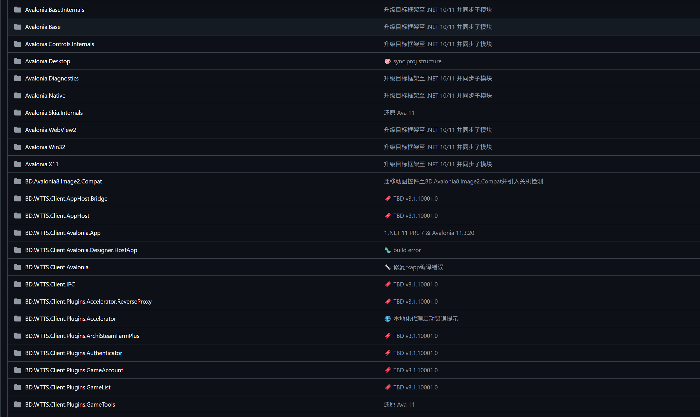
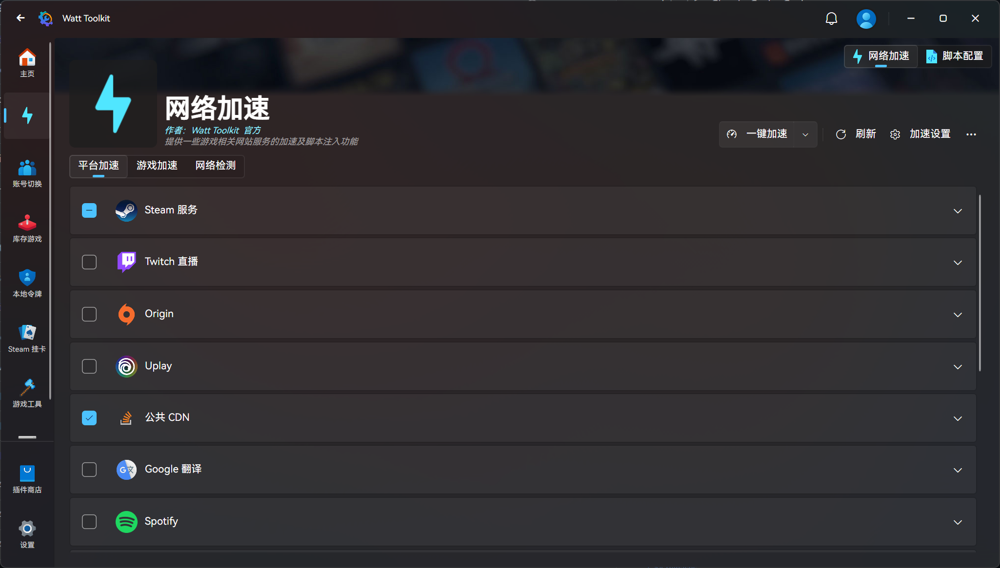
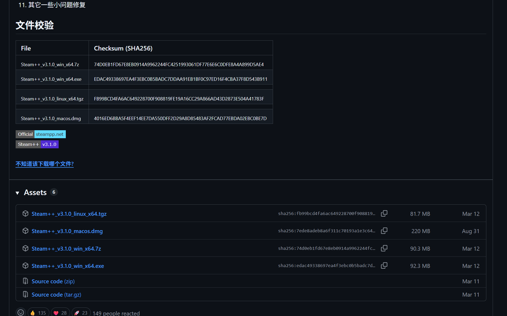

# TractorTool 项目历史记录

本文件保存已经结束的实施轮次、当时的命令、失败与验收证据；**不在 Agent 默认阅读链中**。当前状态和待办只看 [DEVELOPMENT.md](DEVELOPMENT.md#current-status)，现行设计看 [ARCHITECTURE.md](ARCHITECTURE.md)。需要追查具体问题时，通过下面索引定位，或用 `rg -n 'E编号|关键词' Docs/PROJECT_HISTORY.md` 搜索对应片段，不必通读。

## 阅读约定

- 归档表示某轮实施结束，不代表其所属阶段的验收全部通过；当前阶段及未关闭项以开发台账为准。
- 原记录中的“本轮”“当前”“下一步”仅指记录发生时；旧方案、版本、产物路径和命令不可直接当作当前操作指南。
- 历史通过只覆盖当时的代码。早期 artifacts 曾被外部清理，保留日志路径不保证文件仍存在；失败、未执行及证据缺口均保留。
- E01–E20 最初从开发文档迁入，此后轮次按 E 编号追加；保留当时日期、结果和命令，不补造运行证据。
- E45 已删除 `Build-ClipboardPlugin.ps1` / `Build-VideoPlugin.ps1`，并将 `Verify-M1.ps1` 改名；下文旧命令保留为历史证据，当前操作见 [插件构建规范](PLUGIN_DEVELOPMENT.md#6-开发构建与安装验证) 和 [检查入口](DEVELOPMENT.md#workflow)。

## 记录索引

| 阶段 | 记录 |
| --- | --- |
| 公共页面切换 | [E100 · 页面切换时序，保留原动画（2026-10-11）](#evidence-page-entrance) |
| 框架可靠性与打包 | [E99 · 可选 MVVM、Job 通知等待、管道清理（2026-10-11）](#evidence-framework-packaging-process) |
| 发布精简（自动发现插件） | [E98 · 删除额外名单，按源码目录识别（2026-10-09）](#evidence-distribution-discovery) |
| 发布通用化（随包插件选择） | [E97 · 工程清单与产物快照校验（2026-10-09）](#evidence-distribution-plugins) |
| 硬件显示与诊断（HUD） | [E96 · 传感器类型图标与 CPU 访问条件（2026-10-09）](#evidence-hud-hardware-types) |
| 界面精简（HUD 草稿预览） | [E95 · 删除桌面草稿预览入口与逻辑（2026-10-09）](#evidence-hud-remove-draft-preview) |
| 全量代码审查（HUD 插件） | [E94 · 三名子代理全量 Review，2 项 P2 待修复（2026-10-09）](#evidence-hud-full-review) |
| 实现与离屏验证（HUD 独立采样间隔） | [E93 · 按方案设置 0.2–600 秒与到期缓存（2026-10-09）](#evidence-hud-sampling-interval) |
| 只读运行观察（HUD 当前进程） | [E92 · 已运行软件的一分钟性能观察（2026-10-09）](#evidence-hud-live-performance) |
| 修正与离屏验证（HUD 输入/切换） | [E91 · 数字输入、完整读数替换及切换动效（2026-10-09）](#evidence-hud-switching) |
| 修正与离屏验证（HUD 拖动采样） | [E90 · 位置保存不重置采样，托盘方案暂缓（2026-10-09）](#evidence-hud-drag-sampling) |
| 素材替换（HUD Fluent 功能图标） | [E89 · Gauge 彩色仪表盘（2026-10-09）](#evidence-hud-fluent-icon) |
| 修正与离屏验证（HUD 颜色/轮播） | [E86 · 可视化选色与左侧独立轮播（2026-10-08）](#evidence-hud-color-rotation) |
| 页面与离屏验证（HUD 编辑分组） | [E87 · 编辑预览合并与紧凑表单（2026-10-08）](#evidence-hud-preview-panel) |
| 插件调整与接口交接（HUD 开关/图标） | [E88 · 系统数据HUD 名称、现成图标与双开关（2026-10-09）](#evidence-hud-controls) |
| 修正与离屏验证（HUD 稳定宽度） | [E85 · 稳定长条与完整余额标题（2026-10-08）](#evidence-hud-stable-strip) |
| 修正与离屏验证（HUD 自适应） | [E84 · 图标描边、内容收紧与长条/时间对齐（2026-10-08）](#evidence-hud-content-sizing) |
| 修正与离屏验证（HUD 身份组） | [E83 · 所有指标统一图标与名称横排（2026-10-08）](#evidence-hud-inline-identity) |
| 修正与离屏验证（HUD 结构） | [E82 · 左右分组、整体比例与字形居中（2026-10-08）](#evidence-hud-grouped-structure) |
| 修正与离屏验证（HUD 详情） | [E81 · 即时收起与详细态层级（2026-10-07）](#evidence-hud-detail-refinement) |
| 修正与离屏验证（HUD 输入） | [E80 · 点击响应、整岛反馈与长条布局复核（2026-10-07）](#evidence-hud-input-review) |
| 修正与离屏验证（HUD 绑定/布局） | [E79 · 修正绑定串型、状态重排并合并编辑预览（2026-10-07）](#evidence-hud-binding-review) |
| 修正与精简（HUD 内部布局） | [E78 · 删除误加的区域编辑器并修正排版（2026-10-07）](#evidence-hud-built-in-layout) |
| 修正与交互（HUD 三态） | [E77 · 空白回退修正与同指标区域布局（2026-10-07）](#evidence-hud-three-state-layout) |
| 交互（HUD 形变） | [E76 · 紧凑尺寸、整岛弹性形变与原生轮廓（2026-10-07）](#evidence-hud-morph) |
| 交互（HUD 横条与详情） | [E75 · 横向摘要、点击展开与拖动分离（2026-10-07）](#evidence-hud-compact-interaction) |
| 样式（HUD 胶囊） | [E74 · Apple 灵动岛风格卡片（2026-10-07）](#evidence-hud-island-style) |
| 修正（HUD 拖动与对齐） | [E73 · 原生拖动定位、边缘滚动与双栏标题（2026-10-07）](#evidence-hud-drag-layout) |
| 修正（HUD 分栏） | [E72 · 左右工作区与窄窗口滚动（2026-10-07）](#evidence-hud-responsive-layout) |
| 文档（框架结构与精简） | [E71 · 软件框架导航、架构边界与文档分工（2026-10-07）](#evidence-framework-source-guide) |
| HUD 源码组织 | [E70 · 按内部职责整理源码目录（2026-10-07）](#evidence-hud-folders) |
| HUD 第一版 | [E69 · 首版高级数据源与插件内部职责设计（2026-10-07）](#evidence-hud-v1) |
| HUD 第二步 | [E68 · 多方案、轮播、模板、颜色规则与编辑预览（2026-10-07）](#evidence-hud-profiles) |
| 修正（插件框架依赖） | [E67 · SDK 平台清单与私有依赖边界（2026-10-07）](#evidence-framework-assembly-inventory) |
| 修正（HUD 启动与页面） | [E66 · Win32 框架程序集解析与主页面/设置分工（2026-10-07）](#evidence-hud-startup-page) |
| 新插件（HUD 第一步） | [E65 · 原生电源通知与基础桌面状态（2026-10-07）](#evidence-system-hud) |
| 修正（测试日志） | [E64 · 独立插件移除定时心跳（2026-10-06）](#evidence-quiet-probe) |
| 扩展（插件托盘） | [E63 · 托盘菜单与生命周期（2026-10-06）](#evidence-plugin-tray) |
| 反馈（本机测试） | [E62 · 用户测试暂未发现问题（2026-10-05）](#evidence-user-local-validation) |
| M5（依赖复审与 Release） | [E61 · 恢复保护与发布草稿（2026-10-05）](#evidence-dependency-review-release) |
| M5（GitHub 依赖） | [E60 · GitHub 来源与简化管理（2026-10-05）](#evidence-github-dependencies) |
| M5（依赖管理交互） | [E59 · 目录浏览与客户端操作（2026-10-05）](#evidence-dependency-catalog-ui) |
| M5（依赖测试交付） | [E58 · 本地目录刷新与隔离测试包（2026-10-05）](#evidence-dependency-sandbox) |
| 排查（源状态与预览器） | [E57 · 禁用原因与 Debug 绑定核对（2026-10-05）](#evidence-source-preview-diagnostics) |
| M5（外部依赖通用化） | [E56 · 可信索引刷新与第二工具接入（2026-10-05）](#evidence-package-sources) |
| 维护（导航页面回收） | [E55 · 公共导航内存修复与隔离回归（2026-10-05）](#evidence-navigation-memory-fix) |
| 调查（发布版内存） | [E54 · 内存计数与导航事件持有路径（2026-10-05）](#evidence-memory-investigation) |
| 维护（标题栏图文） | [E53 · 轻量标题栏标识（2026-10-05）](#evidence-titlebar-branding) |
| 维护（视频参数标题） | [E52 · 导出参数标题与左右对齐（2026-10-05）](#evidence-video-parameter-heading) |
| 文档（当前状态整理） | [E51 · 验证分层、产物入口与交接整理（2026-10-05）](#evidence-docs-current-state) |
| 文档（脚本说明） | [E50 · 脚本用途、调用关系与产物说明（2026-10-05）](#evidence-scripts-readme) |
| 维护（设置与标题栏） | [E49 · 设置折叠分组与标题栏留白（2026-10-05）](#evidence-settings-chrome) |
| 开发体验（本地发布） | [E48 · VS Code 交互式发布入口（2026-10-05）](#evidence-vscode-publish) |
| 维护（视频导出布局） | [E47 · 固定输出操作栏与按钮层级（2026-10-05）](#evidence-video-output-bar) |
| 维护（剪贴板布局） | [E46 · 剪贴板底部留白与独立更新包（2026-10-05）](#evidence-clipboard-bottom-spacing) |
| 维护（脚本精简） | [E45 · 删除重复打包入口与验证脚本改名（2026-10-05）](#evidence-script-cleanup) |
| 文档（GitHub 首页） | [E44 · 项目 README 与文档入口（2026-10-05）](#evidence-project-readme) |
| M5（用户级安装器） | [E43 · 安装、升级/卸载保留与双代理复审（2026-10-05）](#evidence-installer) |
| M5（三代理分发复审） | [E42 · 路径、ZIP 校验和构建环境修正（2026-10-04）](#evidence-distribution-review) |
| M5（统一分发） | [E41 · 本地/CI 共用 ZIP、许可及静态校验（2026-10-04）](#evidence-distribution) |
| M5（复核与文档整理） | [E40 · 启动复核与当前台账整理（2026-10-04）](#evidence-doc-review) |
| M5（启动交互修正） | [E39 · 主窗口内启动与迁移进度（2026-10-04）](#evidence-startup-shell) |
| M5（双代理复审） | [E38 · 迁移重试空间与快照取消修正（2026-10-04）](#evidence-migration-review) |
| M5（可靠性实现） | [E37 · 数据目录迁移与启动恢复（2026-10-04）](#evidence-data-migration) |
| M5（可靠性起步） | [E36 · 用户回归反馈与日志磁盘保留（2026-10-04）](#evidence-log-retention) |
| M4（用户反馈修正） | [E35 · 日志全部已读、底部跟随与管理冲突（2026-10-04）](#evidence-log-follow) |
| M4（用户反馈修正） | [E34 · 预设命名、公共任务归属与双代理复审（2026-10-04）](#evidence-preset-task-review) |
| M4（用户反馈修正） | [E33 · 日志/任务整合、错误提醒与取消诊断（2026-10-04）](#evidence-logs-tasks) |
| M4（实现补齐，运行待验） | [E32 · 公共有限任务、取消复审与 M4 交接（2026-10-04）](#evidence-m4-tasks) |
| M4（进行中） | [E31 · 视频码率模式、GPU 偏好与紧凑布局（2026-10-04）](#evidence-video-rate-control) |
| M4（进行中） | [E30 · 视频双功能工作区与多预设串行（2026-10-04）](#evidence-video-workspace) |
| M3（进行中） | [E29 · 框架边界复审与视频单次导出（2026-10-04）](#evidence-video-export) |
| 后续规划 | [E28 · Python / pip 依赖扩展边界（2026-10-04）](#evidence-python-plan) |
| M3（进行中） | [E27 · 依赖拒绝/缺失路径异常与全局计数修正（2026-10-04）](#evidence-dependency-feedback) |
| M3（进行中） | [E26 · 设置层级与视频读取入口（2026-10-04）](#evidence-settings-hierarchy) |
| M3（进行中） | [E25 · 依赖申请、引用清理与设置分类（2026-10-04）](#evidence-dependency-flow) |
| M1 | [E01 · 首轮工作与证据（2026-10-03）](#evidence-baseline) |
| M1 | [E02 · 用户截图反馈后的修正（2026-10-03）](#evidence-adjustment) |
| M1 | [E03 · 进一步 UI 反馈与参考源码调研（2026-10-03）](#evidence-research) |
| M1 | [E04 · 用户授权继续后的 UI 补完（2026-10-03）](#evidence-ui) |
| M1 | [E05 · 标题栏故障与核心代码审查修复（2026-10-03）](#evidence-review) |
| M1 | [E06 · 统一产品版本和应用图标（2026-10-03）](#evidence-version) |
| M1 | [E07 · 调试绑定错误与 VS Code 预览复核（2026-10-03）](#evidence-binding) |
| M1 | [E08 · 欢迎主页与已安装插件卡片（2026-10-03）](#evidence-home) |
| M1 | [E09 · Review 修复与彩色图标接入（2026-10-03）](#evidence-icons-review) |
| M1 | [E10 · 收紧导航按钮比例（2026-10-04）](#evidence-nav-density) |
| M1 | [E11 · 窗口大小变化时的正文对齐（2026-10-04）](#evidence-page-layout) |
| M1 | [E12 · GPT-6.1-Sol Review 与外观即时生效（2026-10-04）](#evidence-appearance-review) |
| M1 | [E13 · 移除常驻说明与深浅色过渡（2026-10-04）](#evidence-theme-transition) |
| M1 | [E14 · 设置预览与确定死代码清理（2026-10-04）](#evidence-settings-cleanup) |
| M1 | [E15 · 页面滚动条靠右（2026-10-04）](#evidence-scroll-edge) |
| M2（进行中） | [E16 · 本地 Git、插件管理与剪贴板插件（2026-10-04）](#evidence-m2) |
| M2（进行中） | [E17 · ZIP 拖放、启停开关与剪贴板重做（2026-10-04）](#evidence-clipboard-ux) |
| M2（进行中） | [E18 · 拖放边界、卡片布局与空选择绑定修复（2026-10-04）](#evidence-ui-fixes) |
| M2（进行中） | [E19 · VS Code 解决方案与插件开发组织（2026-10-04）](#evidence-project-layout) |
| M2（进行中） | [E20 · 公共 UI、宿主与插件样式职责复核（2026-10-04）](#evidence-style-ownership) |
| M2（进行中） | [E21 · 卡片信息/操作分组及旧插件绑定诊断（2026-10-04）](#evidence-card-layout) |
| M2（进行中） | [E22 · 统一动效与管理卡片原位更新（2026-10-04）](#evidence-shared-motion) |
| M3（进行中） | [E23 · M2 复审与公共进程服务起步（2026-10-04）](#evidence-process-service) |
| M3（进行中） | [E24 · 外部包事务、租约与设置入口（2026-10-04）](#evidence-package-service) |

按需补充：[M1 人工回归清单](#m1-manual-checklist)、[M1 阶段出口](#m1-exit)、[早期文档整理](#early-docs)、[UI 参考源码调研](#ui-reference)、[图标参考调研](#icon-reference)。

## M1：宿主基础与公共 UI

<a id="evidence-baseline"></a>

<details>
<summary>E01 · 首轮工作与证据（2026-10-03）</summary>

### E01 · 首轮工作与证据（2026-10-03）

- 初始源码与用户提供的起点一致：只有 Avalonia 初始工程。先阅读根 AGENTS 和三份文档，再检查文件；未覆盖已存在的额外业务实现。
- 环境：Windows `10.0.26200` / `win-x64`；SDK `10.0.401`、MSBuild `18.9.11`，已装运行时 `10.0.12`。
- 原项目 `dotnet restore` 通过。第一次 Debug 构建因沙箱禁止 Avalonia BuildServices 写本地日志失败；获得正常构建权限后重试成功，0 警告/0 错误。证据在 `artifacts/evidence/baseline-restore.txt`、`baseline-build.txt`、`baseline-build-retry.txt`。后续脚本使用 `-m:1 -nr:false`，避免复用受限的 MSBuild 节点。
- M1 主工程 Debug 构建通过。最终 Release 解决方案构建、自包含发布、独立插件构建、集成检查工程构建均通过，最终各构建 0 警告/0 错误。最初夹具的两个警告已修正；最终验证在用户接手测试前已启动并完成。
- **核心自动化 33/33 通过**：软件/数据/启动路径分离、默认/自定义指针、相对路径与目录重叠拒绝、不可用自定义目录不创建替代、配置版本、原子替换与备份、并发保存、写失败保留原文件、损坏配置/指针保留、插件设置隔离、实例锁、日志边界、清单/SDK/平台/路径校验、禁用/重复/坏 DLL/缺失 DLL、插件目录受阻不重定向。
- **发布产物集成及 Headless UI 21/21 通过**：宿主发布后单独编译测试插件，仅引用发布 SDK；加载真实 DLL/私有依赖；导航/设置工厂实例化；插件与宿主设置保存读取；主题应用；三个固定入口；页面切换/隐藏期间常驻活动继续；停止/释放；禁用/API/Avalonia/平台不匹配不执行构造器；入口/初始化/注册/页面异常；共享 SDK 副本冲突及缺少私有依赖；一个失败插件不阻止另一个加载。
- **独立发布证据**：先发布宿主并计算所有原有文件 SHA256，再构建/复制插件并测试；原有 **231 个宿主文件哈希全部未变**。不是源码引用或假加载。
- 最终证据目录：`artifacts/m1-20261003-153553-4b56cf/`；包含 `build.txt`、`core-checks.txt`、`publish.txt`、`plugin-build.txt`、`integration-build.txt`、`integration-checks.txt`、`host-hashes-before.json`、`host-hashes-after.json`、`hash-result.txt`。控制台汇总为 `artifacts/evidence/final-verification-console.txt`。测试数据和故障插件副本均隔离；核心检查额外使用随机命名的系统临时目录，位置打印于检查结果末尾。
- **真实 Windows 启动已观察到，交互未验收**：曾启动 `artifacts/m1-20261003-153221-489f42/host/TractorTool.exe --profile-root .../ui-profile`，窗口枚举返回 `TractorTool`，PID 45004（仅为当时观测）。该副本 `ui-profile/Logs` 记录启动、托盘创建、真实插件/私有依赖加载、常驻计数。托盘创建日志只证明程序执行到该分支，不证明用户实际可以点击恢复。
- Computer Use 获取/激活窗口被拒绝，返回 `Computer Use was not approved to use tractortool`，未取得窗口截图或交互结果。随后用户明确表示“测试部分我自己来就行”，**停止后续测试及 UI 操作，保留已启动的隔离窗口供用户检查**。
- 当前人工待验：Windows 真实主题/布局/导航、重启持久化、托盘隐藏/恢复/菜单退出、再次启动恢复、`--no-tray` 兜底。没有声称这些已通过。无界面测试不替代 Windows UI 验收。
- 先前文档整理的 Markdown 链接检查是历史记录，不能当作本次应用验证；本次已经核对工程依赖方向和未静态引用具体插件，文档修改后未再启动自动检查（用户已接手测试）。

</details>

<a id="evidence-adjustment"></a>

<details>
<summary>E02 · 用户截图反馈后的修正（2026-10-03）</summary>

### E02 · 用户截图反馈后的修正（2026-10-03）

- 用户指出初版主窗口纯黑、导航像普通按钮、左下角多出“退出”。这些属于 M1 视觉实现不足；之前的构建及 Headless 结果没有验证颜色和最终观感，不能据此宣称 UI 已完成验收。
- 已补充 `TractorTool.UI/Styles/ThemeResources.axaml`，使用深灰分层背景和对应浅色资源；宿主 Fluent palette 复用这些颜色。增加导航图标、选中/悬停、卡片及路径框样式；插件页整理为本地目录卡片和空状态。移除面向用户的 M1/M2/M3/M5 开发阶段文案。
- 左下角只保留三个固定入口，显式退出改在托盘及“设置 → 关于”；无托盘时的状态提示指向设置中的退出入口。
- 用户截图中的两项工作区诊断来自 `RequirePublishedSdk` / `RequirePublishedHost` 在 IDE 设计时也执行。现将其限制为正式构建；设计时通过条件项目引用提供 IntelliSense，正式构建仍用指定 `HostSdkDir` 的 DLL。独立插件新增同版本 Avalonia 12.1.2 的**仅编译引用**，不复制第二套 Avalonia 运行时，也不引用宿主/Core 实现。
- 已做源码与项目配置核对。生产宿主编译、独立插件正常构建、集成检查工程正常构建均 0 警告/0 错误；两个工程的 MSBuild 设计时 `Compile`（`SkipCompilerExecution=true`）及 `ReferencePath` 解析均成功。证据在 `artifacts/evidence/ui-adjustment-build.txt`、`ui-adjustment-plugin-build.txt`、`ui-adjustment-integration-build.txt`、`independent-design-time.txt`、`integration-design-time.txt`。
- **未执行新的自动化测试、集成程序或真实 UI 操作**，遵守用户自行测试的决定。未直接观察 VS Code 问题面板刷新，也未验证本次实际颜色/布局/托盘交互；旧的 33/21 项测试及发布哈希是修正前的证据，不自动适用于当前改动。
- M0 的定义从一开始就是需求、架构和 Agent 文档整理；文档已经存在。本轮没有跳过 M0，问题是 M1 视觉未达到参考效果。当时仅完成局部修正与编译；进一步反馈后的当前结论见[E03](#evidence-research)，不能继续写成只差人工验收。

本次实际执行的编译/设计时解析命令（未运行检查程序）：

```powershell
dotnet build TractorTool/TractorTool.csproj -c Debug -m:1 -nr:false --no-restore -o artifacts/ui-adjustment-build
dotnet restore tests/IndependentPlugin/IndependentPlugin.csproj -m:1 -nr:false
dotnet msbuild tests/IndependentPlugin/IndependentPlugin.csproj -t:Compile -p:DesignTimeBuild=true -p:BuildProjectReferences=false -p:SkipCompilerExecution=true -p:ProvideCommandLineArgs=true -m:1 -nr:false -getItem:ReferencePath
dotnet msbuild tests/TractorTool.IntegrationChecks/TractorTool.IntegrationChecks.csproj -t:Compile -p:DesignTimeBuild=true -p:BuildProjectReferences=false -p:SkipCompilerExecution=true -p:ProvideCommandLineArgs=true -m:1 -nr:false -getItem:ReferencePath
dotnet build tests/IndependentPlugin/IndependentPlugin.csproj -c Debug -m:1 -nr:false --no-restore -p:HostSdkDir=H:\ProjH\TractorTool\artifacts\m1-20261003-153553-4b56cf\host -o artifacts/ui-adjustment-plugin-build
dotnet build tests/TractorTool.IntegrationChecks/TractorTool.IntegrationChecks.csproj -c Debug -m:1 -nr:false --no-restore -p:HostSdkDir=H:\ProjH\TractorTool\artifacts\ui-adjustment-build -o artifacts/ui-adjustment-integration-build
```

</details>

<a id="evidence-research"></a>

<details>
<summary>E03 · 进一步 UI 反馈与参考源码调研（2026-10-03）</summary>

### E03 · 进一步 UI 反馈与参考源码调研（2026-10-03）

用户再次提供 Watt Toolkit 与 TractorTool 对比截图，指出整体 UI 不一致、切换动画缺失，并要求分析可复用实现。**当时结论：M1 基础设施已有实现，公共 UI 实现尚未完成；A01 未通过。** [E02](#evidence-adjustment)的改色和图标补丁没有解决完整界面组织问题。

这一调研轮只读源码、查询公开依赖及维护文档；后续授权实现见[E04](#evidence-ui)。当时源码核对发现：

- `MainWindow.axaml` 使用 `ColumnDefinitions="200,*"`、三个手写 PathIcon 与普通 ContentControl；没有页面过渡容器或动画。
- `SettingsView.axaml` 是多层 StackPanel，主题下拉框全宽拉伸；没有复用设置行和合理内容宽度约束。
- `MainViewModel` 直接创建插件管理、日志等控件；公共视觉规则未形成完整 View/模板体系。
- `IPluginPageRegistry` 只有 id/title/factory，没有图标元数据；当前共享程序集名单也未包含候选新控件库，需要随 UI SDK 一起处理。

参考源码依据、固定提交、候选版本和加载边界集中在 [架构 UI 参考依据](#ui-reference)。已确认 Watt 使用 FluentAvalonia 导航/Frame、定制设置行和现成过渡，彩色导航使用图片资源。首选评估 FluentAvaloniaUI 3.1.0 与统一 Fluent 图标；包元数据允许 net10.0/Avalonia 12.1.2 基线，但尚无本项目编译或运行证据。当时项目仍使用原来的 Avalonia.Themes.Fluent，没有接入这些候选依赖。

实际只读查询包括：

```powershell
git status --short # 返回 not a git repository；未创建或重置仓库
rg -n 'ContentControl|ColumnDefinitions|PathIcon|Transitions|Animation|CurrentPage|AddNavigationPage' TractorTool/Views/MainWindow.axaml TractorTool/ViewModels/MainViewModel.cs TractorTool.UI/PluginUi.cs
Invoke-RestMethod -Uri 'https://api.github.com/repos/BeyondDimension/SteamTools/git/trees/develop?recursive=1'
Invoke-WebRequest -Uri 'https://api.nuget.org/v3-flatcontainer/fluentavaloniaui/3.1.0/fluentavaloniaui.nuspec'
Invoke-WebRequest -Uri 'https://api.nuget.org/v3-flatcontainer/fluenticons.avalonia.fluent/2.1.333/fluenticons.avalonia.fluent.nuspec'
```

调研轮静态核对完成；当时构建、自动化测试、发布集成测试与真实 Windows UI 验证均**未执行**。用户自行测试的决定保持有效。参考软件的源码实现和包声明不是 TractorTool 的验收结果。

</details>

<a id="evidence-ui"></a>

<details>
<summary>E04 · 用户授权继续后的 UI 补完（2026-10-03）</summary>

### E04 · 用户授权继续后的 UI 补完（2026-10-03）

本轮从现有工作区继续，没有重建仓库或进入 M2。编辑前源码快照在 `artifacts/ui-foundation-before/`。用户自行测试的决定仍有效：**只进行了源码核对、还原、编译、隔离发布及文件哈希核对，没有运行应用、核心检查、Headless 或集成检查程序。**

实际改动：

- 新增 FluentAvaloniaUI 3.1.0，统一窗口、导航、控件主题、符号图标与 Frame；Avalonia 相关托管包统一 12.1.2、MVVM 保持 8.4.2。最终依赖清单在 `artifacts/ui-foundation-ready/ui-dependencies.txt`，不含旧 Avalonia.Themes.Fluent 或具体插件引用。
- 标题区与内容区统一；导航从 200 改为 88 逻辑单位的图文侧栏，底部只有日志/插件/设置。应用及托盘使用项目自绘图标，生成脚本为 `scripts/Generate-AppIcon.ps1`。
- 三个宿主页面独立为 View/VM。设置改为有内容宽度限制的分组设置行；插件页提供空态、版本/错误信息、名称查找与打开工具；日志页提供只读文本、复制、暂停和打开目录；页面工厂异常有重试与日志入口。
- 公共 SettingRow、ToolIcon、PageHost 和样式放在 UI 工程。切页使用 FAFrame 自带过渡，关闭缓存和导航栈；保存动画开关，保留离页清理与后台服务分离。标题栏仍调用既有关闭/托盘服务，未改变数据及插件目录语义。
- UI API 增至 1.1，保留 1.0 注册方法签名，接受旧 UI 1.0 清单；新元数据包含图标与说明。共享程序集增加 FluentAvalonia，插件不得携带共享副本。示例插件只通过已发布 Contracts/UI 编译，使用新公共设置行和图标。核心检查新增兼容性用例，集成检查同步错误页断言及新主题依赖；**这些用例仅编译，未执行**。

| 检查层级 | 本轮结果与限制 |
| --- | --- |
| 静态核对 | 已核对模板层级、绑定/页面工厂、插件依赖方向及最终依赖清单；修正跨模板导航选择器及派生窗口字体规则；59 个本地文档链接无缺失；不等于真实渲染通过 |
| 还原与构建 | 还原通过；宿主 Debug 构建通过。最终解决方案使用隔离中间/输出目录构建，0 警告/0 错误；独立插件及集成检查工程最终均 0 警告/0 错误 |
| 发布与文件 | win-x64 自包含发布成功；发布后独立构建插件，安装至该副本 Plugins/Test.Independent/1.0.0；原有 234 个宿主文件 SHA256 未变化 |
| 自动化测试 | 未执行；旧 33 项通过不覆盖新增兼容性/动画设置 |
| 集成/Headless 测试 | 未执行；独立编译和文件复制不等于真实加载。旧 21 项通过不覆盖新 UI 底座 |
| 真实 Windows UI | 未执行，由用户验收；标题栏、导航比例、主题、动效、DPI、托盘及重启持久化均不能记为通过 |

编译过程中曾修正缺少 Clipboard/资源查找扩展命名空间、示例注册参数顺序；最终编译通过。默认 Debug 解决方案构建另遇 `AVLN9999`：`TractorTool/obj/Debug/net10.0/TractorTool.dll` 被其他进程占用。未终止用户进程，改用各项目 `obj/UIFoundation/`、`bin/UIFoundation/` 构建成功；不声称默认 Debug 文件占用已解除。

最终产物为 `artifacts/ui-foundation-ready/`：`host/` 已放入独立测试插件，`plugin/` 是插件编译输出，`checks/` 是只编译未运行的集成程序；`host-hashes-before.json`、`host-hashes-after.json`、`hash-result.txt` 记录 234/0 的文件结果。默认运行不触碰真实用户数据需要使用[开发操作](DEVELOPMENT.md#workflow)的 profile 参数。

实际命令（从仓库根目录执行，均未启动测试）：

```powershell
dotnet restore TractorTool.slnx -m:1 -nr:false
dotnet build TractorTool/TractorTool.csproj -c Debug -m:1 -nr:false --no-restore -o artifacts/ui-foundation-build
# 默认构建遇到中间文件占用；保留失败日志，随后用独立目录成功编译
dotnet build TractorTool.slnx -c Debug -m:1 -nr:false
dotnet build TractorTool.slnx -c Debug -m:1 -nr:false --no-restore -p:IntermediateOutputPath=obj/UIFoundation/ -p:OutputPath=bin/UIFoundation/
# 最终发布目标当时为空；此命令不会覆盖已有发布目录
./scripts/Publish-Host.ps1 -Output H:/ProjH/TractorTool/artifacts/ui-foundation-ready/host
dotnet build tests/IndependentPlugin/IndependentPlugin.csproj -c Release -m:1 -nr:false --no-restore -p:HostSdkDir=H:/ProjH/TractorTool/artifacts/ui-foundation-ready/host -o artifacts/ui-foundation-ready/plugin
dotnet build tests/TractorTool.IntegrationChecks/TractorTool.IntegrationChecks.csproj -c Release -m:1 -nr:false --no-restore -p:HostSdkDir=H:/ProjH/TractorTool/artifacts/ui-foundation-ready/host -o artifacts/ui-foundation-ready/checks
```

文件核对使用 `Get-FileHash -Algorithm SHA256`，发布后先枚举宿主文件，插件构建/复制后只对相同路径再次计算。执行记录为 `artifacts/evidence/ui-foundation-restore.txt`、`ui-foundation-build.txt`、`ui-foundation-solution-build.txt`（文件占用失败）、`ui-foundation-solution-build-isolated.txt`、`ui-foundation-ready-publish.txt`、`ui-foundation-ready-plugin-build.txt`、`ui-foundation-ready-integration-build.txt`。早期试编译及中间发布 `ui-foundation-publish/`、`ui-foundation-final/` 也保留；最后修正了派生窗口的字体样式匹配，用户应使用包含该修正的 ready 副本。

</details>

<a id="evidence-review"></a>

<details>
<summary>E05 · 标题栏故障与核心代码审查修复（2026-10-03）</summary>

### E05 · 标题栏故障与核心代码审查修复（2026-10-03）

用户报告窗口无法拖动，要求参考软件实现并让子代理审查核心代码；同时明确日常 IDE 为 **VS Code**。已按阅读顺序核对文档/实际源码，保留现有 `.vscode/launch.json`，未切换 IDE。修改前快照为 `artifacts/drag-review-before/`。

标题栏根因：`ExtendsContentIntoTitleBar` 只调整内容/标题布局，自定义 Border 覆盖了框架默认的 TitleBar 区域，却没有声明 Avalonia 12 非客户区角色。已在 `TitleBarDragRegion` 设置 `WindowDecorationProperties.ElementRole="TitleBar"`，纯图文内容设置 `IsHitTestVisible=false`，保留库的系统按钮。复核了 Watt 固定提交的 TitleBar、FluentAvalonia 3.1 的窗口模板/Windows 适配，以及 [Avalonia 12 窗口说明](https://docs.avaloniaui.net/docs/app-development/window-management)；没有照搬旧 Avalonia 11 的标题栏属性，也没有叠加自写 Win32 拖动逻辑。**故障来自用户实际反馈，修复后的拖动/双击/缩放尚未实机验证。**

三个子代理分别审查插件加载与生命周期、存储与恢复、UI 导航。修复了确认的问题，并对退出/路径及最终导航代码做二次只读复核：

- 同一 profile 有无末尾分隔符必须产生同一 Windows 恢复事件，复用实例锁的 `AppPaths.Absolute` 规则。
- 目录包含判断不再给卷根重复追加分隔符；拒绝卷根 DataRoot，避免错误创建业务目录或绕过插件/数据互含限制。
- 私有托管/本机依赖与入口 DLL 共享版本包路径校验；拒绝解析出包外路径及包内任何父级链接。没有把加载上下文当作安全沙箱。
- 显式退出先阻止新保存和界面操作，已有宿主保存与插件停止共用外层 10 秒等待，之后释放锁和关闭；超时记日志。
- 每个插件独立取消、共享幂等清理任务；按初始化完成 → Stop → Background/取消回调完成 → Dispose 的顺序清理。取消回调异常不跳过其他实例，超时不并发释放仍在运行的对象；晚于退出快照完成构造/初始化的实例仍纳入清理且不注册 UI。内部统一等待 9 秒，超时继续观察迟到结束。
- PageHost 用同步 presenter 回报成功/取消/异常；成功后才提交标题/选择并清理旧页，取消保留旧页，失败换掉内部状态可能受损的 Frame 后显示错误页。拒绝已有父级的候选页面，阻止导航重入和退出后工厂调用；保留 FAFrame 过渡。FANavigationView 自行选中的项目也恢复到实际已提交的选择。

新增 7 项路径回归、5 项生命周期/设置/标题栏检查和 5 项导航检查（均为源码用例）。生命周期夹具仍单独构建成真实插件 DLL，只依赖 Contracts/UI，通过每例隔离插件数据目录中的标记控制延迟，失败后也释放等待条件。**没有执行这些检查，不把已编译写成已通过测试。**

| 检查层级 | 本轮事实 |
| --- | --- |
| 静态检查 | 三份专项审查及二次复核已完成；依赖方向、文档链接与源码差异另记录于 `artifacts/evidence/drag-review-static.txt`；不代表运行正确性 |
| 构建与发布 | 核心检查工程、完整解决方案隔离 Debug 构建、Release 发布、发布后独立插件和集成工程编译均成功；各 build 汇总 0 警告/0 错误；发布包含正常还原 |
| 文件集成准备 | 新副本 `artifacts/drag-review/host` 已复制独立示例插件；构建/复制插件前后的 234 个原有宿主文件 SHA256 全部一致，没有重编宿主 |
| 自动化/集成/Headless | 本轮未执行；新增回归只编译。旧 33/21 项结果不覆盖本轮修复 |
| 真实 Windows UI | 本轮未启动或操作，由用户手测；标题栏、页面动画/取消、保存后立即退出、托盘及等价路径恢复均未验收 |

实际命令（仅构建/发布，未运行应用或检查程序）：

```powershell
dotnet build tests/TractorTool.Checks/TractorTool.Checks.csproj -c Debug -m:1 -nr:false --no-restore -p:IntermediateOutputPath=obj/DragReview/ -p:OutputPath=bin/DragReview/
dotnet build TractorTool.slnx -c Debug -m:1 -nr:false --no-restore -p:IntermediateOutputPath=obj/DragReview/ -p:OutputPath=bin/DragReview/
./scripts/Publish-Host.ps1 -Output H:/ProjH/TractorTool/artifacts/drag-review/host
dotnet build tests/IndependentPlugin/IndependentPlugin.csproj -c Release -m:1 -nr:false --no-restore -p:HostSdkDir=H:/ProjH/TractorTool/artifacts/drag-review/host -o artifacts/drag-review/plugin
dotnet build tests/TractorTool.IntegrationChecks/TractorTool.IntegrationChecks.csproj -c Release -m:1 -nr:false --no-restore -p:HostSdkDir=H:/ProjH/TractorTool/artifacts/drag-review/host -o artifacts/drag-review/checks
```

日志分别为 `artifacts/evidence/drag-review-core-build.txt`、`drag-review-solution-build.txt`、`drag-review-publish.txt`、`drag-review-plugin-build.txt`、`drag-review-integration-build.txt`。文件核对仍用 `Get-FileHash -Algorithm SHA256`，JSON 清单和 `hash-result.txt` 位于 `artifacts/drag-review/`。没有执行 Verify-M1.ps1，因为用户已经接手测试。默认 Debug 的旧文件占用未重新验证，也没有结束任何用户进程。

边界：进程内插件同步卡死构造/注册、任意延迟绘制/异步事件异常仍可能影响整个进程；有界退出不能保证不合作插件或持续阻塞磁盘一定完成。M1 继续待验收，未进入 M2。

</details>

<a id="evidence-version"></a>

<details>
<summary>E06 · 统一产品版本和应用图标（2026-10-03）</summary>

### E06 · 统一产品版本和应用图标（2026-10-03）

用户指出版本显示写死，并要求扳手/瑞士军刀主题图标。已确认关于页的 `0.1.0` 是重复字面量，且之前全局固定 AssemblyVersion 使宿主文件版本也停留在 `1.0.0.0`。

- 根 `Directory.Build.props` 的 `Version` 继续作为唯一默认产品版本；当前仍为 `0.1.0`，没有无依据升版。关于页通过 `SettingsViewModel.ApplicationVersion` 读取宿主 `AppInfo.Version`，启动日志复用同一值。宿主程序集/文件版本交给 SDK 派生；公开 SDK 库的程序集身份和 API/UI 兼容版本保持不变。
- `Publish-Host.ps1` 新增可选 `-Version` 参数，直接传递 MSBuild Version；普通发布仍使用根配置，界面无需同步改字面量。Win32 manifest 的固定激活标识增加说明，不与产品版本混淆。
- 使用内置 imagegen 生成透明的红色折叠工具柄、银色扳手和短螺丝刀图标。母版及提示词位于 `Artwork/`，窗口/关于页/EXE/托盘全部继续引用同一套导出资源。更新 Generate-AppIcon.ps1，导出 256 PNG 和含 8 个尺寸的 ICO；没有增加运行时图像依赖。
- 修改前曾备份到 `artifacts/version-icon-before/`，该目录随后随 artifacts 被外部清理；开发 IDE 和现有 `.vscode` 配置未改。

验证事实：隔离编译 `-p:Version=0.1.0-version-check` 成功，0 警告/0 错误；读取产物元数据得到产品版本 `0.1.0-version-check`、文件版本 `0.1.0.0`，Contracts/UI 的 AssemblyVersion 仍为 `1.0.0.0`。随后使用默认版本正常发布，新 EXE 和 DLL 的产品版本均为 `0.1.0`、文件版本均为 `0.1.0.0`。独立插件和集成检查工程也重新编译成功，均 0 警告/0 错误，复制插件后原有 234 个宿主文件哈希未变。

已查看导出的 PNG，核对透明通道及 ICO 的 16/20/24/32/48/64/128/256 尺寸目录。文档链接、版本字面量和脚本语法做静态检查。**没有运行应用、自动化/集成/Headless 测试或真实 Windows UI；以上不是关于页实际显示、托盘可辨识度和 Windows 图标缓存刷新的运行证据。**

首批构建/发布成功后，发现 artifacts 已在外部被清理，因此重新生成下列最终副本及日志。一次文件复制核对因源目录消失而未完成，其空清单输出已明确标记 INVALID，不作为证据；最终完整清单记录 234/0。

实际执行命令（最终重建副本；Generate-AppIcon 在清理前已成功导出至源码 Assets）：

```powershell
./scripts/Generate-AppIcon.ps1
dotnet build TractorTool/TractorTool.csproj -c Release -m:1 -nr:false --no-restore -p:Version=0.1.0-version-check -p:IntermediateOutputPath=obj/VersionProbe/ -p:OutputPath=bin/VersionProbe/
./scripts/Publish-Host.ps1 -Output H:/ProjH/TractorTool/artifacts/version-icon-final/host
dotnet build tests/IndependentPlugin/IndependentPlugin.csproj -c Release -m:1 -nr:false --no-restore -p:HostSdkDir=H:/ProjH/TractorTool/artifacts/version-icon-final/host -o artifacts/version-icon-final/plugin
dotnet build tests/TractorTool.IntegrationChecks/TractorTool.IntegrationChecks.csproj -c Release -m:1 -nr:false --no-restore -p:HostSdkDir=H:/ProjH/TractorTool/artifacts/version-icon-final/host -o artifacts/version-icon-final/checks
```

证据：`artifacts/evidence/version-icon-override-build.txt`、`version-icon-override-metadata.json`、`version-icon-publish.txt`、`version-icon-published-metadata.json`、`version-icon-plugin-build.txt`、`version-icon-integration-build.txt`、`version-icon-assets.txt`、`version-icon-static.txt`，以及 `artifacts/version-icon-final/host-hashes-*.json` / `hash-result.txt`。该次隔离副本为 `artifacts/version-icon-final/host`，包含上一轮拖动/导航/退出修复和示例插件，尚未启动。

</details>

<a id="evidence-binding"></a>

<details>
<summary>E07 · 调试绑定错误与 VS Code 预览复核（2026-10-03）</summary>

### E07 · 调试绑定错误与 VS Code 预览复核（2026-10-03）

用户截图暴露了此前静态审查的遗漏，不能把已有编译/Review 记录当作运行绑定无误的证明。

- `PluginsView` 的 `!!OperationStatus` 把字符串交给布尔转换，空字符串会产生截图中的运行绑定错误。同页 `!!DirectoryError` 存在同类问题。改为 VM 的 `HasOperationStatus` / `HasDirectoryError` 布尔属性，使用 `IsNullOrWhiteSpace`，并在对应源字段上添加 `NotifyPropertyChangedFor`，保证状态更新后可见性跟随变化。
- 复用 UI 子代理只读审查全部 5 个宿主 AXAML、ViewModel、导航模板、共享设置行/图标/主题，核对 DataContext、命令来源、通知和控件属性。剩余 `!` 绑定均用于 bool；没有发现新的确定 P1/P2 绑定问题。另修正 `caption` 只匹配 `TextBlock` 的样式遗漏，使用 `:is(TextBlock).caption` 覆盖可选择的插件路径文字；类型关系依据 [Avalonia 12.1.2 源码](https://github.com/AvaloniaUI/Avalonia/blob/12.1.2/src/Avalonia.Controls/SelectableTextBlock.cs)。此审查范围不代表全仓库没有缺陷。
- `ApplicationVersion` 当前在 SettingsViewModel 中确实存在，MainViewModel 也设置了正确的页面 DataContext。此次重建前，默认 Debug DLL 就已有该公共属性，不能诊断为当前源码或磁盘 DLL 缺少属性。读取 VS Code Avalonia 扩展 12.4.3 的既有日志，确认 18:03:40 预览仍报告缺失，扩展也记录了构建期间 `SIGSTOP` / `SIGCONT` 不支持。预览进程使用旧程序集/旧元数据是当前推断，尚未确认其内部状态或唯一根因。
- 已实际更新 VS Code 默认 `bin/Debug/net10.0` / `obj/Debug/net10.0` 产物；只读 PE 元数据确认 `ApplicationVersion`、`HasOperationStatus`、`HasDirectoryError` 在这两个宿主 DLL 中都有公共 getter。没有删除 obj/bin、结束用户进程、修改 VS Code 配置或升级依赖。

实际构建命令（第一条在 caption 修正前，第二条在全部源码修正后成功）：

```powershell
dotnet build TractorTool/TractorTool.csproj -c Debug -m:1 -nr:false --no-restore -p:IntermediateOutputPath=obj/BindingFix/ -p:OutputPath=bin/BindingFix/
dotnet build TractorTool/TractorTool.csproj -c Debug -m:1 -nr:false --no-restore
```

| 检查类型 | 本次结果 |
| --- | --- |
| 静态审查 | 上述源码/通知/样式复核完成；宿主及共享 AXAML 无 `!!` 绑定；默认 bin/obj 的 6 条属性核对全部存在 |
| 构建 | 两条命令均 0 警告、0 错误；本次默认 Debug 未复现早前的文件占用 |
| 自动化 / 集成 / Headless 测试 | 未执行，继续遵守用户自行测试的决定 |
| 真实 Windows UI / VS Code 预览刷新 | 未操作、未验证；不能宣称绑定日志已在真实运行中清零或预览已恢复 |

证据位于 `artifacts/evidence/binding-fix-build.txt`、`binding-fix-default-debug-build.txt`、`binding-fix-metadata.json`、`binding-fix-static.txt`、`binding-fix-previewer-log.txt`。元数据通过 PowerShell 的 `PEReader` / `MetadataReader` 读取，没有执行应用程序集。预览日志是用户既有会话的只读摘录，不是本轮运行测试。

本次未重新发布；**`version-icon-final` 是[E06](#evidence-version)的旧发布副本，不含此次绑定和 caption 修正**。最新修正位于源码及默认 Debug 输出。用户可先在预览错误页点击 **Restart Previewer** 使其重新加载已构建的程序集；以后改动 C# 属性需先 **Rebuild Project**。若预览仍保持旧状态，可执行 `Developer: Reload Window`。以上操作尚未代用户执行；恢复后再确认关于页版本、插件页空状态及打开目录失败提示。M1 仍待运行验收，不进入 M2。

</details>

<a id="evidence-home"></a>

<details>
<summary>E08 · 欢迎主页与已安装插件卡片（2026-10-03）</summary>

### E08 · 欢迎主页与已安装插件卡片（2026-10-03）

用户要求参考 Watt 的主页显示欢迎内容与已安装插件。核对固定提交的 HomePage.axaml / HomePageViewModel.cs，参考文本存放在 `artifacts/reference-icons/`；采用其卡片聚合与导航思路，没有复制参考源码或素材。修改前快照为 `artifacts/home-before-20261003-184852/`。开发 IDE 仍为 VS Code，依赖版本未变。

- 新增 HomeView/VM，启动默认进入主页，左侧第一项为主页，底部保留日志/插件/设置。欢迎区使用已有应用图标，提供插件管理和外观设置入口。
- 安装卡片复用 PluginsViewModel 的真实记录及导航命令，显示名称、版本、说明和状态；可打开的记录进入首个普通页面，其余进入插件页。按可用宽度换行，沿用统一主题与 Frame 动效，不提前创建插件页面。主页不受管理页搜索影响，启动加载完成也不强制改回主页。
- 加载中、未安装、目录不可用明确区分。单色 Home 图标追加至现有枚举末尾，未改变原值、注册签名或 API/UI 兼容版本。彩色导航素材和图片协议仍待实现，本次未将该项标为完成。
- 集成工程新增 4 项主页检查，覆盖默认加载态、真实插件卡片及搜索隔离、空安装、目录受阻；已有独立页面、注册、故障与导航取消检查同步更新，覆盖卡片复用导航、失败入口回退和启动期间保留已选页面。**仅编译这些用例，未执行。**

| 检查层级 | 本次结果 |
| --- | --- |
| 静态 | 核对新 AXAML 的类型/布尔可见性、数据来源、命令与选择同步、旧图标枚举顺序、文档链接；未发现新的确定问题，不能证明实际布局无误 |
| 构建 | 默认 Debug 构建通过，0 警告/0 错误；独立插件与集成工程均 0 警告/0 错误 |
| 发布与文件 | win-x64 自包含发布成功；发布后单独构建并复制示例插件，234 个原有宿主文件 SHA256 未变 |
| 自动化 / 集成 / Headless | 未执行；遵守用户自行测试的决定 |
| 真实 Windows UI / VS Code 预览 | 未启动或操作；欢迎布局、卡片换行/键盘/长名称/主题、点击与导航选择、返回主页均待用户验收 |

首次受限 Debug 构建在 AvaloniaStatsTask 写入 `LocalAppData/AvaloniaUI/BuildServices/buildtasks.log` 时权限失败；允许必要的构建日志写入后，同一构建命令成功。没有关闭构建任务、改动依赖或结束用户进程。失败与成功日志分别为 `artifacts/evidence/home-debug-build.txt`、`home-debug-build-approved.txt`。

实际命令（前三类只编译/发布，没有运行应用或检查程序）：

```powershell
dotnet build TractorTool/TractorTool.csproj -c Debug -m:1 -nr:false --no-restore
./scripts/Publish-Host.ps1 -Output H:/ProjH/TractorTool/artifacts/home-ready/host
dotnet build tests/IndependentPlugin/IndependentPlugin.csproj -c Release -m:1 -nr:false --no-restore -p:HostSdkDir=H:/ProjH/TractorTool/artifacts/home-ready/host -o artifacts/home-ready/plugin
dotnet build tests/TractorTool.IntegrationChecks/TractorTool.IntegrationChecks.csproj -c Release -m:1 -nr:false --no-restore -p:HostSdkDir=H:/ProjH/TractorTool/artifacts/home-ready/host -o artifacts/home-ready/checks
```

发布、插件及集成编译日志为 `artifacts/evidence/home-publish.txt`、`home-plugin-build.txt`、`home-integration-build.txt`。`artifacts/home-ready/host` 已放入 `Plugins/Test.Independent/1.0.0`；文件清单和 `hash-result.json` 位于 `artifacts/home-ready/`，使用 Get-FileHash 对发布前后相同的原有宿主路径计算。源码/文档静态核对记录为 `artifacts/evidence/home-static.json`。

用户可从仓库根目录执行下面的隔离启动命令；**此命令仅供用户验收，本轮未执行**。该副本同时含 E07 的绑定修正：

```powershell
& .\artifacts\home-ready\host\TractorTool.exe --profile-root H:\ProjH\TractorTool\artifacts\home-manual-profile
```

默认 VS Code 调试仍使用其原有启动配置。不要用缺少本次主页及绑定修正的旧发布副本判断结果。M1 保持待验收，未进入 M2。

</details>

<a id="evidence-icons-review"></a>

<details>
<summary>E09 · Review 修复与彩色图标接入（2026-10-03）</summary>

### E09 · Review 修复与彩色图标接入（2026-10-03）

按用户要求继续 Review 并补齐 M1 图标。复用 review_ui 子代理进行两轮只读审查：首轮确认问题，修正后复核初始化、状态通知、绑定、图片所有权和公开 SDK；复审未发现额外确定缺陷，不代表证明没有其他缺陷。审查没有运行程序。修改前主要文件快照在 `artifacts/icons-review-before-20261003-190421/`。

| 确认的问题 | 修正 |
| --- | --- |
| MainViewModel 再次初始化会重复追加导航和设置入口，虽然底层插件只加载一次 | 缓存整次初始化 Task，在 UI 线程共用首次结果；重复及并发调用都不重复构建入口 |
| 插件页加载时显示“无匹配”，目录不可访问时又同时显示“未安装” | 引入加载状态；空态、搜索无结果排除加载和目录错误，补齐派生属性通知与 AXAML 条件 |

继续补完的图标能力：

- 固定来源的 Fluent Emoji 3D PNG 用于主页/日志/插件/设置导航，示例插件使用随包拼图图片；设置操作继续使用现有单色符号。没有升级依赖或增加图标运行库。来源提交、5 张原文件 SHA256 和 MIT 许可见 `artifacts/reference-emoji/`、[Artwork](../Artwork/README.md)、[第三方声明](../THIRD-PARTY-NOTICES.md)。素材原图已查看，不等同于实际 UI 显示验收。
- UI API 1.2 新增可选 IconPath，保留原构造函数、注册签名、枚举旧值和共享程序集身份；源代码兼容规则接受 1.0/1.1/1.2。还只读核对了旧 home-ready SDK 的 SettingRow.IconSource 元数据，原类型已是 FAIconSource，没有更改该返回类型。旧插件二进制在新宿主的实际加载没有执行。
- 宿主校验 PNG 包内路径、重解析点边界、2 MiB 长度及最多 1024×1024 尺寸后解码；源文件随即关闭，图片/失败结果缓存。控件只呈现 IImage，缺图/损坏回退符号并记录日志。Detach 和托盘隐藏不释放缓存，窗口 Closed 后才释放，避免退出等待期间绘制已释放图片。
- 核心和集成检查新增/更新兼容矩阵、重复与并发初始化、状态互斥、缓存/文件释放、控件切换、坏图/越界/尺寸限制、真实插件缺图仍可导航，以及退出时图片寿命。图像集成检查配置 Headless + Skia 解码；**只编译，全部未执行**。

| 检查层级 | 本次结果 |
| --- | --- |
| 静态 | 两轮源码审查完成；文档本地链接、AXAML/工程 XML、素材/许可随包及宿主文件哈希核对通过；范围见 icons-review-static.json |
| 构建 | 最终默认 Debug 解决方案、独立插件、集成检查工程均 0 警告/0 错误；win-x64 自包含发布成功 |
| 发布与文件 | 发布后再引用 SDK 独立编译插件；完整复制插件资源及许可到临时 Plugins，234 个原有宿主文件 SHA256 未变 |
| 自动化 / 集成 / Headless | 未执行；未运行 Verify-M1.ps1，不把编译、拷贝和哈希等同于插件加载成功 |
| 真实 Windows UI / VS Code 预览 | 未启动或操作；彩色图片、主题/高 DPI、缺图回退、窗口拖动、动画及退出仍待用户验收 |

环境为 Windows、.NET SDK 10.0.401、PowerShell 7.6.5；沿用 VS Code，未改编辑器配置。最初 `dotnet build TractorTool.slnx -c Debug -m:1 -nr:false --no-restore` 因前次 Release 还原留下的条件依赖资产导致 WithDeveloperTools 无法解析；正常还原构建后成功，没有更改依赖。集成工程首编译出现两处 Bitmap.Save 的弃用警告，改用 PngBitmapEncoderOptions 重编后 0 警告。

实际成功执行的构建/发布命令：

```powershell
dotnet build TractorTool.slnx -c Debug -m:1 -nr:false
./scripts/Publish-Host.ps1 -Output H:\ProjH\TractorTool\artifacts\icons-ready\host
dotnet build tests/IndependentPlugin/IndependentPlugin.csproj -c Release -m:1 -nr:false -p:HostSdkDir=H:\ProjH\TractorTool\artifacts\icons-ready\host -o H:\ProjH\TractorTool\artifacts\icons-ready\plugin
dotnet build tests/TractorTool.IntegrationChecks/TractorTool.IntegrationChecks.csproj -c Release -m:1 -nr:false -p:HostSdkDir=H:\ProjH\TractorTool\artifacts\icons-ready\host -o H:\ProjH\TractorTool\artifacts\icons-ready\checks
```

发布前后哈希使用 Get-ChildItem / Get-FileHash 记录相同的原有宿主路径；独立编译后用以下命令复制到新创建的测试插件目录（宿主工程没有具体插件引用）：

```powershell
$pluginTarget = 'H:\ProjH\TractorTool\artifacts\icons-ready\host\Plugins\Test.Independent\1.0.0'
New-Item -ItemType Directory -Path $pluginTarget -Force | Out-Null
Get-ChildItem -LiteralPath artifacts/icons-ready/plugin | Copy-Item -Destination $pluginTarget -Recurse
```

构建日志位于 `artifacts/evidence/icons-review-debug-final.txt`、`icons-review-publish.txt`、`icons-review-plugin-build.txt`、`icons-review-integration-build-final.txt`。早期失败/警告日志保留为 `icons-review-debug-build.txt`、`icons-review-integration-build.txt`。宿主逐文件证据为 `icons-review-host-before.json` / `icons-review-host-after.json`，静态核对命令与结果为 `Inspect-IconsReview.ps1` / `icons-review-static.json`。发布后再次正常构建 Debug，恢复 VS Code 日常配置对应的依赖资产，见 `icons-review-debug-workspace.txt`。

最新隔离副本包含本次修正和独立示例插件。下面只供用户手动验收，**未执行**：

```powershell
& .\artifacts\icons-ready\host\TractorTool.exe --profile-root H:\ProjH\TractorTool\artifacts\icons-manual-profile
```

本轮没有进入 M2；先完成第 2 节的实际 UI 与插件运行验收，再决定后续阶段。

</details>

<a id="evidence-nav-density"></a>

<details>
<summary>E10 · 收紧导航按钮比例（2026-10-04）</summary>

用户对比截图指出侧栏图标按钮区域偏大。核对本地保存的 Watt 固定提交 MainView.axaml（侧栏 72、图标容器 28）及本项目模板，确认本项目侧栏 88、背景最小高度 76，并叠加图文间距和上下留白。参考的是比例，没有复制控件模板。

只调整 `TractorTool/Styles/ShellStyles.axaml` 和 `TractorTool/Views/MainWindow.axaml`：侧栏 88→72，背景最小高度 76→64、四周间距 4、圆角 8→6；呈现器最小高度 72，保留背景以外的留白；图标 32→28、图文间距 9→6、上下留白 10→8。标签字号 11→10、固定行高 14，单行省略，保留完整 Tooltip 与无障碍名称。主页与插件内容区的卡片、设置行和业务逻辑未改。

- 静态：AXAML、模板尺寸和本地文档链接核对通过；修改前快照为 `artifacts/nav-density-before-20261004-fda6cf/`，结果在 `artifacts/evidence/nav-density-static.json`。
- 构建：`dotnet build TractorTool/TractorTool.csproj -c Debug -m:1 -nr:false` 成功，0 警告/0 错误；日志为 `artifacts/evidence/nav-density-debug-build.txt`，默认 VS Code Debug 产物已更新。
- 自动化、集成、真实 Windows UI：均未执行；本次为可逆样式调整，没有新增镜像尺寸的单元测试，也未启动应用。截图仅说明用户看到旧比例偏大，不能作为新样式验收结果。
- 发布：本次未重新发布；E09 的 icons-ready 仍是旧尺寸。M1 继续待验收。

用户可重新启动 VS Code 调试，或用下列已构建程序隔离检查；此启动命令未代执行：

```powershell
& .\TractorTool\bin\Debug\net10.0\TractorTool.exe --profile-root H:\ProjH\TractorTool\artifacts\nav-manual-profile
```

</details>

<a id="evidence-page-layout"></a>

<details>
<summary>E11 · 窗口大小变化时的正文对齐（2026-10-04）</summary>

用户四张截图显示：页头固定左对齐，但主页/设置正文在宽窗口中移到中央，缩窄后又靠近左侧。源码原因是主页和插件页 MaxWidth=1000、设置页 MaxWidth=960、错误页 MaxWidth=800 与 Stretch 组合，而页头使用全宽容器。

移除上述整页宽度上限，四页复用 SharedStyles 中的 `pageScroll` 和 `pageBody`：内容横向 Stretch、禁止水平滚动、竖向滚动 Auto、统一右侧滚动条留白及底部间距。局部空状态文字仍限宽，主页插件卡片仍由 WrapPanel 换行。页头、状态栏、日志自身滚动和插件页面生命周期不变；没有修改 C#、插件协议、字体缩放或依赖。

核对了锁定 FluentAvalonia 提交的 [Frame 模板](https://github.com/amwx/FluentAvalonia/blob/215ee0481e8b0e6d396cbe2a0f33dc791c5646ab/src/FluentAvalonia/Styling/ControlThemes/FAControls/FrameStyles.axaml) 和 [设置行实现](https://github.com/amwx/FluentAvalonia/blob/215ee0481e8b0e6d396cbe2a0f33dc791c5646ab/src/FluentAvalonia/UI/Controls/SettingsExpander/FASettingsExpanderItem.cs)：Frame 已按父视口拉伸，设置行保留描述换行和小于 460 时操作区下移的库内行为，没有重写模板或新增窗口尺寸监听器。参考文本存于 `artifacts/reference-resize/`。

| 层级 | 本次结果 |
| --- | --- |
| 静态 | 核对四页布局、共享样式、原绑定保留和文档本地链接；证据 `artifacts/evidence/page-layout-static.json` |
| 构建 | `dotnet build TractorTool/TractorTool.csproj -c Debug -m:1 -nr:false` 通过，0 警告/0 错误；日志 `artifacts/evidence/page-layout-debug-build.txt` |
| 自动化 / 集成 / Windows UI | 均未执行，遵守用户自行测试的决定；没有为纯样式修正新增镜像参数的单元测试 |
| 发布 | 未重新发布；默认 Debug 已更新，icons-ready 仍是 E09 旧布局 |

修改前快照在 `artifacts/page-layout-before-20261004-d64602/`。以下仅供用户隔离验收，未执行：

```powershell
& .\TractorTool\bin\Debug\net10.0\TractorTool.exe --profile-root H:\ProjH\TractorTool\artifacts\layout-manual-profile
```

待验：720×540 最小窗口、普通宽度与宽窗口的标题/正文对齐，短窗口滚动到设置底部，长路径/错误文字换行，已安装卡片换行，以及系统缩放下的实际视觉表现。M1 仍未验收完成。

</details>

<a id="evidence-appearance-review"></a>

<details>
<summary>E12 · GPT-6.1-Sol Review 与外观即时生效（2026-10-04）</summary>

用户要求使用 GPT-6.1-Sol、相同思考深度审查后继续。三个子代理显式选用该模型，但当时未传 reasoning_effort；原记录将此直接表述为继承主代理深度并不可靠。用户后续截图确认 UI 子代理实际显示“轻度”，不能把本节记录当作高深度 Review 证据。全部为只读审查，没有运行程序。修改前快照：`artifacts/review-appearance-before-20261004-d6f901/`。

| 审查范围 | 结果与处理 |
| --- | --- |
| Storage/Logging、启动、App 退出、Windows/托盘 | 未发现确定阻断缺陷；数据迁移、磁盘日志保留等仍属于后续阶段 |
| 清单、兼容、独立装载、Contracts/UI 注册、插件生命周期 | 发现 Discover 重试未清除旧 DirectoryError；本次在每次扫描开始重置，扩展隔离文件阻塞用例覆盖修复后重扫 |
| 宿主 ViewModels/Views/Services 与 UI 控件 | 旧实现未发现新的确定缺陷；对新外观流程再做两轮复审，最终未发现新的确定问题，但不代表全仓库无缺陷 |

本次外观修改：主题、主题色、动画立即应用，移除“保存外观”和保存期间禁用选项；单个后台保存任务串行写入快照，期间只保留最后选择，旧写盘完成不重新应用旧主题。失败显示“已生效，但未保存”和重试；应用异常单独提示。瞬时空选择不产生配置，相同已应用值不重复写入，同步主题通知重入时应用最后有效选择。退出阻止新变更，等待整个队列；此前最后保存失败时最多再试一次，仍受 App 原有 10 秒退出期限约束。没有升级依赖或改动 SDK。

参考机制在上一轮已核对固定 Watt 提交：外观控件直接绑定设置，[设置属性](https://github.com/BeyondDimension/SteamTools/blob/d04213147e77a8d73277fa8b86eeecfa444df071/src/BD.WTTS.Client/Settings/Infrastructure/SettingsProperty.cs#L98-L122) 触发变更通知和自动保存，[应用](https://github.com/BeyondDimension/SteamTools/blob/d04213147e77a8d73277fa8b86eeecfa444df071/src/BD.WTTS.Client.Avalonia/UI/App.axaml.cs#L197-L204) 订阅主题色；本次使用现有 MVVM/ThemeService/JsonFileStore 实现，没有复制其设置框架。

| 验证层级 | 实际结果 |
| --- | --- |
| 静态 | 三组审查、外观复审及 XML/文档链接核对完成；新检查覆盖快速切换/旧写失败继续/重试/退出等待/临时空选择/同步重入/应用失败 |
| 构建 | 最终默认 Debug 解决方案、独立插件和集成检查均 0 警告/0 错误；win-x64 自包含发布成功 |
| 发布准备 | 宿主先发布，然后引用该 SDK 独立构建插件；复制到临时 Plugins 后，234 个原有宿主文件 SHA256 不变 |
| 自动化 / 集成 / Headless | 全部未执行；新增源码用例和编译不视为运行通过，没有运行 Verify-M1.ps1 |
| 真实 Windows UI / VS Code 预览 | 未启动或操作；主题即时效果、控件实际绑定、系统主题事件、动画和托盘由用户验收 |

失败注入用例在 JsonFileStore 验证回调中抛出 IOException，验证的是保存队列、状态和旧文件保留；不能代表已验证磁盘满、Flush 或 File.Replace 失败。同步主题重入通过 Application.PropertyChanged 注入，不代表已验证实际 ComboBox 模板重建。运行结果仍待补齐。

实际命令（仅编译/发布，未执行程序）：

```powershell
dotnet build TractorTool.slnx -c Debug -m:1 -nr:false
./scripts/Publish-Host.ps1 -Output H:/ProjH/TractorTool/artifacts/appearance-ready/host
dotnet build tests/IndependentPlugin/IndependentPlugin.csproj -c Release -m:1 -nr:false -p:HostSdkDir=H:/ProjH/TractorTool/artifacts/appearance-ready/host -o H:/ProjH/TractorTool/artifacts/appearance-ready/plugin
dotnet build tests/TractorTool.IntegrationChecks/TractorTool.IntegrationChecks.csproj -c Release -m:1 -nr:false -p:HostSdkDir=H:/ProjH/TractorTool/artifacts/appearance-ready/host -o H:/ProjH/TractorTool/artifacts/appearance-ready/checks
# 发布后再次正常 Debug 构建，恢复 VS Code 日常依赖资产
dotnet build TractorTool.slnx -c Debug -m:1 -nr:false
```

首次受限构建因 Avalonia BuildServices 无权写本机日志失败，并出现 NU1900 查询警告；正常权限重试构建成功但暂时保留还原缓存警告。随后发布与最终 Debug 还原构建正常，未关闭漏洞检查。集成工程初编译一处可空警告已用明确的页面非空检查修正。日志：`artifacts/evidence/appearance-debug-build.txt`（初始失败）、`appearance-debug-build-full.txt`（重试含警告）、`appearance-debug-final.txt`、`appearance-publish.txt`、`appearance-plugin-build.txt`、`appearance-integration-build.txt`、`appearance-integration-build-final.txt`。环境：.NET SDK 10.0.401，Windows，PowerShell，IDE 保持 VS Code。

独立插件复制到新目录的命令：

```powershell
$pluginTarget = 'H:\ProjH\TractorTool\artifacts\appearance-ready\host\Plugins\Test.Independent\1.0.0'
New-Item -ItemType Directory -Path $pluginTarget -Force | Out-Null
Get-ChildItem -LiteralPath artifacts/appearance-ready/plugin | Copy-Item -Destination $pluginTarget -Recurse
```

逐文件哈希在 `artifacts/evidence/appearance-host-before.json` / `appearance-host-after.json`，结果 `appearance-host-hashes.json`；源码变更范围及文档核对 `appearance-static.json`。它们只证明文件和编译准备，没有声称新插件真实加载成功。

以下启动命令仅供用户隔离验收，本轮未执行：

```powershell
& .\artifacts\appearance-ready\host\TractorTool.exe --profile-root H:\ProjH\TractorTool\artifacts\appearance-manual-profile
```

下一步：用户检查实际主题/主题色/动画即时生效、快速更改后立即退出并重启保留、隔离写入失败提示及重试，再完成前述布局/图标/插件/托盘运行验收。M1 尚未完成，未进入 M2。

</details>

<a id="evidence-theme-transition"></a>

<details>
<summary>E13 · 移除常驻说明与深浅色过渡（2026-10-04）</summary>

用户截图指出“外观更改即时生效并自动保存”说明多余，且深浅色切换突然闪白。正常初始化、写入中和成功后均不显示保存文案；错误区域仅保存失败时出现，应用失败提示及重试保留。窗口背景/前景、标题区、侧栏、内容区、公共设置行、卡片及辅助文字加入原生 BrushTransition，220 ms、CubicEaseInOut；关闭“界面动画”会撤销过渡样式并取消在途过渡。主页工具按钮仅修改 toolCard 的背景/边框，不全局替换第三方按钮反馈。无截图遮罩、额外动画框架或依赖升级。

参考核对：固定 Watt 提交的 [App.Theme.cs](https://github.com/BeyondDimension/SteamTools/blob/d04213147e77a8d73277fa8b86eeecfa444df071/src/BD.WTTS.Client.Avalonia/UI/App.Theme.cs) 直接设置主题；[MainView.axaml.cs](https://github.com/BeyondDimension/SteamTools/blob/d04213147e77a8d73277fa8b86eeecfa444df071/src/BD.WTTS.Client.Avalonia/UI/Views/Pages/MainView.axaml.cs) 使用页面过渡，已核对的 Border/Window/TextBlock 样式没有整窗主题渐变。不能据此认定用户截图对应的其他版本没有此效果。本次按 [Avalonia 控件过渡机制](https://docs.avaloniaui.net/docs/graphics-animation/control-transitions) 实现；GPT-6.1-Sol 子代理核对 12.1.2 官方 Animatable/Selector 源码，确认过渡状态按控件隔离，撤销样式释放在途实例，设置行需要显式 `/template/` 选择器。

| 验证层级 | 本轮实际结果 |
| --- | --- |
| 静态 | 主题样式、关闭动画、错误区域绑定经子代理只读复审，未发现确定缺陷；XML、文档链接、资源及变更范围见 `artifacts/evidence/theme-transition-static.json` |
| 构建 | 最终默认 Debug 解决方案、独立插件、发布 SDK 集成检查均 0 警告/0 错误；win-x64 自包含发布成功 |
| 发布准备 | 新副本 `artifacts/theme-transition-ready/host` 中加入发布后独立构建的插件；234 个原有宿主文件 SHA256 不变 |
| 自动化 / 集成 / Headless | 未执行；新增窗口/导航/模板表面的动画开关检查，扩展保存失败区域可见性检查，仅编译 |
| 真实 Windows UI / VS Code 预览 | 未执行，由用户验收；没有将源码或编译结果写成视觉通过 |

范围限制：第三方控件内部、导航选中背景、Windows 标题栏按钮等没有全面增加主题颜色过渡；不是整窗所有像素交叉淡化。跟随系统时依靠同一动态资源变化触发过渡，实际系统事件、快速反向切换、关闭开关和深浅色对比度尚未运行核验。

用户截图指出旧 UI Review 显示轻度后，新建 `review_theme_high`，显式传入 `model="gpt-6.1-sol"`、`reasoning_effort="high"`、`fork_turns="1"`，重新只读审查本节修改及必要上下文。独立复核保存提示/失败/重试/退出、窗口 class 与设置行模板选择器、Avalonia 12.1.2 在途过渡取消和反转取当前值，未发现确定的新功能缺陷。检查源码只覆盖过渡配置随开关存在/撤销，不证明颜色时间序列；第三方文字前景、中途对比度和系统主题事件仍待实际验收。本次只更新约定和记录，未更改应用源码、重新构建或运行程序；不能用这次 UI 范围的高深度复审替代全仓库 Review。

实际命令（仅构建/发布和文件准备）：

```powershell
dotnet build TractorTool.slnx -c Debug -m:1 -nr:false
./scripts/Publish-Host.ps1 -Output H:/ProjH/TractorTool/artifacts/theme-transition-ready/host
dotnet build tests/IndependentPlugin/IndependentPlugin.csproj -c Release -m:1 -nr:false -p:HostSdkDir=H:/ProjH/TractorTool/artifacts/theme-transition-ready/host -o H:/ProjH/TractorTool/artifacts/theme-transition-ready/plugin
dotnet build tests/TractorTool.IntegrationChecks/TractorTool.IntegrationChecks.csproj -c Release -m:1 -nr:false -p:HostSdkDir=H:/ProjH/TractorTool/artifacts/theme-transition-ready/host -o H:/ProjH/TractorTool/artifacts/theme-transition-ready/checks
$pluginTarget = 'H:\ProjH\TractorTool\artifacts\theme-transition-ready\host\Plugins\Test.Independent\1.0.0'
New-Item -ItemType Directory -Path $pluginTarget -Force | Out-Null
Get-ChildItem -LiteralPath artifacts/theme-transition-ready/plugin | Copy-Item -Destination $pluginTarget -Recurse
# 最后恢复 VS Code 默认 Debug 资产
dotnet build TractorTool.slnx -c Debug -m:1 -nr:false
```

集成检查初编译新增断言有一处 CS8602，改为检查可空 Property 后重新编译为 0 警告；初始与最终日志均保留。构建使用正常权限允许 Avalonia 写 BuildServices 日志，没有运行应用。证据文件位于 `artifacts/evidence/theme-transition-*`（debug-build/debug-final、publish、plugin-build、checks-build/checks-final 的 txt，host-before/host-hashes 与 static 的 json）。修改前快照：`artifacts/theme-transition-before-20261004-cb31bc/`。环境仍为 Windows / .NET SDK 10.0.401 / VS Code，未改 IDE 配置。

以下仅供用户启动验收，本轮未执行：

```powershell
& .\artifacts\theme-transition-ready\host\TractorTool.exe --profile-root H:\ProjH\TractorTool\artifacts\theme-transition-manual-profile
```

先切到设置页，来回选择深浅色，检查大面积背景和设置行是否柔和变化；关闭“界面动画”确认直接切换，再开启。检查正常状态无保存说明，重启仍保留最后设置；写盘错误及重试只在隔离数据中验证。M1 保持未验收完成，未进入 M2。

</details>

<a id="evidence-settings-cleanup"></a>

<details>
<summary>E14 · 设置预览与确定死代码清理（2026-10-04）</summary>

用户截图是 VS Code 预览：SettingsView 无设计时 DataContext，可见性绑定没有失败/空值回退，存在错误区域按默认 IsVisible 显示的源码问题。截图的 AXAML 也早于 E13（未含父级可见性判断），不能据截图认定当前运行实例发生了保存失败。补充 FallbackValue/TargetNullValue=false，父面板统一控制错误提示与重试按钮；同页其他错误说明也默认隐藏。机制依据：[Avalonia 绑定回退说明](https://docs.avaloniaui.net/docs/data-binding/introduction-to-data-binding#fallbackvalue-and-targetnullvalue)。实际预览未由代理刷新，结果待用户确认。

重试命令确有用途：自动写盘失败后恢复最后已应用的配置，不能因普通保存按钮取消就删除恢复路径。本次将 Status/HasSaveError 两个可写状态合并为 SaveError 及派生 bool，移除成功时冗余清空和子按钮重复可见性绑定；串行队列、重试次数和退出等待语义保留。

GPT-6.1-Sol + high 子代理按 C#/XAML/源生成器/反射入口核对，确认并清理三组残留：NavigationItem.IsSelected 及只写不读的赋值循环；IsPluginsSelected/IsSettingsSelected 及无消费者的通知；未参与当前页面创建的 ViewLocator 与 App 注册。IsLogsSelected 仍供日志刷新使用。公开 Contracts/UI 与共享资源未按“宿主无引用”误删。高深度最终复审未发现确定退化，但并非全仓库无缺陷的证明。

| 层级 | 实际结果 |
| --- | --- |
| 静态 | 上述引用清理、错误状态及可见性复审完成；文档链接/XML/变更范围见 `artifacts/evidence/settings-cleanup-static.json` |
| 构建 | 首次 Debug 通过，0 警告/0 错误；win-x64 自包含发布成功；最新集成检查编译 0 警告/0 错误 |
| 默认输出刷新 | 发布后恢复 Debug 时 TractorTool PID 17892 锁定 apphost EXE，报 MSB3026/MSB3027/MSB3021，10 警告/2 错误；保留用户进程，不声称最后一次默认构建成功 |
| 自动化 / 集成 / 真实 UI | 均未执行；只扩展并编译无 DataContext、错误显示时清空/恢复上下文及实际重试按钮命令绑定的检查 |

真实命令如下；最后的默认 Debug 命令因上述占用失败：

```powershell
dotnet build TractorTool.slnx -c Debug -m:1 -nr:false
./scripts/Publish-Host.ps1 -Output H:/ProjH/TractorTool/artifacts/settings-cleanup-build/host
dotnet build tests/TractorTool.IntegrationChecks/TractorTool.IntegrationChecks.csproj -c Release -m:1 -nr:false -p:HostSdkDir=H:/ProjH/TractorTool/artifacts/settings-cleanup-build/host -o H:/ProjH/TractorTool/artifacts/settings-cleanup-build/checks
dotnet build TractorTool.slnx -c Debug -m:1 -nr:false
```

复审后补强“错误正显示时移除 DataContext”用例，并以相同命令再次编译检查，0 警告/0 错误。日志：`artifacts/evidence/settings-cleanup-debug.txt`、`settings-cleanup-publish.txt`、`settings-cleanup-checks.txt`、`settings-cleanup-checks-final.txt`、`settings-cleanup-debug-final.txt`。修改前快照：`artifacts/settings-cleanup-before-20261004-013830/`。未修改依赖版本、VS Code 配置或真实用户数据；无新增运行结果。

先停止调试/从托盘退出后重新构建、Restart Previewer。以下仅供用户隔离启动（本轮未执行，此发布未装入示例插件）：

```powershell
& .\artifacts\settings-cleanup-build\host\TractorTool.exe --profile-root H:\ProjH\TractorTool\artifacts\settings-cleanup-manual-profile
```

</details>

<a id="evidence-scroll-edge"></a>

<details>
<summary>E15 · 页面滚动条靠右（2026-10-04）</summary>

对照用户本轮参考截图：滚动条靠内容区右边，卡片留白在容器内部。此前 PagePresenter 左右各 28 外边距使滚动条也缩进 28。本次只对主页/设置/插件/错误四个宿主整页滚动页面启用 edgeScroll，取消页面容器右边距，将该 28 加到原正文右边距 8 上；正文位置和宽度保持，滚动条可到内容区右边。MainViewModel.HasPageScroll 随 CurrentPage 通知，ShellStyles 集中适配；日志和独立插件页面使用原边距。没有改公共 SDK、第三方滚动条模板或页面生命周期。

GPT-6.1-Sol + high 子代理只读复审未发现确定退化：正文样式沿内容逻辑树可达，优先级没有本地 Margin 遮挡；成功切页/错误页/Detach 更新 CurrentPage，取消导航保留原状态。实际像素位置与不同滚动条显示态未运行核验。

静态依据为用户截图、实际 AXAML 布局与已有 Watt 源码缓存；没有将截图对应到未经确认的参考版本。构建命令 `dotnet build TractorTool.slnx -c Debug -m:1 -nr:false` 通过，0 警告/0 错误，日志 `artifacts/evidence/scroll-edge-debug-build.txt`；E14 后续曾阻塞的默认输出已在本次成功刷新。XML/链接及变更核对见 `artifacts/evidence/scroll-edge-static.json`。修改前快照 `artifacts/scroll-edge-before-20261004-014805/`。

自动化、集成、真实 UI 均未运行；低风险布局调整没有新增仅重复尺寸常量的测试，也没有重新发布。现有 artifacts 发布副本不含本次改动。以下仅供用户隔离验收，本轮未启动：

```powershell
& .\TractorTool\bin\Debug\net10.0\TractorTool.exe --profile-root H:\ProjH\TractorTool\artifacts\scroll-edge-manual-profile
```

待验：短窗口中的设置/主页/插件页滚动条位置、正文与标题对齐、快速切页、窄窗与高 DPI；切回日志及独立插件页时保持其原有页面边距。M1 仍未完成运行验收。

</details>

## M2：已完成的实施轮次（阶段仍待验收）

<a id="evidence-m2"></a>

<details>
<summary>E16 · 本地 Git、插件管理与剪贴板插件（2026-10-04）</summary>

用户在 E15 后反馈“目前测试一圈没发现啥问题，可以继续开发”，据此推进 M2；没有收到逐项测试记录，未将历史缺证条目批量标为通过。随后用户要求先初始化本地 Git。已建立 `main`、提交 M1 基线 `fc18c20`（95 个文件），未配置远程。当时已经开始的 PluginFiles 新文件和清单 ValidateVersion 提取没有混入基线：用修改前快照恢复这一个文件的暂存版本，工作区改动保留。后续 M2 改动单独形成本地提交，以 `git log` 为准。快照 `artifacts/m2-before-20261004/`、构建产物和测试数据由现有 `.gitignore` 排除。

暂存检查最初报告原始 Windows SDK RTF 许可自带的行尾空白；未修改发行方许可格式，使用仅针对该文件的 `.gitattributes` binary 属性按原字节保存，重新检查其余文本差异。没有更改用户全局换行设置。

本轮代码：

- 插件页从本地 ZIP 安装/更新；启停、卸载、回退、取消待处理请求及错误反馈，全部重启生效。入口使用原生文件选择与现有主题确认框，不增加在线市场。
- Core 校验 ZIP 边界/链接/重名/大小、清单兼容性、共享 DLL 与入口元数据，暂存并记录摘要。活动版本选择、安装目录锁、与 dataRoot 绑定的请求、防覆盖更新、卸载保留数据及启动失败恢复明确分离。
- 更新数据快照在旧进程退出后的新启动制作；回退保留新版数据副本。管理状态使用原子 JSON 保存。固定启动、安装和自定义数据根锁一直保留到进程终止，避免退出超时后迟到写入与新进程重叠。
- 正式剪贴板插件使用真实 Windows 历史 API，UI 线程进入/刷新，只展示文本（每项最多 20,000 字符），其他类型/失效项占位，区分系统关闭、拒绝、空和失败。离页取消与迟到结果保护，无历史库、监听和正文日志。详细平台/依赖/许可见 [插件文档](Plugins/ClipboardHistory.md)。

两名子代理均显式使用 GPT-6.1-Sol + high，分别审查管理事务和剪贴板。确认并修复：首次接管旧插件的 ID 大小写漏洞、取消安装未清理暂存包、失败更新缺少可操作的取消入口、缺失清单时管理卡片重复/丢失恢复操作、长状态文字不换行；退出后继续排队的保护和管理异常日志也已补齐。最终静态复核未发现新确定 P1/P2，未宣称覆盖一切故障。

| 层级 | 实际结果与限制 |
| --- | --- |
| 静态 | 文档链接/片段、项目与 AXAML XML、脚本语法、插件包内容/许可及 Git 差异检查；报告 `artifacts/evidence/m2-static.json` |
| 构建 | 最终默认 Debug 解决方案 0 警告/0 错误；win-x64 自包含宿主发布成功；独立剪贴板插件、剪贴板模型/现有集成工程均 0 警告/0 错误 |
| 自动化 | 新增 15 项管理检查和 8 项剪贴板模型检查，仅编译，未执行。管理用例中的 Loaded 是显式状态夹具，未冒充 DLL 加载；模型读取器不调用系统 API |
| 发布文件检查 | 发布宿主后才单独构建剪贴板，复制到实际发布副本 Plugins/TractorTool.ClipboardHistory/1.0.0；234 个原有宿主文件 SHA256 均不变，无宿主/Core 静态引用或共享 SDK DLL 副本 |
| 集成 / Windows UI | 均未执行；未启动程序、未读取真实剪贴板、未改变系统历史开关、未触碰真实用户数据。首次真实 WinRT 加载/权限/焦点、管理变更和恢复仍待验 |

实际环境为 Windows、.NET SDK 10.0.401，既有 Avalonia 12.1.2 / MVVM 8.4.2 / FluentAvaloniaUI 3.1.0 不变；剪贴板单独采用 net10.0-windows10.0.19041.0，固定 WindowsSdkPackageVersion 10.0.19041.57。编译组件需要访问本机日志目录，构建使用已说明范围的提权执行；没有运行应用。第一次剪贴板构建因 ListBox 不支持 HorizontalContentAlignment 报 AVLN2000，改为 ListBoxItem 样式后重新构建成功；失败日志保留在 `m2-clipboard-build.txt`。

最终实际命令（从仓库根执行，输出目录在当时为空）：

```powershell
./scripts/Publish-Host.ps1 -Output H:/ProjH/TractorTool/artifacts/m2-ready/host
./scripts/Build-ClipboardPlugin.ps1 -HostSdkDir H:/ProjH/TractorTool/artifacts/m2-ready/host -Output H:/ProjH/TractorTool/artifacts/m2-ready/clipboard
dotnet build tests/TractorTool.IntegrationChecks/TractorTool.IntegrationChecks.csproj -c Release -m:1 -nr:false -p:HostSdkDir=H:/ProjH/TractorTool/artifacts/m2-ready/host -o artifacts/m2-ready/integration-checks
dotnet build tests/TractorTool.ClipboardChecks/TractorTool.ClipboardChecks.csproj -c Release -m:1 -nr:false -p:HostSdkDir=H:/ProjH/TractorTool/artifacts/m2-ready/host -p:PluginBuildDir=H:/ProjH/TractorTool/artifacts/m2-ready/clipboard/files -o artifacts/m2-ready/clipboard-checks
dotnet build TractorTool.slnx -c Debug -m:1 -nr:false
```

通过 PowerShell `Get-FileHash` 在独立构建前记录宿主文件，并在复制插件后比较原相对路径；没有用启动程序代替文件校验。证据：`m2-host-before-plugin.json`、`m2-ready-host-hashes.json`。ZIP 的 SHA256 为 `40AC3588BD4F019C06A131F01C0AE8ADE3B527F936EF77FFF8590F7D423D6DE5`，随包 `.sha256`；插件产品版本 1.0.0 来自清单，SDK 添加的 `+fc18c20…` 为编译时 HEAD，产物含当时未提交工作区，不能据此声称二进制恰好等于 M1 基线。

最终日志位于 `artifacts/evidence/`：`m2-ready-publish.txt`、`m2-ready-plugin-package.txt`、`m2-ready-integration.txt`、`m2-ready-clipboard-checks.txt`、`m2-ready-debug.txt`。早期 m2-sdk/m2-package 为中间产物，以 m2-ready 为当前副本。

以下仅供用户运行，**本轮未执行**：

```powershell
& .\artifacts\m2-ready\host\TractorTool.exe --profile-root H:\ProjH\TractorTool\artifacts\m2-manual-profile
# 只验证模型/管理逻辑，不调用 Windows 历史 API：
dotnet .\tests\TractorTool.Checks\bin\Debug\net10.0\TractorTool.Checks.dll
dotnet .\artifacts\m2-ready\clipboard-checks\TractorTool.ClipboardChecks.dll
```

用户验收重点：

1. 从默认主页/左侧进入剪贴板工具，检查真实列表/刷新、长文本、系统关闭/拒绝/空状态、切页后重新进入、浅深主题。仅使用可供验收的系统内容，不需清空历史。
2. 插件页禁用后当前窗口保持原功能；**从设置或托盘显式退出**（关闭窗口只隐藏），重启后没有该工具入口；再启用/重启恢复。
3. 卸载/重启后代码移除、数据保留；选择 `artifacts/m2-ready/clipboard/TractorTool.ClipboardHistory-1.0.0.zip` 重新安装，重启后出现。当前预置同版本时直接再安装应被拒绝覆盖。
4. 更新/数据回退需要另一个更高版本的隔离插件包与临时数据。源码检查已覆盖摘要变动、同版本/ID 冲突、备份时机、数据保留及移动后重放；运行结果仍未取得。真实 ACL、文件占用、磁盘/断电窗口尚未实测，不能将上述用例编译等同于事务验收。

M2 仍待运行出口；M3 的包/进程服务、视频真实链路、数据目录迁移和 CI 未借本轮提前实现。

</details>

<a id="evidence-clipboard-ux"></a>

<details open>
<summary>E17 · ZIP 拖放、启停开关与剪贴板重做（2026-10-04）</summary>

用户截图显示旧版历史列表存在非文本占位、缺少再次复制、选择与文本选区混杂、滚动区域不合理。按最新要求增加拖入安装、开关启停，并以“找回 → 预览 → 再次复制”为剪贴板主流程。本轮仍是 M2，不进入媒体包/视频/迁移阶段。

已实现：

- 插件面板接受一个本地 ZIP，合法拖入时显示目标提示；目录、多文件、非 ZIP、非本地来源不作为安装请求。复用文件选择入口的确认、校验、串行排队和退出保护。
- 启停改为 ToggleSwitch。点击和拖动滑块通过 IsCheckedChanged 排队；显示待重启目标，另列实际加载状态。未执行的启停可反向取消，写入失败恢复原值。
- 剪贴板左右分栏、紧凑历史行及各自边缘滚动；文本选区只在右侧。文本/图片等预览界限、原项复制和资源控制归 [插件设计](Plugins/ClipboardHistory.md)。
- 页面监听系统历史/开关事件，在 UI 线程合并刷新，窗口激活补刷，保留选择和已有预览。复制使用系统原历史项，不复制摘要或截断预览，不建立历史库。
- 独立插件从 1.0.0 升至 **1.1.0**，满足不可覆盖同版本的更新规则；宿主/Contracts/UI 版本及依赖未改。

GPT-6.1-Sol + high 子代理只读复审实现和回归源码。修复：刷新不重试相同项的失败预览；读取异常丢失排队事件；双击列表空白误复制；拖滑块绕过 Click/Command 只改外观；迟到预览检查未等待 VM 处理完成的误报。最终复核未发现新的确定 P1/P2，不等于运行通过或全仓库无缺陷。开关核对 [Avalonia 12.1.2 源码](https://github.com/AvaloniaUI/Avalonia/blob/12.1.2/src/Avalonia.Controls/ToggleSwitch.cs)；拖放、Windows API 和 Apple 布局参考见 [架构](ARCHITECTURE.md#24-安装更新禁用和卸载) / 插件设计。

| 层级 | 本轮实际结果 |
| --- | --- |
| 静态 | 文档链接/片段、XML、脚本语法、ZIP/许可/共享 DLL 和哈希核对，见 `artifacts/evidence/clipboard-ux-static.json` |
| 构建 | win-x64 自包含最终宿主发布成功；独立 1.1.0 插件、模型与 Headless 检查工程均 0 警告/0 错误。最后默认 Debug EXE 被用户运行中的进程占用，见下文 |
| 自动化 | 剪贴板模型 19 项：系统/复制结果、事件合并、异常补刷、选择保留、原项 Id、迟到预览/离页和错误脱敏；**仅编译，未执行** |
| 集成 | 新增 7 项管理 UI 检查：确认/非法路径/并发退出、开关两个方向及写入失败恢复；**仅编译，未执行**。InstallArchiveAsync 用例证明的是共享 VM 流程，不证明原生 Drop 路由 |
| 发布文件 | 宿主发布后独立打包，234 个原有宿主文件 SHA256 不变；宿主未预装插件，供用户拖入验收；**未加载插件 DLL** |
| Windows UI/API | **未执行**；前台访问、图片解码、多格式粘贴、事件/焦点返回、原生拖放、开关拖动和分栏尺寸均待用户验收；没有读取/清空/写入真实剪贴板 |

失败记录：初次 AutomationProperties.Name 的占位符 StringFormat 触发 AVLN2000（类型 0 无法解析），改为直接名称绑定及工具提示后发布成功。一次 Debug AXAML 编译遇到 `obj/Debug/net10.0/TractorTool.dll` 被其他进程占用（AVLN9999），随后默认重建曾成功。最终补正“失败状态仍读取管理记录的启用设置”后，默认重建又被用户运行中的 TractorTool PID 49588 占用 EXE，报 MSB3026/3027/3021（10 警告/2 错误）；未停止用户进程，不能写为最后一次 Debug 成功。最终隔离 Release 发布及检查编译均成功。环境仍为 VS Code / Windows / .NET SDK 10.0.401。

实际最终命令（输出目录当时为空；仅编译/发布/静态核对）：

```powershell
./scripts/Publish-Host.ps1 -Output H:/ProjH/TractorTool/artifacts/m2-clipboard-final/host
./scripts/Build-ClipboardPlugin.ps1 -HostSdkDir H:/ProjH/TractorTool/artifacts/m2-clipboard-final/host -Output H:/ProjH/TractorTool/artifacts/m2-clipboard-final/clipboard
dotnet build tests/TractorTool.IntegrationChecks/TractorTool.IntegrationChecks.csproj -c Release -m:1 -nr:false -p:HostSdkDir=H:/ProjH/TractorTool/artifacts/m2-clipboard-final/host -o artifacts/m2-clipboard-final/integration-checks
dotnet build tests/TractorTool.ClipboardChecks/TractorTool.ClipboardChecks.csproj -c Release -m:1 -nr:false -p:HostSdkDir=H:/ProjH/TractorTool/artifacts/m2-clipboard-final/host -p:PluginBuildDir=H:/ProjH/TractorTool/artifacts/m2-clipboard-final/clipboard/files -o artifacts/m2-clipboard-final/clipboard-checks
dotnet build TractorTool.slnx -c Debug -m:1 -nr:false
./artifacts/evidence/Inspect-ClipboardUx.ps1
```

中间 `artifacts/m2-clipboard-ux` / `m2-clipboard-ready` 不作为交付。最终日志为 `artifacts/evidence/clipboard-ux-*.txt`：publish-final、plugin-package-final、integration-reviewed、model-reviewed、debug-reviewed（最后一次占用失败）；中间记录仍保留。构建前宿主清单 `clipboard-ux-host-before-plugin-final.json`，核对报告 `clipboard-ux-static.json`。ZIP SHA256：`E258399B5FC57977FE033EBDA8D2350476B26B37B664FDF093423454E01460C4`，另附 `.sha256`。编译时 HEAD 为 `8daab60`，产物包含本轮未提交源码；Git 元数据不单独代表二进制来源，按包哈希和本轮提交追溯。

以下供用户验收，**代理未执行**：

```powershell
& .\artifacts\m2-clipboard-final\host\TractorTool.exe --profile-root H:\ProjH\TractorTool\artifacts\clipboard-ux-manual-profile
# 可选模型检查，只用替身，不读取真实剪贴板
dotnet .\artifacts\m2-clipboard-final\clipboard-checks\TractorTool.ClipboardChecks.dll
```

1. 将 `artifacts/m2-clipboard-final/clipboard/TractorTool.ClipboardHistory-1.1.0.zip` 拖入插件页，确认后从托盘或设置**显式退出再启动**；关闭窗口只隐藏。现有调试安装也需更新 ZIP，仅重建宿主不会替换已安装的 1.0.0。
2. 以临时文字/截图验收左右分栏和预览；复制后粘贴到适合的应用核对完整内容。长文本复制应完整，列表空白/滚动条双击不改剪贴板。
3. 在其他应用复制临时内容后返回，确认刷新并保持原选择；快速选择图片/文字、手动刷新和切页，检查无迟到预览覆盖。
4. 点击/拖动启停开关，检查待重启提示、反向取消、重启后的启停；多文件/目录/非 ZIP 拖入拒绝，确认取消不安装。
5. 补充关闭/空/拒绝/项目失效、最窄窗口/高 DPI/深浅色记录。先处理 M2 反馈，不自动进入 M3。

</details>

<a id="evidence-ui-fixes"></a>

<details open>
<summary>E18 · 拖放边界、卡片布局与空选择绑定修复（2026-10-04）</summary>

用户截图指出：拖放遮罩偏离正文边缘且内容透底；剪贴板 `SelectedEntry.TypeName/Timestamp` 在空选择时输出绑定错误；插件卡片右侧纵列撑高整体，卸载孤立在左下角。三处均有源码对应，不将黄色模块加载信息误记为异常。

- `PluginsView` 的 DropOverlay 直接绑定命名正文 PageBody 的有效 Margin，遵循 shell 的右边距与页面底部留白；移除整体 Opacity，提示保持不透明。覆盖层不命中测试，父页仍接收拖放；缩放/滚动后的原生坐标待用户验证。
- 卡片图标与标题顶对齐，版本/当前状态同行，右侧保留启停开关，打开/卸载/回退/取消集中在可换行的操作行；无可用操作不保留空行。重启生效及待变更语义保持。
- 剪贴板 VM 提供非空 SelectedTypeName/SelectedTimestamp 及选择变化通知；避免在隐藏区求值空对象链。新增模型用例覆盖初始空、选择、历史清空、再次选择及离页。插件升至 **1.1.1**，不覆盖已安装 1.1.0 DLL。
- 核查刷新为系统 HistoryChanged/HistoryEnabledChanged、首次进入、窗口激活和手动刷新，没有定时器或持续轮询；图片为当前选择按需缩放预览，复制仍恢复原历史项。业务细节只维护在 [插件文档](Plugins/ClipboardHistory.md#3-平台与内部设计)。

GPT-6.1-Sol + high 子代理只读复审最终差异、空值通知、有效边距与操作换行、事件合并和预览释放，未发现新的确定缺陷。该结论不替代运行验收。环境仍为 Windows / .NET SDK 10.0.401 / VS Code，依赖、SDK 和宿主产品版本未改。

| 层级 | 实际结果 |
| --- | --- |
| 静态 | 文档本地链接/锚点、AXAML/项目 XML、脚本语法、ZIP 内容/许可/哈希和差异核对，见 `artifacts/evidence/ui-fixes-static.json` |
| 构建 | 最终默认 Debug、独立 1.1.1、20 项模型用例工程、7 项管理 UI 检查工程均 0 警告/0 错误；win-x64 自包含 Release 发布成功 |
| 发布准备 | 全新空宿主 `artifacts/m2-ui-fixes/host`；发布后独立构建 ZIP，234 个宿主文件 SHA256 未变；未加载插件 |
| 自动化 / 集成 / Headless | 未执行；本次只新增并编译空选择标题/通知用例，没有用固定尺寸断言冒充视觉验证 |
| 真实 Windows UI / WinRT | 未执行；用户自行验收。没有启动应用、读写真实剪贴板、修改已有安装/profile 或终止用户进程 |

首次 Debug 失败为新增无障碍名称 StringFormat 以 `{0}` 开头被 AXAML 解析为类型（AVLN2000，0 警告/1 错误）；改为文字开头的格式后成功。初次/最终记录分别在 `ui-fixes-debug.txt` / `ui-fixes-debug-final.txt`，未隐藏失败。其余日志为 `ui-fixes-publish.txt`、`ui-fixes-plugin.txt`、`ui-fixes-clipboard-checks.txt`、`ui-fixes-integration-checks.txt`。均位于 `artifacts/evidence`。

真实执行的构建/文件核对命令（检查程序均未运行）：

```powershell
dotnet build TractorTool.slnx -c Debug -m:1 -nr:false
./scripts/Publish-Host.ps1 -Output H:/ProjH/TractorTool/artifacts/m2-ui-fixes/host
# 发布后、构建插件前：Get-ChildItem -Recurse -File + Get-FileHash 保存到 ui-fixes-host-before-plugin.json
./scripts/Build-ClipboardPlugin.ps1 -HostSdkDir H:/ProjH/TractorTool/artifacts/m2-ui-fixes/host -Output H:/ProjH/TractorTool/artifacts/m2-ui-fixes/clipboard
dotnet build tests/TractorTool.ClipboardChecks/TractorTool.ClipboardChecks.csproj -c Release -m:1 -nr:false -p:HostSdkDir=H:/ProjH/TractorTool/artifacts/m2-ui-fixes/host -p:PluginBuildDir=H:/ProjH/TractorTool/artifacts/m2-ui-fixes/clipboard/files -o H:/ProjH/TractorTool/artifacts/m2-ui-fixes/clipboard-checks
dotnet build tests/TractorTool.IntegrationChecks/TractorTool.IntegrationChecks.csproj -c Release -m:1 -nr:false -p:HostSdkDir=H:/ProjH/TractorTool/artifacts/m2-ui-fixes/host -o H:/ProjH/TractorTool/artifacts/m2-ui-fixes/integration-checks
./artifacts/evidence/Inspect-UiFixes.ps1
git diff --check
```

ZIP：`artifacts/m2-ui-fixes/clipboard/TractorTool.ClipboardHistory-1.1.1.zip`；SHA256：`D5BA8F986D3A91D95EC1795BECE10CCFD140E072B426E7ADF2414486138C2BE6`。先发布宿主再构建插件的哈希记录为 `ui-fixes-host-before-plugin.json`，结果在静态报告中；这证明构建/打包未改宿主，不证明运行加载成功。

以下命令仅供用户隔离启动，本轮未执行：

```powershell
& .\artifacts\m2-ui-fixes\host\TractorTool.exe --profile-root H:\ProjH\TractorTool\artifacts\ui-fixes-manual-profile
```

将 1.1.1 ZIP 拖入插件页，确认后**显式退出并重启**。调试宿主也需要安装该 ZIP，单独 F5 不替换已安装插件。依次检查空/已安装列表、长说明、异常/待重启状态、窄/宽窗口中的拖放边界和按钮；剪贴板空历史、首次选择、清空与离页不再出现上述两条错误。继续完成 E17 的多格式原项粘贴、事件/焦点刷新及启停重启闭环，不因本次源码修复勾选全部验收。

</details>

<a id="evidence-project-layout"></a>

<details open>
<summary>E19 · VS Code 解决方案与插件开发组织（2026-10-04）</summary>

用户截图提示正式剪贴板工程不属于当前解决方案。原因是此前把“独立发布后编译”过度施加在日常开发上：根 slnx 漏掉插件及相关检查；只在 DesignTimeBuild 下使用源码引用，普通编译硬需已发布 SDK。源码目录本身不需要搬迁。

对照 Watt 固定提交 `d04213147e77a8d73277fa8b86eeecfa444df071` 的 [WattToolkit.slnx](https://github.com/BeyondDimension/SteamTools/blob/d04213147e77a8d73277fa8b86eeecfa444df071/WattToolkit.slnx)、[GameTools csproj](https://github.com/BeyondDimension/SteamTools/blob/d04213147e77a8d73277fa8b86eeecfa444df071/src/BD.WTTS.Client.Plugins.GameTools/BD.WTTS.Client.Plugins.GameTools.csproj) 等工程：插件列入同一解决方案的 Plugins 分组，并引用公共客户端/UI 工程。其 `src/README.md` 主体仍是 TODO/旧注释，结构判断以实际 slnx/csproj 为准。文件缓存在 `artifacts/reference-projects`；本项目采用边界见 [架构第 1 节](ARCHITECTURE.md#1-当前代码与目标结构)。网页正文获取失败后用正常网络权限下载公开固定源码，仅阅读，未执行。

修改范围：

- 根 slnx 收录全部 10 个工程，Plugins/tests 分组，保留所有物理路径和原 VS Code 启动配置。
- 正式插件、机制插件、剪贴板模型检查和集成检查统一按显式产物路径选择引用模式。日常源码模式可整体构建；发布模式使用 DLL，坏路径拒绝而不回退。ClipboardChecks 必须同时提供 HostSdkDir/PluginBuildDir，源码模式明确引用 UI/Contracts 以供检查程序使用。
- 正式打包和 Verify-M1 的独立阶段使用正常 restore + `-t:Rebuild`。源码输出不能作为发布包，不自动复制到运行安装。宿主 csproj、公开 API、业务代码、依赖和产品版本未改。

GPT-6.1-Sol + high 子代理复审引用方向、条件互斥、CopyLocal、缺参数失败及脚本；没有发现确定新缺陷。依次验证源码编译 → 发布 SDK 独立重建 → 源码编译恢复。默认开发输出与正式交付证据分开，未执行任何应用/检查程序。

| 层级 | 实际结果 |
| --- | --- |
| 工程静态 | slnx 覆盖全部 10 csproj；17 组普通/设计时/产物引用评估均符合预期；5 个无效/缺路径目标按预期报错，非运行测试失败；见 `project-layout-references.json` |
| 构建 | 前后两次默认 Debug 全方案均 0 警告/0 错误；Release 宿主发布、独立剪贴板/机制插件及产物模式模型/集成工程成功 |
| 文件与包 | 发布后独立重建未改变 234 个宿主文件；插件 ZIP/许可/哈希与共享 DLL 排除、文档链接/XML/脚本语法见 `project-layout-static.json` |
| 自动化 / 集成 / Headless | 未执行；MSBuild 参数校验目标的结果不等于应用测试通过，Verify-M1 脚本只改动/核对，没有运行 |
| VS Code / Windows UI | 未操作 IDE 或启动应用，编辑器重新载入后的提示、补全和预览仍由用户确认 |

实际执行命令（均在仓库根目录；日志在 `artifacts/evidence/project-layout-*.txt`）：

```powershell
dotnet build TractorTool.slnx -c Debug -m:1 -nr:false
./scripts/Publish-Host.ps1 -Output H:/ProjH/TractorTool/artifacts/m2-project-layout/host
# 发布后记录 Get-FileHash 到 project-layout-host-before-plugin.json
./scripts/Build-ClipboardPlugin.ps1 -HostSdkDir H:/ProjH/TractorTool/artifacts/m2-project-layout/host -Output H:/ProjH/TractorTool/artifacts/m2-project-layout/clipboard
dotnet build tests/IndependentPlugin/IndependentPlugin.csproj -t:Rebuild -c Release -m:1 -nr:false -p:HostSdkDir=H:/ProjH/TractorTool/artifacts/m2-project-layout/host -o H:/ProjH/TractorTool/artifacts/m2-project-layout/independent
dotnet build tests/TractorTool.IntegrationChecks/TractorTool.IntegrationChecks.csproj -t:Rebuild -c Release -m:1 -nr:false -p:HostSdkDir=H:/ProjH/TractorTool/artifacts/m2-project-layout/host -o H:/ProjH/TractorTool/artifacts/m2-project-layout/integration-checks
dotnet build tests/TractorTool.ClipboardChecks/TractorTool.ClipboardChecks.csproj -t:Rebuild -c Release -m:1 -nr:false -p:HostSdkDir=H:/ProjH/TractorTool/artifacts/m2-project-layout/host -p:PluginBuildDir=H:/ProjH/TractorTool/artifacts/m2-project-layout/clipboard/files -o H:/ProjH/TractorTool/artifacts/m2-project-layout/clipboard-checks
./artifacts/evidence/Inspect-ProjectLayout.ps1
dotnet build TractorTool.slnx -c Debug -m:1 -nr:false
./artifacts/evidence/Inspect-ProjectArtifacts.ps1
git diff --check
```

引用检查只执行 `dotnet msbuild -getItem:ProjectReference` 及 RequirePublishedSdk/RequireBuiltPlugin/RequirePublishedHost 校验目标，没有启动被测程序集。分别确认设计时与普通评估一致、产物模式无公共源码引用，以及检查的 Debug 输出具备 UI/Contracts/插件 DLL。结果不代表空白 NuGet 缓存的离线构建。

本轮只改变工程开发方式，不需要为已安装的 1.1.1 再发同版本更新。后续从 VS Code 重新载入唯一根 slnx；功能验收继续沿用 E18。没有进入 M3。

</details>

<a id="evidence-style-ownership"></a>

<details open>
<summary>E20 · 公共 UI、宿主与插件样式职责复核（2026-10-04）</summary>

用户询问宿主的 `Styles/ShellStyles.axaml` 是否偏离公共 UI 分层。对照产品第 3.2 节、架构第 1/6 节及实际 AXAML/项目引用后，保留当前代码归属：

- ThemeResources/SharedStyles 提供统一颜色、通用控件与外观；UI 工程只依赖 Contracts 与 UI 框架，没有反向引用宿主/Core/具体插件。
- ShellStyles 的内容是主导航模板适配和 PagePresenter 边距；App 负责装配。MainViewModel 只对四个内置整页滚动页面启用 edgeScroll，外部插件使用默认页面边距。
- 剪贴板的 ListBox.Styles 只调整当前列表项排版，表面颜色使用公共动态资源，没有向 Application 加装全局主题。

没有发现上述范围内需要迁移文件或改变工程依赖的确定问题。ShellStyles 当前在应用级挂载，`shell`/`rail` 等选择器靠私有标识限定用途，并非强隔离；现有插件没有复用这些标识。后续若需更强范围约束，应收窄选择器，不能把同名冲突风险解释为现在已经污染插件，也不能把样式文件移进 UI 当作作用域修复。

本轮只补充 [架构中的样式归属表](ARCHITECTURE.md#ui-style-ownership)、插件规范和交接摘要，不更改 AXAML、项目、SDK、功能、版本或目录。高思考深度子代理独立复核此范围；复审不代表全仓库无缺陷。

静态核对命令：

```powershell
rg -n 'Styles|StyleInclude|ThemeResources|SharedStyles|ShellStyles|HasPageScroll' TractorTool TractorTool.UI Plugins -g '*.cs' -g '*.axaml' -g '*.csproj'
./artifacts/evidence/Inspect-StyleDocs.ps1
git diff --check
```

文档本地链接/锚点与本次文档差异核对结果保存在 `artifacts/evidence/style-ownership-static.json`。本轮构建、自动化、集成和真实 Windows UI 均未执行；不把 E19 构建或历史测试当作本次新执行结果。下一步仍由用户完成 E18/E17 运行验收，不因本次架构复核自动进入 M3。

</details>

<a id="m1-manual-checklist"></a>

## M1 人工回归清单（归档时的步骤）

用户手动验收建议（以下为步骤，未因此视作已经执行）：

1. 确认默认进入“主页”，欢迎区和安装卡片与真实插件一致；从卡片进入工具后左侧选中项同步，返回主页仍可打开。无插件、加载中、目录受阻及禁用/失败插件的显示要区分。再打开“独立插件”“日志”“插件”“设置”，检查紧凑图文导航、选中/悬停/键盘焦点、设置行和空态；软件目录应指向本次实际测试的发布副本（开发运行则为构建输出），数据目录应指向隔离 profile。先从标题文字与空白区拖动、双击最大化/还原，确认系统按钮仍可用；再检查缩放、高 DPI 和长路径。
2. 在“设置”选择浅色、深色、跟随系统及主题色，确认立即生效、没有常驻保存按钮；连续切换后退出重启确认最后选择保留。检查彩色导航/卡片保持原色、操作符号可辨、宿主和插件共享主题。在测试副本移走示例插件的 Assets/icon.png 后重启，确认回退符号且页面仍可打开，再恢复文件。开启/关闭页面动画后快速连续切页，检查无叠页/闪烁/误点，重启确认动画设置保留。仅在隔离 profile 中制造不可写配置，确认已生效但未保存的提示及重试。
3. 在“设置”中的“独立插件设置”修改备注并保存；返回插件页、退出重开，确认备注保留。
4. 记录插件页常驻计数，点窗口关闭；从系统托盘点击图标或“显示 TractorTool”恢复，计数应继续增长；切页面也不停止。
5. 隐藏后重复执行同一启动命令，并尝试 profile 参数末尾有/无反斜杠，应恢复同一窗口；从托盘“退出”和“设置 → 关于 → 退出应用”分别检查进程结束及日志中的 StopAsync/DisposeAsync。更改外观后立即退出再重开，检查最后选择仍保留。
6. 退出当前实例后，启动命令追加 `--no-tray`，点击窗口关闭应保留可见窗口并提示从设置退出。该模式是禁用托盘的故障注入，不能当作真实 Explorer 崩溃验证。

所有插件代码实验都使用临时发布副本的 `Plugins`。软件目录不可写时报告实际失败路径，不写入数据目录作为替代；历史自动测试验证了目录被文件阻塞的分支，Windows ACL 拒写尚未实测。测试不会删除真实视频、封面、剪贴板内容或用户数据。

插件开发、清单填写、正式引用与打包流程统一见 [插件开发规范](PLUGIN_DEVELOPMENT.md)，这里不维护第二份教程。

<a id="m1-exit"></a>

## M1 阶段出口（原要求）

### M1：宿主基础出口

- 保留现有应用路径，必要的 Contracts/Core/UI/测试工程可还原和构建，实际环境与结果可追溯。
- 软件、插件、数据和固定启动配置解析正确；设置持久化、备份和日志可用。
- 默认主页的欢迎区/真实安装卡片、日志/插件/设置入口、统一主题、图标/控件/设置行、页面过渡完整；深浅色/跟随系统、主题色、动画设置和重启保留实测。
- 标题栏拖动/双击/系统按钮、长路径、窄窗口和高 DPI 可用；关闭到托盘、恢复、再次启动和显式退出有真实结果，托盘失败时窗口可找回。
- 清单/兼容性/独立 DLL 加载、页面及设置注册和失败隔离得到验证；发布宿主后单独构建测试插件，保留宿主二进制未改变的证据。
- 快速切页、导航取消/失败、后台常驻活动以及保存后立即退出回归通过。测试夹具不作为正式工具交付。

用户已基于实测允许进入 M2；但 A01/A02/A03/A05/A21 的未逐项记录部分不因此自动改为全部通过，历史限制继续有效。

<a id="early-docs"></a>

## 早期文档整理与图标调研

### 1.3 文档整理与前期图标调研（历史摘要）

仅调整文档归属：建立文档导航、通用插件开发规范、剪贴板和视频两个插件文档；架构移出专属业务，开发文档保留台账并将旧命令移入附录，上下文改为精简交接。R01–R17、A01–A22、已确认语义和历史执行记录保留。没有修改应用代码、项目配置或插件实现，没有执行构建和运行测试。

文档静态核对通过：9 份文档的 137 个本地链接（含 41 个片段链接）无缺失；插件需求/设计/媒体验收原文迁移核对通过；本轮文档范围外的 71 个工作区文件 SHA256 未变；6 段历史 PowerShell 命令完整保留。证据：`artifacts/evidence/docs-reorg-links.json`、`docs-reorg-content.json`、`docs-reorg-scope.json`。这只验证文档整理，不新增任何应用验收结论。

随后按用户截图补查 Watt 的图标实现：固定提交的主导航使用图片，设置操作使用字体符号；当时 TractorTool 的 ToolIcon 和注册元数据只接了单色符号。公共设计及固定源码链接集中在 [图标分工与扩展](#icon-reference)。参考文本保留于 `artifacts/reference-icons/`，通过 `Invoke-WebRequest` 获取固定提交源码，并用 `rg` 核对导航、SDK 和本地 NuGet XML 类型声明。该次仅调研和文档更新，没有构建或运行测试；后续彩色资源和协议接入结果见 [E09](#evidence-icons-review)，不再列为尚未实现。

<a id="product-references"></a>

## 产品参考资料与截图（归档）

E71 从产品说明移入，保留原参考与截图；仅用于追查设计背景，不作为当前需求、依赖清单或实现证据。

参考项目用于理解架构与交互，具体实现按 TractorTool 的需求选取。直接复用源码或分发第三方二进制前，确认对应版本的许可证和分发要求。

- [Watt Toolkit / SteamTools](https://github.com/BeyondDimension/SteamTools)：参考插件组织、软件布局与发布形式。仓库标注 GPL-3.0。
- [SteamTools 插件接口](https://github.com/BeyondDimension/SteamTools/blob/develop/src/BD.WTTS.Client/Plugins/Abstractions/IPlugin.cs)：参考菜单、配置和生命周期注册。
- [CC Switch](https://github.com/farion1231/cc-switch)：参考视觉与交互；其 [package.json](https://github.com/farion1231/cc-switch/blob/main/package.json) 和 [components.json](https://github.com/farion1231/cc-switch/blob/main/components.json) 表明它使用 Tauri、React、Tailwind 和 shadcn/ui，不能直接复用为 Avalonia 控件。
- [Apple 人机界面指南](https://developer.apple.com/design/human-interface-guidelines)：作为交互参考，具体行为符合 Windows 桌面使用习惯。

参考项目结构，不要求复制其工程数量或 Avalonia 内部工程：



参考导航和内容区布局：




参考发布资产展示方式，首版只落实 Windows：



<a id="ui-reference"></a>

## UI 参考实现依据（M1 调研）

核对 Watt Toolkit 的 `develop` 提交 `d04213147e77a8d73277fa8b86eeecfa444df071`。用户截图所属版本未知，以下描述所读源码，不声称截图与该提交完全一致。

| 部分 | 源码事实与可借鉴做法 |
| --- | --- |
| 导航与主窗口 | [MainView.axaml](https://github.com/BeyondDimension/SteamTools/blob/d04213147e77a8d73277fa8b86eeecfa444df071/src/BD.WTTS.Client.Avalonia/UI/Views/Pages/MainView.axaml) 使用 FluentAvalonia `NavigationView`、`Frame` 和自定义 `TitleBar`；侧栏宽 72 个逻辑单位，定制图标在上、文字在下的模板及选中条，分别绑定工具与固定底部入口 |
| 切换动画 | [MainView.axaml.cs](https://github.com/BeyondDimension/SteamTools/blob/d04213147e77a8d73277fa8b86eeecfa444df071/src/BD.WTTS.Client.Avalonia/UI/Views/Pages/MainView.axaml.cs) 在选中工具时指定 `FromBottom`；[NavigationService.cs](https://github.com/BeyondDimension/SteamTools/blob/d04213147e77a8d73277fa8b86eeecfa444df071/src/BD.WTTS.Client.Avalonia/Services.Implementation/UI/Widgets/NavigationService.cs) 映射到现成的 Slide、Entrance、DrillIn 或关闭过渡，并交给 Frame |
| 主题 | [App.axaml](https://github.com/BeyondDimension/SteamTools/blob/d04213147e77a8d73277fa8b86eeecfa444df071/src/BD.WTTS.Client.Avalonia/UI/App.axaml) 加载 `FluentAvaloniaTheme` 与自定义主题；后者集中包含颜色、字体、图标、控件样式。不是只更换主窗口背景 |
| 设置行 | [Settings_UI.axaml](https://github.com/BeyondDimension/SteamTools/blob/d04213147e77a8d73277fa8b86eeecfa444df071/src/BD.WTTS.Client.Avalonia/UI/Views/Pages/Settings/Settings_UI.axaml) 复用 `OptionsDisplayItem` 和 `SettingsExpander`；[设置行模板](https://github.com/BeyondDimension/SteamTools/blob/d04213147e77a8d73277fa8b86eeecfa444df071/src/BD.WTTS.Client.Avalonia/UI/Styling/Controls/OptionsDisplayItem.axaml) 将图标、标题/说明、操作区分列，并统一展开与状态外观 |
| 主页 | [HomePage.axaml](https://github.com/BeyondDimension/SteamTools/blob/d04213147e77a8d73277fa8b86eeecfa444df071/src/BD.WTTS.Client.Avalonia/UI/Views/Pages/HomePage.axaml#L517-L570) 将主窗口 TabItems 显示为可换行的按钮卡片，点击调用导航命令；TractorTool 采用欢迎区与本地插件入口，不接入其中的资讯、广告、商城或账号内容 |
| 图标 | 主导航用 `ImageIconSource` 加载 `IconKey` 对应图片；仓库有 home/settings/plugin 等 `.ico` 资源。常规操作另用 SymbolIcon、FontIcon。彩色工具标识与单色操作图标职责不同，添加图标库不会自动生成整个界面 |

其锁定的 [DirectoryPackages 子模块](https://github.com/BeyondDimension/DirectoryPackages/blob/5759bfb7760d10ec09c45ea405646c84fda4872a/Directory.Packages.props) 声明 Avalonia `11.3.20`、FluentAvaloniaUI `2.5.1`；[UI 工程](https://github.com/BeyondDimension/SteamTools/blob/d04213147e77a8d73277fa8b86eeecfa444df071/src/BD.WTTS.Client.Avalonia/BD.WTTS.Client.Avalonia.csproj) 还引用自己的 Avalonia 内部工程。TractorTool 参考其组合方式，不整体迁入这些内部工程、旧版本模板和业务功能。

<a id="icon-reference"></a>

## 图标参考调研（M1）

在第 6.1 节固定提交中，[导航模板](https://github.com/BeyondDimension/SteamTools/blob/d04213147e77a8d73277fa8b86eeecfa444df071/src/BD.WTTS.Client.Avalonia/UI/Views/Pages/MainView.axaml#L354-L360) 将 `IconKey` 经 `BitmapAssetValueConverter` 交给 `ImageIconSource`。仓库包含 home/settings/plugin 等 ICO；[加速插件](https://github.com/BeyondDimension/SteamTools/blob/d04213147e77a8d73277fa8b86eeecfa444df071/src/BD.WTTS.Client.Plugins.Accelerator/Plugins/Plugin.cs) 将自己的 `Resources.accelerator` 作为菜单图标。[通用设置页](https://github.com/BeyondDimension/SteamTools/blob/d04213147e77a8d73277fa8b86eeecfa444df071/src/BD.WTTS.Client.Avalonia/UI/Views/Pages/Settings/Settings_General.axaml) 的操作图标另用 `FontIcon` / `FontIconSource`，部分显式指定 Segoe Fluent Icons，其余使用主题字体。这说明彩色资源和单色符号分别承担识别工具、解释操作的职责；不能仅给所有线框图标套主题色来替代。

<a id="docs-archive"></a>

## 文档归档维护（2026-10-04）

按用户要求降低 Agent 日常阅读量：M1 E01–E15、M2 已完成轮次 E16–E20、M1 人工回归/出口及参考调研迁入本文件。DEVELOPMENT 保留当前状态、操作、待验、里程碑和 A01–A22；PROJECT_CONTEXT 精简交接；AGENTS/README 明确历史不默认读取。归档 M2 的旧轮次不代表阶段完成。

本次只改 Markdown。静态命令 `./artifacts/evidence/Inspect-DocsArchive.ps1` 核对 20 条记录与命令的迁移完整性、A01–A22 原文、本地链接/锚点、唯一 AGENTS 和文档外变更范围；另执行 `git diff --check`。结果保存 `artifacts/evidence/docs-archive-static.json`。没有执行构建、应用、自动化/集成或 Windows UI 测试，也没有提升任何验收状态。

静态核对通过：20 条记录（其中 29 段 PowerShell 命令）、5 份 M1 补充片段和 22 条验收行完整保留；12 份文档的 203 个本地链接、78 个锚点引用无缺失；变更仅为 Markdown，根 AGENTS 仍唯一。

<a id="evidence-card-layout"></a>

<details>
<summary>E21 · 卡片信息/操作分组及旧插件绑定诊断（2026-10-04）</summary>

基于 `17600b2` 干净工作区处理用户的新截图。只读核对 Debug 软件目录的 `Plugins/TractorTool.ClipboardHistory/1.1.0/plugin.json`，确认仍安装 1.1.0；截图同时显示旧 `SelectedEntry.TypeName` / `SelectedEntry.Timestamp` 绑定错误。源码 1.1.1 在 E18 已改为非空派生属性 `SelectedTypeName` / `SelectedTimestamp`，选择变化通知和对应模型用例均存在。这里没有重复修改插件，也没有覆盖用户已安装 DLL；重新提供独立 1.1.1 ZIP，需安装并显式退出重启后验证。目录清单本身不能证明现存进程的加载版本，诊断同时依据截图中的旧绑定路径。

插件卡片局部布局留在宿主 `PluginsView.axaml`：图标与名称/说明/版本/当前状态组成左侧信息组；右列上方为无可见文字的开关，下方为操作组。两组共享高度，移除整张卡片单独预留的操作行；右列最大 240 逻辑单位，额外按钮按 8 单位间距换行。错误和待重启信息仍在下方、与信息文字对齐。没有改动开关状态语义、命令、事务或共享控件主题。

排版依据为 Apple [Layout](https://developer.apple.com/design/human-interface-guidelines/layout) 的对齐、相关内容分组和尺寸适配，以及 [Toggles](https://developer.apple.com/design/human-interface-guidelines/toggles) 的上下文识别原则；开关继续保留可访问名称和重启生效提示。采用本项目现有 Avalonia 控件，不引入 Apple 平台控件/素材。按钮换行使用 Avalonia [WrapPanel](https://docs.avaloniaui.net/controls/layout/panels/wrappanel) 的 ItemSpacing / LineSpacing，本机 12.1.2 API 和编译均确认支持。

实际命令（仓库根目录，Windows / SDK 10.0.401）：

```powershell
git status --short
dotnet --version
dotnet build TractorTool.slnx -c Debug -m:1 -nr:false
# 首次构建因沙箱拒绝写 LocalAppData/AvaloniaUI/BuildServices/buildtasks.log 失败。
# 授权同一构建命令重试，仅允许构建任务日志写入，不启动程序。
New-Item -ItemType Directory -Path artifacts/m2-card-layout -Force | Out-Null
dotnet build TractorTool.slnx -c Debug -m:1 -nr:false 2>&1 | Tee-Object artifacts/m2-card-layout/debug-build.log
./scripts/Publish-Host.ps1 -Output H:/ProjH/TractorTool/artifacts/m2-card-layout/host 2>&1 | Tee-Object artifacts/m2-card-layout/publish-host.log
$publishedRoot = (Resolve-Path artifacts/m2-card-layout/host).Path
Get-ChildItem -LiteralPath $publishedRoot -Recurse -File | ForEach-Object {
    [pscustomobject]@{ Path = [IO.Path]::GetRelativePath($publishedRoot, $_.FullName); Hash = (Get-FileHash -LiteralPath $_.FullName -Algorithm SHA256).Hash }
} | ConvertTo-Json | Set-Content artifacts/m2-card-layout/host-before-plugin.json
./scripts/Build-ClipboardPlugin.ps1 -HostSdkDir H:/ProjH/TractorTool/artifacts/m2-card-layout/host -Output H:/ProjH/TractorTool/artifacts/m2-card-layout/clipboard 2>&1 | Tee-Object artifacts/m2-card-layout/build-clipboard.log
./artifacts/m2-card-layout/Inspect-Delivery.ps1
git diff --check
```

结果分层：

- 静态：新包清单 1.1.1，共 13 文件，不含共享 SDK DLL；插件单独 Rebuild 后 234 个原宿主文件 SHA256 不变。结果在 `artifacts/m2-card-layout/delivery-static.json`，检查脚本只读文件/ZIP，不执行插件。变更与文档链接另作静态核对。
- 构建：授权重试的 Debug 全方案和发布 SDK 模式的剪贴板独立构建均 0 警告、0 错误；Release win-x64 自包含宿主发布成功。隔离输出在 `artifacts/m2-card-layout`，没有复制进真实安装或启动应用。
- 复审：GPT-6.1-Sol / high 子代理只读检查本次 diff、最小窗口布局约束、额外操作、命令绑定和旧插件诊断，未发现确定缺陷；不代表整个项目无问题或 UI 已通过。
- 自动化/集成/真实 Windows UI：均未执行。检查工程仅随方案编译；高 DPI/宽窄窗口、开关与恢复操作、安装更新后空选择控制台错误消失，均待用户运行确认。

交付 ZIP：`artifacts/m2-card-layout/clipboard/TractorTool.ClipboardHistory-1.1.1.zip`，SHA256 `3ADF97493EE6636B1428896B9CFA993F97A1EB6E7628643CE29685718FD74201`。本轮插件业务未改变，继续使用 1.1.1；已经安装该版本时不应重复安装同版本。日常 F5 仍启动原应用目录，发布副本是另一个独立软件目录；二者各自拥有 Plugins。运行入口与待验清单维护在 [开发文档](DEVELOPMENT.md#workflow)。

</details>

<a id="evidence-shared-motion"></a>

<details>
<summary>E22 · 统一动效与管理卡片原位更新（2026-10-04）</summary>

### E22 · 统一动效与管理卡片原位更新（2026-10-04）

起点本地提交 `94d1ed3`，工作区干净。用户最新截图已显示剪贴板 1.1.1，反馈插件启停开关没有参考软件的动画，要求完善公共框架。范围仅宿主/公共 UI 和相关检查，不进入 M3、不修改已安装插件或真实数据、不运行程序。

只读对照来源：

- [Watt Toolkit 开关样式](https://github.com/BeyondDimension/SteamTools/blob/d04213147e77a8d73277fa8b86eeecfa444df071/src/BD.WTTS.Client.Avalonia/UI/Styling/Controls/ToggleSwitch.axaml)：共享样式组织控件外观与过渡。本次仅参考组织方式，不复制其 GPL 模板。
- [FluentAvalonia 3.1.0 开关主题](https://github.com/amwx/FluentAvalonia/blob/215ee0481e8b0e6d396cbe2a0f33dc791c5646ab/src/FluentAvalonia/Styling/ControlThemes/BasicControls/ToggleSwitchStyles.axaml)：当前依赖本来有 Canvas.Left 200 ms 以及表面/旋钮尺寸 167 ms 过渡；按钮、滑杆、展开箭头也有各自内置反馈。本次保留原模板和原生拖动处理。
- [FAUISettings](https://github.com/amwx/FluentAvalonia/blob/215ee0481e8b0e6d396cbe2a0f33dc791c5646ab/src/FluentAvalonia/Core/FAUISettings.cs)：应用动画标志不会自动撤销 AXAML Transitions。[Avalonia Animatable](https://github.com/AvaloniaUI/Avalonia/blob/12.1.2/src/Avalonia.Base/Animation/Animatable.cs) 支持替换有效 Transitions 时移除在途属性过渡；[ToggleSwitch](https://github.com/AvaloniaUI/Avalonia/blob/12.1.2/src/Avalonia.Controls/ToggleSwitch.cs) 在 Loaded 安装滑块过渡，拖动时临时清空并恢复。
- [DynamicResourceExpression](https://github.com/AvaloniaUI/Avalonia/blob/12.1.2/src/Markup/Avalonia.Markup.Xaml/Data/DynamicResourceExpression.cs) 从实际目标控件查资源，[Application](https://github.com/AvaloniaUI/Avalonia/blob/12.1.2/src/Avalonia.Controls/Application.cs) 先查 Resources 再查 Styles，因此应用的 false 不被 MotionStyles 默认 true 遮蔽。[Expander](https://github.com/AvaloniaUI/Avalonia/blob/12.1.2/src/Avalonia.Controls/Expander.cs) 已开始的 CrossFade 不随 ContentTransition=null 取消，这一边界保留。

修正内容：

1. 原 PluginsViewModel.Update 每次管理结果都 Clear 并重建卡片/过滤枚举，销毁正在过渡的开关。改为按记录目录保留可观察 PluginCard，快照原子替换后通知；集合只增删/移动实际变化项，同 ID 不同版本目录仍分开。失败后显式恢复本地开关，不依赖相同模型值必定触发绑定重放。
2. 新增 UI 内的 Motion/MotionStyles。全局控件及模板子元素通过资源读偏好；关闭时可逆覆盖普通 Transitions，不覆盖写死原生拖动的底层值；开启恢复原值。自有颜色过渡时长统一为 220 ms；页面仍走同一个 FA 应用标志；移除主窗口 themeTransitions 接入要求。新增窗口/页面不必重复配线。
3. 不复制完整模板、不引入依赖、轮询、通用动画引擎或全局时钟冻结。普通属性过渡与后续展开/切页受控；已开始的第三方展开/页面短时过渡仍由库结束，自定义业务动效需遵循偏好与自身取消。
4. 管理 UI 用例扩充至 8 项（原对象/控件保留、失败复位、筛选与重复 ID）；新增 2 项共享动效检查覆盖模板局部过渡、关闭/恢复、拖动下层值和新窗口。保留已有忙碌串行保护，不宣称焦点始终保持。

实际命令（仓库根 PowerShell，SDK 10.0.401）：

```powershell
dotnet build TractorTool.slnx -c Debug -m:1 -nr:false 2>&1 | Tee-Object artifacts/m2-motion/build-debug.log
# 首轮失败：新增 MotionChecks 直接访问 ITransition.Property，2 个 CS0122；宿主/UI 库编译成功。
# 修为 OfType<DoubleTransition>() 后再次编译：
dotnet build TractorTool.slnx -c Debug -m:1 -nr:false 2>&1 | Tee-Object artifacts/m2-motion/build-debug-fixed.log
./scripts/Publish-Host.ps1 -Output H:/ProjH/TractorTool/artifacts/m2-motion/host 2>&1 | Tee-Object artifacts/m2-motion/publish-host.log
# 复审要求用例先处理 Loaded；修正后最终编译检查工程及依赖：
dotnet build tests/TractorTool.IntegrationChecks/TractorTool.IntegrationChecks.csproj -c Debug -m:1 -nr:false 2>&1 | Tee-Object artifacts/m2-motion/build-checks-final.log
./artifacts/m2-motion/Check-Docs.ps1
git diff --check
```

结果分层：

- 静态：GPT-6.1-Sol/high 子代理只读复审实现及精确依赖源码，指出 Expander 在途取消边界和检查用例 Loaded 时序，分别保留限制/修正；未发现其他确定缺陷不等于全仓无缺陷。文档相对链接及新增 E22 锚点检查结果在 `artifacts/m2-motion/docs-links.json`。
- 构建/发布：修正后的 Debug 全方案 0 警告/0 错误；最终检查工程及依赖编译 0 警告/0 错误；Release win-x64 自包含发布成功。首次失败日志保留。构建授权仅用于 Avalonia 构建日志等正常输出，不启动应用。
- 自动化/集成/Windows UI：**均未执行**，新增检查仅编译。动画视觉连续性、真实点击/拖动、快速反向/失败复位、偏好关闭恢复及新页面、深浅主题仍交用户验收；对象引用断言不能证明渲染流畅。
- 产物：隔离宿主 `artifacts/m2-motion/host`；已有剪贴板 1.1.1 ZIP 沿用 E21，本轮不重编正式插件、不声称取得新的独立加载或哈希不变证据。VS Code F5 使用已构建的原 Debug 宿主；隔离宿主自带空 Plugins，用户可在该副本安装既有 ZIP 测试。

当前操作与未关闭事项只在 [开发文档](DEVELOPMENT.md#workflow) 维护；本记录归档不代表 M2 或真实动效验收通过。

</details>

<a id="evidence-process-service"></a>

<details>
<summary>E23 · M2 复审与公共进程服务起步（2026-10-04）</summary>

### E23 · M2 复审与公共进程服务起步

起点为本地提交 `d1465dc`，工作区干净。用户要求 Review，无阻塞则继续开发；运行检查/UI 仍由用户负责。两位显式 GPT-6.1-Sol/high 子代理只读复审上一轮共享动效、稳定卡片/开关、M2 文件事务及剪贴板生命周期，未发现确定阻塞问题，没有把静态结论改写成 M2 验收通过。

本轮进入 M3 第一个增量：

- Contracts API 1.1 增加 `IProcessRunner`、请求/结果与 `PluginContext.Processes`，接受旧 API 1.0；保留原五参数构造/解构和 `AssemblyVersion=1.0.0.0`。剪贴板插件仍为 1.1.1，没有修改其安装目录。
- Core 负责参数快照、UTF-8 双流并发有界保留、非零退出码、超时/取消分类与清理；实例属于插件，注册请求和关闭新请求使用同一把锁。初始化失败和宿主停止都会开始取消进程，不依赖页面卸载或插件 StopAsync 是否响应。
- Windows 适配放在宿主 Platform，创建时用 Job 属性绑定整个进程树，限制继承句柄并关闭 stdin；正常结束、取消和失败都清理 Job，最后句柄关闭再兜底。Core/Contracts 未加入 Win32 依赖，没有 Worker/IPC 框架。非 Windows 调用明确不支持。
- 此增量不含下载包、包租约、管理页、实时进度或真实媒体处理；清单非空 dependencies 继续拒绝。没有 FFmpeg/GPU 结果、没有发布产物新哈希证明。

复审与修复记录：

1. 初稿只依赖 `.NET Process.Kill(entireProcessTree)`，根先退出会失去后代；改为 `CreateProcessW` 创建属性 `PROC_THREAD_ATTRIBUTE_JOB_LIST` 原子绑定，不能用启动后 Assign Job 冒充无竞争。
2. 初稿启动前取消检查在异常分类外，极短执行时限可能返回普通取消；已放入同一分类路径。
3. 正常结束时内部清理超时在第二次清理成功后可能被误报 Cancelled；两位复审均指出，现转为 IOException，并补故障用例。调用方取消、宿主停止、请求时限分别保留。
4. 最终自查将 OS 等待包装改为共享同一 SafeWaitHandle 引用计数；已登记等待保护实际进程句柄，释放同时结束未派发的退出 Task。

实现依据：[微软创建属性](https://learn.microsoft.com/en-us/windows/win32/api/processthreadsapi/nf-processthreadsapi-updateprocthreadattribute)、[Process.Kill 的后代等待限制](https://learn.microsoft.com/en-us/dotnet/api/system.diagnostics.process.kill?view=net-10.0)。未复制参考软件模板或新增依赖，普通工具参数按参数向量传递，Windows 原生入口仅做 CRT 引用编码。

实际命令（仓库根目录；只编译/静态检查）：

```powershell
dotnet build TractorTool.slnx -c Debug -m:1 -nr:false *> artifacts/m3-process/build-debug.log
dotnet build TractorTool.slnx -c Debug -m:1 -nr:false *> artifacts/m3-process/build-debug-final.log
dotnet build TractorTool.slnx -c Debug -m:1 -nr:false *> artifacts/m3-process/build-debug-reviewed.log
./artifacts/m3-process/Check-Docs.ps1
git diff --check
```

证据分层：

- 静态：两位 GPT-6.1-Sol/high 审查新进程实现与适配器，以上确定问题均修复。最后错误分类及 4 项失败/竞争用例复审未发现新确定缺陷。文档相对链接/锚点核对保存 `artifacts/m3-process/docs-links.json`。
- 构建：Debug 全方案 10 工程 0 警告/0 错误；日志保存在上述路径。本轮没有 Release 发布或独立插件重打包，不把 E22 产物视为含新服务。
- 自动化/集成：新增 17 项进程用例（4 项替身：读失败、清理取消、清理失败、启动/关闭竞争；13 项 Windows 真实子进程夹具：参数/双流/状态/取消/超时/关停/EOF/后代及相互隔离）和 1 项 API 兼容检查，**仅编译，未运行**。夹具使用当前检查程序和随机临时目录，不调用媒体工具或用户文件。没有宣称 native Job 在本机运行通过。
- Windows UI/剪贴板/媒体/GPU：**均未执行**。M2 闭环、API 1.0 旧 DLL 与新宿主实际装载、Windows 嵌套 Job/权限/后代清理仍待用户运行；包与媒体阶段未完成。

开发接续与阶段缺口见 [当前台账](DEVELOPMENT.md#current-status)，不因本记录归档关闭验收项。

</details>

<a id="evidence-package-service"></a>

## E24 · 外部包事务、租约与设置入口（2026-10-04）

起点提交 `7e40df1`，工作区干净。用户允许继续开发，仍由用户负责运行验收。本轮实现 M3 包服务与设置入口，没有开发视频业务或启动应用/检查程序/FFmpeg。

### 实现与复审

- Contracts API 1.2 增加只读状态/取租约的 Packages 能力，保留上下文原构造/解构和程序集身份，接受旧 1.0/1.1。清单声明固定 ID/版本，只支持宿主目录和 RID；依赖缺失仍可加载页面，任务取得租约明确失败。
- Core/Packages 集中固定目录、HTTPS 下载、SHA-256、安全 ZIP、工具版本探测、receipt、同版本请求合并、占用保护和版本共存。设置页显式下载/取消/重试/移除，展示路径、文件大小、来源/许可和使用者。进程/页面所有权继续分开，未引入 Worker/IPC 或新项目。
- 临时事务位于 Packages/.work，带精确归属标记；启动恢复不删除无标记目录。退出封闭新请求并取消/等待已有请求；插件停止后回收遗漏租约。
- GPT-6.1-Sol / high 子代理静态复审发现：单包路径异常穿透构造、HTTP 超时误报取消、Acquire 失败先释放占用导致旧状态覆盖新事务、清理过早删归属标记。均已修复并获复审确认。补充设置页实际目录/文件大小/来源信息并再次复核，无新确定缺陷；大小为安装时逻辑文件总量，不是实时物理磁盘占用。不将静态复审当运行通过。

### 固定来源与静态证据

[FFmpeg 官方下载页](https://ffmpeg.org/download.html)指向 Windows 构建提供方；本轮选 [Gyan 9.0.2 release](https://github.com/GyanD/codexffmpeg/releases/tag/9.0.2) 的 essentials ZIP，固定 win-x64、GPLv3，上游 [构建说明](https://www.gyan.dev/ffmpeg/builds/)及[版本校验文件](https://www.gyan.dev/ffmpeg/builds/packages/ffmpeg-9.0.2-essentials_build.zip.sha256)已核对。代码不使用 latest。

只下载到仓库 artifacts/m3-packages 后，用 Get-FileHash 和 .NET ZipArchive 读取文件目录，未执行 EXE、未向真实 DataRoot 安装：

- ZIP 大小 114,768,076 字节，49 个条目，展开文件共 329,221,735 字节。
- SHA-256：`60f467265b1e312373dbcd92200c2618a74850f98d3d078e94296bb3fa2047ba`，与上游相同。
- ffmpeg/ffprobe 路径为 ffmpeg-9.0.2-essentials_build/bin 下对应 EXE；LICENSE 存在，首部为 GPL version 3，安装保留全文与 README。
- 证据：`artifacts/m3-packages/source-inspection.json` 和同目录 ZIP。初次受限网络请求 TLS 失败，获准正常网络权限后完成下载；未绕过证书校验。

### 构建与限制

实际在仓库根目录执行：

```powershell
dotnet build TractorTool.slnx -c Debug -m:1 -nr:false --no-restore
```

初次、复审修正后和最终构建均成功，10 工程，0 警告/0 错误。日志分别为 artifacts/m3-packages/build-debug.log、build-reviewed.log、build-final.log。本轮未发布，旧 E22 Release 副本不含 M3 变更。

新增 18 项包事务用例（内存 ZIP/HTTP/进程替身）和依赖声明检查，覆盖多版本、安装/读取损坏、恶意 ZIP、哈希/版本错误、网络超时、取消/合并、占用、作用域、退出与遗留清理，**只编译未运行**。上一轮 17 项进程检查与 M2 用例仍未运行；没有真实 FFmpeg 版本探测、服务安装/取消、低磁盘/ACL/锁定、旧插件加载、视频导出或 GPU 证据。

文档核对：183 个仓库本地链接无缺失，E24 锚点唯一，记录在 artifacts/m3-packages/docs-links.json；Git 差异空白检查通过。

当前验收与下一步继续维护在 [开发台账](DEVELOPMENT.md#current-status)。接续为视频插件的真实探测/执行/进度，不能将本轮 ZIP 静态核对记为安装或转码已通过。

<a id="evidence-dependency-flow"></a>

## E25：依赖申请、引用清理与设置分类（2026-10-04）

用户确认：首次缺失依赖经确认下载、已装复用；首版软件统一维护可信源，插件卸载保留包，设置可清理未引用包。按图将软件设置和插件设置分组。补充要求是替换流程时清除旧命令/绑定，保持框架边界干净。

- Contracts API 1.3 新增 RequestAsync（默认接口实现兼容既有实现类），原 AcquireAsync 语义不变。Core 合并确认/安装，申请预留覆盖直到获取租约；宿主确认对话框统一排队，退出可取消。
- C# 固定源目录改成软件目录 PackageSources/default.json，构建/发布复制；无远程索引服务或自定义源功能。receipt v2 固化安装定义，源移除仍可复用和清理；修复使用当前源，旧 v1 可选升级失败保留有效 Ready 状态。
- 引用由清单与管理日志重建，保护活动、禁用、失败、待激活和回退版本；不可读暂停清理。管理锁内同步到包服务，Core 同锁检查引用、请求、租约和事务。卸载重启前后正确分离引用与包文件，清理前展示具体清单并重新检查保护条件。
- SettingsView 变为分类容器，正文拆通用/数据/依赖/关于，动态添加实际插件设置。宽窗口分栏、窄窗口分类选择，复用 PageHost 动画与边缘滚动。旧长页、返回设置命令、目录全量卡片入口已移除。嵌套页转发直接路由的离页取消，失败工厂不得清理仍显示的页面。
- GPT-6.1-Sol/high 分 Core/UI 静态复审，修复：DirectoryError 正常 null；单坏目录终止恢复；安装定义与当前源混用；旧 receipt 迁移写失败误报坏包；错误页导航取消后的过早清理；嵌套取消传递；旧控件定位及 Loaded 异步调度的测试适配。审查未运行程序。
- 包用例新增 8 项，Windows 合计 26 项（旧 receipt 占用仅 Windows）；加入设置嵌套导航回归，更新协议与未知源兼容检查。全部只编译，未执行。

构建过程与证据：首次沙箱构建因 Avalonia 用户缓存日志访问被拒失败；允许构建缓存访问后发现拆分 AXAML 子元素的重复 xmlns，移到根声明后修复；随后修正新增测试缺 using。最终命令为 `dotnet build .\TractorTool.slnx -c Debug --no-restore -m:1 -nr:false`，全方案 0 错误、2 个 NU1900（NuGet 漏洞数据源不可达）警告，日志 `artifacts/m3-dependency-flow/build-debug.log`。静态确认宿主输出含 PackageSources/default.json，文档本地链接及 diff 空白检查通过。

本轮未启动应用、检查程序、FFmpeg 或 UI 自动化，没有读写真实剪贴板/已安装插件/用户数据；未发布、未配置远程或推送。首次确认、来源失效后复用、卸载后清理、窗口分类布局/动画/退出、旧 DLL 兼容及真实网络/媒体行为仍待运行验收；编译和静态复审不替代这些证据。当前状态只维护 DEVELOPMENT.md。

<a id="evidence-settings-hierarchy"></a>

## E26：设置层级与视频读取入口（2026-10-04）

用户用 Windows 设置/PowerToys 截图澄清原图为包含关系，并确认理解：左侧软件/插件分组、通用与外部依赖两个软件大类、通用下三个子页及包详情、顶部面包屑返回。并指出没有实际依赖消费插件使功能无法验收。

- SettingsPage 加父关系，SelectedCategory 与当前子页分离；入口行进入子页、面包屑返回。保留 PageHost 动画、窄窗口及取消离页，替换旧四项平级入口/Pages 集合；外观页移至 SettingsAppearanceView，主页快捷入口直达。包列表只展示摘要，原详情移入 PackageDetailsView。
- 新增正式视频插件 0.1.0，API 1.3、win-x64、FFmpeg 9.0.2：单视频选择、RequestAsync 申请、真实 ffprobe 命令与 JSON 解析，取消、文件变化检查、错误与未知信息。实例共享模型使离页不取消，停止经 UI dispatcher 取消并等待。插件偏好是选择后自动读取，通过公开 Settings 自动保存，坏配置不覆盖。无导出/封面/GPU 或模拟结果。
- 阅读 [ffprobe 官方文档](https://ffmpeg.org/ffprobe.html)，使用 show_format/show_streams/of json；工具运行与返回内容本轮未实际执行验证。纯音频及只有附加封面不当视频，平均帧率与编码尺寸标签不冒充 VFR 时间轴/旋转后的尺寸。
- 两位 GPT-6.1-Sol/high 只读复审，设置层级未发现确定阻塞缺陷；视频退出工作线程访问模型/取消源的竞争已通过 Dispatcher 调度修复，复核关闭。新增层级回归及 5 组纯 JSON 断言，仅编译未运行。
- 本轮没有改 Core 包服务/进程事务，没有创建通用 Worker/IPC；没有运行应用/检查程序/ffprobe/FFmpeg，没有安装插件或写真实用户数据。

实际构建/静态证据：

```powershell
dotnet build TractorTool.slnx -c Debug -m:1 -nr:false
./scripts/Publish-Host.ps1 -Output H:\ProjH\TractorTool\artifacts\settings-hierarchy\host
./scripts/Build-VideoPlugin.ps1 -HostSdkDir H:\ProjH\TractorTool\artifacts\settings-hierarchy\host -Output H:\ProjH\TractorTool\artifacts\settings-hierarchy\video
```

首次受限构建因 Avalonia 用户缓存日志权限失败；授权构建缓存访问后通过。修复退出调度时多 await 层次造成 CS0815，按本地 Avalonia Func<Task> 重载自动展开规则改为一次 await 后编译通过。最终 Debug 共 12 工程，0 错误/0 警告；Release 宿主发布、只引用发布 DLL 的视频插件独立构建同样成功。235 个原宿主文件哈希全部未变。日志及哈希在 artifacts/settings-hierarchy/{build-debug.log,publish-host.log,build-video.log,host-hash-check.json}；插件 ZIP 与 SHA256 在 video 子目录。

本地 Markdown 链接、JSON/ZIP 结构与共享 SDK 排除、Git diff 空白检查通过。运行验收仍由用户执行；真实网络下载、ffprobe 媒体内容、设置交互、卸载保留/清理、退出并发，以及先前 M2/进程/包测试仍未取得运行证据。当前状态集中在 DEVELOPMENT，不把信息读取入口当视频导出验收完成。

<a id="evidence-dependency-feedback"></a>

## E27：依赖拒绝/缺失路径异常与全局计数修正（2026-10-04）

用户测试截图显示：缺失依赖选择“先不安装”后调试器在共享准备任务上中断；清理和下次启动出现 Packages/.work 及 FFmpeg 路径缺失异常；全局插件计数占用每页底部空间。

- 原拒绝流程抛 OCE，视频模型虽捕获，跨优化插件调试仍可能中断。新增 API 1.4 `TryRequestAsync`，拒绝返回 null、保留输入、结束忙碌，调用 token 取消及实际失败仍抛异常。Core 共享准备结果和申请预留、Scope 租约回收继续复用；旧 1.3 `RequestAsync` 签名/拒绝语义保留，程序集身份不变。新宿主仍接受旧清单。
- `PackageFiles.CheckPath` 原来对每个缺失组件调用 File.GetAttributes 再捕获，导致 first-chance 异常日志。改用 FileInfo.Attributes 的 -1 缺失值并继续向上检查重解析点，权限等错误仍传播。核对 [.NET 10 属性文档](https://learn.microsoft.com/en-us/dotnet/api/system.io.filesysteminfo.attributes?view=net-10.0)及[运行时实现](https://github.com/dotnet/runtime/blob/v10.0.0/src/libraries/System.Private.CoreLib/src/System/IO/FileSystemInfo.Windows.cs)。没有关闭调试器异常设置，也没有吞掉未知错误。
- 主窗口移除正常计数及“加载中”页脚；主页与插件管理已有摘要继续保留。条件 Notice 只在实际初始化/呈现失败、托盘不可用时占位，取消导航不留下常驻提示。
- 视频插件升至 0.1.1 / API 1.4，使用新申请接口；独立生成 ZIP，不覆盖已安装 0.1.0。宿主设置安装入口也使用新流程。
- 包回归从 Windows 26 项增至 29 项，新增旧协议拒绝兼容、共享拒绝、安装/清理/重启正常路径无缺失文件 first-chance 异常；已有拒绝/重试/取消共享用例改测新接口，补协议版本检查。全部仅编译未运行。
- GPT-6.1-Sol/high 只读复审契约、共享确认、取消/租约及路径防护，未发现确定缺陷；实际并发、旧 DLL 加载及真实 UI 仍未验证。

实际构建与打包：

```powershell
dotnet build TractorTool.slnx -c Debug --no-restore -m:1 -nr:false
./scripts/Publish-Host.ps1 -Output H:\ProjH\TractorTool\artifacts\dependency-feedback\host
./scripts/Build-VideoPlugin.ps1 -HostSdkDir H:\ProjH\TractorTool\artifacts\dependency-feedback\host -Output H:\ProjH\TractorTool\artifacts\dependency-feedback\video
```

首次 Debug 构建指出 App 初始化错误处理仍引用旧 Status 属性（CS1061），改为 Notice 后全方案 12 工程编译通过，0 警告/0 错误。Release 宿主发布及插件独立构建成功，235 个宿主文件哈希未变。日志为 artifacts/dependency-feedback/{build-debug-first.log,build-debug.log,publish-host.log,build-video.log,host-hash-check.json}。ZIP 为 video/TractorTool.VideoExport-0.1.1.zip，SHA256 为 `7A44BD7C8ABABD14BF177CAE0422B3522F0AC2CC3B852FFC91059E87973C2290`。

静态核对 186 个本地文档链接、ZIP 9 个条目、清单版本/API、无共享 DLL 副本及 diff 空白均通过（static-checks.json）。独立打包后正常 restore 恢复源码 SDK 依赖图；首次受限 restore 无诊断退出 1，授权缓存访问后还原成功，证据在 restore-development.log。

未启动应用、检查程序、UI 自动化或 FFmpeg，没有改用户实际依赖、已安装插件或数据。用户截图是问题定位证据，源码修正/构建不等于实机问题已验收；新宿主与新 ZIP 需一同使用，修复复测和已有阶段缺口仍留在 DEVELOPMENT。

<a id="evidence-python-plan"></a>

## E28：Python / pip 依赖扩展边界（2026-10-04）

用户询问未来能否使用 pip 安装源，并确认将其列入后续计划。本轮核对现有包契约、本地源与分层后，只修正产品需求、架构、开发计划及交接快照；首版便携包范围与 M3 媒体工作不变。

方案保留宿主统一申请/确认/引用/清理，由 Core 在实际接入 Python 时区分安装流程，增加解释器和隔离环境的管理。重点记录版本冲突、间接依赖保护、完整环境复用条件，以及 venv 在数据根迁移时需重建的限制；现行边界见[架构计划](ARCHITECTURE.md#python-dependencies)。环境共享粒度、锁定格式和源码分发支持尚未决定。

调研依据：[Python venv 的隔离与迁移限制](https://docs.python.org/3/library/venv.html)、[pip 的进程调用方式](https://pip.pypa.io/en/stable/user_guide/#using-pip-from-your-program)、[pip 依赖解析](https://pip.pypa.io/en/stable/topics/dependency-resolution/)、[Python 包索引协议](https://packaging.python.org/en/latest/specifications/simple-repository-api/)。E71 将这些参考链接从架构归回本记录，不增加 Python 实现或改变原验收结论。

5 份改动文档的 165 处本地链接/锚点与文档范围 diff 空白检查通过。不构建、不运行应用或测试，不安装 Python/pip 依赖；本轮不产生功能通过结论。已有 `.vscode/launch.json` 工作区修改保持原样，不纳入文档提交。

<a id="evidence-video-export"></a>

## E29：框架边界复审与视频单次导出（2026-10-04）

用户强调框架精干、业务归插件，要求再次 Review 后继续。两路 GPT-6.1-Sol/high 静态复审现有公共层和插件生命周期，未发现确定阻塞；保留有实际用途的进程实例分工与旧 API 兼容入口，不把它们误当死代码删除。随后按 M3 接入单次真实导出，没有提前实现 Python/AI 或通用 Worker/IPC。

- 公共改动限定为 API 1.5 的 ProcessRequest 可选 stdout 分块回调：保留原构造/解构和程序集身份，worker 顺序回调，捕获限制不截断通知，回调失败仍清理进程。宿主不解析 FFmpeg 参数或进度，旧 API 1.0–1.4 清单继续兼容。
- 视频 0.2.0 自己实现结构化探测、容器/编码参数、码率估算、可选首帧封面、进度解析、GPU 短片编码检查和完整导出、取消、输出探测与无覆盖提交。MP4/MKV/MOV 的 H.264/AAC 为当前实现范围；多预设和公共有限任务仍在 M4。
- 文件操作限定为用户指定目录中的独有事务目录和指定临时文件；输入不覆盖，封面快照，源文件变更检查，失败保留其他文件。包租约覆盖整个导出；切页/隐藏继续，停止时取消并等待。
- 新代码复审发现透明封面可能透出原首帧、高位深识别遗漏，以及新增接受 API 1.5 检查与旧拒绝 1.5 检查相冲突。分别改为封面先铺黑合成不透明画面、明确 8 位 SDR 格式/色彩白名单、未知协议拒绝用例升为 1.6。两位复核未发现其他确定阻塞，均未运行程序。
- 新增 stdout 到达时机/超出捕获上限与回调异常清理检查，进程检查合计 19 项（6 个替身、13 个 Windows）。视频检查合计 12 组，覆盖 JSON/旋转/SAR、输入拒绝、实际流映射与参数、分块进度、输出元数据拒绝、隔离无覆盖提交与取消清理；29 项 Windows 包用例保留。以上全部只编译，未执行。

实际构建与独立打包：

```powershell
dotnet build TractorTool.slnx -c Debug --disable-build-servers -m:1 -nr:false
./scripts/Publish-Host.ps1 -Output H:/ProjH/TractorTool/artifacts/video-export/host
./scripts/Build-VideoPlugin.ps1 -HostSdkDir H:/ProjH/TractorTool/artifacts/video-export/host -Output H:/ProjH/TractorTool/artifacts/video-export/video
# 正式 SDK 模式打包后，恢复日常源码依赖图并作最终构建
dotnet build TractorTool.slnx -c Debug --disable-build-servers -m:1 -nr:false
```

首次受限构建因 Avalonia BuildServices 用户日志权限失败，并出现 NU1900 数据源不可达；使用正常构建缓存权限后编译成功，中间两次 Debug 日志各保留 4 个 NU1900 警告。最后一次正常源码 restore/build **12 工程 0 警告/0 错误**，Release 宿主发布和只引用发布 SDK 的插件独立构建成功。日志位于 artifacts/video-export/{build-debug.log,build-debug-final.log,publish-host.log,build-video.log,build-source-final.log}，早期受限失败仅保留工具输出。

独立构建前后 **235 个宿主文件哈希未变**，记录为 host-before.json、host-hash-check.json。ZIP 为 video/TractorTool.VideoExport-0.2.0.zip，含 9 项、无共享 SDK/FFmpeg 副本，SHA256 为 `C6F334EA16027DA0A58E1BFFF74B28769EC693997A8212794D4F334DE2B4DFA0`。新插件要求 API 1.5，测试时必须搭配本轮新宿主；未覆盖用户已安装目录。已有用户 `.vscode/launch.json` 改动保持原样并排除提交。

实现时核对 [FFmpeg 参数文档](https://ffmpeg.org/ffmpeg.html)及[滤镜文档](https://ffmpeg.org/ffmpeg-filters.html)；使用实际 stdout 进度，提交前最多 99%，输出探测只是元数据检查，不证明画面/音画正确。封面在第 0 帧覆盖、VFR 保留时间戳、8 帧 GPU 检查均是待验证的实现，不记为真实结果。

静态核对 10 份 Markdown 的 234 处本地链接/锚点、修改的 AXAML XML、ZIP 9 项及版本/API/共享 DLL 排除通过；本轮 diff 空白检查通过，排除用户已有的 launch.json 空白改动。结果保存在 artifacts/video-export/static-checks.json。

本轮未启动应用、检查程序、FFmpeg 或 UI，没有读写真实剪贴板/安装插件/修改用户数据。CFR/VFR、旋转、透明封面首帧和后续画面、时长/音画同步、不同容器及实际 GPU 链、取消/退出仍待用户实测；M3 尚未关闭，M2 和旧依赖/设置运行缺口继续留在 DEVELOPMENT。

<a id="evidence-video-workspace"></a>

## E30：视频双功能工作区与多预设串行（2026-10-04）

用户提供草图：右上切换功能，导出页左侧输入/参数、右侧预设/进度/导出。用户进一步明确“放视频”指拖入文件识别，信息页应类似 MediaInfo 提取信息，而不是视频播放器或首帧预览。按最终更正实现，无媒体播放依赖或预览任务。

- 视频插件 0.3.0 / Contracts 1.5 / UI 1.3，拆为 VideoView 导航、ExportWorkspaceView、MediaInfoView、共用 VideoInputView，替换旧单列设置行/摘要 Expander。复用 PageHost 切换动效，宽窗口左右、窄窗口上下，区域滚动独立，右侧列表底部保留导出按钮。
- 左侧拖放一次一个本地文件，和文件选择走相同模型入口；图片区仅接指定图片扩展名。信息模式拖入即识别，右侧只读文本支持全选/复制；ffprobe show_format/show_streams/show_chapters/show_programs 的字段全部保留，按容器/媒体轨/章节/节目和嵌套层级格式化，不枚举逐帧/逐包内容。
- 左侧编辑器新增/修改卡片；右侧勾选、复制、删除，名称不解析成参数。VideoSettings 使用新增可选 Presets 字段兼容旧偏好，保存稳定 ID、名称、参数、勾选，不保存输入/输出路径；写失败可重试，坏配置不覆盖。编辑已有预设清除旧输出状态。
- 插件实例持有单批次和每项取消源，快照勾选项后串行执行，失败继续，取消等待项跳过，取消整批终止当前/后续；运行中不允许编辑输入/预设。包租约覆盖整批，封面只读共享锁防止版本之间变化，单项输出仍用原事务与无覆盖提交。没有扩展公共媒体任务协议；公共有限任务及中断恢复仍待接续。
- 宿主只新增可选 UsesCustomHeader（默认 false），让插件提供标题与局部导航；导航成功后才提交隐藏状态，错误页默认恢复标题，设置容器不受影响。UI API 1.3 接受旧 1.0–1.2，保留旧构造/签名与程序集身份；新插件需配套新宿主。
- 静态复核修正预检部分失败遗留卡片等待态、编辑后旧结果状态，以及批次封面变化窗口。增加 UI 协议兼容、完整报告、旧偏好/参数无路径持久化、串行/取消等待项/失败继续回归；视频检查共 15 组，仅编译未运行。本轮没有再调用子代理，E29 的模型复审结果不套用本轮代码。

构建/打包在 artifacts/video-workspace：初次 Debug 成功但有 AVLN5001 Watermark 过时警告，改用 PlaceholderText 后 build-final.log 和独立打包后的 build-source-final.log 均为 **12 工程 0 错误/0 警告**。实际命令：

```powershell
dotnet build TractorTool.slnx -c Debug --disable-build-servers -m:1 -nr:false
./scripts/Publish-Host.ps1 -Output H:/ProjH/TractorTool/artifacts/video-workspace/host
./scripts/Build-VideoPlugin.ps1 -HostSdkDir H:/ProjH/TractorTool/artifacts/video-workspace/host -Output H:/ProjH/TractorTool/artifacts/video-workspace/video
dotnet build TractorTool.slnx -c Debug --disable-build-servers -m:1 -nr:false
```

Release 宿主发布和插件独立构建通过（publish-host.log、build-video.log），独立构建前后 **235 个宿主文件 SHA256 未变**（host-before.json、host-hash-check.json）。video/TractorTool.VideoExport-0.3.0.zip 的 SHA256 为 `E80E625CFBA71A92027CE2C1211A457D8434F1A246CE6163B4D1DE9370997120`；未安装到用户 Plugins。正常源码 restore/build 已恢复开发依赖图。

静态检查通过：10 份 Markdown 的 235 处本地链接/锚点、7 个相关 AXAML 的 XML、ZIP 9 项及版本/API/共享二进制排除，以及本轮 diff 空白检查（排除用户已有 launch.json 改动）。结果保存在 artifacts/video-workspace/static-checks.json。

本轮核对 [ffprobe 官方信息输出选项](https://ffmpeg.org/ffprobe.html)。Apple Layout 页面只返回需 JavaScript 的提示，未将其当作新读取的设计证据；布局依据用户草图及仓库既有对齐/分组/适配约定。没有运行应用、自动化检查、FFmpeg 或 Windows UI，也没有读取真实视频或剪贴板；拖放路由、缩放布局、复制、持久化/串行/取消及真实媒体结果仍由用户验收。已有 `.vscode/launch.json` 用户空白修改保留、不提交。

<a id="evidence-video-rate-control"></a>

## E31：视频码率模式、GPU 偏好与紧凑布局（2026-10-04）

用户反馈 E30 的卡片/报告排版松散，要求导出主要参数为格式、VBR 一次/两次/CBR、视频/音频码率，GPU 加速移到插件设置；确认不支持时自动使用 CPU 并显示原因。澄清 VBR/CBR 是码率而非帧率。业务修改均在视频插件，不修改宿主/SDK/Core、不引入新依赖。

- 0.4.0 以原生 TabStrip 切换功能；输入区压缩，文件名省略并悬浮显示完整路径；未输入路径、未开始进度及空错误不占卡片空间，预设卡片按可用宽度排列。输出位置/导出按钮集中右下，尺寸及首帧替换折叠在画面选项；信息报告的边框/工具条和外边距统一。
- 输出格式由插件配套：MP4/MKV/MOV/TS → H.264/AAC，WebM → VP9/Opus。文件选择不再过滤输入扩展名；ffprobe/FFmpeg 负责识别，导出仍保留明确的 SDR/位深/隔行限制，未承诺所有格式。码率模式不添加 -r，不等同 CFR/VFR。
- VBR 两次在独有事务目录写统计文件，完整分析后再第二遍编码；第一遍 null muxer 不写视频，第二遍映射音轨，两遍共享滤镜/首帧规则，进度分段，取消不启动下一遍，清理已知统计产物。CBR 配置 VBV 与后端码率控制，x264 filler 避开 MP4 的 nal-hrd=cbr 限制。
- GPU 开关默认关闭、自动保存；批次开始快照。开启时先检查 H.264 GPU 后端，失败/不支持用 CPU；已通过短检查但完整导出失败也最多重试一次 CPU。卡片保留使用方式/回退原因，取消不回退。VBR 两次为真正文件级两遍，使用 CPU；WebM 暂用软件 VP9，不把 NVENC 内部 multipass 当整段两遍。
- 旧 schema 1、预设 ID/名称/参数/勾选保留；缺少 RateControl 默认 VBR 一次，旧 Encoder 字段只被读取器忽略、下次保存不再输出，没有遗留旧选择器或 VM Encoder/Encoders。宿主 JsonFileStore 严格检查 schema，因此没有为了字段调整升高 schema 后拒绝旧设置。
- 回归共 22 组，新增旧字段转换、格式/模式参数组合、分析统计复用/取消清理、GPU 不可用与完整失败回退、VBR 两次绕过 GPU；仅编译，未执行。本轮由主代理静态核对，没有调用新的模型子代理复审。

实际构建/打包命令：

```powershell
dotnet build TractorTool.slnx -c Debug --disable-build-servers -m:1 -nr:false
./scripts/Build-VideoPlugin.ps1 -HostSdkDir H:/ProjH/TractorTool/artifacts/video-workspace/host -Output H:/ProjH/TractorTool/artifacts/video-rate-control/video
dotnet build TractorTool.slnx -c Debug --disable-build-servers -m:1 -nr:false
```

日志在 artifacts/video-rate-control：build-debug.log 首次成功但有 1 个 CS8604（passLog 可空）警告，补显式空值检查后 build-final.log 为 0 警告/0 错误；build-video.log 独立 Release 构建通过；恢复正常源码依赖后的 build-source-final.log 为 **12 工程 0 警告/0 错误**。复用的 E30 宿主 **235 个文件哈希未变**（host-before.json、host-hash-check.json），本轮没有重新发布或修改宿主。

新包为 video/TractorTool.VideoExport-0.4.0.zip，SHA256 为 `982C0AE5E0B01D5D887F91D6783B91FA6733861D9BD4BBD5E156E6D7228357E4`，API 1.5 / UI 1.3 需求不变；用户安装后显式退出重启。本轮不安装插件、不覆盖用户目录，保留已有 .vscode/launch.json 改动。

静态检查通过：10 份 Markdown 的 236 处本地链接/锚点、5 个插件 AXAML 的 XML、ZIP 9 项及版本/API/共享二进制排除，以及本轮 diff 空白检查（排除用户已有 launch.json 改动）。结果保存在 artifacts/video-rate-control/static-checks.json。

依据：[FFmpeg 两次编码选项](https://ffmpeg.org/ffmpeg.html#Video-Options)、[FFmpeg 编码器文档](https://ffmpeg.org/ffmpeg-codecs.html)、[NVENC 逐帧 multipass](https://docs.nvidia.com/video-technologies/video-codec-sdk/13.0/nvenc-video-encoder-api-prog-guide/)、[FFmpeg libvpx 码率映射源码](https://github.com/FFmpeg/FFmpeg/blob/master/libavcodec/libvpxenc.c)及 [x264 filler 参数](https://github.com/mirror/x264/blob/master/common/base.c)。Apple Layout 页面仍仅返回 JavaScript 提示；未将未读取的正文当作验证依据。

没有运行应用、检查程序、FFmpeg 或 Windows UI。新布局实际视觉、帧率/首帧/音画同步、VBR/CBR 实际码率与大小、两遍结果、WebM/TS 播放、GPU 及回退都仍待用户测试；不以编译或参数检查关闭媒体/GPU 验收。

<a id="evidence-m4-tasks"></a>

## E32：公共有限任务、取消复审与 M4 交接（2026-10-04）

用户要求先 Review 代码、解决问题后推进完 M4，最后由用户测试。本轮子代理显式使用 GPT-6.1-Sol / high 做媒体链路和预设/生命周期只读复审，补齐公共任务后再核对整合；没有启动应用、检查程序、FFmpeg 或 Windows UI，也没有安装插件、读写真实剪贴板或用户媒体。M4 实现补齐不改变 M2/M3/M4 运行待验状态。

- Contracts API 1.6 增加 Tasks 契约，PluginContext 追加 Tasks 属性，保留原构造/解构和程序集身份，兼容旧 API 1.0–1.5；UI API 仍为 1.3。Core BackgroundTaskService/Scope 负责通用摘要、状态、取消与插件生命周期，视频参数、快照和串行策略仍留插件。
- QueueBatchAsync 原子登记并持久化整批，插件逐项等待 RunAsync。整合复审发现原先逐项 QueueAsync 期间“取消整批”仅覆盖已经发布的快照，会漏掉之后登记的版本，已改整批一次登记；公共回调正常返回前视频已校验和提交结果，原先迟到取消会改成 Cancelled 丢掉真实结果路径，已改为正常返回保留成功和结果。再次静态复核取消竞争、Core 存盘/关停未发现新阻塞，没有将静态复核记成运行回归。
- 摘要保存在 DataRoot/Data/tasks.json，保留活动项和最近 100 条终态；启动把非终态标为 Interrupted，不持久化业务参数、不自动重试/续转码、不删除崩溃遗留输出。坏文件保留并阻止新任务执行，任务页可重试记录保存。页面切换和隐藏不拥有或取消任务。
- 宿主标题栏“任务”稳定可达，显示进度、单项/整批取消、结果及返回工具，不增加底部导航或插件页脚。显式退出有活跃公共任务时允许继续处理或停止任务后退出；系统退出跳过确认并执行有界停止，任务、插件和包服务仍共用外层最多 10 秒等待。
- 视频升为 0.5.0 / API 1.6 / UI 1.3，必须使用本轮新宿主。媒体读取、依赖准备和参数检查仍为入队前预检；失败/拒绝安装不建公共任务，准备期间在插件页显示状态/取消，预检成功后一次入队。没有把所有读取、下载都声称为公共任务。
- MediaProbe 补 color_space/color_range，ExportPlan 拒绝明确广色域及未支持范围；无色彩标记的 8 位输入仍按普通 SDR 假设，FFmpeg 自动颜色协商未做实测。BT.709/full-range、彩色/透明封面、首帧/后续画面和同步仍需用户验证。VideoExporter 补实际编码器诊断日志，供 GPU 验收定位；修正文档第 5 节仍要求手动改 CPU 的旧语义，沿用用户已确认自动回退。
- TaskChecks 新增 13 项有限任务状态、取消、摘要和关停用例，VideoChecks 现为 23 组；均仅编译未运行，旧进程/包/剪贴板/Headless 用例没有自动执行。用户已有 .vscode/launch.json 修改保留。

构建、发布和独立插件打包沿用仓库现有脚本，输出至新的 artifacts/m4-complete。实际日志与结果：

| 日志/记录 | 实际结果 |
| --- | --- |
| build-debug.log | Debug 解决方案 12 工程，0 警告/0 错误 |
| publish-host.log | Release 宿主发布通过，输出 host；公开 SDK 同时供独立插件构建 |
| build-video.log | 使用本轮已发布 HostSdkDir 独立构建视频 0.5.0，通过，0 警告/0 错误 |
| build-source-final.log | 恢复正常源码依赖图后 Debug 12 工程通过，0 警告/0 错误 |
| host-before.json、host-hash-check.json | 独立插件构建前后 235 个宿主文件 Changed=0；这证明本轮新宿主发布后独立插件构建没有改动它，不代表 E31 旧宿主可继续使用 |

早期媒体复审代理的必要编译受 Avalonia BuildServices 本地日志权限阻塞，允许构建日志写入后重试通过；Core 任务初稿单独构建成功。检查工程曾有一次构建失败，输出为 0 警告/0 错误、没有错误明细，也未留独立日志；原因未确认，随后最终完整构建通过覆盖当前编译状态，不隐去这一失败。

产物为 host/TractorTool.exe 与 video/TractorTool.VideoExport-0.5.0.zip，ZIP SHA256 为 `D9E032CEF2AFB87727CA943BCD94768CCA7F20119EA580E574BD6944D5D5025C`。用户需更新为 API 1.6 宿主，再拖入 ZIP、确认、显式退出并重启；本轮没有自动安装或替换用户 DLL。

静态脚本为 artifacts/m4-complete/verify_static.py。文档编辑中的首次检查覆盖 10 份文档 239 处链接、2 个新 AXAML、9 项 ZIP，唯一报告是尚未创建的 E32 锚点；补入锚点并完成文档整理后，最终核对 10 份文档 238 处本地链接、2 个 AXAML、ZIP 清单及 9 项内容均通过，结果保存于 static-checks.json（Issues 为空）。本轮变更的 git diff --check 通过；用户已有 .vscode/launch.json 修改不属于本轮。

真实 UI、整批串行/取消、显式退出/系统退出、重启中断与坏摘要恢复、旧 DLL 兼容、码率/真实输出/首帧/VFR/音画同步/色彩和 GPU 均未运行，由用户最终测试。M5 数据迁移、可靠性回归、CI/安装器仍未开始。

<a id="evidence-logs-tasks"></a>

## E33：日志/任务整合、错误提醒与取消诊断（2026-10-04）

用户要求取消标题栏任务按钮，将任务实时进度合入日志；INFO 绿、WARNING 黄、ERROR 红，只写重要信息，日志图标左上角红色数字提醒错误；轮询作为特例记录开发优化警告。用户对取消异常的具体触发操作回答“暂时不确定”。本轮主代理完成源码复核，没有新建子代理，没有执行应用、检查程序、FFmpeg、UI 或操作用户媒体/剪贴板。

- API 1.7 保留旧 IAppLog.Write 与旧 ABI，新增默认接口重载 AppLogLevel；接受旧插件 API 1.0–1.6，UI API 1.3 不变。AppLog 结构化记录、内存 300 条、文件详情、坏订阅者隔离；写文件失败在内存报告一次该故障，不递归写失败的日志文件。
- LogsView 内“运行记录 / 任务进度”页签复用原 TasksView/模型，删旧标题栏按钮、命令与 ButtonLabel。记录提供级别/搜索/复制/所选全文/暂停，深浅主题绿黄红语义资源共享。角标统计本次启动未读 ERROR 记录，手动确认显示快照水位，不随进页、暂停或 300 条淘汰丢失新提醒。
- 普通导航、窗口隐藏/恢复不写日志。插件发现/初始化/常驻启停/清理/管理、依赖安装/清理、任务开始/阶段/每 10% 节点/取消/结果保留；重复取消不重复提交，持续同一任务存盘故障不重复计数。CPU 回退和恢复中断摘要为 WARNING，正常取消为 INFO，真正故障为 ERROR。
- ProcessRunner 桥接和有限任务包装观察已完成 Task 状态，私有管道读取仅在自己的清理取消中正常返回；减少已确认取消重复抛出，保留公开取消语义及超时/清理失败。插件初始化因宿主退出而取消不再误记加载失败，视频仅在自身令牌取消时报告正常取消，意外取消进入错误分支。
- Windows 正常进程退出采用 OS 等待事件。终止 Job 后确认活跃进程仍是 20ms 轮询，每次由 Core 约束最多 3 秒；先查零活跃立即返回，真正进入轮询才经宿主每次启动提示一条 WARNING。事件化替换未完成；日志、任务和剪贴板不新增轮询。
- 视频独立包 0.5.1 / API 1.7，需新宿主；剪贴板包未改。新增 LogChecks 5 组及 Headless 2 组分级/筛选/暂停/角标/页签等检查，均仅编译。既有 TaskChecks 13 项、VideoChecks 23 组和进程/包/剪贴板检查未运行。

取消语义依据：[.NET ConfigureAwaitOptions](https://learn.microsoft.com/en-us/dotnet/api/system.threading.tasks.configureawaitoptions?view=net-10.0)、[微软调试异常说明](https://learn.microsoft.com/en-us/visualstudio/debugger/managing-exceptions-with-the-debugger?view=vs-2022)。调试器“引发异常”输出本身不证明未处理崩溃；截图未包含足够触发证据，也可能涉及系统/第三方动画，不能声称全部根治。本轮没有关闭异常过滤来掩盖输出。

构建与产物在 artifacts/logs-tasks，沿用仓库 Publish-Host.ps1 与 Build-VideoPlugin.ps1：

| 日志/记录 | 实际结果 |
| --- | --- |
| build-debug.log | 首次受 Avalonia BuildServices 写用户目录日志的沙箱权限阻塞；另有 CA2261 警告，Task.WhenAll 泛型任务已显式转非泛型再使用 SuppressThrowing |
| build-debug-authorized.log | 允许构建任务写日志后编译成功，有 1 个 Watermark 过时警告；已改 PlaceholderText |
| build-debug-final.log | 编译成功，新 Headless 断言有 1 个可空警告；已明确非空 |
| publish-host.log | Release 自包含宿主发布通过，未安装、未启动 |
| build-video.log | 第一份 0.5.1 独立包构建通过；随后复审收紧视频取消筛选，该包不是最终交付 |
| build-video-final.log | 最终 video-final 独立构建 0 警告/0 错误 |
| build-source-final.log | 恢复正常源码 SDK 依赖后 Debug 12 工程，0 警告/0 错误 |
| host-before.json、host-hash-check.json | 独立插件构建前后 235 个宿主文件 Changed=0 |

最终交付 host/TractorTool.exe 和 video-final/TractorTool.VideoExport-0.5.1.zip；ZIP SHA256 为 `1F763F745F6EFB663EA03B95242A3BFCEB44F71EC5E0D5D589886A480888E381`。不会自动覆盖已装 DLL；用户使用新宿主、安装最终 ZIP 并显式退出重启。保留已有 .vscode/launch.json 空白修改、不提交。普通构建不代表运行检查或真实 UI 通过。

静态脚本 artifacts/logs-tasks/verify_static.py 核对通过：10 份文档 238 处本地链接/锚点、5 个 AXAML XML、ZIP 清单及 9 项内容（版本/API/共享二进制排除），static-checks.json 的 Issues 为空。本轮 git diff --check 通过（排除用户已有 launch.json 空白改动）。真实颜色/角标/暂停/筛选/进度、取消异常触发、任务与插件生命周期、旧 DLL 兼容以及全部媒体/GPU 等仍待用户执行，M2/M3/M4 不标为验收完成。

<a id="evidence-preset-task-review"></a>

## E34：预设命名、公共任务归属与双代理复审（2026-10-04）

用户要求输出为原文件名加下划线和预设名，任务进度必须是宿主公用功能，并要求修改后由子代理审查错误、悬空代码及过量重复。本轮未启动应用、检查程序、FFmpeg 或 Windows UI，没有访问用户媒体/剪贴板，也未替换已安装插件。

- VideoExporter 接收本批次预设快照名称，正式输出为 `原文件名_预设名.扩展名`。名称只用于文件命名，不参与编码参数解析；Windows 非法字符/控制字符清洗、空结果兜底，长主干保守限制为 200 个 UTF-16 字符（预设最多 80）。文件或目录冲突追加 `_2`、`_3`；原子不覆盖提交遇到竞争后继续下一名称，替换旧固定 `_导出` 和随机尾缀逻辑。既有输出不重命名，失败仍只清理本次事务文件。
- 静态确认 Contracts/Core 任务服务原本已经公用，快照含 PluginId，插件决定执行策略。宿主任务按钮从“返回工具”改为“打开＋插件名”，按 PluginId 找首个普通页面；不可用则“查看插件”进入插件管理。初始化完成刷新摘要行的插件名称/入口，未引入视频专属路由或新任务框架，公共 API 1.7 / UI 1.3 不变。
- 新增 VideoChecks 3 组命名夹具，覆盖中文空格、非法字符/分隔符、清洗为空、已有文件和同名目录；既有批次检查增加预设名输出断言，合计 26 组。新增 TaskUiChecks 跨插件模型检查：两个插件即使使用同 BatchId，取消仍相互隔离；另在 Headless 主程序增加经过 MainViewModel 实际回调的正常工具/缺失插件路由检查。全部只编译，未运行。
- 按用户要求显式使用两位 `gpt-6.1-sol` / `high` 子代理，分别只读审查命名/快照/输出事务和公共任务/日志/路由边界。未发现范围内 P0–P2 阻塞或明显悬空、大量重复实现。命名审查建议明确截短边界，已写入设计；任务审查指出委托检查不能替代宿主路由，已补检查，并采纳 P3 建议同时断言实际页面类型，避免错误页沿用相同导航 Key 时误通过。初始化恢复链仍只静态核对，不借检查源码宣称运行通过。

构建与产物在 artifacts/preset-task-review，沿用 Publish-Host.ps1 与 Build-VideoPlugin.ps1：

| 记录 | 实际结果 |
| --- | --- |
| build-debug.log | 修改后 Debug 12 工程，0 警告/0 错误 |
| publish-host.log | Release 自包含宿主发布通过，未安装/启动 |
| build-video.log | 发布 SDK 独立构建视频 0.5.2，0 警告/0 错误 |
| build-source-final.log | 补宿主页面断言并恢复源码 SDK 引用后 Debug 12 工程，0 警告/0 错误 |
| host-before.json、host-hash-check.json | 独立插件构建前后 235 个宿主文件 Changed=0 |
| verify_static.py、static-checks.json | 10 份文档 239 处本地链接/锚点、5 个 AXAML XML、ZIP 清单和 9 项内容检查通过，Issues 为空；变更 diff --check 通过 |

最终产物为 host/TractorTool.exe 和 video/TractorTool.VideoExport-0.5.2.zip，ZIP SHA256 为 `ABC5CFC9B7263407F000A07633BBE6B459EF205D2D001A952FA86C3FFC76E857`。用户使用新宿主、安装新 ZIP 并显式退出重启；开发编译不自动替换已装 DLL。本轮保留 .vscode/launch.json 已有空白修改，不纳入提交。

真实 Windows 命名/同名竞争/超长名、多个实际插件任务与跳转、恢复摘要及既有日志/取消/媒体/GPU 回归仍交用户运行，M2/M3/M4 不标记验收完成。M5 未开始。

<a id="evidence-log-follow"></a>

## E35：日志全部已读、底部跟随与管理冲突（2026-10-04）

用户明确更正：“已读”清除当前全部红点；日志从旧到新在底部追加，停在底部时跟随，向上翻阅不强制跳转；日志正文/详情存在留白和空间问题。截图明确定位 PluginManager.RequireNoPending 的重复安装异常，本轮仅修复该类可预期状态冲突，不将其当作此前取消异常的根因。

- AppLog.AcknowledgeErrors 改为无参数、锁内确认当前全部 ERROR；按钮为“已读”，暂停和筛选隐藏项一并确认，不删除文件或内存日志。删除旧 TotalErrors 显示快照水位字段和 MarkErrorsRead 命令；之后新错误继续提醒。
- LogsViewModel 保留稳定条目并按时间正序输出；LogEntriesView 监听集合更新/原生滚动与布局变化，合并调度底部跟随，手动上翻/拖动优先，离页解除模型和滚动订阅。关闭自动滚到选择项；沿用 ListBox 虚拟化，不引入定时器、轮询或另一套日志列表。API 依据参考 [Avalonia ScrollViewer](https://docs.avaloniaui.net/api/avalonia/controls/scrollviewer) 与 [ListBox 虚拟化](https://docs.avaloniaui.net/docs/how-to/listbox-how-to)；这些文档不是本应用运行证据。
- LogsView 从整页滚动扩边中移除，恢复宿主 28 DIP 两侧留白；内部删除重复的 36 DIP 边距，工具栏可换行、页签字体收紧，详情改为默认折叠的可展开区域。任务页仍复用既有模型与列表。
- QueueInstall/QueueChange 对待重启、已存在/较旧版本、无活动版本/回退版本返回拒绝原因，判断仍在管理锁内；不改既有请求，拒绝时清理本次暂存。宿主显示具体原因并记录 ERROR，无人为构造的异常堆栈；错误文件类型也直接提示。损坏/越界包、实际 I/O、程序错误保留异常处理，不改 VS Code 异常选项。原 RequireNoPending 已移除，没有保留旧包装入口或建立通用结果框架。
- 修订 LogChecks 和 Headless 已读检查，覆盖暂停/筛选全部确认、保留记录、之后新错误重新提醒及时间顺序。管理核心新增冲突/原请求/暂存保留检查，管理 VM 夹具补重复安装后 ERROR 无异常堆栈。新增 LogViewChecks 检查底部跟随、上翻阅读/选择、回到底部、暂停恢复和折叠详情。仅编译，未运行检查程序。

证据位于 artifacts/log-follow：build-debug.log、build-final.log 和 build-reviewed.log 均为 Debug 12 工程 0 警告/0 错误；publish-host.log 发布第一份宿主，最终滚动边界修正后 publish-host-final.log 发布 host-final 自包含宿主。静态 verify_static.py 与 static-checks.json 核对 10 份文档 240 处本地链接/锚点及 5 个 AXAML，Issues 为空；git diff --check 通过，排除用户原有 launch.json 空白修改。本轮没有新子代理，主代理复核当前变更；E34 的双代理结论不自动覆盖本轮。

交付 host-final/TractorTool.exe；Contracts API 1.7 / UI 1.3 和视频 0.5.2 不变，未重新打包插件，不需要重复安装同版。用户可使用当前源码 F5 或新发布宿主运行测试。本轮未启动应用、检查程序、FFmpeg、UI 自动化，也未操作真实插件安装目录、媒体或剪贴板。

真实 Windows 滚轮/拖动/键盘、300 条淘汰、不同高度/缩放/窄窗口、点击已读与并发日志、管理拒绝和实际故障提示仍待用户验证。旧取消调试异常、媒体/GPU/任务/生命周期等缺口保持，不能将编译或静态检查记为运行通过。

<a id="evidence-log-retention"></a>

## E36：用户回归反馈与日志磁盘保留（2026-10-04）

用户对 E35 交付回复“看着没啥问题了，继续往下推进吧”。记为该轮日志交互/冲突处理的总体反馈，未推定每个边界、媒体或 GPU 已通过。按当前里程碑进入 M5，本轮选择先落实已有计划中的日志磁盘保留；数据目录迁移留作下一项。

- 新增 Core 内部 LogFileWriter，替换 AppLog 的无界 AppendAllText。保留同一写锁与日志模型，不增加公共接口、外部包、线程或定时器。唯一会话名与分段编号避免同秒/同进程撞名，FilePath 指向当前段。
- 单文件上限 10 MiB，按容量及 UTC 跨日滚动；首次写入/滚动时保留最近 14 天、最多 20 个文件，总量目标 100 MiB，预留当前段完整容量以避免逐条扫描。当前文件保留；只识别顶层精确命名的宿主普通日志，兼容旧文件名。其他文件/目录/链接不清理，日志路径祖先链接拒绝写入或清理。
- 占用/权限等清理失败只记一次 WARNING，继续写入新记录，下次滚动重试；失败时不声称上限已经满足。实际写入故障仍使用原 ERROR 提示。磁盘淘汰不改变内存 300 条窗口、未读数或全部已读行为。
- 单条磁盘内容上限 64 KiB，按完整 UTF-8 字符截断并写明标记；完整原文仅保留在本次内存窗口。应用数据页展示由策略常量生成的说明及打开日志目录按钮，不引入另一套配置。
- LogChecks 增加 6 组：会话隔离、过期与清理边界、数量及未读独立性、总容量预留、滚动与中文/emoji 截断、Windows 文件占用与重试。与既有 5 组合计 11 组，仅编译未执行；UTC 跨日/实际磁盘空间和原生 UI 仍待运行验收。

证据位于 artifacts/m5-log-retention：初次 build-debug.log 因受限构建无法写 LocalAppData/AvaloniaUI/BuildServices/buildtasks.log 失败；自动审批允许必要构建写入后，build-debug-approved.log 构建成功。最后的 build-final.log 为 Debug 12 工程 0 警告/0 错误；publish-host.log 沿用 scripts/Publish-Host.ps1 成功发布 win-x64 自包含宿主 host/TractorTool.exe。没有关闭 Avalonia 构建任务、更改 IDE 配置或运行应用。

静态 verify_static.py / static-checks.json 核对 10 份文档 240 处本地链接/锚点及 6 个 AXAML，Issues 为空；git diff --check 通过。主代理复核清理边界及失败路径，没有新子代理审查，不将旧审查结论套用到本轮。用户原有 .vscode/launch.json 空白修改继续保留，不纳入提交。

Contracts API 1.7 / UI 1.3 与视频 0.5.2 未变，插件未重新打包或安装。未运行检查程序、应用、FFmpeg、UI 自动化，未访问实际媒体/剪贴板，也未清理真实用户日志。M5 开始不等于阶段完成；M1–M4 未逐项记录的运行缺口、旧取消异常及 Job 终止轮询仍保留。

<a id="evidence-data-migration"></a>

## E37：数据目录迁移与启动恢复（2026-10-04）

用户在 M5 日志保留后要求“继续”，按接续计划实现数据根迁移；未扩大到 Python/AI 或通用事务平台。本轮无子代理，主代理复核复制范围、启动次序与故障提交点。

- Core DataRootMigration 沿用 AppPaths/JsonFileStore/InstanceLease：固定 bootstrap schema 1 增加请求与 previousDataRoot，旧文件兼容；本机空目标、目录重叠/链接/空间检查，事务归属标记，流式复制及 SHA256 校验，无覆盖提交，保留文件时间（允许目标文件系统精度不同）。源数据、目标已复制文件和插件代码不自动删除。
- 设置页增加选择/确认、待处理目标、重试/取消与旧目录信息，关停等待请求保存。App 启动先独占 profile/DataRoot/插件目录，再后台执行迁移并显示进度，完成后才创建写入服务和插件；启动窗口关闭取消复制并退出。普通目标冲突正常返回原因，不人为抛异常；实际 I/O/损坏记录仍捕获并说明。
- Config/Data/Packages/Logs 迁移，Cache/Packages/.work/bootstrap/host.lock/Plugins 不复制。失败重试只复用相同内容，外部变化拒绝覆盖；取消只撤销请求，保留部分目标。待重启管理变更在旧根先处理，不与迁移交叉执行。
- 复制验证后原子切换指针，事务暂留；PluginManager 在新根核对并重绑定当前安装引用的插件回退状态及快照，全部完成才清除请求；切换前先复用同一校验逻辑，损坏快照在旧指针阶段拒绝迁移。指针提交前失败回原根；提交后收尾失败停在恢复阶段，重启先完成收尾，不加载旧根插件。复核修正了“保存指针报错后错误记录不得使用尚未成功提交的新 state”的分支，并重新读取落盘指针处理保存结果不确定的情况。
- 新增 DataMigrationChecks 9 组及 PluginManagementChecks 4 组：旧 schema、复制范围/源保留、目录冲突、目标占用、取消恢复、改变源后的拒绝、提交后恢复、bootstrap 写入失败、目标混入内容、管理变更互斥、迁移后快照回退和管理状态占用后的收尾、损坏快照提交前拒绝。其中 2 组 Windows 专属占用场景，全部只编译未运行。测试在随机隔离目录内构造夹具，不代表真实插件运行或 UI 已验。

证据位于 artifacts/m5-data-migration：首次受限构建遇 Avalonia BuildServices 的 LocalAppData 日志权限错误（会话输出保留）；获自动审批后 build-debug.log 成功，未关闭构建任务或改 IDE。build-final.log 成功；复核时错误移除了 AppLogLevel 所需 using，build-reviewed.log 记录 2 个 CS0103，恢复后 build-verified.log 成功。最后处理跨卷时间精度后的 build-final-storage.log 为 Debug 12 工程 **0 警告/0 错误**。publish-host.log 生成首份副本；publish-host-final.log 发布时间精度修正副本。随后补切换前快照校验，build-delivery.log 再次通过 12 工程、0 警告/0 错误；最终 publish-host-reviewed.log 沿用 Publish-Host.ps1 生成 win-x64 自包含 **host-reviewed/TractorTool.exe**，不覆盖旧安装。

静态 verify_static.py / static-checks.json 核对 10 份文档、242 处本地链接/锚点、6 个 AXAML，Issues 为空；git diff --check 通过。Contracts API 1.7 / UI 1.3、剪贴板 1.1.1、视频 0.5.2 均未改；没有重打包或替换已安装插件。保留用户原有 .vscode/launch.json 空白修改，不纳入提交。未运行应用、检查程序、FFmpeg 或 UI 自动化，未操作真实配置/依赖包/媒体/剪贴板。

交付由用户在隔离 profile 和新空目录验收。启动进度/退出、跨卷时间精度、空间不足、ACL、链接、取消恢复、提交点两侧故障、真实包复用和插件回退仍待运行证据；M5 不能标记完成，既有 M1–M4 缺口、旧取消异常和 Job 终止轮询仍保留。后续推进统一分发/CI/安装器。

<a id="evidence-migration-review"></a>

## E38：迁移重试空间与快照取消修正（2026-10-04）

用户要求“然后用子代里 Review”。两位子代理均显式 `gpt-6.1-sol`、`high`，分别只读审查 E37 存储事务和启动/退出调用链；确认两项 P2，由主代理修正后交同两位复审。复审均无新增发现，在本轮范围内未确认需要删除的死代码或大量重复实现；没有据此声称全仓库无问题，也未扩展到下一项 CI 工作。

- 存储审查：中断复制留下的专属临时文件占用空间，重试先检查可用空间、后截短临时文件，接近满盘时本可完成却反复拒绝。现改为持有目标租约、核对归属/路径/内容后，只回收 `.tractortool-migration-copy.tmp`，再查实际可用空间；不估算逻辑文件长度对应的物理可回收量，不删除源数据或已提交目标文件。
- 启动审查：复制后回退快照预检未传取消令牌，大快照需要全部哈希完才响应退出。现将同一令牌传入预检/收尾，在遍历和每 64 KiB 读取前检查；摘要仍是有序相对 UTF-8 路径、NUL 和各文件 SHA256 的组合，兼容现存快照。提交前取消保留旧指针，请求不写错误；提交后取消保留新指针和请求，App 正常退出，下次启动幂等收尾。提交后真实 I/O 故障仍阻止加载，不回旧根写入。
- 关联检查新增两组阶段入口取消/重启恢复，扩展既有用例的空文件/嵌套目录/跨哈希块固定摘要及残留 scratch 回收。迁移核心 9 组、管理关联 6 组合计 15 组只编译未执行。取消夹具通过同步进度回调触发，未直接覆盖块内取消或部分快照元数据已保存后取消；容量夹具未模拟近满盘。这些限制保留到当前台账，不以静态路径证明冒充运行通过。

证据位于 artifacts/m5-migration-review：`dotnet build TractorTool.slnx -c Debug -m:1 -nr:false` 的 build-debug.log 为 12 工程 **0 警告/0 错误**；沿用 `scripts/Publish-Host.ps1 -Output H:\ProjH\TractorTool\artifacts\m5-migration-review\host`，publish-host.log 记录 Release / win-x64 自包含发布成功。必要构建经自动审批允许 Avalonia 自有缓存/日志写入；未改 IDE 或关闭构建任务。

静态 verify_static.py / static-checks.json 核对 10 份文档、243 处本地链接/锚点及 6 个 AXAML，Issues 为空；变更 diff 检查通过。最终宿主 host/TractorTool.exe；Contracts API 1.7 / UI 1.3、剪贴板 1.1.1、视频 0.5.2 不变，插件未重打包或安装。`.vscode/launch.json` 用户原有空白修改未纳入提交。

本轮未启动应用、检查程序、FFmpeg 或 UI 自动化，未操作真实数据目录/媒体/剪贴板。近满盘重试、块内/部分收尾取消与真实启动窗口，以及 E37 其他运行缺口仍待用户验收；M5 不标记完成。

<a id="evidence-startup-shell"></a>

## E39：主窗口内启动与迁移进度（2026-10-04）

用户反馈每次启动都会出现白色小窗口，并给出主窗口内容区居中显示状态/进度条的示意。源码确认旧流程无论是否迁移都会创建 520×220 的普通 Window，完成后再创建 MainWindow，失败又创建另一普通窗口；显示“正在打开应用数据”不代表每次都在迁移。

- 移除上述临时窗口。App 只创建一次 MainWindow 并赋给 desktop.MainWindow；启动内容区复用标题栏、图标、背景与主题资源，保留空侧栏轮廓、居中状态/横向活动条和退出按钮，不强制最大化。普通启动显示“正在启动 TractorTool”，迁移回调才显示复制/校验状态和实际百分比文本。活动条不伪造总进度。
- 取得 profile/DataRoot 租约后，后台只读现有外观并在 UI 线程应用，再进行迁移；迁移准备完成后才配置写入服务/模型和插件。就绪后在同一窗口切换到主页，插件仍按原流程初始化；失败在同窗显示可选择复制的原因和退出。初始配置读取完成前沿用系统主题，首次原生呈现与主题切换视觉未实测。
- 关闭启动界面或点击退出沿用取消链，保留数据与迁移请求；进入业务界面后仍按原规则关闭到托盘、显式退出清理。首次 Opened 处理器解绑，避免恢复窗口重复初始化；实例恢复监听提前到主窗口创建后，启动期间最小化也可接收恢复信号。没有引入定时器、延迟停留或通用启动框架，Core 迁移事务未改。
- 主代理复核一次窗口创建/赋值、取消与错误分支、迟到进度保护、主题只读和服务启动次序。本轮没有新子代理，不将 E38 的复审自动算作本轮通过。未增加仅镜像界面显隐属性的检查用例；完整启动生命周期需要原生运行证据。

证据位于 artifacts/m5-startup-shell：build-debug.log 记录 `dotnet build TractorTool.slnx -c Debug -m:1 -nr:false` 成功，12 工程、**0 警告/0 错误**；publish-host.log 记录 `scripts/Publish-Host.ps1 -Output H:\ProjH\TractorTool\artifacts\m5-startup-shell\host` 发布 Release / win-x64 自包含成功。必要构建允许 Avalonia 自有缓存/日志写入，没有修改 IDE 或关闭构建任务。

静态 verify_static.py / static-checks.json 核对 10 份文档、244 处本地链接/锚点和 6 个 AXAML XML，Issues 为空；变更 diff 检查通过。宿主为 host/TractorTool.exe；Contracts API 1.7 / UI 1.3 和既有插件版本不变，没有重新打包/安装插件。保留 `.vscode/launch.json` 用户已有空白修改，不纳入提交。

未启动应用、检查程序、FFmpeg、UI 自动化或访问真实数据。普通启动不弹额外窗口、迁移进度、错误退出、主题首帧、缩放/窄窗口、启动中关闭及托盘/实例恢复仍由用户验证。M5、近满盘/块内取消及既有 M1–M4 运行缺口继续保留。

<a id="evidence-doc-review"></a>

## E40：启动复核与当前台账整理（2026-10-04）

用户要求再次 Review、整理文档并汇报进度。本轮主代理只读复核 E39 的 App、MainWindow、MainViewModel、TrayService、WindowsRestoreSignal，以及调用到的 DataRootMigration/PluginHost 生命周期；未发现新增可确认的代码问题，未修改生产代码，也未扩展到下一项 CI 开发。本轮无新子代理，不复用 E38 双代理结论冒充当前审查。

- 核对唯一 MainWindow 创建/赋值、Opened 首次解绑、恢复信号不重复初始化、启动 CTS 取消与迟到进度保护、只读主题和业务写入服务启动次序。继续检查迁移提交前/后恢复分支、初始化遇退出后的脱离保护，以及正常托盘/显式退出分支；未发现本轮范围内遗留的旧临时启动窗口或重复启动路径。静态代码结论不证明首次原生呈现、事件时序或异常 I/O 已运行通过。
- DEVELOPMENT 删除旧 M2 验收副本与过时迁移副本入口，改用 E39 的 `artifacts/m5-startup-shell/host`。合并重复里程碑说明、人工步骤与用例计数，插件详细验收方法链接回业务文档；A01–A23 全部保留并按顺序排列，不把未执行或缺证条目改成通过。
- PROJECT_CONTEXT 只保留当前阶段、最新代码、修改边界、关键入口和下一步；详细设计与验收回到架构/台账。README 明确交接不复制完整架构或验收表，历史导语不再把旧 M2 状态描述为当前。
- ARCHITECTURE 修正“外部包需求在 M3 前拒绝加载”“任务/包服务尚属未来”“依赖可排队重启删除”和旧设置分组等过时表述；加入迁移先于业务服务/插件加载的次序，公开契约表补 IAppLog。现行代码行为未改变。

本轮静态文档证据位于 `artifacts/m5-doc-review/verify_docs.py` 与 `static-checks.json`：10 份文档、234 处本地链接/锚点、A01–A23 完整顺序检查通过，Issues 为空；`git diff --check -- Docs` 通过，排除用户已有 `.vscode/launch.json` 空白修改。开发台账字符数减少约 40%，交接页约 47%，精简前后字符数记录于同一 JSON，不以行数代替篇幅。

源码仍为 `2fe0bd6`，没有重复构建/发布，也没有运行应用、检查程序、FFmpeg、UI 自动化或访问真实用户数据。最近 Debug/Release 证据仍只引用 E39；现场确认该轮宿主、构建/发布日志及 E34 视频 0.5.2 ZIP 文件仍存在，不代表已执行它们。M5 正式分发/安装器待开发，迁移故障、实际媒体/GPU/任务/生命周期、旧取消输出与 Job 轮询缺口继续留在当前台账。

<a id="evidence-distribution"></a>

## E41：本地/CI 共用 ZIP、许可及静态校验（2026-10-04）

用户在 E40 交接后要求“好 下一步”，推进已经列明的 M5 分发流程。本轮不改 C# / AXAML，不实现安装器或改运行时框架；没有创建远程、推送或实际发布。主代理自行 Review，无新子代理，不把旧审查结论当本轮证据。

- 新增 Build-Distribution.ps1：PowerShell 7，读取 Directory.Build.props 默认版本 0.1.0（支持显式 -Version），拒绝已有输出及经过目录链接的路径；不删除或覆盖旧产物。复用 Publish-Host 的 win-x64 / Release / 自包含发布，禁止 AOT、裁剪、单文件。
- 合并两个插件打包脚本的重复逻辑到 Build-Plugin.ps1，保留原有专用入口；读取各自清单版本，显式引用已发布 SDK、正常 restore 后 Rebuild，拒绝共享程序集副本。复制到正常 Plugins/Id/Version，原宿主文件 SHA256 保持不变；不把插件改为宿主静态引用，也不运行插件。
- 输出宿主 ZIP、剪贴板 1.1.1 ZIP、视频 0.5.2 ZIP、SHA256SUMS 和 release.json；主 ZIP 有单一顶层产品目录，内部 files.json 记录除自身外文件的大小与 SHA256。release.json 记录实际程序集产品版本、RID、SDK、UTC 时间、Git 基线与未提交状态。当前产物基线为 30d3c052d4bcbe4cdd29bae46f6034401fcc5697、sourceDirty=true，不声称对应干净提交。
- Export-DependencyNotices 按发布 deps.json 的运行依赖和本次 assets 的包根收集 23 项 NuGet 元数据及许可原文，包括 .NET runtime、Skia/HarfBuzz 原生通知。无内嵌原文的 Avalonia、DataGrid、FluentAvalonia、MicroCom、Tmds.DBus 按 NuGet repository commit 取得官方文本；Inter 字体附上游 OFL，固定来源记录在 packaging/licenses/sources.json。构建时不联网补许可，缺材料则失败。插件继续携带各自许可，修正旧 NOTICE 中“仅文本”“导出开发中”等过时说明。
- Verify-Distribution 只读取 ZIP/JSON 并计算哈希，检查路径、外层校验、内层清单、必要文件、整包与独立插件版本/内容一致、无测试插件/数据/FFmpeg/共享程序集副本。不执行程序集、程序或媒体任务；完整性检查不是签名或运行验证。
- .github/workflows/distribution.yml 为 main push、PR、手动触发准备 Windows 2022 / SDK 10.0.401 作业，调用同一脚本，只上传 assets。checkout v7、setup-dotnet v6、upload-artifact v7 的官方提交 SHA 经 GitHub API 核对后固定；contents:read、关闭凭据持久化，不提供发布写权限。GitHub 端尚未执行，未把配置完成记作 CI 通过。

本地证据在 artifacts/m5-distribution：

1. build-1.log：统一脚本先成功发布宿主，随后因 Avalonia.Controls.DataGrid/12.1.2 独立仓库许可未覆盖而主动停止。按该包的固定仓库提交补入 licence.md 后，单独收集得到 23 项依赖许可；没有跳过检查。
2. build-2.log：`scripts/Build-Distribution.ps1 -Output H:\ProjH\TractorTool\artifacts\m5-distribution\attempt-2` 成功。宿主 Release win-x64 自包含发布完成；两个插件独立构建均 **0 警告/0 错误**，宿主原文件哈希未变。ZIP 内 **311 个清单文件**（另含 files.json）、2 个插件校验通过。必要构建经自动审批写 Avalonia/NuGet 自有缓存，没有关闭构建任务或修改 IDE。
3. check-artifacts.ps1 / artifact-checks.json：仅使用 artifacts 中复制的分发样本，确认已有输出、非法版本、外层哈希变更、内层文件变更（重算外层哈希）、ZIP 越界路径（重算外层哈希）五种情况被相应检查拒绝。未改动交付包和真实安装。最终交付另以 check-artifacts-final.ps1 / artifact-checks-final.json 重验同五项通过。6 份脚本语法、10 份文档/241 处本地链接与 A01–A23 编号核对通过，结果在 static-checks.json。

复核修正许可来源空数组的 null 项，以及测试插件真实标识的拒绝规则后，build-delivery.log 在新目录完整重跑上述构建与静态校验成功。最终交付入口为 delivery/assets，宿主 ZIP 约 81.3 MiB，独立剪贴板约 6.5 MiB、视频约 187 KiB；同内容展开布局在 delivery/layout/TractorTool-0.1.0-win-x64。没有运行宿主、检查程序、FFmpeg 或 UI 自动化，没有访问真实配置/媒体/剪贴板。打包编译不代替当前 DLL 加载、GPU、迁移和任务运行验证。

仓库暂未附本项目代码许可证；第三方声明不替代本项目授权。安装器、用户插件/数据升级保留、GitHub Release 发布、签名/最低系统/无 SDK 机器，以及此前未关闭的运行缺口仍留在 DEVELOPMENT。当前流程只做新目录分发，不用于覆盖更新现有安装。保留用户 .vscode/launch.json 空白改动，不纳入提交。

<a id="evidence-distribution-review"></a>

## E42：路径、ZIP 校验和构建环境修正（2026-10-04）

用户要求用子代理 Review，并关注关键设计约束。三位子代理均显式指定 gpt-6.1-sol / high，分别检查分发完整性与数据边界、CI/许可、架构/复用，并对修正做最终复审。主代理核对源码与项目依赖、修复问题并执行本地分发；没有改动 C# / AXAML、API 或插件版本，没有扩展业务和框架。

确认并修正的问题：

1. PowerShell 切换到 artifacts 后，相对参数仍由进程工作目录解析，导致校验找错目录。分发、校验、宿主发布和插件构建入口改用 PowerShell 路径解析；dotnet 在仓库/插件目录执行并以 finally 恢复位置。
2. ZIP 校验原先接受尾点文件名，以及文件 `collision` 和 `collision/child.txt` 的路径冲突；测试 ZIP 的清单/哈希一致仍会被 Windows 解压拒绝。现在逐段检查 Windows 文件名、保留设备名、大小写重复及文件/目录冲突，同时允许正常显式目录与任意目录条目顺序。
3. 共享 DLL 后缀比较原先区分大小写，`TractorTool.Contracts.DLL` 可绕过分发校验；已改为忽略大小写，与宿主安装检查保持一致。额外排除 bootstrap.json，坏样本验证通过；没有发现正式交付包实际夹带用户数据。
4. setup-dotnet 安装指定版本不等于 CLI 固定选用该版本。新增 global.json 固定 10.0.401、关闭滚动和预发布选择，CI 从同一文件安装；本地 SDK 原本恰好一致，不能据此声称旧 CI 已经失败。固定 Action 提交的 global-json-file 参数已核对。
5. 原脚本声称支持 PowerShell 7.0，但所用 SHA256.HashData(Stream) 依赖较新运行时。统一分发/插件/许可/校验声明为 PowerShell 7.4+，采用 .NET 8 基线；不是声称该 API 直到 7.4 才出现。
6. 插件构建输出通过 Out-Host 显示而未完整进入外层日志文件。插件元数据改为显式收集，构建输出直接进入普通输出流，日志保留两个独立构建的完整结果。

静态审查没有发现本轮引入宿主静态引用业务插件、迁移插件代码、夹带 FFmpeg、预建空框架或无调用者的新抽象。现有两个专用插件打包入口仍复用 Build-Plugin，不为假设中的未来插件新增配置平台。公共日志/任务保持按插件身份处理，未新增定时轮询；现有 Windows Job 退出确认的有界轮询及旧运行缺口继续保留，不能由本次分发审查关闭。

证据与验证：

| 层级 | 本轮结果及文件 |
| --- | --- |
| ZIP 静态夹具 | `artifacts/review-distribution-integrity/fixture.ps1` 与 `recheck.ps1` / `recheck-results.txt`：有效基线接受，尾点、共享大写 DLL、bootstrap、文件/目录冲突 4 个坏包拒绝；11 个内存路径边界含 3 个有效和 8 个拒绝场景通过。旧正式包绝对路径、切换位置后的相对路径校验均通过。最初复现仅解压 artifacts 下虚拟内容，不执行程序 |
| 许可静态核对 | `artifacts/review-distribution-licenses/static-evidence.json`：E41 包的 23 项实际运行依赖与声明一致，28 份许可文本非空且与对应 NuGet/固定来源原文哈希一致；两个插件的 MVVM 与 WinRT/Windows SDK 私有依赖许可已核对。该文件保留修正前 sdkResolverPinned=false 的事实，不表示修正后仍未锁定 |
| 当前分发构建 | `artifacts/m5-distribution-review/build-final.log`：Release win-x64 自包含宿主发布成功，剪贴板 1.1.1 与视频 0.5.2 独立构建均 0 警告/0 错误，输出均进入日志；原宿主哈希未变，最终 311 文件和 2 个插件静态一致性通过 |
| 脚本/文档 | `artifacts/m5-distribution-review/static-checks.json`、`script-checks.json`：文档链接/锚点、A01–A23 完整顺序及 7 份相关脚本语法核对；当前台账和交接替换旧结论，历史证据不复制为新的运行通过 |
| 未执行 | GitHub CI、应用/检查程序、FFmpeg、UI/硬件、安装/升级/卸载。没有访问真实配置、媒体或剪贴板，没有创建远程、推送或发布 |

实际成功命令如下（PowerShell 7.6.5，SDK 10.0.401；工具输出日志使用绝对路径）：

```powershell
Push-Location artifacts
try {
    & ../scripts/Build-Distribution.ps1 -Output m5-distribution-review/delivery-final *>&1 |
        Tee-Object -FilePath H:\ProjH\TractorTool\artifacts\m5-distribution-review\build-final.log
    if ((Get-Location).Path -ne 'H:\ProjH\TractorTool\artifacts') { throw '调用目录未恢复。' }
} finally { Pop-Location }
```

当前 assets 与 layout 位于 `artifacts/m5-distribution-review/delivery-final`，包内基线为 `9dcb9afc171bea640d848e4d7b6f0d29f2f940e2`、sourceDirty=true；不声称与随后提交逐字对应。首次验证用了相对 Tee-Object 文件路径，日志目标错误导致命令失败，前面的宿主发布已执行，留下 `delivery` 的部分产物；第二次同目录重试被新目录保护拒绝。两次失败未覆盖旧产物，随后改用新目录 delivery-final 和绝对日志路径才完成。失败尝试没有被记成构建成功，也没有删除用户文件来重试。

三位子代理最终复审未提出新的确定缺陷；此结论限于当前分发及关联边界，不代表整个产品无缺陷或运行验收通过。M5 的下一项仍是安装器与升级/卸载保留逻辑；真实运行继续交用户。用户 `.vscode/launch.json` 空白改动保留且不纳入本轮提交。

<a id="evidence-installer"></a>

## E43：安装、升级/卸载保留与双代理复审（2026-10-05）

用户要求继续。依据当前台账推进 M5 Windows 安装器，沿用两位此前显式配置为 gpt-6.1-sol / high 的子代理，分别审查完整性/恢复和 CI/许可；只读复审，不执行安装器、应用或检查程序。没有扩展公共服务或插件业务，Contracts/UI API、插件版本不变。C# 仅新增宿主 Windows 平台维护保护并接入 Program，安装流程仍由专用工具完成。

实施与复审修正：

1. 固定 Inno Setup 6.7.3。Get-InnoCompiler 核对官方安装文件 SHA256 `9C73C3BAE7ED48D44112A0F48E66742C00090BDB5BEF71D9D3C056C66E97B732` 及 Authenticode 签名，以 `/PORTABLE=1 /CURRENTUSER` 展开到新的 artifacts 构建工具目录；保留版权与许可证。中文语言来自官方源码固定提交，原文哈希和来源见 packaging/Languages/SOURCE.txt。未系统级安装编译器，未创建工具文件关联。
2. Build-Installer 先静态验证 ZIP，再提取到新快照，从精确文件列表编译；不读取或覆盖真实安装。安装版默认 `%LOCALAPPDATA%\Programs\TractorTool`，用户级权限，稳定 AppId；拒绝目录链接、非安装版非空目录及数字版本降级。安装版卸载删除宿主自身安装记录中的文件，保留 Plugins 和所有应用数据，不使用递归清空安装目录规则。
3. Plugins 只在首次不存在时播种；正常升级/重装跳过已有 Plugins，不覆盖用户更新、不恢复卸载项、不改 .management。子代理发现“首次中断留下插件目录，重试误以为已完整安装”，补入绑定来源 ZIP 哈希的 .plugin-seed 标记；只允许同包且未由插件管理接管时恢复。标记存在时应用不启动。
4. 单靠安装开始前检测运行状态不足以阻止安装中再次启动。WindowsMaintenance 和 Inno 脚本共用维护门，登记应用存活信号和开始维护相互排斥；维护期间保持门，不强杀进程或轮询。保护范围为同一 Windows 会话，跨会话未取得保证，继续留在当前台账。
5. Inno 的 ssPostInstall 回调抛异常不保证失败退出。标记删除失败改为非零自定义退出码及完成页失败提示，同时应用仍因残留标记拒绝启动；不会生成 .management 阻断同包重试。子代理静态复审确认修复闭合。
6. 编译器自身 FileVersion 为 0.0.0.0，不能拿它判断工具版本，改用 Inno 预处理版本门。安装产物显式写数字版本 0.1.0.0。installer.json 与 setup.exe 必须成对提供；校验版本、源 ZIP 哈希、提交和 dirty，避免仅校验外层文件后漏掉来源绑定。旧宿主 ZIP 缺少启动维护保护时禁止编译，要求 installationProtocol=1。
7. CI 准备固定便携编译器后调用同一 Build-Distribution，输出三个 ZIP、setup.exe、release.json、installer.json、SHA256SUMS。仍只上传 artifact，未加发布权限、远程、推送或 Release。公开发布前本项目授权和签名安排仍待确认。

证据（均位于 `artifacts/m5-installer`，历史 artifacts 部分已被外部清理，不保证旧路径继续存在）：

| 层级 | 本轮结果 |
| --- | --- |
| 编译工具 | prepare-compiler.log：固定文件哈希、有效签名、便携展开成功，ISCC 位于 inno/compiler；仅用于构建，不作为应用运行证据 |
| 早期编译 | compile-check.log 首次因错误的 INI 标志失败；改用普通 installation.ini 文件记录归属。compile-check-2.log 成功，仅以旧 ZIP 验证安装脚本可编译，不能交付缺启动保护的旧宿主 |
| 完整构建 | build-delivery.log：当前宿主 Release win-x64 自包含发布成功，两插件独立构建均 0 警告/0 错误；原宿主文件哈希未变，311 个文件/2 个插件一致性通过；安装器成功编译，数字文件版本 0.1.0.0。delivery/assets 为当前交付，源码基线 af47817dfbd3e234c93477a8557c0defffd33237、sourceDirty=true，不冒充干净提交产物 |
| 静态坏样本 | check-installer-artifacts.ps1 / artifact-checks.json：只操作复制的样本，基线接受；分别移出 installer.json、移出 setup.exe、修改来源 SHA256 后重算外层清单，三种坏样本均被预期检查拒绝；复原基线再次接受，交付目录未改动 |
| 脚本/文档 | static-checks.json：11 份 PowerShell 语法、10 份文档/248 处本地链接与锚点、A01–A23 编号核对通过；当前台账/交接替换为 E43，运行缺口保留 |
| 子代理 | 两代理最终复审未提出其他确定缺陷。审查了门与存活信号顺序、首次恢复/收尾、来源/版本、中文编码/固定来源、共享脚本；该结论不等于运行验证 |
| 未执行 | 安装器/卸载器、应用/检查程序、FFmpeg、UI、硬件、GitHub CI/Release。未操作真实配置、媒体、剪贴板或日常安装；取消/权限/半安装恢复及维护并发由用户隔离验证 |

完整成功构建命令（PowerShell 7.6.5、SDK 10.0.401）：

```powershell
./scripts/Get-InnoCompiler.ps1 -Output artifacts/m5-installer/inno
./scripts/Build-Distribution.ps1 -Output artifacts/m5-installer/delivery `
    -CompilerPath artifacts/m5-installer/inno/compiler/ISCC.exe `
    *> H:/ProjH/TractorTool/artifacts/m5-installer/build-delivery.log
./artifacts/m5-installer/check-installer-artifacts.ps1
```

下一项开发为 GitHub Release 流程；安装/升级/卸载与中断恢复、最低系统/无 SDK 机器及前述 M2–M5 运行缺口继续保留。没有把编译通过改写为产品验收通过，也没有修改用户已有 `.vscode/launch.json` 空白改动。

<a id="evidence-project-readme"></a>

## E44：项目 README 与文档入口（2026-10-05）

用户要求为后续上传 GitHub 准备项目 README。新增根 README.md，复用已有应用图标，说明精干宿主/插件业务边界、两个工具、公共体验、发布文件、数据目录、VS Code/F5、独立插件安装、统一分发脚本及文档入口。核对当前项目、SDK 配置、插件清单、脚本参数与入口；不写个人绝对路径、虚构仓库/下载地址或未经确认的开源许可证，不把参考软件截图作为本项目截图。

标明当前开发中，Release/CI 实跑和完整运行验收仍待完成；Python/pip/AI 仅为计划。Docs/README.md 增加首页职责，开发台账和交接保留 E43 的代码事实。11 份文档/272 处本地链接与锚点、A01–A23 编号、README 图标资源及可移植路径核对通过，结果在 artifacts/readme-docs/doc-checks.json；不构建、不运行应用/检查程序/安装器，不配置远程或上传。用户 `.vscode/launch.json` 空白修改及工作中新增的 `.gitignore` 修改保留且不纳入提交。

<a id="evidence-script-cleanup"></a>

## E45：删除重复打包入口与验证脚本改名（2026-10-05）

用户确认上一轮脚本审查建议后，删除只透传项目路径的 Build-ClipboardPlugin.ps1 和 Build-VideoPlugin.ps1。正式插件直接使用 Build-Plugin.ps1 的 -Project 参数，现有 Build-Distribution 本来就直接调用该通用入口，因此不改分发及 CI 流程。

Verify-M1.ps1 改名为 Verify-PluginHost.ps1，证据目录前缀从 artifacts/m1- 改为 artifacts/plugin-host-；构建、核心检查、独立机制插件、Headless 及宿主哈希验证内容保持不变。同步检查工程注释、插件规范示例、当前台账与交接；历史记录中的旧命令保留，并在阅读约定中指向现行入口。图标生成和其他分发脚本继续保留，没有新增兼容包装或抽象。

静态验证：9 份 PowerShell 脚本及文档中的插件打包命令语法通过；现行文件无被删/改名入口的残留引用，文档本地链接和锚点有效；改名脚本除证据目录前缀外与原文件一致。结果记录于 artifacts/script-cleanup/static-checks.json。未执行构建、发布、应用、检查程序或安装器，不增加运行验收通过项；用户 .gitignore 和 .vscode/launch.json 修改保留且不纳入提交。下一项开发仍为 M5 GitHub Release 流程。

<a id="evidence-clipboard-bottom-spacing"></a>

## E46：剪贴板底部留白与独立更新包（2026-10-05）

用户截图中历史列表与预览卡片贴住窗口底框。源码核对显示：宿主 PageHost 没有底边距，普通 pageBody 提供 24 个逻辑像素底部留白；剪贴板使用固定 Grid 与两个独立滚动区，未包含该留白。仅在插件根 Grid 增加 Margin="0,0,0,24"，让星号行使用缩减后的剩余高度，保留原有左右独立滚动及预览逻辑，不增加包装控件或修改宿主布局。

插件清单版本由 1.1.1 升至 1.1.2，便于走正常更新；API 和宿主不变。引用既有发布 SDK 独立 Rebuild 成功，0 警告/0 错误；构建前后发布目录原有 312 个文件哈希一致。AXAML、清单/程序集产品版本、ZIP 内容与 SHA256、共享 DLL 排除、4 份许可文件、11 份文档的 275 处本地链接及 A01–A23 编号静态核对通过。证据位于 `artifacts/clipboard-ui-1.1.2`：build.log、host-before.json、static-checks.json；交付为 package/TractorTool.ClipboardHistory-1.1.2.zip。

```powershell
./scripts/Build-Plugin.ps1 `
    -Project ./Plugins/TractorTool.Plugins.ClipboardHistory/TractorTool.Plugins.ClipboardHistory.csproj `
    -HostSdkDir ./artifacts/local-distribution/layout/TractorTool-0.1.0-win-x64 `
    -Output ./artifacts/clipboard-ui-1.1.2/package
```

未运行应用、检查程序、安装器或 UI 自动化，未访问系统剪贴板；实际窗口留白、缩放及滚动效果待用户安装更新包、退出重启后验证。未替换用户安装或既有分发包；.gitignore 和 .vscode/launch.json 修改保留。当前文档同步现存产物路径，E43 等旧产物清理不抹去其历史证据。M5 下一项仍为 Release 流程，运行验收缺口不变。

<a id="evidence-video-output-bar"></a>

## E47：固定输出操作栏与按钮层级（2026-10-05）

用户指出视频导出 UI 中输出位置不明显，要求结合 Apple HIG 改进。核对截图和 AXAML：原入口为透明 quiet 按钮，与路径及导出分散在预设区底部两行。参考 [Apple Buttons](https://developer.apple.com/design/human-interface-guidelines/buttons) 中可辨识控件、用样式区分主次操作及相邻按钮尺寸一致的原则，以及 [Design principles](https://developer.apple.com/design/human-interface-guidelines/design-principles) 的清晰层级；继续使用既有 Windows/Avalonia 主题。

ExportWorkspaceView 将输出区域移到独立底行，横跨输入区与预设区，滚动只发生在其上方。主题卡片显示文件夹图标、保存位置标签和长路径省略/悬停；普通按钮在空路径时显示“选择文件夹…”，选择后为“更改位置…”。导出使用强调色并紧邻路径操作，预设添加/保存退为普通按钮；窄窗口复用现有宽度断点，把操作放到路径下一行。沿用同一选择事件、忙碌保护和导出命令，不增加全局样式、依赖、服务或第二套选择流程；删除旧页脚，未改业务参数和持久化格式。

视频清单升至 0.5.3，引用现存发布 SDK 独立打包成功，0 警告/0 错误；发布目录原有 312 个文件哈希不变。更新包内容/清单产品版本/SHA256/许可/共享 DLL 排除、AXAML 及文档链接/验收编号静态核对通过。证据在 `artifacts/video-ui-0.5.3` 的 build.log、host-before.json、static-checks.json；交付为 package/TractorTool.VideoExport-0.5.3.zip。

```powershell
./scripts/Build-Plugin.ps1 `
    -Project ./Plugins/TractorTool.Plugins.VideoExport/TractorTool.Plugins.VideoExport.csproj `
    -HostSdkDir ./artifacts/local-distribution/layout/TractorTool-0.1.0-win-x64 `
    -Output ./artifacts/video-ui-0.5.3/package
```

未启动应用、检查程序、FFmpeg 或 UI 自动化，没有真实 UI/转码/硬件新证据。用户安装更新后验证宽窄窗口/高 DPI、长路径、选择/取消/忙碌及滚动时操作栏可达；原有运行缺口继续保留。既有安装和整包未改，.gitignore 与 .vscode/launch.json 的用户修改不纳入提交。

<a id="evidence-vscode-publish"></a>

## E48：VS Code 交互式发布入口（2026-10-05）

用户希望通过 VS Code 交互完成本地发布。新增 .vscode/tasks.json，使用原生任务及 pickString 选择 ZIP 或 ZIP＋安装包；进程任务调用 PowerShell 7，选择值通过环境变量传递，不把工作区路径拼成可执行命令。自动生成带日期时间及随机后缀的新目录，直接调用已有 Build-Distribution；安装包模式先调用 Get-InnoCompiler，版本、哈希和来源校验继续由现有脚本负责。未新增包装脚本、插件或发布依赖，没有改动 launch.json/F5、CI、产品 API 或业务源码。

README 和开发入口改为菜单优先，同时保留 CLI。明确 PowerShell 扩展与运行时区别，要求 PowerShell 7.4+ 的 pwsh 在 PATH 中；本轮环境只能确认代理运行时提供 pwsh，不能据此保证用户 VS Code 可用。JSON、内嵌 PowerShell/既有脚本语法、任务输入/脚本引用及文档链接静态核对通过，检查脚本与结果在 artifacts/vscode-publish。未实跑 VS Code 菜单、发布/下载、应用或安装器，不新增运行验收证据。工作区并行进行的视频 0.5.3 修改及其文档保留，本轮提交仅包含发布入口和对应说明。

<a id="evidence-settings-chrome"></a>

## E49：设置折叠分组与标题栏留白（2026-10-05）

用户要求软件设置/插件设置像参考图一样独立折叠，并指出标题栏底部空带。SettingsView 用两个原生 Expander 包裹现有分类列表，默认展开、子项缩进、无插件设置时整组隐藏；收起不改变 SelectedPage/SelectedCategory，不触发右侧页面清理。ShellStyles 只调整分组尺寸、透明背景与悬停，不复制模板、不新增状态服务，键盘与展开箭头/淡入动效沿用控件和现有 Motion 偏好；窄窗大类选择保持原逻辑。

源码中 MainWindow 根 Grid 和 TitleBar.Height 均固定 48 DIP；对照当前 FluentAvalonia 3.1.0 的标题栏默认 32 DIP 及截图中按钮高度差，改为 TitleBarDragRegion.Height=32，根 Grid 使用 Auto，TitleBar.Height 取同一控件高度。保留原生标题区角色和不可命中的装饰内容，启动/迁移与业务界面共享此修正，不引入拖动处理或 Win32 Hook。

已有集成检查补充标题区高度/内容紧接标题区，以及分组独立折叠、保留插件设置编辑器与选中项的断言。首次沙箱内构建被 Avalonia BuildServices 的用户目录日志写入权限阻止；允许该构建后成功，并修正新断言中的引用比较警告。最终命令如下，宿主及集成检查工程 Debug 编译成功，0 警告/0 错误；日志位于 artifacts/settings-chrome/build-final.log。AXAML、差异空白与受影响文档链接静态检查通过。

```powershell
dotnet build tests/TractorTool.IntegrationChecks/TractorTool.IntegrationChecks.csproj -c Debug --no-restore -m:1 -nr:false
```

未运行应用、检查程序或 UI 自动化，未改变用户安装、插件或数据。真实深浅主题、展开/收起与关闭动画、键盘、窄窗、普通/最大化/DPI 及原生标题栏按钮和拖动仍待用户验证。公共 API 和插件版本不变；并行的视频布局及 VS Code 发布入口修改保持独立，不纳入本轮代码提交。M5 Release 与既有运行验收缺口不变。

同日后续 Review：按用户要求使用 gpt-6.1-sol / high 子代理只读审查提交 05c8371，检查选择/页面生命周期、折叠样式与动画、标题栏布局与命中边界、无用/重复代码、框架精简及断言/文档证据。独立核对 FluentAvalonia 3.1.0 固定提交 215ee048 的 Expander、AppWindow 模板和相关窗口实现，未发现可确认、可操作的缺陷；主代理复核一致，生产代码及检查程序不变，没有为审查新增抽象或重复构建。构建证据仍为本节前述上一轮结果，artifacts/settings-chrome 已被外部清理，不再视为现存日志。真实点击、键盘焦点、最大化、DPI 切换及原生非客户区命中继续待用户验证；本轮未构建、运行应用/检查程序或 UI 自动化。

<a id="evidence-scripts-readme"></a>

## E50：脚本用途、调用关系与产物说明（2026-10-05）

用户要求解释 scripts 下各脚本，并建议就地放 README。按实际源码及 VS Code/CI 调用核对 9 个入口，新增 scripts/README.md：菜单优先，说明用途/使用时机、分发调用关系、assets/layout/work、常用参数与空输出目录要求。明确 Publish-Host 仅发布宿主，Verify-Distribution 只做文件静态校验，Verify-PluginHost 则会执行核心/独立插件/Headless 检查；图标导出只在更换母版时使用。命令示例和验收台账继续引用原文档，不复制维护第二套。

根 README 与文档导航补上入口，当前台账和交接同步。文档本地链接/锚点、脚本表与 9 个实际脚本的一一对应、A01–A23 编号及差异空白核对通过，记录位于 artifacts/scripts-readme/doc-checks.json。仅修改文档，没有执行任何构建、发布、脚本业务、检查程序或应用；保留 .gitignore 和 .vscode/launch.json 原有改动。

<a id="evidence-docs-current-state"></a>

## E51：验证分层、产物入口与交接整理（2026-10-05）

按用户要求只整理文档。DEVELOPMENT 将逐轮流水摘要合并为实现与验证分层表，区分源码审查、编译、产物静态校验和运行验收，保留 A01–A23 全部原文。PROJECT_CONTEXT 去除重复状态与过时路径，保留交接约束、代码入口和下一步；Docs/README 明确产物快照的单一归属。E49 的后续子代理 Review 原文从 E50 尾部归回 E49，避免把审查错误归入脚本说明轮次；架构去除一处“本轮”时态。

只读核对源码版本、VS Code/脚本/CI 入口及工作区产物。旧 local-distribution、clipboard-ui-1.1.2、video-ui-0.5.3 和 settings-chrome 目录已不存在；现存 artifacts/local-publish-20261005-160113-3f6ed8/distribution 含宿主 ZIP、安装器和两个插件 ZIP。release.json/installer.json 记录产品 0.1.0、剪贴板 1.1.2、视频 0.5.3、sourceCommit=05c8371、sourceDirty=true、SDK 10.0.401、Inno Setup 6.7.3；仅确认文件/元数据存在，没有执行构建、分发校验、安装器、应用或检查程序，也不将这份快照视作重跑 E43 的结果。

本地文档链接/锚点、R01–R17 与 A01–A23 编号、验收台账全文保持不变及差异空白核对通过，结果记录在 artifacts/docs-cleanup/static-checks.json。没有更改功能、配置、测试或用户数据；保留 .gitignore 与 .vscode/launch.json 的用户修改。M5 Release 开发及全部未关闭运行缺口不变。

收尾时观察到并行提交 b83338d：视频源码清单变为 0.5.4，参数/预设标题对齐，插件业务文档同步。本轮只读核对其差异并更新当前摘要，不修改该提交，也未验证其构建或运行；现存整包元数据仍记录视频 0.5.3，两者分别说明。

<a id="evidence-video-parameter-heading"></a>

## E52：导出参数标题与左右对齐（2026-10-05）

按用户截图在视频导出左栏加入“导出参数”，复用右栏 sectionTitle 样式与 12 DIP 下间距；标题放在滚动区外，两侧首行卡片平齐，左右内容仍独立滚动。仅调整 ExportWorkspaceView 的 Grid 布局，沿用现有窄窗口切换，不增加业务逻辑或共享抽象。插件业务文档同步，代码提交 b83338d。

视频清单升至 0.5.4，使用 Build-Plugin.ps1、正式插件 csproj 和 `artifacts/local-publish-20261005-160113-3f6ed8/distribution/layout/TractorTool-0.1.0-win-x64` SDK，输出至 `artifacts/video-ui-0.5.4/package`。独立构建通过，0 警告/0 错误；SDK 原有 312 文件哈希未变。更新包为 TractorTool.VideoExport-0.5.4.zip，AXAML、清单/程序集产品版本、SHA256、包内容一致性、许可和共享 DLL 排除核对通过；证据为同目录上层的 build.log、host-before.json、assembly-version.json、static-checks.json。

文档 321 个本地链接/锚点与 A01–A23 编号静态核对通过，记录在 doc-checks.json。未启动应用、检查程序或 UI 自动化，未更新已安装插件或整包，未操作用户数据；实际标题/卡片对齐和宽窄窗口滚动交由用户确认。

<a id="evidence-titlebar-branding"></a>

## E53：轻量标题栏标识（2026-10-05）

用户要求参考 Apple HIG，并确认针对当前 Windows 窗口的调整：图标 24 → 16 DIP，软件名 15/半粗 → 13/常规，左边距 20 → 12、图文间距 12 → 8；移除标题栏“桌面工具箱”，主页和关于中的描述保留。只改 MainWindow.axaml，沿用现有主题色、32 DIP 高度、垂直居中、非客户区角色及装饰内容不参与命中；窗口按钮和拖动/双击实现不变，无新控件、样式框架或遗留辅助代码。

参考 [Apple Branding](https://developer.apple.com/design/human-interface-guidelines/branding) 的品牌让位于内容、[Typography](https://developer.apple.com/cn/design/human-interface-guidelines/typography) 的字重/字号层级和 [Toolbars](https://developer.apple.com/design/human-interface-guidelines/toolbars) 的有用标题原则。具体尺寸是本项目选择，不是 Apple 强制规格；保留 Windows 窗口行为，不复制 macOS 标题栏。

执行 `dotnet build TractorTool/TractorTool.csproj -c Debug --no-restore -m:1 -nr:false`：首次被沙箱阻止写入 Avalonia BuildServices 用户日志，获准重跑同一构建后通过，0 警告/0 错误。日志为 artifacts/titlebar-branding/build.log 和 build-final.log。AXAML 解析、文档链接/编号和差异空白静态检查通过；不为纯尺寸/字重修改新增断言程序。

没有启动应用、检查程序或 UI 自动化，未重新打包分发或更新已安装插件；视觉比例、深浅主题、高 DPI、最大化及原生窗口交互仍待用户验证。公共 API、插件版本和业务均未改变；用户 .gitignore 与 .vscode/launch.json 修改保留且不纳入提交。

<a id="evidence-memory-investigation"></a>

## E54：内存计数与导航事件持有路径（2026-10-05）

用户报告调试版从一百多 MB 增至 383 MB，主要操作为频繁切页、查看/复制剪贴板图片；随后确认发布版同样增长，截图 418.1 MB。只读进程信息确认 PID 50824 来自 `artifacts/local-publish-20261005-172429-36f064/distribution/layout/TractorTool-0.1.0-win-x64/TractorTool.exe`；runtimeconfig/deps 记录 .NET 10.0.12、Avalonia 12.1.2、FluentAvaloniaUI 3.1.0。这只验证当前运行位置和依赖版本，不继承旧分发包验收结论。系统工作集、私有提交与截图列口径不同，不能直接互相比涨幅。

用户明确授权“当前发布版约一分钟内存数字计数”，不读取剪贴板正文、不保存堆转储、不重启或接管界面。微软 `dotnet-counters` 10.0.745401 安装在忽略的 artifacts/memory-diagnostics/tools，非全局安装。首次附加被沙箱拒绝访问诊断管道；以同用户权限重试成功，命令为：

```powershell
& artifacts/memory-diagnostics/tools/dotnet-counters.exe collect --process-id 50824 --duration 00:00:01:00 --refresh-interval 1 --counters System.Runtime --format csv --output artifacts/memory-diagnostics/release-50824-counters.csv --resume-runtime:false
```

采集于香港时间 2026-10-05 17:33:28–17:34:27 完成，原始 CSV 与聚合 summary.json 均在 artifacts/memory-diagnostics；不含堆对象、文本或图片内容。60 个快照的 `dotnet.gc.last_collection.heap.size` 各代合计首尾为 390.43 / 451.83 MiB；Gen2 为 355.10 / 425.57 MiB，LOH 保持 20.44 MiB。59 个分配区间合计 271.47 MiB，累计分配不是净增长。Gen2 回收计数增量为 0，因此不能将 Gen2 全部空间或全部新增对象宣称为完整回收后仍存活。工作集为 723.52 → 785.10 MiB，但包含本机库、诊断与渲染等，不是纯托管对象大小。微软方法参考：[计数工具](https://learn.microsoft.com/en-us/dotnet/core/diagnostics/dotnet-counters)、[泄漏诊断](https://learn.microsoft.com/en-us/dotnet/core/diagnostics/debug-memory-leak)。

静态调查沿实际发布依赖的 nuspec 固定提交核对，发现可导致旧页面滞留的具体引用链：

1. [FluentAvalonia 3.1.0 FAFrame](https://github.com/amwx/FluentAvalonia/blob/215ee0481e8b0e6d396cbe2a0f33dc791c5646ab/src/FluentAvalonia/UI/Controls/Frame/FAFrame.cs) 在 OnAttachedToVisualTree 订阅窗口 BackRequested，在 OnDetachedFromVisualTree 通过 TopLevel.GetTopLevel(this) 重新查窗口后解绑。
2. [Avalonia 12.1.2 Visual](https://github.com/AvaloniaUI/Avalonia/blob/d3c867a9e2de379249b03dbeb3495bd7f076a81a/src/Avalonia.Base/Visual.cs) 的 SetVisualParent 先写入新父节点，再发出离树回调；[TopLevel.GetTopLevel](https://github.com/AvaloniaUI/Avalonia/blob/d3c867a9e2de379249b03dbeb3495bd7f076a81a/src/Avalonia.Controls/TopLevel.cs) 沿 VisualParent 查找窗口。整个页面被移除时，嵌套 Frame 已无法沿该路径找到原窗口，漏掉 -=。
3. 原窗口仍持有 Frame 的事件处理器；Frame 又保留 Content、NavigationPageFactory 及其所在旧控件树。项目 [PageHost](../TractorTool.UI/Controls/PageHost.cs) 被日志、视频和设置页面嵌套使用，重新进入页面会重建导航控件；CacheSize=0 和关闭历史栈不能消除这条事件引用。单纯清 Content 也不能完整切断工厂及旧父控件引用。

剪贴板当前代码会释放被替换/迟到预览、离页取消和解绑；图片缩放仍会产生临时数组，快速预览的取消与新解码可能重叠，但本轮未证明它们是实际泄漏来源。此次发现是依赖源码层的明确持有路径加真实堆增长证据，尚无旧页面对象数量/引用根的运行快照，不能把全部占用归因于同一问题。

本轮只修改调查/交接文档，功能代码、依赖版本和发布包未改；未启动/重启应用、未执行自动化/Headless/UI 测试、未强制 GC、未收集转储。后续应在公共 PageHost 统一修复生命周期并补旧页面可回收的隔离检查，再由用户对发布版执行相同操作比较趋势；其他验收状态不因诊断成功而升级。

<a id="evidence-navigation-memory-fix"></a>

## E55：公共导航内存修复与隔离回归（2026-10-05）

用户要求修复 E54 的内存问题并由子代理 Review；另明确同意“允许本次隔离检查”。授权仅涵盖测试窗口/临时数据中的导航检查，不含当前发布进程、真实剪贴板、转储或全量媒体测试。

修复集中在 PageHost：移除 FAFrame 实例及其导航缓存/窗口事件路径，原生 Border 承载单页，Avalonia Transitions 完成 18 DIP、500 ms 上移淡入。换页清空过渡，脱离由框架释放；排队的入口回调核对容器与页面身份。保留原同步 Present/Clear、未挂载校验、取消返回 false 和异常后新容器恢复。未添加反射解绑、定时器或生产 GC。

UI API 增至 1.4，增加原生 CancelRoutedEventArgs 的 PageHost.NavigatingFromEvent；Settings 转发使用此事件。接受原 UI 1.0–1.3 注册及二进制方法，保留已发布 IFANavigationPageFactory/GetPage/GetPageFromObject 签名；旧 FAFrame 导航事件不再发生，依赖这些事件的页面需按插件规范迁移，IPluginPageLifetime 不变。现有两个正式插件未引用旧事件，不需改插件版本。

执行证据：

```powershell
dotnet build tests/TractorTool.IntegrationChecks/TractorTool.IntegrationChecks.csproj -c Release --no-restore -m:1 -nr:false -o artifacts/navigation-memory-fix/checks
dotnet artifacts/navigation-memory-fix/checks/TractorTool.IntegrationChecks.dll artifacts/navigation-memory-fix/checks artifacts/navigation-memory-fix/evidence-final --navigation-only
```

- 宿主及关联库/检查工程 Release 构建：0 警告、0 错误。首次沙箱构建因 Avalonia BuildServices 写用户目录日志被拒失败，窄范围提权后成功；首次改写缺少工厂接口命名空间的编译错误已修。
- Headless 导航检查：10/10 通过，日志 `artifacts/navigation-memory-fix/navigation-checks.txt`。覆盖动画开启/关闭时旧嵌套宿主、页面、叶节点及模型回收；快速切页/Clear/关闭动画后仍可见；UI 版本边界；取消保留原页；导航回调/逻辑挂载/脱离异常后恢复；拒绝已挂载页面；嵌套 Settings 取消、分类/面包屑/窄窗与 MainViewModel 成功后才清理。
- 回收检查在窗口及外层 PageHost 仍存活时，动画关/开各导航 40 轮，共 320 个弱引用全部失效；半数内层显式 Clear，半数随外页一起脱离。强制 GC 只在此合成测试进程内，用于判断对象仍有无强引用，不计为实际应用内存曲线。
- 首次 Headless 检查的回收/窄窗断言失败：补充测试平台渲染时钟推进及尺寸变更 Dispatcher 排空后通过。渲染器尚未处理的控件引用不能直接当泄漏，未为此更改生产生命周期。
- 反证：复制检查输出到独立 `baseline` 目录，仅以 E54 运行包的旧 TractorTool.UI.dll 替换该目录的 UI DLL，原包只读。相同回收检查（不依赖新增事件）在动画关闭时报告 **124/160** 个对象仍被持有。其余新接口/内部容器断言因旧 DLL 缺少事件或类型不同失败，属于对照不兼容，不能用作其他产品回归结论。
- 子代理 `memory_fix_review` 明确使用 gpt-6.1-sol / high，只读检查根因、所有调用入口、原生动画释放、取消/错误所有权、SDK 边界及多余代码；未发现可确认的 P0–P2 缺陷。保留两个兼容工厂方法有已发布 ABI 依据，不新增业务框架。

本轮未执行全量检查、正式插件真实加载、Windows UI/图片预览、FFmpeg 或发布进程新计数；未覆盖正在使用的发布目录。用户下一步重新发布并重复原操作比较长期趋势，不能由弱引用测试推断所有本机/GPU/剪贴板内存均无增长。文档、协议说明、当前验收和交接同步更新；其余 M5/真实运行缺口继续保留。

<a id="evidence-package-sources"></a>

## E56：可信索引刷新与第二工具接入（2026-10-05）

用户在 pip/npm 机制讨论后授权：复用现有包服务，增加独立更新的可信索引、通用版本验证、第二真实工具测试插件，完成子代理 Review 和文档；实际运行测试继续由用户接手。未扩展 Python、公开商店、用户添加源或安装脚本系统，未配置 Git 远程或推送。

实现：

- PackageSources/source.json 随宿主分发，indexUri 默认 null，明确尚无正式源地址；配置后只在申请无本地可用来源时或手动按钮刷新，启动仅读缓存。HTTPS 同站点、15秒/1MiB上限；整份校验后原子缓存到 DataRoot/Cache/PackageSources，文件按源URL哈希隔离。远程叠加内置兜底，错误保留有效状态；同 ID/版本/RID 不允许改变归档哈希或身份大小写。
- 共享刷新纳入原有退出登记；单调用者取消等待不取消其他等待者。已装定义与运行租约独立于源更新；确认展示时捕获定义，批准后按该快照下载，避免刷新改变用户已批准来源。
- PackageTool 增加可选 arguments、stdout/stderr 选择，旧定义缺省仍为 -version/stdout；输出与前缀统一 CRLF/LF。参数向量直接传原有进程服务，无 shell。整份定义最大48KiB，为64KiB receipt预留工具哈希空间。Contracts/API和插件依赖清单保持不变。
- 外部依赖列表增加刷新按钮与源状态；未配置禁用并说明。Verify-Distribution 要求 source.json 存在。生产内置仍只有 FFmpeg，第二工具资料和消费方保留在 tests。
- 新增 tests/PackageProbePlugin（Test.PackageProbe 1.0.0）和 tests/PackageSources/mediainfo.json。插件仅点击时申请 MediaInfo 并读取 --Version，持有租约至执行结束，拒绝/取消正常处理；无业务媒体读取，页面切换不取消模型操作。

第二工具静态证据：

- 上游 MediaInfo CLI 26.05，包管理版本26.5.0；[官方 Windows 下载页](https://mediaarea.net/en/MediaInfo/Download/Windows)、[固定官方 ZIP](https://mediaarea.net/download/binary/mediainfo/26.05/MediaInfo_CLI_26.05_Windows_x64.zip)。下载文件4,136,659字节，计算 SHA256 `f7f80620ce6d14f4995f0de6f98e3ef18ad29496db01899571152ee3311229f9`；这是本地计算值，不宣称上游独立签名/校验文件。
- 归档根部 MediaInfo.exe / LIBCURL.DLL / LICENSE / License.html，静态 PE Machine=0x8664，主许可 BSD-2-Clause。--Version 参数及两行输出由上游 v26.05 CLI/Lib 源码确认；未运行二进制验证输出。
- 以现存 `artifacts/local-publish-20261005-172429-36f064/distribution/layout/TractorTool-0.1.0-win-x64` 公开 SDK 独立 Build-Plugin，最终0警告/0错误；初稿打包静态核验原宿主313文件哈希未变。最终 ZIP `artifacts/dependency-probe-mediainfo/package-final/Test.PackageProbe-1.0.0.zip`，SHA256 `fea2995e7bf4f82bd173cc7f63c9322633f525011064cba83e30b98377b0df9e`，包含私有Toolkit/许可，无共享SDK或MediaInfo工具；真实加载未执行。

构建与 Review：

- 普通 Debug 构建先受沙盒内 Avalonia buildtasks.log 写权限限制；正常权限重试又遇 Debug obj/TractorTool.dll 被其他进程占用。未结束用户进程或删除输出，改用隔离 artifacts 路径。
- 最终 `dotnet build TractorTool.slnx -c Release --artifacts-path artifacts/dependency-source-build -m:1 -nr:false -v:minimal`：13工程全部通过，0警告/0错误。覆盖宿主、两个正式插件、独立测试插件和检查工程的编译，不是运行证据。
- PackageChecks 新增共享刷新/取消/退出、按需发现、内置兜底、缓存及源隔离、坏索引/过大/大小写冲突/HTTPS身份、已装离线复用/哈希不变、批准快照、验证参数/通道/换行和48KiB记录边界用例；只编译未运行。
- 文档相对文件链接 251 个、4 个 XML（含 AXAML/工程/解决方案）、3 个 JSON 及 Verify-Distribution 的 PowerShell 语法静态检查通过；本轮改动 diff --check 通过。文档链接检查不包含网页可达性或标题锚点解析。
- 子代理显式 gpt-6.1-sol / high 审查：发现合法大定义可能写出超过64KiB的receipt、安装后不可读的P2；在源校验阶段加入48KiB预算，并补超预算拒绝及恰好48KiB可安装/租用用例。子代理复核该P2已关闭，其余所查取消/缓存/确认/占用/测试插件/分发路径未发现可确认P1/P2；不把静态审查视作运行通过。

未完成：正式 HTTPS 索引尚未部署（配置仍为 null），远程实际更新/故障恢复、MediaInfo安装及输出、独立插件加载、界面窄窗/按钮反馈和卸载清理闭环待用户验收。没有启动应用、运行检查程序、执行 FFmpeg/MediaInfo 或操作真实配置/媒体/剪贴板。保留既有E55内存复测、媒体/GPU、迁移/安装器与Release缺口；本轮未重打完整分发或运行安装器。

<a id="evidence-source-preview-diagnostics"></a>

## E57：禁用原因与 Debug 绑定核对（2026-10-05）

用户反馈刷新安装源灰色、Avalonia 预览器报告 RefreshSourceCommand/SourceStatus 不存在。核对结果：

- 源配置和 Debug 输出副本均为 indexUri=null；CanRefreshSource 要求真实源地址且服务未退出，禁用符合实现。正式源部署仍待完成，未随意填写地址或改变首次确认行为。
- 源码包含两个公开属性；只读扫描现有 Debug bin/obj 及 E56 Release 程序集，均存在对应 getter 名称。结合截图的 C# 类型提示可识别属性，推断预览器仍使用旧状态；没有检查其进程内加载对象，因此不把推断写成已证实根因。
- 本机 avaloniateam.vscode-avalonia 12.4.3 的 package.json 提供 Restart Previewer、Rebuild Project and Restart Previewer。操作方法加入开发入口，不修改现有 VS Code 配置。
- `dotnet build TractorTool/TractorTool.csproj -c Debug --no-restore -m:1 -nr:false -v:minimal`：沙盒首次因 Avalonia buildtasks.log 写权限失败，正常用户权限重试通过，宿主及引用工程0警告/0错误；未出现截图中的绑定编译错误。
- 无生产代码修改，无运行测试或预览器操作；预览重启后的实际恢复待用户确认。保留用户 .gitignore 和 launch.json 修改，正式 HTTPS 源及其运行验收仍未完成。

<a id="evidence-dependency-sandbox"></a>

## E58：本地目录刷新与隔离测试包（2026-10-05）

用户反馈只有未配置的远程源和零散测试资料，无法直接操作验证，授权继续补齐。未配置或发布远程端点，不把本地目录刷新冒充线上索引。

- Core 复用已有共享刷新任务：无远程源时重新读取 default.json，未知依赖按需重读；通过整份校验与已有身份/哈希约束后才应用。失败保留现行目录、已装记录和租约；本地启动读失败后修正文件可刷新恢复。注入目录只用于 Core 构造与隔离验证，没有新公共插件 API、用户自定义源界面或轮询。
- 设置按钮按模式显示“刷新本地目录”或“刷新安装源”，本地模式可用并明确没有远程更新。生产 default.json 仍仅 FFmpeg；未改真实配置或安装数据。
- Build-DependencySandbox.ps1 复用 Publish-Host、Export-DependencyNotices、Build-Plugin，在尚不存在的新目录生成自包含宿主、预装独立测试插件和合并的 MediaInfo 资料。启动文件 Start-DependencyTest.cmd 始终指定相邻 profile；source.json 在测试副本强制 null。含操作说明及可再次安装的插件 ZIP，不自动运行应用，不预下载工具，不读取真实媒体。
- 全解决方案构建：`dotnet build TractorTool.slnx -c Release --artifacts-path artifacts/dependency-source-build -m:1 -nr:false -v:minimal`，13工程通过，0警告/0错误。新增本地发现/重复复用/坏目录保留/同版本哈希拒绝/启动故障恢复/关闭用例仅编译未运行。
- 同步 VS Code 产物：`dotnet build TractorTool/TractorTool.csproj -c Debug -m:1 -nr:false -v:minimal`，0警告/0错误，未接管预览器。264个文档相对文件链接、AXAML/XML及脚本语法静态检查通过；本轮 diff --check 通过。
- 已执行 `./scripts/Build-DependencySandbox.ps1 -Output ./artifacts/dependency-sandbox-20261005`，发布/独立插件构建成功，插件构建0警告/0错误。产物静态核对：app共297文件、23项宿主运行依赖许可、本地目录FFmpeg和MediaInfo、插件仅依赖MediaInfo 26.5.0；启动参数含隔离profile，profile尚不存在。测试插件ZIP共9项，包含私有许可，不含共享SDK或MediaInfo.exe；SHA256 `1f600a977d770a6c21a515baf57e125de9ca7d9e51c57ce16662d6c12bc672aa`。
- 子代理 review_local_source_sandbox（显式gpt-6.1-sol/high）只读审查共享刷新、退出/取消、坏源回退、快照/租约、同版本内容保护和沙盒路径/数据隔离，未发现可确认P1/P2；没有执行检查程序或应用。

用户下一步双击上述目录的 Start-DependencyTest.cmd，在“外部依赖测试”申请依赖并验证拒绝、下载、复用、卸载重启后保留/清理。真实加载、官方网络下载、MediaInfo输出和按钮效果均待验；正式HTTPS远程链路、既有M5/媒体/内存缺口继续保留。

<a id="evidence-dependency-catalog-ui"></a>

## E59：目录浏览与客户端操作（2026-10-05）

用户明确保留测试插件，但不需要继续扩展临时源沙盒；先补齐客户端可见、可操作的管理入口，后续使用真实源。E58 最后的沙盒测试建议由本轮取代，既有产物未删除或运行。

- Core 的 GetPackages 增加可选 includeCatalog，只供宿主管理查询；默认仍只返回引用、已申请或本机包。返回当前源资料与安装快照，浏览不会创建需求或下载；Contracts 不变。
- 设置默认“源中可用”，另有“本机依赖”，支持名称/ID/版本搜索；源位置、状态、包数量及详情可见，安装/取消/单包清理复用现有服务和确认。引用/请求/租约保护保留，源移除后的详情禁用旧操作，退出后禁用命令。未增加下载器、源配置平台、定时刷新或视频专属逻辑。
- 删除 Build-DependencySandbox.ps1 及当前文档入口；独立 MediaInfo 测试插件/真实包资料保留，生产 default.json 仍只有 FFmpeg，source.json 的 indexUri 仍为 null，未部署或伪造 HTTPS 端点。
- `dotnet build TractorTool.slnx -c Release --artifacts-path artifacts/dependency-source-build -m:1 -nr:false -v:minimal`：首次出现 TextBox.Watermark 过时警告，改用 PlaceholderText 后重建13工程通过，0警告/0错误。
- `dotnet build TractorTool/TractorTool.csproj -c Debug -m:1 -nr:false -v:minimal`：30警告/6错误，均为复制依赖 DLL 被 TractorTool（45284）及 .NET 调试适配器（43156）占用，MSB3026/3027/3021。未终止或操作这些进程，常规 Debug 输出没有成功同步。
- `dotnet build TractorTool/TractorTool.csproj -c Debug --artifacts-path artifacts/dependency-source-build -m:1 -nr:false -v:minimal`：改用隔离输出构建通过，0警告/0错误。
- 已有 PackageChecks 补目录浏览不产生需求、未知引用和源移除后本机保留断言；IntegrationChecks 补真实随附目录的筛选、卡片复用、拒绝安装及退出命令断言。均只编译未运行，未启动应用、检查程序、工具或 UI 自动化。
- 子代理 review_catalog_ui（显式 gpt-6.1-sol/high）只读审查目录查询、确认/安装/清理、状态同步、源移除和退出，并复核资料展示及取消判断增量；未发现可确认 P1/P2 或新增无用抽象。静态 Review 不代表真实 UI 和网络操作通过。
- 静态检查：271 个文档相对文件链接、2 个修改的 AXAML/XML 和本轮 diff --check 通过；保留用户 .gitignore 与 .vscode/launch.json 修改，不纳入本轮提交。

后续部署维护者控制的真实源再安排测试插件验收；本轮不要求用户运行临时源。客户端 UI 与远程/下载/清理的实际表现仍待验证，其他未关闭项保留在当前台账。


<a id="evidence-github-dependencies"></a>

## E60：GitHub 依赖来源与简化管理（2026-10-05）

用户取消自有索引方向，要求默认 GitHub；外部依赖只有 Packages 和依赖来源两个入口。澄清确认本轮只实现 GitHub，pip 在安装能力接入后开放。

实现：删除 PackageCatalog 的索引加载/解析、default.json/source.json、远程索引/缓存/刷新、旧目录浏览与相关检查；保留 PackageDefinitions 的实际安装资料校验和快照。插件 Core 清单 dependencies 新增 downloads，公开 PackageReference/Contracts ABI 不变。来源地址保存于 Config/dependency-sources.json；默认公共 API，额外公开 Enterprise API 可添加/移除。缺包按精确 Release tag/ZIP/hash 解析、首次确认及既有事务安装；已装离线复用、旧 receipt 补资料、损坏修复、引用/租约和安全清理保留。用户旧缓存/数据未删除。

Core 与 UI 分别由 gpt-6.1-sol / high 子代理只读 Review。修复其发现的 Ready/Acquire 绕过声明冲突、schema1 无资料及损坏记录无法修复、SHA 大小写比较、修复卡片/取消入口消失，以及已安装计数和测试 NOTICE 过时；移除不再消费的 PackageListItem.SourceDefinition。查询 task 从登记集合移除后才完成，避免紧接的重试加入旧失败任务。

新增回归：真实 HTTP 形状的离线替身检查共享解析、拒绝/重试、离线复用、声明冲突、坏附件/hash/重定向、配置增删持久化、schema1 大写 hash/损坏修复和退出；设置检查改为已装列表与来源命令。所有新检查只编译，未运行。

只读上游证据：GitHub GyanD/codexffmpeg tag 9.0.2 返回 uploaded 的 ffmpeg-9.0.2-essentials_build.zip，114768076 字节，digest sha256:60f467265b1e312373dbcd92200c2618a74850f98d3d078e94296bb3fa2047ba，与插件声明一致。ripgrep 14.1.1 官方 .zip.sha256 为 d0f534024c42afd6cb4d38907c25cd2b249b79bbe6cc1dbee8e3e37c2b6e25a1；只在内存查看 ZIP 条目，确认 rg.exe、LICENSE-MIT、UNLICENSE 路径，没有提取或执行工具。文档引用 GitHub 官方 Release API，未引入自建测试源。

构建记录：初次 Release 编译发现新 AXAML 命名空间写法及已删 Availability 绑定残留，另有 Watermark 过时与空引用警告；修复后 `dotnet build TractorTool.slnx -c Release --nologo -v minimal` 13 工程通过，0 警告/0 错误。`dotnet build TractorTool/TractorTool.csproj -c Debug --artifacts-path artifacts/github-sources-e60-build --nologo -v minimal -m:1 -nr:false` 通过，0 警告/0 错误。使用 Publish-Host.ps1 在 artifacts/github-sources-e60/host 生成独立宿主副本，不改用户 Debug 输出或启动程序。最终修复后全 13 工程 Release 及隔离 Debug 宿主复编均通过（0 警告/0 错误）。

未执行应用、检查程序、真实插件加载、FFmpeg/ripgrep 运行、UI 操作或 GPU 验证；没有更新真实配置/已安装插件，没有停止用户进程，没有配置远程或推送。已有媒体/可靠性缺口保留；索引部署待办取消，不能标作部署通过。

最终 Core 复核未发现剩余确定问题；UI 的两处 P3（已安装计数、NOTICE）已修。Markdown 文件链接静态扫描 251 项无缺失，新增产物链接后 253 项仍无缺失；本轮 diff 空白检查通过（排除用户已有 launch.json 尾随空白）。

独立打包均复用 Build-Plugin.ps1，以 artifacts/github-sources-e60/host 为 HostSdkDir：视频输出到 video，Test.PackageProbe 输出到 probe，均 0 警告/0 错误。ZIP 静态核对真实 GitHub 清单、NOTICE/许可、SHA256 sidecar 及没有宿主共享 DLL 副本；宿主副本无 PackageSources 目录。视频 ZIP SHA256：633ad7eb6571387cc3d209931a81c61ca00d6aa68d82da9c49730b91bf0b7daa；测试插件 ZIP SHA256：2f701fc22f6fc7a1d383ee8af83fce47c984e485a965cda79dcda27bae8d463e。没有启动或安装产物；本轮没有重打完整分发 ZIP/安装器。

<a id="evidence-dependency-review-release"></a>

## E61：依赖恢复复审与 Release 草稿流程（2026-10-05）

用户反馈界面看着无问题，要求子代理 Review 后继续。按约定分别使用 gpt-6.1-sol / high 复审 Core 和 UI，未启动用户应用、检查程序或外部工具。

- Core 发现真实宿主没有预注入 definitions 时，缺失/坏 JSON/过大/无效 Definition 的 receipt 只记日志，既有目录丢失管理入口，重装又被旧目录阻挡。恢复改为保留目录身份，由实际插件声明补资料；校验失败保持 Failed/HasFiles，拒绝安装仍保留原文件，同意后复用原修复流程。可读取的旧 ArchiveHash 必须保持一致，v2 Definition 同样校验，不能借损坏资料更换同版内容。
- Windows 的大小写目录规则与 PackageReference 相等语义不同，别名可能被视为无引用的两个包。现在拒绝别名申请，并在引用注册时标记不完整以暂停清理；保留 Contracts ABI，不新增身份抽象或改公共相等语义。pending receipt 只保留必要资料，不再存可推导的目录字段。
- UI 来源保存只在输入仍等于提交快照时清空/折叠，避免保存期间新输入丢失。删除产品需求中残留的自有 HTTPS 索引/缓存/刷新段。两代理复核修复后未发现剩余确定问题。
- 复用 distribution.yml 与既有 Build-/Verify-Distribution。新增 v* 标签 push 的独立 draft-release job，只有该 job 有 contents:write；下载同次构建的 artifact、验证 tag/version/commit/干净工作区及安装器后，GitHub CLI --draft --verify-tag 创建草稿。预发布后缀映射 --prerelease；不配置远程、创建标签、推送或执行 gh 发布命令。
- 发布 Review 指出附件失败可留下部分草稿。采用明确人工恢复路径，不自动删除/clobber：到 Releases 核对，仅删除本次失败草稿后重跑 draft-release job，正式 Release 不覆盖。README 和脚本说明同步操作及限制。

构建：`dotnet build TractorTool.slnx -c Release --nologo -v minimal -m:1 -nr:false` 首次失败（0 警告/1 错误），新增断言误用 Core internal AcquireAsync；改为公开 PackageScope 后，13 工程重建通过（0 警告/0 错误）。没有为检查开放内部接口。未重新生成宿主或插件分发包，E60 的宿主副本不含 E61 修复。

新增 PackageChecks 的坏记录四种输入、拒绝保留/接受修复、旧 hash 冲突及大小写租约保护断言只编译未运行；tests/ReleaseMetadataChecks.ps1 针对干净完整分发的正常/错误标签与提交，只做语法核对未运行。本机 Python 没有 PyYAML，未安装新依赖；workflow 由源码/子代理静态复核，并解析内嵌 PowerShell 语法，不声称 Actions 实跑或完整 YAML 工具验证。

官方只读依据：[GitHub CLI release create](https://cli.github.com/manual/gh_release_create)、[workflow 权限](https://docs.github.com/en/actions/reference/workflows-and-actions/workflow-syntax#permissions)、[download-artifact](https://github.com/actions/download-artifact)。官方 API 解析 v8 固定为 3e5f45b2cfb9172054b4087a40e8e0b5a5461e7c，未使用浮动 action 标签。第一次受限网络读取失败，获准只读请求后返回该提交。

运行验收、真实安装/修复、CI、草稿创建及上传中断恢复全部未执行。用户笼统界面反馈不关闭 A07/A22；公开发布仍需用户提供远程目标、确认项目自身授权和运行验收。保留用户 .gitignore 与 .vscode/launch.json 修改，不纳入提交。

最终静态核对：两个 PowerShell 文件与 workflow 三段内嵌脚本语法通过；253 个 Markdown 文件链接无缺失；排除用户原有改动后的 git diff --check 通过。Release/UI 复核确认人工恢复说明覆盖剩余问题，未执行 gh 或远程写入。


<a id="evidence-user-local-validation"></a>

## E62：用户本机测试暂未发现问题（2026-10-05）

用户在收到“依赖安装/拒绝重试/修复清理、视频/GPU、插件升级、数据迁移，以及后续 GitHub 发布准备”的下一步建议后，明确回复：“目前上述我都测试过了，暂未发现问题”。按该上下文将本机主要流程记为用户已测试、暂未发现问题，不再重复要求同一轮常规测试。

本轮仅同步开发台账和交接快照，未修改代码、重新构建、启动应用或运行检查。用户未单列构建哈希、硬件型号、逐帧/音画测量和故障注入明细，保留相应专项覆盖，不推定全部 A01–A23 或所有设备均已通过。新增的用户反馈不改写 E61 当时“代理未执行运行测试”的历史事实。

只读 `git remote -v` 为空；当前工作区仍有用户 .gitignore 和 .vscode/launch.json 修改。未配置远程、推送或执行 GitHub CI/Release。下一步进入仓库/项目授权确定及 CI/草稿实跑准备，本机反馈不替代远程执行证据。

文档核对发现 E60 宿主目录和两个 ZIP 已不在磁盘；保留历史构建证据，把台账里的现行下载链接改为历史路径说明，本轮未删除或重新生成产物。

<a id="evidence-plugin-tray"></a>

## E63：插件托盘菜单与生命周期（2026-10-06）

用户讨论插件通过托盘快捷切换悬浮球等业务后，明确要求直接开发；范围为公共菜单接入，不实现悬浮球或参数监控业务。沿用 Avalonia NativeMenu/TrayIcon，新增 UI API 1.5 的可选 IPluginTrayModule、菜单注册和状态句柄，Contracts API 1.7 不变。旧页面接口/程序集身份保留，宿主接受旧 UI 1.0–1.4，旧宿主拒绝声明 1.5 的插件。

- 宿主按插件名建立一级子菜单，空菜单不显示；保留显示/退出。注册期间校验 ID/文字和重复项，之后仅允许推送文字/启用/勾选状态；跨线程更新回 UI，无轮询。
- 每项异步动作执行期间禁用并防重复点击，统一记录结果与失败。插件负责编写异步业务或使用现有 Tasks，不增加命令平台。菜单跟随插件实例，切页/隐藏继续存在；停止封闭入口、取消/解绑，等在途动作结束后才能释放插件。
- PluginHost 保留原 LoadAsync(Action) 包装，新增注册资源返回路径，Core 只接 IAsyncDisposable。初始化/注册与重入退出交接纳入原清理序列；失败注册不遗留菜单。菜单 UI 移除失败时仍观察取消和在途动作。
- tests/IndependentPlugin 在发布 SDK 上独立编译，增加计数/允许计数的实际菜单消费者与故障注册夹具。没有静态引用具体插件，没有修改正式业务插件版本。

子代理 gpt-6.1-sol / high 进行两次静态 Review：发现未筛选 OperationCanceledException 会将超时等意外取消写成 INFO，已增加停止令牌条件，其他取消进入 ERROR；最终复审未发现剩余确定问题。覆盖旧 ABI、注册失败、空菜单、重入退出、跨线程状态、重复点击与资源寿命；复审不代表运行验收。

构建与静态证据：

1. `dotnet build TractorTool.slnx -c Release --artifacts-path H:\ProjH\TractorTool\artifacts\e63-tray-build -m:1 -nr:false`：首次受沙箱限制，AvaloniaStatsTask 无法写用户目录 buildtasks.log；获准构建后出现 1 条 Tray 可空引用警告，修正为可空访问，再构建 13 工程通过，0 警告/0 错误。
2. `scripts/Publish-Host.ps1 -Output H:\ProjH\TractorTool\artifacts\e63-tray\host`：现有脚本发布新 win-x64 自包含宿主成功，不覆盖已有安装。随后以 HostSdkDir 指向该目录，`dotnet build tests/IndependentPlugin/IndependentPlugin.csproj -t:Rebuild -c Release -m:1 -nr:false ... -o artifacts/e63-tray/plugin-files` 独立编译成功，0 警告/0 错误；234 个原宿主文件 SHA256 未变。
3. 标准 ZipFile 打包 Test.Independent-1.0.0.zip，含根清单、入口/私有 DLL、资源与原许可，无宿主共享 DLL。SHA256：`c5fd493f9d87cab0e73a207c5a42e0b9dfc32d9f3212dc73d29cd47f4bcdfb79`。仅将同一输出放入新测试宿主的 Plugins/Test.Independent/1.0.0，未安装到日常宿主；该副本不是完整正式分发包。
4. 新 TrayMenuChecks 覆盖分组/同 ID 隔离、注册失败/旧协议拒绝、后台更新、禁用/忙碌保护、停止等待/迟到事件、真实失败与意外取消分类；Program 加独立 DLL 注册/回滚/停止检查，NavigationChecks 增 UI 1.5 兼容断言。全部只编译，未执行。

本轮未启动应用、检查程序或接管 Windows UI，未运行真实托盘/硬件验收，未改用户配置或停止进程，未做远程推送/CI/Release。新 A24 留待用户；E62 既有本机反馈保留。保留用户 .gitignore 与 .vscode/launch.json 修改，不纳入提交。需求、架构、接入规范、台账与交接快照同步到本轮。

最终静态核对：268 个 Markdown 文件链接无缺失；排除用户原有两项改动后的 diff 空白检查通过。

<a id="evidence-quiet-probe"></a>

## E64：独立测试插件移除定时心跳（2026-10-06）

用户实际运行测试插件并报告日志持续出现 background-tick，确认它是旧生命周期夹具每 200ms 计数/每 5 次写日志后，要求稍作处理。删除该 PeriodicTimer、计数字段及页面计数展示；RunAsync 改为取消令牌注册加 TaskCompletionSource，只等待停止，无定时唤醒或正常取消异常。生命周期开始/结束沿用宿主日志，托盘菜单与点击计数保留。

Test.Independent 清单升至 1.0.1，供现有 1.0.0 正常更新。原切页/隐藏检查改为确认常驻服务已开始、尚未结束且不输出 tick，退出检查确认服务结束；不再依靠连续刷日志证明存活。Verify-PluginHost 按输出清单决定安装路径，集成故障夹具/图标检查从隔离发布目录及清单读取版本，清理硬编码 1.0.0。没有改宿主协议或业务插件。

构建以 `artifacts/e63-tray/host` 为 HostSdkDir，使用新输出根 `artifacts/e64-tray-quiet`。IndependentPlugin Rebuild/Release（Version=1.0.1）和 IntegrationChecks Release 均 0 警告/0 错误；公共宿主源码未修改，不重复全方案/发布构建。已有宿主 234 个文件 SHA256 不变。Verify-PluginHost 仅解析 PowerShell 语法，没有执行脚本。

新包 `artifacts/e64-tray-quiet/Test.Independent-1.0.1.zip` 使用标准 ZipFile 打包，根清单版本、共享 DLL 排除及随包资源许可静态核对通过。SHA256：`22115c4ec571dd717574920f40cce95314bd149d67d7ee05a023edbcf00db76f`。没有覆盖 E63 旧包、旧宿主内插件或用户实际安装；用户需安装此更新 ZIP、显式退出并重新启动，单纯修改源码不会让正在运行的旧 DLL 停止 tick。

检查代码仅编译未执行；没有启动软件、接管 UI、修改用户数据或停止进程。E63 的子代理审查属于上一轮，未把它当成本轮再次审查证据；本轮为局部源码/调用方静态复核。保留用户 .gitignore 与 .vscode/launch.json 修改，需求/宿主架构不变，同步开发台账、交接快照和插件规范。

<a id="evidence-system-hud"></a>

## E65：桌面状态 HUD 第一步（2026-10-07）

用户参考 GlacierGlimmer/zmd-charge-plus，明确使用自己的 .NET 10 / Avalonia 12.1.2；采集优先原生通知，不能替代时再周期采样；权限不足直告管理员运行，不构建提权服务；无需导航 API，托盘打开软件足够。认可基础 HUD、方案编辑、高级数据源三个阶段。本轮实施第一步，后两步未实现。

调研对象固定提交 eada0e216aed59297dee02e6cbb2815429584410。参考程序为 .NET 8 / Avalonia 11.2.1，含自己的应用壳、100ms 热区/时间调度、150ms 电源检查、计数器/WMI/LibreHardwareMonitor 和外部数据源。只参考功能及 CPU/网络计数差分思路，未复制代码或美术/字体/动画资源。原生 API 依据见 [插件文档](Plugins/SystemHud.md)：电源/电量可通知，NetworkChange 只通知连接/地址变化，不能提供实时吞吐。精确利用率仍需区间采样，不为消灭一秒读取而引入 ETW 跟踪平台。

实现 SystemHud 0.1.0，只注册设置与 4 个托盘项，不更改宿主/Contracts/UI。常驻服务拥有窗口，停止使用 TaskCompletionSource，无正常取消异常。电源通知在隐藏时仍可提醒；性能仅采可见指标，每秒后台读取，不重叠，隐藏/暂停停止，新读取重建基线，迟到结果失效。支持无电池/未知/权限不足/保存失败状态、不激活、穿透、位置/DPI/缩放及淡入。设置页复用宿主样式。

静态自查补正：消除 Styles 名称遮蔽警告；电源读取失败不继续显示旧值；SchemaVersion 可反序列化，公共存储可拒绝未来版本。复核 Windows 消息、UI 调度、退出等待和采样失效。本轮未使用子代理，不把 E63 复审当作本轮证据。

构建与产物证据：

1. dotnet build tests/TractorTool.HudChecks/TractorTool.HudChecks.csproj -c Release --artifacts-path H:/ProjH/TractorTool/artifacts/e65-hud-build -m:1 -nr:false：首次 1 个 CS0108 警告，修正后最终 0 警告/0 错误，覆盖插件、AXAML 绑定及纯逻辑检查。未执行检查；未改宿主代码，不重复全方案构建或发布。
2. scripts/Build-Plugin.ps1 使用 artifacts/e63-tray/host 的 SDK，最终输出 artifacts/e65-system-hud/package：独立 Rebuild/Release 0 警告/0 错误。9 个 ZIP 文件与输出哈希一致，清单、入口元数据、许可及共享 DLL 排除通过；244 个原宿主文件 SHA256 未变。
3. 最终 ZIP SHA256：DE151912BADB4244C566C361AA14DB703AB25661FBCBBA21C639A13016F62006。父目录的同轮中间包不是交付入口；最终路径只见开发台账。
4. HudChecks 留下 CPU 差分、零间隔/回退计数、网络实际间隔、无效配置及负坐标/小屏定位断言，仅编译。电源、穿透/焦点、动画、DPI、网卡变化、休眠恢复、退出竞争与长期使用尚无运行证据，记 A25 待用户验证。

同步插件文档、产品索引、README、台账与交接。首版整包仍组装原两个正式插件，HUD 独立安装；没有覆盖已装 DLL/配置，没有启动应用、硬件读取、检查程序、UI 接管或远程推送。保留用户 .gitignore 与 .vscode/launch.json 修改。

最终静态核对：当前涉及的文档中 100 个本地文件链接存在，AXAML XML 可解析，slnx 为 15 工程；暂存 diff 空白检查通过。

<a id="evidence-hud-startup-page"></a>

## E66：HUD 启动异常与主页面/设置分工（2026-10-07）

用户运行 E65 的 SystemHud 0.1.0 后提供错误截图：Microsoft.Win32.Primitives 10.0.0.0 被 PluginLoadContext 误报缺失私有依赖，HudModel.FailureText 也无法解析 Win32Exception，常驻服务失败；之后托盘仍记录操作成功。用户同时要求重新分析主页面与插件设置的职责。“不新增导航接口”不等于“不提供插件主页面”，据此修正此前解释。

Core 只扩充显式框架名称 Microsoft.Win32.Primitives / Microsoft.Win32.Registry，由默认运行时解析；没有复制运行时 DLL、放开 Microsoft.* 或整份 TRUSTED_PLATFORM_ASSEMBLIES。后者同时含应用依赖，不能作为宽泛私有依赖兜底。官方依据：[Win32Exception 所属程序集](https://learn.microsoft.com/en-us/dotnet/api/system.componentmodel.win32exception?view=net-10.0)、[默认探测规则](https://learn.microsoft.com/en-us/dotnet/core/dependency-loading/default-probing)。截图证明程序集解析失败，不单独推断被遮住的原生 API 故障已运行排除。

插件版本升为 0.1.1，复用现有页面接口和共享主题：主页面提供运行状态、显示/隐藏、暂停/恢复、预览、最近内容以及指标和位置布局；设置留下五项长期偏好。两个保存命令合并各自字段，共享持久化和应用逻辑；保留另一页未保存草稿，托盘临时指标独立于持久配置。托盘和页面复用操作，启动失败状态可见且所有控制禁用；不新增轮询、公共服务、库或导航 API。

验证记录：

1. `dotnet build TractorTool.slnx -c Release -m:1 -nr:false --artifacts-path artifacts/e66-hud-fix/build`：15 工程通过，0 警告/0 错误，包括新 AXAML 绑定及检查代码。
2. `scripts/Publish-Host.ps1 -Output artifacts/e66-hud-fix/host`：win-x64 自包含发布成功，新空目录，无运行和安装。
3. `scripts/Build-Plugin.ps1 -Project Plugins/TractorTool.Plugins.SystemHud/TractorTool.Plugins.SystemHud.csproj -HostSdkDir artifacts/e66-hud-fix/host -Output artifacts/e66-hud-fix/plugin`：引用发布 SDK 独立 Rebuild 通过，0 警告/0 错误。
4. ZIP 9 文件与输出逐一 SHA256 一致，无共享 SDK/运行时 DLL，打包前后 234 个新宿主文件哈希不变。清单/InformationalVersion 为 0.1.1，程序集绑定标识遵循 Directory.Build.props 固定 1.0.0.0。首次静态校验误把 AssemblyVersion 预期成 0.1.1.0 导致失败；核对统一版本约定后修正检查，不修改程序集身份。最终 ZIP SHA256：E95235C2DF1D0763FBB69DAFDA42AE6D87E0AC9EF8052BB781A1AEB5E55C28B7。
5. IndependentPlugin 新增 FrameworkReferencePlugin，不调用原生 API，构造 Win32Exception 并断言其程序集来自 Default 上下文；IntegrationChecks 通过真实 PluginHost 加载该入口，保留私有 FixtureDependency 缺失失败检查。这里只编译，未执行任何检查程序。源码静态自审确认各控制入口和停止状态，不把上一轮子代理审查当作本轮证据。

本轮必须更新宿主和插件：F5 用户重新构建宿主后安装新 ZIP 并显式退出重启；旧宿主仅更换插件仍无法解析。新发布宿主没有预装插件，也不是完整分发。未替换用户 Debug/正在运行 DLL，未启动应用或接管 UI，未修改实际设置、硬件配置或用户数据；A25 从“未运行”更新为“用户复现失败、代码修正后待复测”。保留用户 .gitignore / .vscode/launch.json 修改，不纳入提交。当前文档与产品分工同步，后两步未提前开发。

最终静态核对：本轮涉及文档的 171 个本地文件链接存在，两页 AXAML XML 可解析，diff 空白检查通过。

<a id="evidence-framework-assembly-inventory"></a>

## E67：插件框架依赖识别（2026-10-07）

用户指出 E66 按名称补充 Win32 DLL 不够通用，要求处理并保持核心框架质量。本轮只调整托管插件加载边界，不扩展 HUD 业务、外部包管理或公开接口。

移除逐个框架名称和 System.* 前缀兜底。Core 构建从 SDK 已解析的 Microsoft.NETCore.App targeting pack 取得 PlatformManifest.txt，直接嵌入程序集；运行时读取一次，按精确名称（忽略大小写）判断是否可交给默认运行时解析。只使用含程序集版本的 DLL 条目；缺少文件在构建时失败，缺失/空/格式无效资源明确失败。插件私有 resolver/相邻 DLL、版本目录边界、禁止引用宿主/Core、共享 SDK 的显式列表及版本校验不变。

自审纠正了中间方案：只收集引用程序集会漏掉 System.Private.Xml 等运行时实现，故最终使用 SDK 平台清单；不保留中间生成器或 corelib 名称补丁。不使用完整 TRUSTED_PLATFORM_ASSEMBLIES，因为其中也有宿主应用依赖；不用目录扫描或新依赖库。依据为 [SDK targeting pack 解析](https://github.com/dotnet/sdk/blob/main/src/Tasks/Microsoft.NET.Build.Tasks/ResolveTargetingPackAssets.cs) 和 [.NET 默认探测](https://learn.microsoft.com/en-us/dotnet/core/dependency-loading/default-probing)，并核对本机 SDK 10.0.401 / targeting pack 10.0.12 的实际输出。

沿用 IndependentPlugin / IntegrationChecks 夹具：扩展 Win32Exception、Visual Basic、大小写 Registry 名称和 XML 实现程序集的 Default 上下文断言；宿主先定义同名 System.* 私有程序集，插件漏带时仍须失败。原有随包私有依赖和缺失失败用例保留。所有检查只编译，未执行；本轮为主代理自审，不借用此前子代理结论。

最终验证：

1. `dotnet build TractorTool.slnx -c Release --artifacts-path H:/ProjH/TractorTool/artifacts/e67-framework-loader/build -m:1 -nr:false`：15 工程，0 警告/0 错误。
2. 设置本次进程 `ArtifactsPath=H:/ProjH/TractorTool/artifacts/e67-framework-loader/publish-build`，执行 `scripts/Publish-Host.ps1 -Output H:/ProjH/TractorTool/artifacts/e67-framework-loader/host-final`：win-x64 自包含发布通过，不启用裁剪/AOT。`host` 是修正清单范围前的同轮中间产物，最终入口为 host-final。
3. 使用 PEReader 只读解析普通构建和发布的 Core DLL：嵌入资源各一份，内容与 SDK 原清单完全一致；得到 176 个平台名称，覆盖发布 deps.json 中全部 172 个 .NET runtime pack 程序集。宿主 Core、Avalonia、CommunityToolkit.Mvvm 和 System.TractorTool.HostOnlyProbe 不在清单中；这证明产物内容，不冒充加载运行测试。
4. 沙箱 Git 差异读取曾报“must be run in a work tree”；不修改仓库配置，使用授权后的 Git 读取正常。构建/发布使用隔离输出；最终产物没有预装插件，也不是完整分发。HUD 沿用 E66 的 0.1.1 ZIP，本轮未重打或安装。

同步架构、插件接入规范、当前台账与交接快照；A03 新边界运行检查和 A25 修复复测仍待用户确认。未启动应用、检查程序、FFmpeg 或 UI，未修改真实安装/数据，未推送远程；.gitignore 与 .vscode/launch.json 用户修改保留在提交外。

最终文档静态核对：本轮涉及文档的 171 个本地文件链接存在，Core 工程 XML 可解析。

### E67 后续代码质量 Review（2026-10-07）

用户要求再次 Review。主代理核对调用链、SDK 元数据和 .NET 10 解析规则，子代理 gpt-6.1-sol / high 独立只读审查提交 7016c23；本轮未改实现、未构建或运行测试。确认：

- **新增 P2**：IntegrationChecks 的 DefineDynamicAssembly 仅证明对象关联 Default，不证明默认绑定器能按名找到它；即使恢复旧 System.* 返回 null，夹具也可能因绑定器找不到动态程序集而得到预期 Failed。应换成真实 System.* 私有 DLL，Default.LoadFromAssemblyPath 后先断言 LoadFromAssemblyName 同名成功，再验证插件漏带时拒绝。依据：[动态程序集创建](https://github.com/dotnet/runtime/blob/v10.0.0/src/coreclr/vm/assembly.cpp#L340)、[动态 PEAssembly](https://github.com/dotnet/runtime/blob/v10.0.0/src/coreclr/vm/peassembly.cpp#L787)、[默认绑定器](https://github.com/dotnet/runtime/blob/v10.0.0/src/coreclr/binder/defaultassemblybinder.cpp#L36)。
- **继承 P2**：PluginLoadContext 的 FileNotFoundException 不能作为完全终止解析的拒绝信号。若其他可信插件/依赖注册全局 AppDomain.AssemblyResolve 并返回相应程序集，缺失私有依赖仍可被解析；当前仓库未发现该订阅，不声称默认配置已出现串用。建议改为 FileLoadException 并加全局回调不得被调用的检查。官方 [Load 文档](https://learn.microsoft.com/en-us/dotnet/api/system.runtime.loader.assemblyloadcontext.load?view=net-10.0) 指出 FileNotFoundException 的特殊回退；[.NET 10 AppDomain 实现](https://github.com/dotnet/runtime/blob/v10.0.0/src/coreclr/vm/appdomain.cpp#L2876) 进一步确认全局事件路径，不能扩写为该异常后一定继续 Default 缓存查找。

两项均待修，非运行复现结论。清单解析、MSBuild 嵌入、私有路径边界未发现其他确定缺陷；未新增库、服务或重复抽象。原构建/静态产物证据保留，但“缺失依赖拒绝”的行为不能据此记为已验收。同步台账与交接，不把待修项只留在历史中。

### E67 Review 问题修正（2026-10-07）

用户要求处理上述两项。PluginLoadContext 对缺失私有依赖改抛 FileLoadException，并将解析成功后加载时出现的 FileNotFoundException 包装为相同终止语义，避免文件消失再次开放全局解析。框架清单、共享 SDK、路径边界和公开 API 不变。

复用 FixtureDependency 项目，将实际程序集名改为 System.TractorTool.FixtureDependency；删除 Reflection.Emit 动态替身和 MissingHostDependencyPlugin。IntegrationChecks 先预载真实 DLL 并断言非动态、属于 Default、按名解析返回同一实例，再检查插件随包依赖仍属于其私有上下文、漏带依赖的失败原因，以及全局 AssemblyResolve 回调完全不被调用；事件在 finally 中解绑。缺失检查复用现有 Fault，不新增项目或依赖库。原 gpt-6.1-sol / high 子代理只读复核认为两项源码问题已闭合，未发现新增确定缺陷；未执行检查。

验证记录：

1. `dotnet build TractorTool.slnx -c Release --artifacts-path H:/ProjH/TractorTool/artifacts/e67-review-fix/build -m:1 -nr:false`：15 工程，0 警告/0 错误。
2. 设置当前构建进程 `ArtifactsPath=H:/ProjH/TractorTool/artifacts/e67-review-fix/publish-build`，执行 `scripts/Publish-Host.ps1 -Output H:/ProjH/TractorTool/artifacts/e67-review-fix/host`：win-x64 自包含发布成功，无裁剪/AOT；取代旧 host-final 作为本轮最新宿主。
3. `dotnet build tests/IndependentPlugin/IndependentPlugin.csproj -t:Rebuild -c Release -m:1 -nr:false -p:HostSdkDir=H:/ProjH/TractorTool/artifacts/e67-review-fix/host --artifacts-path H:/ProjH/TractorTool/artifacts/e67-review-fix/independent-build -o H:/ProjH/TractorTool/artifacts/e67-review-fix/plugin-files`：独立构建 0 警告/0 错误。
4. PEReader 只读核对真实 DLL 的 AssemblyDefinition，以及 IndependentPlugin 的 AssemblyReference/deps.json runtime 条目，均为 System.TractorTool.FixtureDependency；新输出没有旧 FixtureDependency.dll。源码/脚本无旧动态入口引用。此步骤未装载/执行插件。

没有启动应用、检查程序、FFmpeg 或 UI，没有改动 Debug/已安装插件/真实数据。新宿主未装插件，夹具未打 ZIP；HUD 沿用 E66 包。运行边界和 A03/A25/A24 继续待用户验证，不能把编译及子代理静态复核记为运行通过。用户 .gitignore 与 .vscode/launch.json 修改仍保留在提交外。

最终静态检查：本轮四份文档的 135 个本地文件链接存在，本轮差异无空白错误。

<a id="evidence-hud-profiles"></a>

## E68：HUD 多方案、轮播与编辑预览（2026-10-07）

用户对上一版表示“看着没问题，继续”，并明确今后修改软件框架代码必须先停下说明，再由架构侧分析。本轮将该约定写入根 AGENTS.md 与交接快照；只改 SystemHud 插件、HudChecks 和相关文档，未改 TractorTool/Core/Contracts/UI 框架源码，没有重新发布宿主。

SystemHud 升至 0.2.0，落实第二步的基本功能：最多 32 个单指标方案，新增/复制/删除/改名、保存并使用和撤销；3–300 秒顺序轮播；标题/数值/说明模板支持 label/value/detail/percent/name；基础颜色与一个百分比阈值颜色规则。没有加入表达式/脚本平台、混合多指标采集或高级数据源。共用窗口位置和五项长期偏好保留原入口，第三步未实施。

方案存入插件私有 profiles.json schema 1；旧 hud.json schema 1 保持，不为此改公共存储接口。缺少方案文件时继承旧 Metric，第一次显式保存才写入。新增/复制/删除先持久化成功再原位更新列表；草稿期间禁切换，撤销恢复保存值；各保存区域互不提交别处草稿。未知百分比改为 nullable，不伪造零值和误触发颜色。

抽取插件内部 HudCard：桌面 HUD、最近读数和编辑示例使用同一个控件。编辑预览明确标注示例，真实草稿预览用当前指标的原生采集且不写配置。轮播只在显示/未暂停时运行，电源提醒/草稿预览暂挂；停止沿用已有生命周期。静态复核补正了预览期间再暂停时的到期恢复：缓存当前方案最后读数，预览到期即回到该显示，再依可见性刷新。切换使旧采样失效，不叠加读取或逐帧日志。

验证：

1. `dotnet build tests/TractorTool.HudChecks/TractorTool.HudChecks.csproj -c Release -m:1 -nr:false --artifacts-path artifacts/e68-hud-profiles/build`：首次及最终构建均 0 警告/0 错误，涵盖新 AXAML 编译绑定、模板/颜色/轮播纯逻辑检查。检查未运行。
2. `scripts/Build-Plugin.ps1 -Project Plugins/TractorTool.Plugins.SystemHud/TractorTool.Plugins.SystemHud.csproj -HostSdkDir artifacts/e67-review-fix/host -Output artifacts/e68-hud-profiles/plugin`：引用既有发布 SDK 独立 Rebuild，通过，0 警告/0 错误。
3. ZIP 9 个文件与输出逐一 SHA256 相符，清单及 ProductVersion 为 0.2.0，未夹带共享 SDK/运行时 DLL。234 个既有宿主文件哈希不变。ZIP SHA256：EBC810C57DAF6BAD693B50BBCC43654C02911381F5E30BDD1614C2627DFF174B。
4. HudChecks 增加旧 Metric 继承、轮播回绕/间隔、模板合法性/非递归替换、阈值/未知数据、JSON 往返及重复标识拒绝断言；仅编译，不能记为运行通过。未使用子代理，不沿用其他轮次 Review 当本轮证据。

未启动软件、检查程序、硬件读取或 UI 自动化，未安装新 ZIP、改真实配置或替换运行文件。已有修正加载器的宿主仅需用户安装新版插件并显式退出重启；本轮不要求再次升级宿主。用户“看着没问题”作为 A25 基本反馈，未扩写成专项硬件验收；新增 A26 保留待用户验证。文档和本地提交不包含用户原有 .gitignore / .vscode/launch.json 修改，不配置远程或推送。

最终静态核对：本轮文档的 108 个本地文件链接存在，4 个 AXAML XML 可解析；框架源码无 diff。

<a id="evidence-hud-v1"></a>

## E69：HUD 第一版高级数据源与内部职责设计（2026-10-07）

用户先允许继续，随后明确要求先做插件内部架构设计并直接交付第一版，预留后续 UI/交互迭代；参考 Apple 人机交互原则。原有框架修改须先停下说明的约定不变。本轮只改 SystemHud、专属回归检查和文档；没有更改宿主/Core/Contracts/UI 或分发脚本，没有使用子代理。

实现范围：

- SystemHud 0.3.0 沿用 .NET 10 / Avalonia 12.1.2，加入 CPU/GPU 硬件传感器、ICMP/TCP、HTTP 状态及响应头耗时、JSON Pointer 单字段、DeepSeek 官方余额、本地磁盘占用和系统时长；原五项指标编号保留。模板新增 unit/updated，颜色规则仍只作用于明确百分比。
- 将原方案文件里的显示转换抽到 HudPresentation；HudSampler 协调 WindowsMetrics / NetworkMetrics / HardwareMetrics，HudModel 的 Sources 分部处理检测/凭据。没有一实现一接口、通用采集注册器或脚本平台；后续改视觉主要落在 AXAML/HudCard，改操作流落 VM，改数据源落采集器。设计写入插件文档，不改公共架构文档。
- Apple [HIG Layout](https://developer.apple.com/design/human-interface-guidelines/layout) 与 [Settings interface](https://developer.apple.com/documentation/foundation/adding-a-settings-interface-to-your-app) 用作层级、对齐、分组和使用频率分工的依据；主页面分显示方案/窗口位置，重要动作保持可见，来源字段按类型出现，文字颜色/轮播折叠，长期偏好与账号放设置。保持宿主标准控件/主题，不引入 macOS 窗口控件或设计系统。
- 网络只在当前方案显示且未暂停时请求；4 秒截止覆盖连接到响应体，不重定向、不存 Cookie；JSON 限 64 KiB/32 层/160 显示字符，拒绝对象/null/错误百分比。HTTP/JSON 首版针对公开/本地服务，不做通用请求头认证。ICMP 失败不等于服务离线，TCP 成功只代表连接成功。
- 按方案记录请求尝试时间及结果，取消请求也不能通过轮播绕过间隔；缓存带版本，保存来源/凭据使旧数据失效。隐藏、暂停、切换取消在途网络请求并用修订号丢弃迟到结果；Stop 等待采样/检测后释放资源。原生硬件读取不可强制取消，退出需等其返回。性能/网络轮询各警告一次，同一原因不反复写日志，恢复记一次 INFO。
- DeepSeek key 单独 DPAPI 当前用户加密保存，密文文件与方案分开；请求级 Bearer 仅发固定 HTTPS 官方端点，不调用模型。保存/清除成功才改内存与缓存；失败保留原凭据，不记录响应体/查询参数/密钥。DPAPI 不作为可信插件间的安全隔离。
- 硬件采用官方 NuGet LibreHardwareMonitorLib 0.9.6，固定源码提交 `3d331e3370efb858411f19511373eff65a218701`。只打开 CPU/GPU 组，按显式检测或活动方案需要初始化；串行检测与读取，关闭时释放。部分数据需管理员及已安装 PawnIO，明确提示，未增加驱动安装/自动提权。依赖与原始许可、第三方声明、对应源码链接随 ZIP，未修改上游代码或二进制。

资料依据：除上述 HIG 外，参考 [DeepSeek balance](https://api-docs.deepseek.com/api/get-user-balance/)、[DPAPI CryptProtectData](https://learn.microsoft.com/en-us/windows/win32/api/dpapi/nf-dpapi-cryptprotectdata)、[HttpCompletionOption](https://learn.microsoft.com/en-us/dotnet/api/system.net.http.httpcompletionoption)、[LibreHardwareMonitor](https://github.com/LibreHardwareMonitor/LibreHardwareMonitor)。参考程序的全部变量、跨指标模板、脚本表达式、HTTP 任意头、价格时段、桌面嵌入未纳入首版；未复制其代码/美术。

验证与失败记录：

1. `dotnet build tests/TractorTool.HudChecks/TractorTool.HudChecks.csproj -c Release -m:1 -nr:false --artifacts-path artifacts/e69-hud-v1/build`。首次沙箱 NuGet 代理连接权限失败 NU1301，获准使用网络构建后恢复；中间出现缓存 NU1900/旧 Watermark API 警告，改用 Avalonia 12 PlaceholderText 并强制还原后消失。新增检查一次括号笔误导致 CS1525/CS1002/CS1022，修正后最终 **0 警告/0 错误**。最终构建包括本轮所有插件代码和检查。
2. `scripts/Build-Plugin.ps1 -Project Plugins/TractorTool.Plugins.SystemHud/TractorTool.Plugins.SystemHud.csproj -HostSdkDir artifacts/e67-review-fix/host -Output artifacts/e69-hud-v1/plugin-final`：独立 Rebuild **0 警告/0 错误**，只引用既有已发布 SDK；未重新发布宿主。
3. ZIP 67 文件与独立输出逐项 SHA256 一致；deps.json 中 49 项运行资产路径存在，无宿主/Avalonia 共享 DLL 副本；清单和 ProductVersion 均为 0.3.0，234 个既有宿主文件 SHA256 不变。ZIP 5,470,412 字节，SHA256 `B3A84CA4DA43E9E308442757B82FB1089461EE89A3C4A9FBE81285DED1AF5504`。ProductVersion 提交部分为构建时基底 fbee73e，不能将它当作新代码已提交的标识。
4. HudChecks 新增地址/JSON Pointer、字段边界/超限/深度/百分比、余额币种、密钥字符、配置往返，以及内存 HttpMessageHandler 的凭据路由、重定向、未知体积响应、缓存、取消断言；**仅编译，未执行**。没有运行应用、检查程序、真实网络探测、余额请求、DPAPI、硬件或 UI 自动化；没有操作真实配置或替用户安装。

第一版以独立 ZIP 交给用户，A26/A27 仍待运行，不能凭编译和包路径校验宣称硬件兼容/交互通过。既有 E67 加载器宿主仅需装插件后显式退出重启。新增文档保留后续 UI/操作流的修改落点和边界；用户原有 .gitignore/.vscode/launch.json 修改不纳入本地提交，不配置远程或推送。

最终复核补正：取消后的缓存占位没有成功读取时间，不能产生“读取已恢复”日志；退出时即使第三方资源释放抛错，也在 finally 清空内存密钥。两处修正后重新编译检查和独立打包均 0 警告/0 错误，重新完成 ZIP/依赖路径/宿主哈希校验，上述哈希和路径对应 plugin-final。旧 plugin 目录为本轮中间产物，不交付。

最终文档静态核对：README 与四份本轮文档的 109 个本地文件链接存在，4 个插件 AXAML XML 可解析；真实 UI 未打开。全工作区空白检查仍显示用户原有 launch.json 空白行，不替用户清理；本轮代码/文档检查单独排除原始第三方许可原文。

<a id="evidence-hud-folders"></a>

## E70：HUD 源码目录整理（2026-10-07）

用户要求按照刚确认的插件内部设计分目录，方便人工阅读。只做物理文件组织：Configuration 放方案/设置/凭据，Sampling 放协调器和三个采集器，ViewModels 放 HudModel 三个分部，Views 放四组 AXAML/后台文件及 HudPresentation。根目录保留 HudPlugin.cs、工程、清单、许可与说明，新增 README 源码导航。类型命名空间不变，入口和持久化身份不变；无新服务或接口，未修改框架。

19 个文件移动前后逐一 SHA256 相同，沿用 SDK 默认递归编译/AXAML 包含规则，无需显式维护文件清单。同步插件文档、交接和历史中的源码链接，不重写历史验证结论。

`dotnet build tests/TractorTool.HudChecks/TractorTool.HudChecks.csproj -c Release -m:1 -nr:false --artifacts-path artifacts/e70-hud-folders/build`：0 警告/0 错误，涵盖插件 AXAML 编译绑定及现有检查引用。没有新增测试、运行检查程序、启动应用/硬件或接管 UI。版本保持 0.3.0，没有重打包/重新安装；E69 包证据属于此前交付，不描述为本轮包验证。用户原有 .gitignore / .vscode/launch.json 修改保留，不提交、不推送。

<a id="evidence-plugin-source-guide"></a>
<a id="evidence-framework-source-guide"></a>

## E71：框架源码导航说明（2026-10-07）

用户制作插件时发现框架 README 缺少类似 HUD 的职责目录图。本轮只补文档：根 README 增加通用源码布局、阅读顺序和真实示例入口；插件规范补充分工、按需拆分、目录整理时的身份/资源路径约束，以及需要改框架时先交架构侧分析的现行约定。示例不是脚手架或加载协议，不强制小插件建立所有目录。

文档导航区分插件源码 README、业务设计和当前验收台账；同步开发摘要与交接，保留 E69/E70 交付及未验收状态。核对 HUD 实际目录、入口和工程引用，只做文档链接及差异检查，未构建或运行程序，未移动源码、改 SDK 或生成插件包。用户 .gitignore / .vscode/launch.json 修改继续保留在提交外。

静态检查：本轮六份文档的 159 个本地文件链接存在，三个新增锚点可定位，本轮 diff 无空白错误。

用户随后澄清要补的是软件框架自己的 README。首轮误将截图当作插件结构需求；本次将根 README 的简略目录表与插件示例替换为实际框架目录树，展开宿主应用、Contracts、Core、公共 UI 的子目录与关键文件职责，补充依赖方向、启动阅读链和常用修改入口。插件示例归回插件开发规范，当前摘要与文档导航按澄清同步。只做文档核对，不改框架或插件代码，不构建或运行程序。

修正后静态核对：177 个本地文件链接与结构图中的 37 个实际目录/文件路径存在，更新锚点可定位，日常文档无旧插件示例锚点引用，本轮差异无空白错误。

后续按用户要求进一步精简框架 README：删除剪贴板、视频、HUD 的业务介绍、参数和专属操作，改为框架公共能力概览；去掉具体业务输出路径、测试插件与业务后续计划，压缩重复构建说明。保留框架源码职责图和阅读入口、安装/数据边界、开发与 Release 草稿入口；插件内容通过文档目录查阅。仅改文档，未构建、运行或改变产品实现与验收状态。

同轮继续精简架构：按分层依赖、装载、生命周期、公共服务、存储、UI 和发布组织，删除具体插件业务、过时工程计数、重复版本/尺寸及实施过程；SDK 细则和操作步骤改为规范/源码入口，选型与 Python 参考链接归历史。保留私有加载终止边界、共享版本检查、事务归属/引用/租约、迁移提交前后恢复、退出限时和现有限制。核对加载器、来源服务、页面容器源码，仅改文档，未执行构建或运行程序；并行 HUD 改动不纳入本次提交。

精简结果：架构正文按 LF 归一后字符数减少约 56%。本轮五份文档的 240 个本地链接、140 处锚点引用及 14 处架构反向引用均有效，文档差异空白检查通过；仅属静态文档证据。

随后核对其他框架文档的引用与依赖：产品说明保留需求编号和行为，业务细节回指插件文档，参考截图归档；插件规范集中 .NET/共享 SDK/私有库/外部工具分类，区分源码与发布 SDK 引用、解决方案归属与运行装载。依赖调用和清单统一用现有机制夹具示例，收敛重复打包步骤；开发台账移除已有历史记录的过程长段，验收行保留。第三方通知移除已失效的宿主包目录说明，外部工具资料归回使用它的插件 NOTICE。源码核对还发现 Build-Plugin 要求唯一 MVVM 依赖、只自动收集该库及自备许可，已如实补充脚本限制，不修改脚本。仅文档整理，未构建、联网核验资料或执行应用/检查程序；并行插件实现和用户配置不纳入本次提交。

本次静态核对：13 份文档的 382 个本地链接、177 处锚点引用有效；17 条 R 需求和 27 条 A 验收行相对当前 HEAD 均未改变。工程引用与脚本边界已对照源码，外部工具通知中的版本、仓库、标签、附件和 SHA256 与插件清单一致；本次文档差异空白检查通过。106 处外部引用未联网核验，不作为新增资料或运行证据。

<a id="evidence-hud-responsive-layout"></a>

## E72：HUD 左右工作区与窄窗口滚动（2026-10-07）

用户提供展开最近读数后编辑表单被挤压、窄窗口编辑区几乎消失的截图，并要求常规窗口改左右结构。根因是旧页面 Auto 预览行加星号编辑行，预览与编辑操作栏优先占高度，内部表单滚动区可能接近零。参考 [Apple HIG Layout](https://developer.apple.com/design/human-interface-guidelines/layout) 的窗口尺寸适配及 [Scroll views](https://developer.apple.com/design/human-interface-guidelines/scroll-views) 避免同方向嵌套滚动的建议，在插件 HudView 内修正：900 DIP 起左 400 DIP 状态/预览，右侧方案和位置编辑，两栏分别滚动；更窄时同控件上下排布，由整页滚动，栏内滚动关闭。方案操作与表单同属一个滚动区，避免低高度时操作栏再次挤没表单；预览卡片允许向下缩放防止裁边。不新建布局服务，不修改宿主或公共 UI。

版本升至 0.3.1；采集、配置、命令、持久化均未改变。原有 72 个绑定逐项比对一致。宽窄切换仅设置行列和滚动策略，不重建 VM/视图、不切方案或清草稿。

验证：`pwsh -NoProfile -File scripts/Build-Plugin.ps1 -Project Plugins/TractorTool.Plugins.SystemHud/TractorTool.Plugins.SystemHud.csproj -HostSdkDir artifacts/e67-review-fix/host -Output artifacts/e72-hud-layout/plugin` 独立 Rebuild **0 警告/0 错误**，包括 AXAML 编译绑定。脚本拒绝共享 DLL 副本，67 个 ZIP 条目与输出文件逐一 SHA256 相同，清单与 ProductVersion 都为 0.3.1；234 个现有宿主文件哈希不变。静态摘要保存在 `artifacts/e72-hud-layout/static-checks.json`。

交付 ZIP：`artifacts/e72-hud-layout/plugin/TractorTool.SystemHud-0.3.1.zip`，5,471,024 字节，SHA256 `A8917CCE3E7A31EF367892085A783E2A90CC5294088617A4329FBABBBBFA1364`。未替用户安装/重启，未运行应用、检查程序、硬件或 UI 自动化；宽窄/低高度、不同 DPI、页签/草稿保留的真实运行效果待用户确认，不能用构建通过替代。保留用户 .gitignore / .vscode/launch.json 修改，不纳入提交、不推送。

精简后检查：本轮五份文档的 136 个本地文件链接及 README 内部锚点有效，未残留具体插件介绍或已删除标题的日常文档链接，差异无空白错误。并行出现的 HUD 代码/清单改动不纳入本次文档提交。

<a id="evidence-hud-drag-layout"></a>

## E73：HUD 原生拖动、边缘滚动与双栏标题（2026-10-07）

用户要求窄窗口滚动条靠页面边缘、左侧标题与右侧平齐，并用桌面 HUD 拖动代替“窗口位置”页；明确选择默认关闭点击穿透，需要时去设置开启。SystemHud 升至 0.3.2，仅改插件、既有 HudChecks 与文档，没有框架改动。

页面复用 UsesCustomHeader，将 28 DIP 留白放进滚动内容，保留标题与底部状态区。左右“状态预览 / 显示方案”使用同规格标题；删除位置 Tab、ApplyLayout 命令、显示器列表事件同步和编辑字段，缩放并入插件设置。保留宽窗口两栏分别滚动、窄窗口整页滚动，不重建控件或清草稿。

桌面浮层使用 [Avalonia BeginMoveDrag](https://api-docs.avaloniaui.net/docs/M_Avalonia_Controls_Window_BeginMoveDrag)，在 [WM_EXITSIZEMOVE](https://learn.microsoft.com/en-us/windows/win32/winmsg/wm-exitsizemove) 时投递 UI 工作并保存一次。核对上游实现会异步发起移动，因此不在 BeginMoveDrag 返回时保存。不新增鼠标轮询或持续写配置。位置存为屏幕名称/编号及可移动工作区相对坐标，考虑 DPI/缩放并钳制；名称缺失回主屏，名称重复取首个匹配，不能当硬件唯一标识。旧锚点/偏移仅作首次拖动前兼容回退。

既有显式穿透 true 保留，页面提示关闭后可拖动；单击不再隐藏，使用页面/托盘按钮隐藏。拖动只合并位置，不提交未保存偏好或方案，写入失败恢复旧位置；拖动时暂停预览到期与轮播，结束后原预览重新计时 6 秒。退出解绑新增事件。

验证与交付：

1. `dotnet build tests/TractorTool.HudChecks/TractorTool.HudChecks.csproj -c Release -m:1 -nr:false --artifacts-path artifacts/e73-hud-drag/build` 最终 **0 警告/0 错误**。新增负坐标/150% DPI 拖动往返、JSON 往返、越界/缩放/小工作区及默认/旧配置断言；**只编译，未执行**。
2. `pwsh -NoProfile -File scripts/Build-Plugin.ps1 -Project Plugins/TractorTool.Plugins.SystemHud/TractorTool.Plugins.SystemHud.csproj -HostSdkDir artifacts/e67-review-fix/host -Output artifacts/e73-hud-drag/plugin-final` 独立 Rebuild **0 警告/0 错误**。只交付 plugin-final，plugin 是补上重复拖动保护前的中间包。
3. ZIP 67 文件逐项 SHA256 与输出一致，脚本拒绝共享 SDK 副本；清单/ProductVersion 0.3.2，4 个 AXAML XML 可解析，234 个宿主文件哈希不变。摘要见 `artifacts/e73-hud-drag/static-checks.json`。ProductVersion 的提交部分是构建时基底 080f93f，不代表本轮改动已在该提交中。
4. ZIP `artifacts/e73-hud-drag/plugin-final/TractorTool.SystemHud-0.3.2.zip`：5,470,072 字节，SHA256 `5E0D6862C576721DBC647E26D9C99C85CE3D5EEC6C644D7DCA22D490893188ED`。本轮文档本地文件链接静态核对通过，代码差异无空白错误。

没有启动应用、检查程序、硬件/网络或 UI 自动化，没有替用户安装或修改真实配置。标题/滚动、拖动/预览到期、跨屏/DPI/拔屏/重启恢复、写入失败、穿透行为待用户运行验证。用户配置和另一轮框架文档整理改动保留，不纳入本轮提交；不配置远程或推送。

<a id="evidence-hud-island-style"></a>

## E74：Apple 灵动岛风格 HUD（2026-10-07）

用户要求将截图中的黄色描边/闪电卡片改为 Apple 灵动岛的感觉。查阅 [Apple HIG Live Activities](https://developer.apple.com/design/human-interface-guidelines/live-activities) 和 [WWDC23 Design dynamic Live Activities](https://developer.apple.com/videos/play/wwdc2023/10194/)，采用黑色不透明背景、紧凑信息层级与圆角同心留白的视觉原则。没有复制 Apple 字体/素材、相机占位或手机专属交互。

SystemHud 0.3.3 的共用 HudCard 改为 320 × 104 DIP、52 DIP 圆角胶囊，删除通用闪电图形和彩色描边，保留低对比度中性细边界；标题/说明为灰色，数值与 2 DIP 进度条使用方案/规则强调色。使用 Windows 的 Segoe UI / Microsoft YaHei UI 字体，三行单行省略并支持悬停全文。原淡入、动画开关、拖动、穿透、模板、轮播及采集不变；不新增悬停展开模式。桌面和两处预览沿用同一个控件。

原来散落在卡片、窗口和位置计算中的尺寸统一为 HudSettings.CardWidth/CardHeight，避免只改视觉后保留旧屏幕边界。配置 schema 不变、不改写已存相对位置；按新尺寸恢复并钳制。既有 HudChecks 的右下角/缩放定位断言随高度变化调整，没有新增测试工程。

验证：

- `dotnet build tests/TractorTool.HudChecks/TractorTool.HudChecks.csproj -c Release -m:1 -nr:false --artifacts-path artifacts/e74-hud-island/build` 最终 0 警告/0 错误；只编译、未执行检查。
- `pwsh -NoProfile -File scripts/Build-Plugin.ps1 -Project Plugins/TractorTool.Plugins.SystemHud/TractorTool.Plugins.SystemHud.csproj -HostSdkDir artifacts/e67-review-fix/host -Output artifacts/e74-hud-island/plugin-final` 独立 Rebuild 0 警告/0 错误。`plugin` 是显式字体设置前的中间产物，交付只用 `plugin-final`。
- 67 个 ZIP 文件与独立输出逐项 SHA256 相同，构建脚本拒绝共享 SDK 副本；清单/ProductVersion 均为 0.3.3，4 个 AXAML XML 可解析，234 个现有宿主文件哈希不变。摘要在 `artifacts/e74-hud-island/static-checks.json`。
- ZIP `artifacts/e74-hud-island/plugin-final/TractorTool.SystemHud-0.3.3.zip`，5,469,995 字节，SHA256 `2A278490676997ACBBAA68510A0EAE4CCAB5FAB9138F2EBA3CBE40B69E9F0CE2`。ProductVersion 提交部分是构建时基底 63ae9d2，不代表本轮代码已在该提交中。

没有启动应用、检查程序、硬件或 UI 自动化，未替用户安装。实际字体/圆角、明暗桌面对比、长文、各 DPI/缩放和位置恢复待用户确认；编译和静态校验不代表视觉验收通过。没有框架改动，保留用户 .gitignore/.vscode/launch.json，提交不包含这两项，不配置远程或推送。

<a id="evidence-hud-compact-interaction"></a>

## E75：HUD 横向摘要、点击展开与拖动分离（2026-10-07）

用户指出 E74 仍是三行卡片，提供参考程序的横向内存条和 Apple 紧凑/展开示例，并明确选择本次加入“单击展开详情，再点收起”。核对 [参考软件 HudWindow](https://github.com/GlacierGlimmer/zmd-charge-plus/blob/eada0e216aed59297dee02e6cbb2815429584410/Views/HudWindow.axaml) 的图标/主数值/右侧环布局，及 [Apple WWDC23](https://developer.apple.com/videos/play/wwdc2023/10194/) 的重要信息优先、减少紧凑态高度、按相关内容展开、按钮只承载实际操作的原则。读取的四份上游源码暂存于 `artifacts/e75-hud-interaction/reference`；用于研究，没有复制到插件或打包分发，也未引入其计时动画和配置引擎。

SystemHud 0.3.4：

- 共用 HudCard 紧凑态为 360 × 60 DIP，原创指标线条图标/方案数值/百分比环和箭头横排；展开为 360 × 224 DIP，完整标题、数值、说明支持滚动，保留自定义模板及颜色规则。不为温度、余额和未知读数画假百分比。使用 Avalonia Arc，无进度绘制计时器；删除旧 Progress 显示属性。
- 原生 ToggleButton 处理单击和页面键盘展开，带可访问名称、状态与焦点反馈。桌面窗口仅在摘要按住移动达到 6 DIP 后取消按钮捕获、调用 BeginMoveDrag；删除整窗 PointerPressed 直接拖动，详情区不拦截输入，未来具体按钮可直接放普通控件，没有空接口或动作注册框架。
- 展开/拖动期间暂停预览到期与轮播，沿用当前采样频率；收起且结束拖动才重新计时，显式隐藏/关闭/穿透仍优先。展开空间不足时向上钳制，未拖动则收起恢复紧凑锚点，不写配置；实际拖动仍合并位置字段并在失败时恢复。尺寸和旧位置断言同步，schema/采集器/凭据不变。

验证与交付：

1. `dotnet build tests/TractorTool.HudChecks/TractorTool.HudChecks.csproj -c Release -m:1 -nr:false --artifacts-path artifacts/e75-hud-interaction/build --force` 最终 **0 警告/0 错误**。初次沙箱还原有 6 个 NU1900；联网 Rebuild 仍有 4 个缓存的审计源不可达警告，最终使用 --force 刷新还原已消失。新增展开边缘/DPI/小工作区、展开越界拖动保存、点击抖动阈值、进度环 0/100/未知/越界及身份/模板断言。**只编译，未运行**，不代表原生鼠标交互通过。
2. `pwsh -NoProfile -File scripts/Build-Plugin.ps1 -Project Plugins/TractorTool.Plugins.SystemHud/TractorTool.Plugins.SystemHud.csproj -HostSdkDir artifacts/e67-review-fix/host -Output artifacts/e75-hud-interaction/plugin-final` 独立 Rebuild **0 警告/0 错误**。自查补齐展开拖动超出底部时先钳制再保存，防止收起后跳动；`plugin` 是该修正前的中间产物，不作为交付。
3. ZIP 67 个文件与输出逐项 SHA256 一致，4 个 AXAML XML 可解析，清单/ProductVersion 0.3.4，无共享 SDK 副本，234 个宿主文件哈希和文件数不变。摘要：`artifacts/e75-hud-interaction/static-checks.json`。
4. ZIP `artifacts/e75-hud-interaction/plugin-final/TractorTool.SystemHud-0.3.4.zip`，5,474,831 字节，SHA256 `BF9F2857AB27E3241E59D5D31769CD010A77BB65F44FC3BA3950215ADDF89719`。ProductVersion 提交部分为构建时基底 2d48de4，不代表本轮代码已包含在该旧提交。

没有启动应用、检查程序、硬件、业务网络请求或 UI 自动化，未替用户安装。真实横条观感、环形进度、点击/拖动互斥、展开计时、长文滚动、穿透及屏幕边缘/DPI/跨屏恢复待用户确认。未改框架，保留用户 .gitignore/.vscode/launch.json；仅本地提交，不推送。

<a id="evidence-hud-morph"></a>

## E76：HUD 紧凑尺寸、整岛弹性形变与原生轮廓（2026-10-07）

用户指出 0.3.4 设计过大、缺少动效，点击表现仍是下拉，要求深入参考原软件与 Apple，将专属动效留在插件；需要框架支持时先停下列问题。本轮现有 Avalonia Transitions、SpringEasing 和公开动画偏好足够，无框架改动。

调研核对 [zmd-charge-plus 固定提交 eada0e2](https://github.com/GlacierGlimmer/zmd-charge-plus/tree/eada0e216aed59297dee02e6cbb2815429584410) 的 HudAnimations、HudWindow 与 WindowsHudHitTest：原程序用多条时间线一起改变整体轮廓、尺寸和内容位置，带回弹曲线，默认 560 × 60 配合 0.8 缩放；原生绘制窗口大于可见内容。其当前命中实现是整窗穿透，不能直接满足本插件可点击/可拖动需求，因此没有照搬。源码仅保存于 artifacts/e76-hud-morph/reference 供研究，未进入交付包。

参考 [Apple WWDC23 Live Activities](https://developer.apple.com/videos/play/wwdc2023/10194/)、[HIG Motion](https://developer.apple.com/design/human-interface-guidelines/motion) 与 [Accessibility](https://developer.apple.com/design/human-interface-guidelines/accessibility)：紧凑态减少空白，展开有连贯形变，动作简短且可打断，遵循动画偏好。本插件的尺寸、时长和曲线参数是实现选择，不声称 Apple 规定了这些数值。

SystemHud 0.3.5：

- 紧凑态 248 × 44 DIP；展开 336 × 148 DIP。删除摘要下追加详情的 StackPanel，改为共享圆角轮廓的两个场景，交叉淡入替换内容。原生 SpringEasing（1/360/27）驱动 420ms 宽高/圆角变化；内容 140ms CubicEaseOut，出现 180ms 淡入，字体保持原大小，不进行拉伸。
- 使用现有 FAUISettings.AreAnimationsEnabled 与 Motion 偏好；插件已保存的 Animate 同时用于桌面与页面预览。关闭动画直接到位；隐藏/分离/关闭或开始拖动结束过渡。没有新动画轮询、全局时钟覆盖或额外依赖。独立 SDK 构建补上既有共享 FluentAvalonia 编译引用，Private=false，不打包副本。
- 原生 Button 负责两个场景的点击，键盘焦点随场景移交；紧凑摘要和展开标题保留 6 DIP 拖动阈值，详情普通输入保持独立。沿用展开/拖动暂停预览到期与轮播的既有逻辑。
- 形变围绕紧凑中心，四边钳制只影响临时显示；不拖动则收起恢复原锚点，展开拖动保存新中心。保留 DPI、旧锚点/相对坐标配置、草稿隔离、写入失败恢复。新增 360 × 180 透明绘制边界允许超调，Win32 圆角区域随可见轮廓更新，配合命中测试避免挡住下层窗口；成功的 region 交系统管理，失败释放、隐藏并提示，不从布局回调反复抛异常。API 依据：[SetWindowRgn](https://learn.microsoft.com/en-us/windows/win32/api/winuser/nf-winuser-setwindowrgn)、[CreateRoundRectRgn](https://learn.microsoft.com/en-us/windows/win32/api/wingdi/nf-wingdi-createroundrectrgn)。

验证和交付：

1. HudChecks 新增中心展开/高 DPI/四边避让、展开越界拖动保存、圆角命中、原生 SpringEasing 超调与中间尺寸边界断言。命令 dotnet build tests/TractorTool.HudChecks/TractorTool.HudChecks.csproj -c Release -m:1 -nr:false --artifacts-path artifacts/e76-hud-morph/build --force。初次受网络沙箱影响有 6 个 NU1900；允许联网刷新还原后为 0 警告/0 错误，最后源代码调整后 --no-restore 编译仍为 0 警告/0 错误。只编译，没有执行检查程序。
2. pwsh -NoProfile -File scripts/Build-Plugin.ps1 -Project Plugins/TractorTool.Plugins.SystemHud/TractorTool.Plugins.SystemHud.csproj -HostSdkDir artifacts/e67-review-fix/host -Output artifacts/e76-hud-morph/plugin，独立 Rebuild 0 警告/0 错误。
3. ZIP 67 个文件逐一与输出 SHA256 一致，清单/ProductVersion 为 0.3.5，无共享 SDK 副本，4 个 AXAML XML 可解析。234 个现有宿主 SDK 文件数量和哈希不变。摘要 artifacts/e76-hud-morph/static-checks.json。
4. 交付 artifacts/e76-hud-morph/plugin/TractorTool.SystemHud-0.3.5.zip，5,479,410 字节，SHA256 8F2CB134559EB918B40DD00CEEA973039AA41B3BF5CA8CC3BB2E97FAC3CAB6C5。ProductVersion 的提交部分为构建时基底 388555b，不代表本轮代码已在该旧提交中。

未启动应用、检查程序、硬件/业务网络/DPAPI 或接管 UI；未替用户安装。实际形变观感、快速反向、动画中拖动、两级动画偏好、透明区域可操作下层程序、长文/键盘焦点和 DPI/四边/跨屏恢复仍待用户确认。静态自查不代替原生运行证据。保留用户 .gitignore 和 .vscode/launch.json，仅提交本轮代码/文档，不推送。

<a id="evidence-hud-three-state-layout"></a>

## E77：HUD 空白回退修正与同指标三态区域布局（2026-10-07）

用户真实运行 0.3.5 后报告展开空白、无法回退，要求统一默认三格、长条四格、详细四格加底部的布局；明确本轮先做同一指标自由布局，不组合不同指标。静态追查 E76 的 ShowScene 与 OpacityProperty 回调：淡入起点也是零透明度，回调可能把准备显示的场景设为不可见，并隐藏其中的收起按钮。这是源码解释与用户故障证据，本轮没有启动程序复现。

参考 [Apple HIG Live Activities](https://developer.apple.com/design/human-interface-guidelines/live-activities)、[Motion](https://developer.apple.com/design/human-interface-guidelines/motion)、[Accessibility](https://developer.apple.com/design/human-interface-guidelines/accessibility)：紧凑状态保留重点、扩大后保持内容关系、动作简短且可打断、遵循动画偏好。默认/长条/详细的单击与双击规则来自用户要求，不宣称 Apple 规定了桌面鼠标行为或具体尺寸。

实现 SystemHud 0.4.0：

- 删除双场景交叉隐藏和旧展开布尔控制；一个持续存在的顶部 Button 加通用 HudSlotView。默认 248×44 DIP 三格、长条 400×48 四格、详细 400×184 顶部沿用四格（左、中央、右上、右下）加底部。所有指标只投影同一 HudReading，不各写三套视图。
- HudLayout/HudSlot 保存区域内容与图标/模板；每格可用图标、标题、数值、说明、百分比、进度环、完整信息、自定义文字或隐藏。无百分比时环退回图标；内置指标图标外补 GPU。字段记录使用值相等语义，接入既有草稿脏检查、保存/复制/撤销；旧 JSON 缺字段得到默认，非法/null 区域阻止保存。区域模板 120 字符单行，底部 320 字符可多行，不执行脚本/递归插值。
- 顶部按系统双击时限延迟单击，双击取消待执行单击；拖动前 6 DIP 阈值，超过即取消点击。单击默认与长条往返；双击默认/长条进入详细、详细回默认；详细单击保留状态。页面预览支持 Enter/Space、向下键和 Escape；桌面不抢焦点。拖动识别统一移到 Card，Window 只执行原生移动，删除原重复手势代码。拖动后不把无待执行单击的第二次原生 ClickCount 当双击。
- 保留有限 420ms 弹性尺寸/圆角与 180ms 出现动效，不再以动画透明度驱动内容可见性。固定透明绘制边界改为 432×208，原生轮廓和命中测试沿用；尺寸改变仍围绕默认中心并避让屏幕边界。长条/详细都暂停轮播与预览到期；数据采集、位置保存、草稿隔离、穿透和退出边界不变。
- 仅插件、现有 HudChecks 和文档变化；没有改宿主/Core/Contracts/UI、加入新依赖、运行时安装或动作注册框架。

验证与交付：

1. `dotnet build tests/TractorTool.HudChecks/TractorTool.HudChecks.csproj -c Release -m:1 -nr:false --artifacts-path artifacts/e77-hud-layout/build --force` 首次出现 6 个 NU1900 和一个 CS1061。Avalonia 12 的 TopLevel.PlatformSettings 不能从插件访问；根据 [12.1.2 官方源码](https://github.com/AvaloniaUI/Avalonia/blob/12.1.2/src/Avalonia.Base/VisualTree/VisualExtensions.cs) 改为公开 `GetPlatformSettings()` 扩展。联网刷新还原后 0 警告/0 错误，最后清理与手势修改后 `--no-restore` 再编译仍 0 警告/0 错误。
2. HudChecks 补充六个状态转移、同读数不同区域顺序、GPU 图标、多行详情、布局保存相等/脏检查、旧 JSON 默认、非法/null 字段、十二指标未知百分比以及全部状态形变方向的窗口边界断言。只编译，未执行，不能视为断言运行通过。
3. `pwsh -NoProfile -File scripts/Build-Plugin.ps1 -Project Plugins/TractorTool.Plugins.SystemHud/TractorTool.Plugins.SystemHud.csproj -HostSdkDir artifacts/e67-review-fix/host -Output artifacts/e77-hud-layout/plugin-final` 独立 Rebuild 0 警告/0 错误。67 个 ZIP 文件逐项哈希与输出一致，无共享 SDK DLL，5 个 AXAML XML 可解析，234 个宿主 SDK 文件数量/哈希未变。证据 `artifacts/e77-hud-layout/static-checks.json`。
4. ZIP `artifacts/e77-hud-layout/plugin-final/TractorTool.SystemHud-0.4.0.zip`，5,493,453 字节，SHA256 `BBDE588A9FA22C496F52671C999F892D654757AF182D3AE7E253BA9F4E94C72F`。ProductVersion `0.4.0+b363eaa7153f8527c031e05a583ef08c3beb4760` 的提交部分是构建时基底，不表示本轮变更已存在于该旧提交。

最终补齐编辑预览模式与区域状态选择双向同步，再编译并打包至 plugin-final；plugin 为此前中间产物，不作为交付。四份当前文档的 72 个本地文件链接已核对，限定本轮文件的 git diff --check 通过。

按约定未启动应用、检查程序、硬件/业务网络/DPAPI 或接管 UI；未替用户安装。原空白故障的真实闭合、单/双击/拖动、区域编辑、动效/动画偏好、边缘/DPI/透明输入、保存/重启均保留用户确认。静态自查不等于子代理 Review 或运行验收。保留用户 .gitignore 与 .vscode/launch.json，按约定仅本地提交，不推送。

<a id="evidence-hud-built-in-layout"></a>

## E78：HUD 删除误加的区域编辑器并修正排版（2026-10-07）

用户提供 0.4.0 的真实截图：顶部内容挤在左侧、右侧留空，网速重复图标及长说明挤占短区域，提示框遮挡岛。并明确更正 E77：区域用于开发者组织显示代码，便于以后新增指标，不是让用户配置布局。此次以更正为准删除编辑器；没有新增游戏 FPS 或修改框架。

静态根因：HeaderButton 未明确水平撑满；[Avalonia 12.1.2 Fluent Button 源码](https://github.com/AvaloniaUI/Avalonia/blob/12.1.2/src/Avalonia.Themes.Fluent/Controls/Button.xaml) 的默认 HorizontalAlignment 为 Left，按下还有默认缩放。原无百分比进度区回退为相同指标图标，网速说明直接填短格，造成重复和拥挤。未启动程序复现，不把源码推断等同真实 UI 验证。

- SystemHud 0.4.1 删除 Configuration/HudLayout.cs、HudModel.Layout.cs、区域 AXAML 编辑入口、草稿保存/预览同步与校验分支。新的 Views/HudLayout 只表达 Compact.Left/Center/Right、Strip.Left/Primary/Secondary/Right、Detail 及三态切换规则。类型不进入用户配置，不留弃用字段或空接口。
- 旧 layout 字段由现有 JSON 反序列化自然忽略，名称、指标、模板等保留，下次正常保存不再写 layout；不自动改写真实文件。既有方案模板、颜色规则和草稿操作保留。
- HudPresentation 统一填具名区域，HudSlotView 共用绘制。内存长条显示图标/容量/占用率/环；网速显示图标/下载/上传/名称，采样结果独立给出上传文字，不解析本地化说明。GPU 传感器右端使用 GPU 身份图标。无真实百分比不画环或重复同一图标；详情保留完整标题、数值和说明。
- 顶部及区域内容撑满，短区域限宽、次要文字靠右，详细右端对齐；悬停只强调岛轮廓，取消嵌套 hover 胶囊、按钮默认按压缩放及重复 tooltip。保留键盘、无障碍摘要和焦点反馈。行列只在状态切换时重排，不逐次采样重建。
- 保留 E77 的三个尺寸、单/双击规则、拖动、弹性形变、原生轮廓、位置保存与轮播/预览暂停。没有修改宿主、Core、Contracts、公共 UI、硬件库、凭据或采样频率。

验证：

1. `dotnet build tests/TractorTool.HudChecks/TractorTool.HudChecks.csproj -c Release -m:1 -nr:false --artifacts-path artifacts/e78-hud-built-in-layout/build --force`：沙箱首次还原因 NuGet 漏洞元数据不可达出现 6 个 NU1900，正常联网重试后 0 警告/0 错误。最终对齐调整后以 `--no-restore` 再编译仍 0 警告/0 错误。新增/更新内存、网速、GPU、未知值和旧 layout 兼容断言，保留三态等已有断言；**只编译未运行检查程序**。日志 `checks-build.txt`、`checks-build-final.txt`。
2. `pwsh -NoProfile -File scripts/Build-Plugin.ps1 -Project Plugins/TractorTool.Plugins.SystemHud/TractorTool.Plugins.SystemHud.csproj -HostSdkDir artifacts/e67-review-fix/host -Output artifacts/e78-hud-built-in-layout/plugin-final`：独立 Rebuild 0 警告/0 错误，日志 `plugin-build-final.txt`。`plugin` 为中间产物，交付以 `plugin-final` 为准。
3. 最终 ZIP 67 文件逐一 SHA256 与构建输出一致；无共享 SDK DLL，5 个 AXAML XML 可解析，顶部撑满和无区域编辑入口静态核对通过。234 个 E67 宿主 SDK 文件数量及哈希未变。证据 `artifacts/e78-hud-built-in-layout/static-checks-final.json`，ProductVersion 中的 c69271c 是构建基底，不代表本轮变更已存在于旧提交。

交付 `artifacts/e78-hud-built-in-layout/plugin-final/TractorTool.SystemHud-0.4.1.zip`，附 SHA256 文件。没有启动应用、检查程序、硬件/业务网络、DPAPI 或接管 UI，没有替用户安装。截图排版、长文字、三态往返与此前空白故障的真实闭合仍待用户确认；其他 A26/A27 专项继续保留。文档更新内部区域边界及源码导航；保留用户 .gitignore/.vscode/launch.json，仅本地提交，不推送。

<a id="evidence-hud-binding-review"></a>

## E79：HUD 修正绑定串型、状态重排并合并编辑预览（2026-10-07）

用户提供 0.4.1 运行截图，报告大量 HudDisplay/HudSlotDisplay 转换错误、左右两个预览重复、长条重叠和详细内容重复。要求只保留左侧并叫“编辑预览”，详细态遵循给出的五区域示意。用户本轮明确允许仅 HUD 离屏绑定/布局检查，不启动主程序、不读取真实配置或硬件；此前限制继续适用于其他运行检查。未使用子代理，不把本轮自审称为子代理 Review。

复现与根因：

- 在原实现上运行专项离屏检查，得到 39 条绑定 Warning/Error：区域根控件继承 HudDisplay，但子项按 HudSlotDisplay 编译；直接给区域控件改 DataContext 后，Second.Foreground 又按 HudDisplay 取 Accent。改为 HudSlotView.Item 接收区域内容、内部 Grid 显式绑定 Item，保留根控件的父级上下文；空上下文清除内容。
- 长条 Third/Fourth 的实际边界相交；状态切换后重新挂载还触发 Grid.MeasureCellsGroup 的 ArgumentOutOfRangeException。HudCard 不再替换行列定义集合，保持四列两行，仅改尺寸和附加位置；详细态主值与次值放下排、右侧身份/环放上排，控件限宽裁剪。不是通过隐藏日志或去掉编译绑定掩盖问题。
- 左侧只保留 EditorDisplay，删除“最近显示的内容”折叠层和右侧重复卡片；草稿示例随编辑更新，不采样。真实桌面继续显示实际读数。
- HudReading 增加可选 Context，内存沿用现有快照补充可用容量，网速补充活动接口范围；没有新采样。顶部放关键值，底部不再拼接标题/主值/说明的完整摘要；去掉与顶部完全相同的整段文字，保留自定义模板。参考 [Apple WWDC23 Live Activities 设计说明](https://developer.apple.com/videos/play/wwdc2023/10194/) 的紧凑信息与区域层级，具体尺寸/鼠标规则仍是本插件决定。
- 保留三态尺寸、鼠标规则、弹性形变、原生窗口边界、位置/偏好和生命周期。生产代码仅改 HUD 插件；测试工程复用仓库已有版本 Avalonia.Headless 12.1.2，不随插件打包，不改软件框架。

验证（证据根目录 `artifacts/e79-hud-review`）：

1. 编译专项检查：`dotnet build tests/TractorTool.HudChecks/TractorTool.HudChecks.csproj -c Release -m:1 -nr:false --artifacts-path artifacts/e79-hud-review/build --force`；后续 `--no-restore` 构建，最终 `page-build.txt` 为 0 警告/0 错误。初次截图保存 API 的弃用警告改为 PngBitmapEncoderOptions 后消除，没有抑制警告。
2. 实际运行：`dotnet artifacts/e79-hud-review/build/bin/TractorTool.HudChecks/release/TractorTool.HudChecks.dll --ui-only artifacts/e79-hud-review/page`。Avalonia.Headless/Skia 载入实际控件与主题，内存配置、模型不 Start，禁止保存；12 类指标三态及返回、读数更换/空上下文/长文、重新挂载、唯一草稿预览和 1200/800 宽度往返通过。零绑定错误与区域重叠，`page/bindings.txt`、`page/failures.txt` 为空；结果见 `page-run.txt`，边界见 `page/layout.txt`。检查并查看内存/网速三态 PNG；`page/metric-3-Detail.png`、`page/metric-4-Strip.png` 是真实离屏渲染。修正前日志在 `before-run.txt`、`before/bindings.txt`、`before/failures.txt`；首次未捕获 Grid 异常，补齐失败落盘后重新取得复现日志。中间验证见 `after-run.txt`、`content-run.txt`。
3. 独立构建：`pwsh -NoProfile -File scripts/Build-Plugin.ps1 -Project Plugins/TractorTool.Plugins.SystemHud/TractorTool.Plugins.SystemHud.csproj -HostSdkDir artifacts/e67-review-fix/host -Output artifacts/e79-hud-review/plugin`，`plugin-build.txt` 为 0 警告/0 错误。
4. `static-checks.json`：ZIP 67 文件逐项 SHA256 与构建输出相符，无共享 SDK DLL；5 个 AXAML XML 可解析，234 个原宿主文件数量/哈希未变。ZIP 5,487,557 字节，SHA256 `ADCA1E99D4297C7B5E04F14E905166E9FA75113C96406947D48942F3B9219DAD`。ProductVersion `0.4.2+cb271190972632e37cc9306165892d576f3b32b9` 的提交部分是构建时基底，不代表本轮修改已存在于旧提交。

交付 `artifacts/e79-hud-review/plugin/TractorTool.SystemHud-0.4.2.zip`，附 SHA256。没有执行 HudChecks 默认逻辑/内存 HTTP 套件、原生 HudWindow、主程序、硬件/业务网络/DPAPI 或安装操作。离屏状态切换不等于真实鼠标双击、动画时序、DPI、透明命中、位置持久化和硬件验收；这些继续由 A26/A27 保留。用户安装 ZIP 后需显式退出重启。保留用户 .gitignore/.vscode/launch.json，仅本地提交，不推送。

<a id="evidence-hud-input-review"></a>

## E80：HUD 点击响应、整岛反馈与长条布局复核（2026-10-07）

用户反馈 0.4.2 的顶部灰色分层、长条视觉间距及单击伸长慢，要求复核代码质量并参考 Apple HIG。本轮继续使用用户已授权的 HUD 专项离屏检查，没有接管真实 UI 或扩大到硬件/网络/默认逻辑套件。

复核与改动：

- 原单击需等待系统双击时限后才开始 420ms 动画。改为默认态松手即伸长，第二击按系统 ClickCount 接续详情。仅保留长条鼠标收起的等待：若第一击立即缩小，两端的第二击会落在岛外，关闭动画时同样存在；因此不通过强制缩短系统双击时限、保留透明输入阻挡或跨窗口鼠标捕获掩盖冲突。键盘切换立即执行。
- 原插件 pressed 样式给顶部 Surface 单独填色，形成截图中的上下分层。改为 HeaderButton.IsPressed 驱动整个 Island 的背景/轮廓，顶部保持透明。此前检查没有模拟按下，只证明静态不重叠，不能据此宣称交互外观无问题。
- 长条 400×48 缩为 360×48，两个读数平分剩余宽度，次值字号由 14 改为 16，与末格间距由 10 改为 20；详细态主值获得更多宽度。形变缩短为 320ms，保留原弹簧参数、动画偏好和反向切换；默认/详细尺寸不变。网络说明精简，不改变采样次数或算法。
- 显式 Mode 变化统一取消待执行收起与候选点击，避免已收起后旧计时器又将其展开；键盘处理改到隧道路由，在 Button 默认动作前清除鼠标取消状态。拖动后的下一次点击作为单击，不继承旧双击候选。
- 依据 [Apple Gestures](https://developer.apple.com/design/human-interface-guidelines/gestures) 的及时反馈、[Motion](https://developer.apple.com/design/human-interface-guidelines/motion) 的简短/可打断过渡及 [Live Activities 设计说明](https://developer.apple.com/videos/play/wwdc2023/10194/) 的紧凑布局。具体 DIP、320ms 和鼠标单双击规则是插件自己的设计，不冒称 Apple 标准。生产改动只在插件内，未改框架、依赖或配置模型。

验证与证据根目录：`artifacts/e80-hud-interaction`。

1. 专项检查在既有 Avalonia.Headless/Skia 上加入真实共享资源/样式，使用原始鼠标/键盘事件。修正前复现 7 项失败（浅深色三个状态的顶部按下填色、单击未立即伸长），零绑定错误；`before-run.txt`、`before/failures.txt` 和 `before/Dark-Detail-pressed.png` 保留。没有把故意捕获的回归失败记为通过。
2. 编译命令：`dotnet build tests/TractorTool.HudChecks/TractorTool.HudChecks.csproj -c Release -m:1 -nr:false --artifacts-path artifacts/e80-hud-interaction/build --force`，后续用 `--no-restore`。初次新增代码有两个 CS8602，补齐 Application.Current 非空说明后消除；最终 `checks-build-final.txt` 为 0 警告/0 错误。
3. 检查命令：`dotnet artifacts/e80-hud-interaction/build/bin/TractorTool.HudChecks/release/TractorTool.HudChecks.dll --ui-only artifacts/e80-hud-interaction/final`。`checks-run-final.txt` 通过：浅深色悬停/按下、整岛反馈、松手即伸长、第二击详情、长条两端双击、Escape/Enter、拖动互斥和拖后单击、收起计时、显式取消，以及动画中途 Strip→Detail→Compact 返回。原 12 指标三态/上下文/长文/重新挂载/单一预览/宽窄切换仍通过，零绑定错误/检查失败。中间 `input-run.txt` 的单击收起失败来自检查仅用 RunJobs 而未调度平台计时器；改用有界 Dispatcher.MainLoop 后真实计时路径通过，没有删掉断言。
4. 查看 `final/Dark-Detail-pressed.png`、`final/Dark-Strip-hover.png`、`final/metric-3-Strip.png` 以及三个 `motion-*.png` 的实际离屏渲染，确认没有上半部底板，长条关键内容可读，反转后内容仍在。检查不代表原生 Win32 窗口、真实鼠标手感、系统合成/DPI 或硬件验证；没有运行默认逻辑/HTTP 套件。
5. 独立打包：`pwsh -NoProfile -File scripts/Build-Plugin.ps1 -Project Plugins/TractorTool.Plugins.SystemHud/TractorTool.Plugins.SystemHud.csproj -HostSdkDir artifacts/e67-review-fix/host -Output artifacts/e80-hud-interaction/plugin`，`plugin-build.txt` 0 警告/0 错误。`static-checks.json` 记录 ZIP 67 文件逐项 SHA256 一致、无共享 SDK 副本、5 个 AXAML 可解析、234 个原宿主文件不变。

交付 `artifacts/e80-hud-interaction/plugin/TractorTool.SystemHud-0.4.3.zip`，5,487,783 字节，SHA256 `E4713925964A92B93004FAE837CFD04CFF7E40500D44D0DEA39F355B76E7B9DE`，附哈希文件。ProductVersion 的 31ee8e7 是构建时基底，不表示本轮修正已在旧提交。未替用户安装或启动；用户安装后需显式退出重启。本轮为主代理自审与离屏回归，不冒称子代理复审。保留 .gitignore/.vscode/launch.json 的用户修改，只保存本地提交，不推送。

<a id="evidence-hud-detail-refinement"></a>

## E81：HUD 即时收起与详细态层级（2026-10-07）

用户反馈长条回短条仍慢，CPU/网速详细态空散、信息层级不佳。删除 E80 有意保留的收起计时器及对应测试等待路径，两个方向均在松手时切换。第二击沿系统 ClickCount 识别；已向用户说明双击需要落在收窄后仍可见的中央，长条两端消失后不保留输入目标，未增加透明阻挡或跨窗口捕获。

参照 [Apple HIG Live Activities](https://developer.apple.com/design/human-interface-guidelines/live-activities) 的紧凑内容和连贯位置、[Layout](https://developer.apple.com/design/human-interface-guidelines/layout) 的层级及对齐，将详细态从 400×184 调整到 360×152 DIP：图标与名称同排，主读数放大至 24，辅助值靠右；补充说明与独立读取时间使用较小字号和较弱颜色。Expanded 复用四槽数据类型，不强套长条顺序；CPU 环不再重复图标，内存右侧显示容量，网络右侧显示上传。保留模板、未知状态、滚动正文和无障碍摘要；自定义说明不能因塞入辅助槽而丢失。没有改变生产依赖、配置格式、采样、原生窗口或软件框架。

证据根目录 `artifacts/e81-hud-detail`：

1. `dotnet build tests/TractorTool.HudChecks/TractorTool.HudChecks.csproj -c Release -m:1 -nr:false --artifacts-path artifacts/e81-hud-detail/build --force`，后续 `--no-restore`；`checks-build-final.txt` 为 0 警告/0 错误。同步默认逻辑检查中的详细尺寸位置期望，但未运行默认套件。
2. 沿用已授权的 `--ui-only` 专项：`dotnet artifacts/e81-hud-detail/build/bin/TractorTool.HudChecks/release/TractorTool.HudChecks.dll --ui-only artifacts/e81-hud-detail/final`。`checks-run-final.txt` 通过，`final/bindings.txt`、`final/failures.txt` 为空。原始鼠标检查中央/两端立即收起、中央双击接续，键盘、拖动/点击区分、显式状态重置、动画中途反转保持通过；12 指标三态/长文/上下文/重新挂载/单一预览/宽窄切换保持通过。新增正文与时间不重叠、时间不重复、自定义说明保留检查。
3. 实际查看 CPU/内存/网速详细 PNG，以及浅色按下和内存长条 PNG；新图保存于 `final/metric-2-Detail.png`、`metric-3-Detail.png`、`metric-4-Detail.png`、`Light-Detail-pressed.png`、`metric-3-Strip.png`。初次相同范围检查也通过，见 `first/`；没有将静态尺寸或状态规则当成渲染证据。
4. 收尾补查标题、正文、时间区域的原始双击返回，发现时间文字旁的空白没有命中 TextBlock；`footer-before-run.txt`、`footer-before-failures.txt` 留存该 1 项失败。为时间行设置透明背景覆盖自身矩形，不扩大岛外命中范围；重新运行专项后全部通过，最终日志和 PNG 已更新。
5. 独立打包：`pwsh -NoProfile -File scripts/Build-Plugin.ps1 -Project Plugins/TractorTool.Plugins.SystemHud/TractorTool.Plugins.SystemHud.csproj -HostSdkDir artifacts/e67-review-fix/host -Output artifacts/e81-hud-detail/plugin-final`，`plugin-build-final.txt` 为 0 警告/0 错误。`static-checks-final.json`：ZIP 67 个文件逐项哈希一致，无共享 SDK 副本，234 个原宿主文件未变，5 个 AXAML 可解析。早期 `plugin/` 仅为候选产物，不是交付包。

交付 `artifacts/e81-hud-detail/plugin-final/TractorTool.SystemHud-0.4.4.zip`，5,488,150 字节，SHA256 `43C8830F1F60A0C2B39DB57277F4406C45ACC56A8A59AB3DFFF75915DCBA110A`。ProductVersion `0.4.4+7464bc370503b4b0d7d86c70482467b999babb60` 中提交为构建基底，不代表本轮代码在旧提交中。未安装、未启动宿主/原生 HUD，未运行默认逻辑/HTTP、硬件、真实配置或 DPAPI；原生手感、DPI/透明区域/位置恢复仍由 A26/A27 保留。源码和检查由主代理复核，没有声称子代理 Review。保留 .gitignore/.vscode/launch.json 的用户修改，仅保存本地提交。

<a id="evidence-hud-grouped-structure"></a>

## E82：HUD 左右分组、整体比例与字形居中（2026-10-08）

用户提供新的红框、中心线和航班示意，澄清详情应强调左右组及完整底部信息区。E81 的普通卡片层级未满足该结构。本轮详情改为 400×160（约 2.5:1），左组为上图标/下大名称，右组为上辅助/下主值；下方细线连接整段说明与右对齐时间。网速左侧只保留身份，右上上传、右下下载；CPU、内存等沿用同一具名区域。内置 Context 的主动换行合为分号，按实际宽度自然折行；用户模板换行不改。参考用户图和 [Apple Live Activities](https://developer.apple.com/design/human-interface-guidelines/live-activities)、[WWDC23 设计说明](https://developer.apple.com/videos/play/wwdc2023/10194/) 的分组、连续位置与圆角留白，具体桌面尺寸不是 Apple 规定。

长条原先只按行框居中，字形像素测量显示 100% 下主/次文字偏低 1 px，名称偏低 0.5 px。插件局部 headerSlot 样式以 TranslateTransform 将文字上移 1 DIP，不移动图标/环或正文；无需框架支持。原立即单击、中央双击、拖动互斥、320ms 形变、透明边界、配置和采样均保留。

证据目录 `artifacts/e82-hud-structure`：

- 初始专项检查及像素基线：`before-build.txt`、`before-run.txt`、`before/layout.txt` 和 PNG。初始断言允许 1 px 偏差，因此检查通过，但日志记录了偏低，不声称旧版已经光学对齐。中间 XAML 字符串变换解析失败见 `transform-parse-failure.txt`，改为显式 TranslateTransform 对象后闭合；截图 Save 改用 BitmapEncoderOptions 消除弃用警告。
- 最终构建：`dotnet build tests/TractorTool.HudChecks/TractorTool.HudChecks.csproj -c Release -m:1 -nr:false --artifacts-path artifacts/e82-hud-structure/build --no-restore`，`checks-build-final.txt` 为 0 警告/0 错误。最初还原使用同命令的 `--force`。
- 授权专项运行：`dotnet artifacts/e82-hud-structure/build/bin/TractorTool.HudChecks/release/TractorTool.HudChecks.dll --ui-only artifacts/e82-hud-structure/final`，`checks-run-final.txt` 通过。浅深色 100%/150%/200% 离屏栅格化的文字中心偏差最多 0.75 DIP；12 指标三态、左右组实际边界、说明/时间隔离、内置自然折行与自定义换行均通过，旧原始输入、标题/正文/时间双击返回、键盘、拖动、动画反转、单一编辑预览/宽窄切换保持通过。`final/bindings.txt`、`final/failures.txt` 为空。实际查看 `metric-2-Detail.png`、`metric-3-Detail.png`、`metric-4-Detail.png`、`metric-4-Strip.png` 与 `strip-Dark-1.5x.png`。像素检查使用已有 SkiaSharp 依赖，没有增加测试或生产 NuGet 包。
- 独立构建：`pwsh -NoProfile -File scripts/Build-Plugin.ps1 -Project Plugins/TractorTool.Plugins.SystemHud/TractorTool.Plugins.SystemHud.csproj -HostSdkDir artifacts/e67-review-fix/host -Output artifacts/e82-hud-structure/plugin`，`plugin-build.txt` 为 0 警告/0 错误。`static-checks.json`：ZIP 67 文件哈希逐项一致，无共享 SDK DLL，234 个宿主文件未变，5 个 AXAML 可解析。

交付 `artifacts/e82-hud-structure/plugin/TractorTool.SystemHud-0.4.5.zip`，5,488,554 字节，SHA256 `136F7030103154091CB2B151FED06FEAFCCA0BEE784E4F88109557B9DC6E4DFE`。ProductVersion 中 f350820 是构建基底，不表示本轮修改在旧提交中。未自动安装或启动宿主/原生 HUD，未运行默认逻辑/HTTP、硬件、真实配置或 DPAPI；离屏倍率不替代真实显示器 DPI/原生手感验收，A26/A27 缺口继续保留。主代理自审，未称子代理 Review；保留用户 .gitignore/.vscode/launch.json 修改，仅本地提交。

<a id="evidence-hud-inline-identity"></a>

## E83：所有指标统一图标与名称横排（2026-10-08）

用户先以网速截图要求“图标在左文字在右”，随后明确此排列适用于所有指标。仅修改共享 HudCard 的详情行列：图标与名称分列并跨两行居中，右侧仍为上辅助/下主值；切回短条/长条恢复单行跨度。保留 400×160 尺寸、字号、正文、时间、动画和输入逻辑，无指标特判、配置项或框架修改。

证据根目录 `artifacts/e83-hud-inline-identity`：

- `dotnet build tests/TractorTool.HudChecks/TractorTool.HudChecks.csproj -c Release -m:1 -nr:false --artifacts-path artifacts/e83-hud-inline-identity/build --force`，`checks-build.txt` 为 0 警告/0 错误。
- 沿用已授权专项：`dotnet artifacts/e83-hud-inline-identity/build/bin/TractorTool.HudChecks/release/TractorTool.HudChecks.dll --ui-only artifacts/e83-hud-inline-identity/final`。`checks-run.txt` 通过；既有 12 指标三态断言改为验证图标在名称左侧且中心对齐，区域不重叠、三态往返、绑定、长文字、正文/时间、输入、字形与动画反转检查通过。`final/bindings.txt`、`final/failures.txt` 为空；实际查看 CPU/内存/网速的 `metric-2-Detail.png`、`metric-3-Detail.png`、`metric-4-Detail.png`。
- 独立构建：`pwsh -NoProfile -File scripts/Build-Plugin.ps1 -Project Plugins/TractorTool.Plugins.SystemHud/TractorTool.Plugins.SystemHud.csproj -HostSdkDir artifacts/e67-review-fix/host -Output artifacts/e83-hud-inline-identity/plugin`，`plugin-build.txt` 为 0 警告/0 错误。`static-checks.json`：ZIP 67 文件逐项哈希一致，无共享 SDK 副本，234 个宿主文件未变，5 个 AXAML 可解析。

交付 `artifacts/e83-hud-inline-identity/plugin/TractorTool.SystemHud-0.4.6.zip`，5,488,570 字节，SHA256 `137FB5AAD6797E972A179A2B83D674F16FA256D56B405C3F5545B56A1B08A7C9`。ProductVersion 的 acebad5 是构建基底。未安装或启动宿主/原生 HUD，未运行默认逻辑/HTTP、硬件、真实配置或 DPAPI；原生 UI/DPI 仍待用户安装并显式退出重启后验证。保留 .gitignore/.vscode/launch.json 的用户修改，仅保存本地提交。

<a id="evidence-hud-content-sizing"></a>

## E84：HUD 图标描边、内容收紧与长条/时间对齐（2026-10-08）

用户在同一轮补充四项反馈：图标切边、空区域撑高且身份组太轻；长条位置需参考 Apple；内存容量省略和右侧环不同心；更新时间应与短说明对齐。最终 SystemHud 0.4.7 统一处理这些问题，没有新增宿主接口、配置、采样或依赖。

- 图标采用含描边余量的 24 单位画布，详情图标 32、名称 26；修正温度路径超过画布的问题。长条两端分别按图标/环尺寸同心定位，文字使用圆角内侧边距。
- 长条宽 280–360、高 48，按较宽读数为两个等宽列预留空间，常规内存容量/网速样例不省略。详情宽 400、高不超过 160，空辅助时主值居中、空正文/时间行折叠，绑定传播后合并一次测量，长说明仍可滚动。
- 用户最后明确左侧文字不能延伸到时间上方：说明与时间固定两列，按时间实际宽度加 16 DIP 留白保留右栏，说明只在左栏换行。两边底部对齐，一行时同基线。最终样例时钟 400×106、内存 400×126、网速 400×142；长条分别宽 280、308、312。具体尺寸为插件设计。
- 本轮阅读 [Apple WWDC23 Design dynamic Live Activities](https://developer.apple.com/videos/play/wwdc2023/10194/)：依据按信息量调整高度、紧凑内容、同心留白与保持相对位置的说明。HIG 页面只返回 JavaScript 壳，未将其未读内容当成证据。

证据根目录 `artifacts/e84-hud-content-sizing`：

1. `dotnet build tests/TractorTool.HudChecks/TractorTool.HudChecks.csproj -c Release -m:1 -nr:false --artifacts-path artifacts/e84-hud-content-sizing/build --force` 初次还原，最终用 `--no-restore`；`checks-build-final.txt` 0 警告/0 错误。
2. 沿用授权执行 `dotnet artifacts/e84-hud-content-sizing/build/bin/TractorTool.HudChecks/release/TractorTool.HudChecks.dll --ui-only artifacts/e84-hud-content-sizing/final`。`checks-run-final.txt` 通过，`final/bindings.txt` 和 `failures.txt` 为空。12 指标三态覆盖描边、两端同心、常规读数不省略、动态清空/恢复/时间、长文滚动、短说明/时间同行，旧输入、字形、动画反转和单一编辑预览回归通过。
3. 初次 `first-run.txt` 捕获温度路径和旧文字测量问题；`boundaries-*` / `diagnostic-*` 捕获旧 ScrollViewer 尺寸多留空白，并确认 Arc 边界仅有约 0.019 DIP 几何近似误差，断言容差为 0.05 DIP。`strip-sizing/` 曾显示容量截断，改为按较宽列预留空间并新增省略断言。`footer-run.txt` 的“加入时间必然增高”旧断言与新同行需求冲突，改为同排且无额外高度。失败记录不记为通过。
4. 查看最终时钟/内存/网速长条和详情、CPU 详情 PNG；时间同行已单独核对。无真实 Windows 窗口、原生输入、显示器 DPI、硬件、网络、真实配置/DPAPI 或默认逻辑套件运行证据。
5. 独立打包命令：`pwsh -NoProfile -File scripts/Build-Plugin.ps1 -Project Plugins/TractorTool.Plugins.SystemHud/TractorTool.Plugins.SystemHud.csproj -HostSdkDir artifacts/e67-review-fix/host -Output artifacts/e84-hud-content-sizing/release`。`release-build.txt` 0 警告/0 错误；`static-checks-release.json` 记录 67 个 ZIP 文件逐项一致、无共享 SDK 副本、234 个原宿主文件未变、5 个 AXAML 可解析。较早 `plugin/` 与 `plugin-final/` 是此前布局候选，不交付。

最终包 `artifacts/e84-hud-content-sizing/release/TractorTool.SystemHud-0.4.7.zip`，5,489,814 字节，SHA256 `83A0562212B1CCCE011E5D27A2E6489EFD0F26388900D55C9957FF1A85D6C888`。ProductVersion 中 338fb35 为构建基底。未自动安装；安装后需显式退出重启，A26/A27 原生专项继续保留。保留 .gitignore/.vscode/launch.json 用户修改，仅本地提交。

<a id="evidence-hud-stable-strip"></a>

## E85：HUD 稳定长条与完整余额标题（2026-10-08）

用户指出 E84 的长条随读数伸缩且有省略，详情“DeepSeek 余额”挤成“DeepS...”，随后明确只要信息完整也接受自适应。根因分别是每次读数刷新重算外宽，以及详情用固定比例切分名称/数值列。SystemHud 0.4.8 删除长条逐次量宽，恢复固定 360×48；详情右组用 Auto（上限 210）按内容取宽，名称使用剩余空间。保留 E84 的详情高度收紧、底部说明/时间独立两列、图标描边/同心留白和原输入/动画；未改框架、配置、采样或依赖。

证据根目录 `artifacts/e85-hud-stable-strip`：

1. `dotnet build tests/TractorTool.HudChecks/TractorTool.HudChecks.csproj -c Release -m:1 -nr:false --artifacts-path artifacts/e85-hud-stable-strip/build --force` 初次还原，最终用 `--no-restore`；`checks-build.txt` 0 警告/0 错误。
2. 沿用授权执行 `dotnet artifacts/e85-hud-stable-strip/build/bin/TractorTool.HudChecks/release/TractorTool.HudChecks.dll --ui-only artifacts/e85-hud-stable-strip/final`。`checks-run.txt` 通过，`final/bindings.txt`、`final/failures.txt` 为空。新增同一长条状态连续更新位数、KiB/s/MiB/s、未知读数，验证始终 360×48 且主次读数不省略；真实余额样例“DeepSeek 余额 / 14.20 CNY”和常规详情名称/数值无省略。原 12 指标三态、边界/同心、动态高度、说明/时间、长文/重新附加、输入/字形/动画反转/单一编辑预览回归通过。
3. 新余额样例最初触发旧检查“时间必须在 footer”的假设：源读数已经在正文提供更新时间，生产逻辑正确去重。`first-run.txt`、`first-failures.txt` 保留这次失败；检查修正为正文或时间栏合计出现一次，未改生产行为掩盖失败。实际查看最终 `metric-9-Detail.png` 与 `network-strip-live.png`，标题、金额及网速完整显示。任意超长自定义模板仍遵循有界布局，此处不宣称所有任意文本都能单行完整显示。
4. `pwsh -NoProfile -File scripts/Build-Plugin.ps1 -Project Plugins/TractorTool.Plugins.SystemHud/TractorTool.Plugins.SystemHud.csproj -HostSdkDir artifacts/e67-review-fix/host -Output artifacts/e85-hud-stable-strip/plugin`，`plugin-build.txt` 0 警告/0 错误。`static-checks.json`：ZIP 67 文件逐项哈希一致，无共享 SDK 副本，234 个宿主文件未变，5 个 AXAML 可解析。

交付 `artifacts/e85-hud-stable-strip/plugin/TractorTool.SystemHud-0.4.8.zip`，5,489,650 字节，SHA256 `9D9217EEA11FEC87138B84186640DEEE4288B0AA5F64830551BB70C487C3ED3E`。ProductVersion 中 74769d1 为构建基底。未自动安装或启动宿主/原生 HUD，未运行默认逻辑/HTTP、硬件、真实配置或 DPAPI；实际原生 UI/DPI 仍待用户安装并显式退出重启后确认。保留用户 .gitignore/.vscode/launch.json 修改，仅保存本地提交。

<a id="evidence-hud-color-rotation"></a>

## E86：HUD 可视化选色与左侧独立轮播（2026-10-08）

用户认为颜色代码和“按百分比改变颜色”不直观，要求可视化调整；反馈轮播似乎不生效，希望安排到左侧并切换已保存方案。核对原代码发现：轮播设置与右侧方案草稿一起保存，勾选未立即应用；`IsExpanded` 同时覆盖长条和详情，长条也会停止轮播。

- 使用已安装的 Avalonia ColorPicker 和 FluentAvalonia 主题；没有新增库、转换器或宿主改动。色块打开色谱/调色板，编辑模型使用 Color，保存回兼容的六位 RGB，禁用透明度；小写旧颜色不产生虚假脏状态。依据 [Avalonia ColorPicker 文档](https://docs.avaloniaui.net/controls/input/selectors/colorpicker) 及本机 12.1.2 API XML 核对主题和属性。
- “常规颜色 / 提醒颜色”“达到条件时变色”及完整条件句替代开发式标签；无百分比的指标隐藏无效规则，传感器明确仅适用 % 读数。仍是一条原有百分比规则，不新增规则系统。
- 轮播放到左侧预览下方，开关/间隔独立即时保存，展示顺序和运行/等待/暂停原因，下一方案复用托盘动作。保存仅更新 Rotate/Seconds，不重载或保存右侧草稿，不改变默认方案，失败恢复原设置。默认/长条轮播，详情/拖动暂停；电源/草稿预览、隐藏/暂停/退出限制保持。原预览到期计时仍在长条/详情暂停。

证据根目录 `artifacts/e86-hud-color-rotation`：

1. `dotnet build tests/TractorTool.HudChecks/TractorTool.HudChecks.csproj -c Release -m:1 -nr:false --artifacts-path artifacts/e86-hud-color-rotation/build --force` 初次还原，后续 `--no-restore`。`checks-build.txt` 构建成功、0 错误，3 个 NU1900 警告来自受限网络无法读取 NuGet 审计源；没有禁用审计或隐藏警告。
2. 沿用用户 HUD 离屏授权执行 `dotnet artifacts/e86-hud-color-rotation/build/bin/TractorTool.HudChecks/release/TractorTool.HudChecks.dll --ui-only artifacts/e86-hud-color-rotation/final`。只使用内存方案/保存失败夹具和 Headless UI，不调用 Start、不创建原生 HudWindow、不采样、不读真实配置、凭据或网络。真实 DispatcherTimer 验证 Net → CPU → Net、详情暂停/长条恢复、隐藏停止，定时切换不写配置、不改变草稿；选色绑定、保存兼容、阈值边界、无百分比规则提示和轮播保存失败回退通过。原三态/字形/图形/动态高度/输入/动画/宽窄预览检查继续通过。
3. 初次轮播检查仅调用 RunJobs，未驱动平台计时事件，出现两次“未切到 CPU”；`first-run.txt`、`first-failures.txt` 保留失败。检查改用既有动效检查同样的有界 Dispatcher.MainLoop，未改生产计时器迁就测试。最终 `checks-run.txt` 通过，`final/bindings.txt`、`final/failures.txt` 为空。实际查看 `editor-color-rotation-1200.png`、`editor-color-rotation-800.png` 和真实色块点击打开后渲染的 `color-picker-popup.png`。
4. `pwsh -NoProfile -File scripts/Build-Plugin.ps1 -Project Plugins/TractorTool.Plugins.SystemHud/TractorTool.Plugins.SystemHud.csproj -HostSdkDir artifacts/e67-review-fix/host -Output artifacts/e86-hud-color-rotation/plugin` 允许还原联网后独立构建：`plugin-build.txt` 0 警告/0 错误。只增加对宿主既有 ColorPicker DLL 的不复制引用；`static-checks.json` 记录 67 个 ZIP 文件逐项哈希一致、无共享 SDK 副本、234 个宿主文件未变、5 个 AXAML XML 可解析。

交付 `artifacts/e86-hud-color-rotation/plugin/TractorTool.SystemHud-0.4.9.zip`，5,493,137 字节，SHA256 `29FF580FC66BF29C996F063D3713E7235784D3BB9F4161035EABA9A036D759A6`。ProductVersion 的 d04c6e3 是构建基底。未自动安装/重启，未运行主程序、默认逻辑/HTTP 或真实硬件/磁盘保存/原生窗口检查；这些证据继续保留在 A26/A27。保留 .gitignore/.vscode/launch.json 用户修改，仅本地提交。

<a id="evidence-hud-preview-panel"></a>

## E87：HUD 编辑预览合并与紧凑表单（2026-10-08）

用户要求左侧预览和轮播合并，明确两者都属于“编辑预览”；随后要求右侧“文字与颜色”紧凑排列。核对 `HudProfiles.Rotate/Seconds` 确认轮播原本就是公共配置，无需迁移数据或修改模型。SystemHud 0.4.10 用一张左侧卡片和内部分隔线，标注“所有方案共用，修改后立即保存”。文字/颜色内容宽度至少 640 DIP 时左右分组，不足时上下排列；文字标签同行、常规/提醒色块并排、条件比较与阈值同行。沿用原滚动、草稿、绑定、轮播及桌面 HUD 布局，只修改插件视图和已有离屏检查。

证据根目录 `artifacts/e87-hud-preview-panel`：

1. `dotnet build tests/TractorTool.HudChecks/TractorTool.HudChecks.csproj -c Release -m:1 -nr:false --artifacts-path artifacts/e87-hud-preview-panel/build --force` 首次还原，最终 `--no-restore` 构建，`checks-build.txt` 0 警告/0 错误。初次发现既有截图 `Bitmap.Save` 重载过时，改用项目已有的 `PngBitmapEncoderOptions.Default`。
2. 沿用已授权离屏检查，执行 `dotnet artifacts/e87-hud-preview-panel/build/bin/TractorTool.HudChecks/release/TractorTool.HudChecks.dll --ui-only artifacts/e87-hud-preview-panel/final`。1600/1200/800/600 宽度下验证同一左卡片、文字/颜色分组无重叠及草稿保留；E86 颜色/轮播/失败回退和原三态/输入/动画回归通过。`checks-run.txt` 通过，`final/bindings.txt`、`final/failures.txt` 为空。实际查看 `editor-color-rotation-1600.png` 和 `editor-color-rotation-600.png`，宽屏并排、窄屏分组与同行控件正常；图中启动/控制禁用来自未启动真实模型的离屏夹具。
3. `pwsh -NoProfile -File scripts/Build-Plugin.ps1 -Project Plugins/TractorTool.Plugins.SystemHud/TractorTool.Plugins.SystemHud.csproj -HostSdkDir artifacts/e67-review-fix/host -Output artifacts/e87-hud-preview-panel/plugin` 独立构建，`plugin-build.txt` 0 警告/0 错误。`static-checks.json`：ZIP 67 文件逐项哈希一致、无共享 SDK 副本、234 个宿主文件未变、5 个 AXAML 可解析。

交付 `artifacts/e87-hud-preview-panel/plugin/TractorTool.SystemHud-0.4.10.zip`，5,493,776 字节，SHA256 `0D3E3B330C379563B66E2AC426ED2090EC4A2F23564F126E4447647839883E36`。未自动安装或运行主程序/原生 HUD，未读真实配置、采样、硬件、凭据或网络；真实 UI/DPI、磁盘保存与重启仍待用户确认。保留 .gitignore/.vscode/launch.json 用户修改，仅本地提交。

<a id="evidence-hud-controls"></a>

## E88：系统数据HUD 名称、现成图标与双开关（2026-10-09）

用户要求托盘保留“显示 HUD”、分隔线下直接选保存方案，删除暂停/预览/下一个方案；左侧删预览、显示和暂停改滑块，并更名换图标。核对 UI 1.5 与宿主实现发现仅注册时允许 Add，没有分隔线/删除或运行期集合更新。遵循 AGENTS 框架边界停止该项，未改宿主/Core/Contracts/UI；完整方案菜单仍待架构侧，[交接](Plugins/SystemHud.md#tray-menu-pending)保留在当前文档。0.4.11 只移除旧三项，托盘保留显示项。

插件名、导航、设置及窗口标题统一为“系统数据HUD”，稳定 ID/schema 不变。主页面复用原显示/暂停逻辑，改用双向 IsChecked 状态绑定并绑定 CanControl 禁用，删除无消费者的当前方案预览方法/命令；右侧“预览草稿”与电源提醒的到期计时保留。核对 [Avalonia 12.1.2 ToggleSwitch 源码](https://raw.githubusercontent.com/AvaloniaUI/Avalonia/12.1.2/src/Avalonia.Controls/ToggleSwitch.cs)：拖动旋钮直接写 IsChecked，并不走按钮命令，因此使用双向状态绑定覆盖点击及拖动路径。

用户在生成调用期间更正应复用独立插件图标方式，生成调用已中止，未采用生成图片。实际追查到独立插件的拼图来自 Microsoft Fluent Emoji，HUD 使用同一固定提交 `1ffb34c752ecf5d402f04cfb4b392c77f57c54bc` 的 `assets/Bar chart/3D/bar_chart_3d.png` 原图；256×256、38,652 字节，SHA256 `0D83833E992B128AA00B85220FC2F777516BBDEB92E9E1E019A7B715ECC6EF97`。Assets 路径通过已有 IconPath 注册，MIT 许可随包，未新增库或修改公共图标枚举。

证据根目录 `artifacts/e88-hud-controls`：

1. `dotnet build tests/TractorTool.HudChecks/TractorTool.HudChecks.csproj -c Release -m:1 -nr:false --artifacts-path artifacts/e88-hud-controls/build --force` 首次还原，最终 `--no-restore`。`checks-build.txt` 0 警告/0 错误。
2. 沿用 HUD 离屏授权执行 `dotnet artifacts/e88-hud-controls/build/bin/TractorTool.HudChecks/release/TractorTool.HudChecks.dll --ui-only artifacts/e88-hud-controls/final`。新增双滑块初始状态/禁用和不可控时 setter 保护、内存托盘只保留显示项断言；原四档宽度/颜色/轮播/输入等回归通过，`final/bindings.txt`、`final/failures.txt` 为空。实际查看 1600 宽页面 PNG 及原始图标；禁用外观来自未启动真实模型的夹具，不能证明真实托盘或运行后滑块已验收。
3. `pwsh -NoProfile -File scripts/Build-Plugin.ps1 -Project Plugins/TractorTool.Plugins.SystemHud/TractorTool.Plugins.SystemHud.csproj -HostSdkDir artifacts/e67-review-fix/host -Output artifacts/e88-hud-controls/release`，`plugin-build.txt` 0 警告/0 错误。`static-checks.json`：69 个 ZIP 文件逐项哈希一致，图标/许可和更名清单齐全，无共享 SDK 副本；234 个宿主文件未变、5 个 AXAML 可解析。早期 `plugin/` 目录为最终措辞调整前的包，交付只用 `release/`。

阶段产物 `artifacts/e88-hud-controls/release/TractorTool.SystemHud-0.4.11.zip`，5,531,747 字节，SHA256 `71E743BEBC32BC0C9862823C1BAC2D2E190E0B62B8BAE124F399EEF6D12C75CD`。未自动安装、运行主程序/原生 HUD/托盘或读取真实配置/硬件/凭据，默认逻辑/网络检查未执行。真实开关点击/拖动、托盘显示同步、侧栏图标/DPI 需安装后显式退出重启确认；动态方案菜单仍未实现。保留用户 .gitignore/.vscode/launch.json，只本地提交。

<a id="evidence-hud-fluent-icon"></a>

## E89：Fluent System Icons Gauge 彩色仪表盘（2026-10-09）

用户更正图标可以直接使用 Fluent 功能图标库，不限定 Emoji。SystemHud 0.4.12 将导航/设置共用的 Assets/icon.png 替换为官方 Gauge 彩色仪表盘；保留现有 IconPath 注册，无运行逻辑、布局、公共接口或配置变更。旧 Emoji 许可替换为对应 MIT 许可；Artwork 保留原始 SVG，NOTICE 记录固定来源。E88 历史素材说明保留为当时事实。

来源为 microsoft/fluentui-system-icons 提交 `883bef1e12d37343d0b2a64a1af43d0209de1128` 的 `assets/Gauge/SVG/ic_fluent_gauge_32_color.svg`。原图 SHA256 `9CEAD7CF604F99C61DF754AE9A79BA7BE62CA5ECE728E4BF2B4E7F1F0F3545B5`；使用已有 Sharp，density 576、resize(256,256)、png() 栅格化，无改色或重绘。输出 14,513 字节，SHA256 `C7FC62570664A3A28743BE861A7D6502E55C5B5D5107BBB33EA34D87928CF62B`。未增加项目依赖或生成脚本。

证据根目录 `artifacts/e89-hud-fluent-icon`：

1. `pwsh -NoProfile -File scripts/Build-Plugin.ps1 -Project Plugins/TractorTool.Plugins.SystemHud/TractorTool.Plugins.SystemHud.csproj -HostSdkDir artifacts/e67-review-fix/host -Output artifacts/e89-hud-fluent-icon/plugin` 成功，`plugin-build.txt` 0 错误，2 条 NU1900 警告：沙箱网络限制使 NuGet 漏洞数据查询失败；未关闭审计或将其记为通过。
2. `static-checks.json` 记录 ZIP 69 文件逐项 SHA256 与输出目录一致，清单名称/0.4.12 正确，附新 MIT 许可且无旧 Emoji 许可，无共享 SDK 副本，234 个宿主文件数和哈希不变。
3. PNG 为 256×256 RGBA，非透明内容边界 (16,16)-(240,240)，四周透明。已查看完整图标和 `icon-small-preview.png` 的浅深背景 24/32 像素缩略图，未发现边缘截断。本次纯素材修改未重跑 HUD 离屏/逻辑测试，E88 结果不冒充 E89 新执行证据。

产物 `artifacts/e89-hud-fluent-icon/plugin/TractorTool.SystemHud-0.4.12.zip`，5,507,539 字节，SHA256 `F64F77B0CD3137955290962ED109B184E83F1E1E5030D76F0193E988FE5C09CA`。未自动安装、启动应用或读取真实配置/硬件；实际侧栏/设置与 DPI 效果待用户安装后显式退出重启验证。托盘分隔线/动态方案菜单仍等待架构接口支持，本轮未解决。保留 .gitignore/.vscode/launch.json 用户修改，仅本地提交。

<a id="evidence-hud-drag-sampling"></a>

## E90：位置保存不重置采样，托盘方案暂缓（2026-10-09）

用户再次要求在“系统数据HUD”托盘子菜单列出保存方案并点击切换，随后明确：如果缺少宿主支持导致无法实时更新，则先不做此功能。已复核 UI 1.5 注册入口及宿主 Commit 限制：方案业务归插件，分隔线和运行期增删能力未开放。本轮不改菜单或宿主/Core/Contracts/UI；当前台账与上下文更新为暂缓，不再把架构改造列为本轮下一步。

用户反馈拖动后网速显示“—”。源码链为 HudWindow.CompleteDrag → HudModel.SavePosition → Save → InvalidateSample：保存位置成功错误取消在途采样、标记重置并增加结果版本；下一次 HudSampler 读取先 WindowsMetrics.Reset，CPU/网速需建立计数基线。网速按累计字节差除实际秒数，CPU 按两次累计空闲/内核/用户时间差计算；位置变化不影响这些数据。

SystemHud 0.4.13 仅删除通用 Save 内的 InvalidateSample；ApplyPreferences 已通过 EndPreview 使采样失效，其他切换/隐藏/暂停路径保留。保存位置不清基线、取消读取或清屏；失败回退和只合并位置保持原行为。没有增加生产抽象、依赖或配置字段。

证据目录 `artifacts/e90-hud-drag-sampling`：

1. 新增 HUD 离屏回归，调用实际 SavePosition 回调，使用内存设置和模拟在途 CancellationTokenSource；验证成功/不变/失败保存、未提交缩放/方案草稿、基线/结果版本/取消状态/当前显示不变，以及保存偏好仍使采样失效。未创建原生 HudWindow、启动模型或读取真实硬件。旧代码运行 `--ui-only .../before` 时准确产生 1 项失败：`Dragging must not cancel in-flight sampling, invalidate counter baselines or clear the current reading.`，零绑定错误。
2. 修复后 `dotnet build tests/TractorTool.HudChecks/TractorTool.HudChecks.csproj -c Release -m:1 -nr:false --artifacts-path artifacts/e90-hud-drag-sampling/build --no-restore` 为 0 错误/3 条 NU1900；初次 --force 还原为 0 错误/6 条 NU1900。均是沙箱网络限制导致漏洞查询不可用，未禁用审计。
3. 沿用已授权 HUD 离屏检查：`dotnet artifacts/e90-hud-drag-sampling/build/bin/TractorTool.HudChecks/release/TractorTool.HudChecks.dll --ui-only artifacts/e90-hud-drag-sampling/after` 全部通过。原 12 指标/三态/输入/布局/颜色/轮播回归通过，`after/bindings.txt` 和 `after/failures.txt` 均为空。日志 `checks-before.txt` / `checks-after.txt` 保留先失败后通过证据；默认逻辑/网络套件未运行。
4. `pwsh -NoProfile -File scripts/Build-Plugin.ps1 -Project Plugins/TractorTool.Plugins.SystemHud/TractorTool.Plugins.SystemHud.csproj -HostSdkDir artifacts/e67-review-fix/host -Output artifacts/e90-hud-drag-sampling/plugin` 成功，0 错误/2 条 NU1900。`static-checks.json`：ZIP 69 文件逐项哈希一致，无共享 SDK 副本，234 个宿主文件未变，5 个 AXAML 可解析。

交付 `artifacts/e90-hud-drag-sampling/plugin/TractorTool.SystemHud-0.4.13.zip`，5,507,522 字节，SHA256 `6373765A77B3038A9998C8753A4618934978C53B54941E5C4383E2DE68573BE6`。未自动安装或启动宿主/原生 HUD/真实采样，未读用户配置/硬件/凭据；原生拖动、跨屏及真实位置保存仍待用户复测。保留用户 .gitignore/.vscode/launch.json 改动，仅本地提交。

<a id="evidence-hud-switching"></a>

## E91：数字输入、完整读数替换及切换动效（2026-10-09）

用户要求轮播间隔能手输、切换不短暂显示横线、不同指标有参考 Apple 的动画；过程中再次指出单位“秒”覆盖减小箭头。SystemHud 0.4.14 只改插件和既有 HUD 离屏检查，不改框架；托盘方案列表仍按 E90 用户决定暂缓。

- 秒数改纯整数编辑，秒/% 单位放在输入框外独立列，保留原验证及即时保存；百分比仍可输入小数。初稿采用 NumericUpDown.InnerRightContent，与 Fluent 的减小箭头重叠，已按渲染及用户截图撤掉。检查了 Avalonia 12.1.2 NumericUpDown 的文本/提交/格式解析源码；旧格式对照仅复现小数误存，未复现全部合法手输失败，不能将格式问题声称为唯一已证实原因。
- ActivateProfile 不再发布占位读数；基线用 IsInitializing 标记，与真实错误/没有网卡分开。CPU/网速首次后台读后等待 250ms 最多补一次读取，正常单次读取和每秒频率不变，取消中止等待。新读数前保留旧图标/标题/数值/时间，整个结果就绪后替换，不伪造零、不为所有方案后台采集；原版本隔离和取消保护保留。
- HudDisplay 携带方案/指标身份；只有身份切换启动 200ms CubicEaseOut 的 65%→100% 透明度及 4 DIP→0 位移。同方案每秒刷新不重播，外框保持原尺寸规则。原生有限 Transitions 不叠放旧内容；快速切换的旧回调失效，关闭动效、分离及 FinishMotion 清理归位。
- 参考 [Apple Live Activities](https://developer.apple.com/design/human-interface-guidelines/live-activities) 的信息变化、保持布局及避免交叠建议，以及[减少动态效果](https://developer.apple.com/help/app-store-connect/manage-app-accessibility/reduced-motion-evaluation-criteria)；参数是本插件选择，不是 Apple 指定值。官方页面的检索内容用于设计，直接 Motion 页面仅返回 JS 壳，未将未取到的全文当作已读。未增加第三方依赖或改设置 schema。

证据目录 `artifacts/e91-hud-switching`：

1. 专项构建使用 `dotnet build tests/TractorTool.HudChecks/TractorTool.HudChecks.csproj -c Release -m:1 -nr:false --artifacts-path artifacts/e91-hud-switching/build --force` 首次还原，最终 `--no-restore`；`checks-build.txt` 0 错误/3 条 NU1900。旧格式对照 `legacy-input/failures.txt` 有 2 条小数/非法间隔未保持有效值的断言失败；`input-edge` 曾因测试用方向键代替按钮出现 1 项失败，修正为实际点击 PART_IncreaseButton。
2. 沿用已授权离屏检查，执行 `dotnet artifacts/e91-hud-switching/build/bin/TractorTool.HudChecks/release/TractorTool.HudChecks.dll --ui-only artifacts/e91-hud-switching/final`。实际键盘输入有效数值立即保存（在 Enter/失焦前）、清空后逐字输入、粘贴式输入、Enter/失焦、越界/非法/小数、实际增减按钮及百分比输入通过。完整旧读数等待/新读数整体提交/真实错误显示、内存源最多两次读取/普通单次/取消、动画中间帧/快速切换/普通更新不重播/关闭动效/减少动效/重新挂载，以及原布局/颜色/轮播/拖动回归通过。`checks-run.txt` 为通过日志，`final/bindings.txt`、`final/failures.txt` 为空。没有启动模型或原生窗口、真实硬件、网络、凭据或磁盘配置；默认逻辑/HTTP 套件未执行。
3. 查看宽窄编辑页与 profile-entry-midpoint/final PNG，单位在输入框外、增减箭头独立，内容入场时可读，最终归位。离屏效果不等于 Windows 原生 HUD 的动画/DPI/硬件性能验收。
4. `pwsh -NoProfile -File scripts/Build-Plugin.ps1 -Project Plugins/TractorTool.Plugins.SystemHud/TractorTool.Plugins.SystemHud.csproj -HostSdkDir artifacts/e67-review-fix/host -Output artifacts/e91-hud-switching/plugin` 独立构建成功，`plugin-build.txt` 0 错误/2 条 NU1900。NU1900 来自沙箱联网受限导致漏洞查询不可用，未关闭或宣称审计通过。`static-checks.json`：ZIP 69 文件逐项哈希一致、无共享 SDK 副本、234 个宿主文件未变、5 个 AXAML 可解析。

产物 `artifacts/e91-hud-switching/plugin/TractorTool.SystemHud-0.4.14.zip`，5,508,911 字节，SHA256 `A905429C3833AAC0B20AC9330E4A88DF38963C5E5E2A2140935AEFEB0310048E`。未安装或启动宿主，真实输入/桌面切换/硬件耗用仍待用户安装后显式退出重启确认；保留 .gitignore/.vscode/launch.json 用户修改，仅本地提交。

<a id="evidence-hud-live-performance"></a>

## E92：已运行软件的一分钟性能观察（2026-10-09）

用户明确要求“我软件运行着，你实时读取一分钟看看”。只读识别既有 TractorTool 进程 PID 40940，不启动/关闭软件、不切换方案或操作界面/配置，也不另行采集硬件。宿主路径为 TractorTool/bin/Debug/net10.0/TractorTool.exe；模块枚举确认实际加载 Plugins/TractorTool.SystemHud/0.4.14/TractorTool.Plugins.SystemHud.dll 及 LibreHardwareMonitor 0.9.6。HUD DLL SHA256 为 C9A8B384626E3466A4B766307ABE8065E05E3305117B01368E139DCB88E2889C，与 E91 独立包完全一致。

2026-10-09 21:39:45–21:40:45（Asia/Hong_Kong，UTC+8）用 Process.Refresh 每秒读取累计进程 CPU 时间、工作集、私有提交、线程/句柄数，Stopwatch 实际间隔计算，60 个样本覆盖 60.0078 秒。CPU 全机百分比 = 进程 CPU 秒数差 / 实际间隔 / 24 逻辑处理器 × 100，并非单核占用或硬件频率归一化利用率。

- 累计 CPU 时间 0.671875 秒；平均全机 0.0466519%，相当于单核 1.11965%；最高单秒全机 0.329069%，P95 0.130018%。
- 工作集 325.1133→325.5742 MiB，范围 324.8633–326.9141 MiB。
- 私有提交 270.0938→270.5508 MiB，范围 269.9492–285.4961 MiB；短时升高后回落，不能据此认定 GC 成因或长期无泄漏。
- 线程 86–88，首尾均 88；句柄 944–955，首尾 949→952。

原始证据 `artifacts/e92-hud-live-performance/samples.csv`、`summary.json` 和 `context.json`。当前一分钟未显示明显全机 CPU 压力或线程持续堆积；并未读取/控制活动 HUD 方案、暂停或可见状态，结果为整个 Debug 宿主进程，不能分离采样、界面、其他插件或用户交互的开销。没有测 GPU/功耗/游戏帧时间、单次硬件调用耗时、暂停对照或长期内存，不将 A26/A27 整体标为通过。本轮无生产代码/包变更、无新构建；仅保存证据及文档，本地提交，保留用户编辑器配置改动。

<a id="evidence-hud-sampling-interval"></a>

## E93：按方案设置 0.2–600 秒与到期缓存（2026-10-09）

用户要求各参数按需设置采样频率，最多每秒 5 次、最少每 10 分钟一次。SystemHud 0.4.15 将每个方案的采样间隔放在数据指标下方，支持小数手输/增减，单位在外侧，提示换算次数/分钟；与全局轮播间隔分开保存。电量沿用系统事件；新选本地指标默认 1 秒、网络 30 秒、余额 60 秒，允许按需改到完整范围。

全部非电量指标复用既有按方案缓存：保留实际读数时间及尝试起点，轮播回来尚未到期时不再次采集；完成后只安排剩余间隔的一次唤醒。网络仍有 4 秒整次上限，慢读取不叠加或补跑；隐藏/暂停取消并停计时器，仅当前指标采集，原生硬件调用仍只能等待返回。首次基线取消后保留最多 250ms 的冷却，首个可用读数后恢复设定间隔；不会因 600 秒配置而等待十分钟才重试第一笔读数。网络异常仍使用脱敏提示。

宿主 JsonFileStore 要求配置 SchemaVersion 与新实例一致，因此保持 schema 1，不扩展框架：新增 SamplingSeconds 小数字段，旧网络专用 RefreshSeconds 只在插件内导入，旧本地恢复原有 1 秒、旧网络最长收敛为 600 秒；非有限数被拒绝。加载不写原文件，后续保存移除旧字段。没有新依赖，没有变更托盘暂缓决定。

验证及证据：

1. `dotnet build tests/TractorTool.HudChecks/TractorTool.HudChecks.csproj -c Release -m:1 -nr:false --artifacts-path artifacts/e93-hud-sampling-interval/build`，初次还原和最终 `--no-restore` 构建均 0 错误/0 警告；日志 build.log / build-final.log。
2. 沿用授权运行该构建的 `TractorTool.HudChecks.dll --ui-only artifacts/e93-hud-sampling-interval/final`。新增 HudSamplingChecks 仅注入内存读取委托，覆盖 0.2/600 与无效值、旧字段导入、小数回存、独立到期/轮播缓存、编辑及清缓存失效、首次基线取消与恢复、补读仍无基线时遵守慢间隔。实际键盘输入两个端点、1200/600px、保存/复制/撤销/不同方案隔离和电量事件说明通过；原布局/交互/动画/拖动/颜色/轮播回归全部通过，零绑定错误/检查失败。查看 sampling-0.2-1200.png / sampling-600-600.png，无单位/箭头挤压。日志 ui-check.log；未运行默认完整检查、原生窗口、真实采集、HTTP/硬件或用户配置。
3. 最终 `Build-Plugin.ps1 -Project Plugins/TractorTool.Plugins.SystemHud/TractorTool.Plugins.SystemHud.csproj -HostSdkDir artifacts/e67-review-fix/host -Output artifacts/e93-hud-sampling-interval/plugin-final`，0 错误/0 警告。ZIP 69 文件逐项哈希一致，无共享 SDK 副本；234 个宿主文件哈希/数量未变，5 个 AXAML 可解析，结果在 static-checks.json。

最终产物 `artifacts/e93-hud-sampling-interval/plugin-final/TractorTool.SystemHud-0.4.15.zip`，5,510,464 字节，SHA256 `596C65D29C556C1F0AE114D308AB281E3ED7044810FE89ACFF14E168DB9F39C2`。未自动安装、重启或修改正在运行的软件；E92 一分钟旧版进程观察不外推为新版本 5Hz 性能证明。真实各指标耗用、慢硬件/网络行为及重启配置仍由用户验证；保留 .gitignore/.vscode/launch.json，按约定仅本地提交。

<a id="evidence-hud-full-review"></a>

## E94：三名子代理全量 Review，2 项 P2 待修复（2026-10-09）

用户在 E93 完成后要求“让子代理全量 Review 这个插件的代码，还是之前的要求”。审查快照为 `5f33fff9441bc34301f541cffb1791c7a7311274`、SystemHud 0.4.15。三个子代理均显式指定 gpt-6.1-sol / high，分别审查采样/缓存/取消/轮播/生命周期、全部 Views/显示/输入/动画/Win32、配置/保存/网络/凭据/接入/依赖打包；关联检查源代码、宿主设置与注册调用只读核对。按单用户 Windows 桌面、最多 32 方案、仅当前指标采集、0.2–600 秒间隔评估。主代理重新读取实际调用链和行号，合并重复发现；没有把固定长条、64 核范围、虚拟网卡合计或托盘暂缓等已确认边界当作缺陷。

确认问题（均为静态代码推导，未运行复现，未修复）：

1. **P2：硬件启用偏好保存后缓存未失效。** `ViewModels/HudModel.cs:148–149` 成功保存后仅 LoadPreferences/EndPreview/ApplySavedSettings，后两者只使在途采样和基线失效。`Sampling/HudSampler.cs:40–41` 在 hardwareEnabled 判断前按 profile/version 返回缓存。已有硬件方案设 600 秒且关闭硬件时会缓存“请先启用”，随后启用并保存偏好仍可保留该提示近十分钟；反向关闭也会保留旧硬件值。最小修复在硬件开关实际改变且保存成功时清缓存，不能放进位置保存共用 Save。现有偏好回归只看取消/基线标记，缓存检查只显式调用 ResetCache，缺少实际 ApplyPreferences 入口的读数回归。
2. **P2：非硬件方案隐藏字段 null 可使插件初始化失败。** `Configuration/HudProfile.cs:51` 仅对 Metric=8 验证 SensorId；合法 JSON 的 CPU 方案添加 `"sensorId": null` 后可通过 Normalize。InitializeProfiles 的加载异常捕获结束后设置 SelectedProfile，经过 LoadProfile 进入 `ViewModels/HudModel.Sources.cs:61` 的 SensorId.Length 抛空引用。HudPlugin.InitializeAsync 尚未完成，宿主不能注册页面，用户失去插件内修复入口，而非按约定保留坏配置并回退。最小修复在配置边界把可选 SensorId 的 null 归一为空或统一安全校验，补显式 null 的模型加载用例。

UI 审查没有其他可确认发现，预览计时在长条/详情/拖动时暂停、收起/拖完恢复，显式隐藏清标记的路径闭合。网络限时/响应体上限/取消/脱敏、固定 DeepSeek 地址及独立 Bearer、原子保存失败保持内存旧值、草稿与轮播隔离、DPAPI 当前用户加密未发现新的确定缺陷；这不替代运行验收。另有密钥保存/清除失败及坏密文恢复测试缺口，不另计为确定故障。

本轮没有新构建、检查程序、原生 UI、真实硬件/网络/DPAPI 或用户配置访问；E93 测试仍只是原快照的既有证据。生产代码/版本/安装包未修改，仅维护当前台账、交接与本记录；保留用户 .gitignore/.vscode/launch.json，按约定本地提交。建议先修复以上两项并补回归，再推进原生跨屏/DPI/退出竞争与高频采样性能验证。

<a id="evidence-hud-remove-draft-preview"></a>

## E95：删除桌面草稿预览入口与逻辑（2026-10-09）

用户截图指定删除右侧“预览草稿”。SystemHud 0.4.16 移除按钮、PreviewProfileCommand/CanPreviewProfile、_draftPreview 快照、对应状态文案及轮播暂停条件；EffectiveProfile 仅在电源提醒和已保存活动方案之间选择。保留左侧随编辑更新的示例预览、保存并使用/撤销、共享轮播，以及电源提醒/手动下一方案所需的六秒临时显示；同步插件设置说明。只改插件，未扩展框架或配置格式；E94 的两项 P2 未在本次请求中修复，仍列为待办。

验证：`dotnet build tests/TractorTool.HudChecks/TractorTool.HudChecks.csproj -c Release -m:1 -nr:false --artifacts-path artifacts/e95-hud-remove-draft-preview/build` 通过，0 错误/0 警告。沿用已授权运行生成的 HudChecks.dll `--ui-only artifacts/e95-hud-remove-draft-preview/final`，全部既有离屏与内存数据回归通过，零绑定错误/检查失败；没有为按钮删除新增重复测试。已查看 sampling-0.2-1200.png，操作区只有“保存并使用”“撤销修改”，左侧编辑预览保留；生产源码无 PreviewProfile/CanPreviewProfile/_draftPreview 残留。日志 build.log/ui-check.log；未运行默认完整检查、原生窗口或真实硬件/HTTP。

使用 Build-Plugin.ps1 引用 artifacts/e67-review-fix/host 独立构建，0 错误/0 警告。产物 `artifacts/e95-hud-remove-draft-preview/plugin/TractorTool.SystemHud-0.4.16.zip`，5,509,593 字节，SHA256 `40B64F435656271E1CE356DC2671744DD33358EC02CB3D39DA7704BA703179C2`。69 文件 ZIP 与输出逐项哈希一致、无共享 SDK 副本、234 个宿主文件哈希及数量未变，5 个 AXAML 可解析；证据在 static-checks.json/package.log。未自动安装、退出重启或操作用户软件/配置；保留 .gitignore/.vscode/launch.json，仅本地提交。

<a id="evidence-hud-hardware-types"></a>

## E96：传感器类型图标与 CPU 访问条件（2026-10-09）

用户报告 CPU 温度能选中但显示横线，功率/占用率仍用温度计。确认 HudPresentation 对全部 Metric=8 使用温度计，UpdateEditor 同样固定 48 °C；现按 LibreHardwareMonitor 稳定 ID 中的类型映射图标和示例，覆盖温度/功率/占用率/频率/转速/电压/容量，错误读数与重启后未检测也保留类型。无新配置字段、依赖或宿主代码。

只读检查本机 HKLM 的 PawnIO 安装记录和同名服务：沙箱最初无法打开服务管理器，随后获准的只读检查成功，安装记录不存在、未找到同名服务；没有读取真实传感器或操作用户软件。对照固定 0.9.6 的 [IntelCpu](https://github.com/LibreHardwareMonitor/LibreHardwareMonitor/blob/3d331e3370efb858411f19511373eff65a218701/LibreHardwareMonitorLib/Hardware/Cpu/IntelCpu.cs) 和 [PawnIo](https://github.com/LibreHardwareMonitor/LibreHardwareMonitor/blob/3d331e3370efb858411f19511373eff65a218701/LibreHardwareMonitorLib/PawnIo/PawnIo.cs)，温度通过驱动读取，失败为 null；模块未装载时可返回零数组，功率 0 W 不能独立证明读取成功。缺少驱动与症状相符，未声称实际温度已恢复。[PawnIO 官方仓库](https://github.com/namazso/PawnIO) 指向 pawnio.eu 下载。

HardwareMetrics 打开时记录驱动安装/管理员条件，CPU 温度/功率/电压缺少前置条件时明确未知与原因，不拦截 GPU 或 CPU 负载；有访问条件的合法零值保留。检测列表标注暂不可读，页面汇总原因，成功重新检测后清旧读数缓存。安装/修复驱动后需要显式退出重启；未安装驱动或自动提权，不承诺条件齐备就保证设备支持。E94 两项 P2 未在本轮修复。

证据目录 artifacts/e96-hud-hardware：

1. 专项构建 `dotnet build tests/TractorTool.HudChecks/TractorTool.HudChecks.csproj -c Release -m:1 -nr:false --artifacts-path artifacts/e96-hud-hardware/build` 初次有 6 条 NU1900，允许正常联网还原后最终 0 错误/0 警告，见 build.log。
2. 沿用 --ui-only 授权，执行生成的 HudChecks.dll `--ui-only artifacts/e96-hud-hardware/verified`。加入纯数据诊断、真实编辑选择、八种单位/三态图标及错误保持检查；修正新闪电图标尖角切边。额外形状检查曾触发既有 36% Arc 的保守边界估算，新增图标专项限定为 Path，原通用形状回归未改；不据此声称修复或实测所有比例进度弧。最终全部既有及新增检查通过，bindings.txt/failures.txt 为空，日志 ui-check-verified.log；查看 sensor-power.png、sensor-load.png。未运行默认完整检查、原生窗口、硬件或网络。
3. 旧 artifacts/e67-review-fix/host 已被外部清理，现有 Release DLL 与旧 SDK 哈希不同，不冒称相同快照。本轮 `Build-Plugin.ps1 -Project Plugins/TractorTool.Plugins.SystemHud/TractorTool.Plugins.SystemHud.csproj -HostSdkDir TractorTool/bin/Release/net10.0/win-x64 -Output artifacts/e96-hud-hardware/plugin` 独立构建成功，0 错误/0 警告；未重编宿主。引用目录 234 个文件哈希/数量不变，ZIP 69 文件逐项一致、无共享 SDK 副本、5 个 AXAML 可解析，见 host-before.json、package.log、static-checks.json。

交付 TractorTool.SystemHud-0.4.17.zip，5,511,433 字节，SHA256 `34D0C2CA9E950DC23A5DB0C453B85EEA66204D51073061715F493CBBAF97314B`。未自动安装插件或驱动，未验证真实 CPU 温度恢复；保留用户 .gitignore/.vscode/launch.json，仅本地提交。

<a id="evidence-distribution-plugins"></a>

## E97：随包插件清单与产物快照校验（2026-10-09）

用户确认去除发布脚本的固定两插件名单并保证通用性。新增 packaging/plugins.json 作为唯一随包选择，列工程路径而不重复 ID/版本，默认选入当前剪贴板、视频和 HUD。Get-DistributionPlugins 只读取源码元数据，在创建输出/构建前拒绝非数组、缺文件、仓库 Plugins 外或链接路径、重复工程/ID及无效身份；工程命名不限，空数组可只分发宿主。Build-Distribution 按顺序引用发布 SDK 独立构建，核对构建前后身份，原宿主哈希检查保持。

release.json.plugins 保存实际组包快照；Verify-Distribution 继续逐包哈希/文件校验，并拒绝重复插件记录、路径不一致及未登记的插件文件，不回读当前仓库名单。安装器仍消费经过校验的 ZIP，首次附带/升级保留行为不变。本地菜单和随包说明移除固定数量，README/脚本导航/架构/台账同步；GitHub Actions 沿用同一入口，无需新增流水线分支。Build-Plugin 既有 MVVM/私有许可收集限制未在此轮扩展。

静态验证：4 个相关 PowerShell 文件通过 Parser.ParseFile 语法检查，任务配置及随包清单 JSON、3 个工程 XML 与同目录插件清单可解析；名单身份分别为 TractorTool.ClipboardHistory 1.1.2、TractorTool.VideoExport 0.5.5、TractorTool.SystemHud 0.4.17，版本仅为核对时源码快照。新增 tests/DistributionPluginsChecks.ps1，用临时元数据及 ZIP 覆盖 0/1/多个任意命名插件、坏清单、重复与漏登记；按用户接手测试约定未运行该检查，也未构建分发、启动应用/安装器或执行 CI。静态证据不证明本轮整包已能运行，E43 历史构建不套用于新名单；并行 HUD 实现及用户配置不纳入本轮提交。

<a id="evidence-distribution-discovery"></a>

## E98：删除额外名单，自动识别插件工程（2026-10-09）

用户更正 E97：发布应自动识别，不再维护额外文件。删除 packaging/plugins.json；Get-DistributionPlugins 仅扫描仓库 Plugins 一级子目录，以 plugin.json 识别插件，再要求同目录恰有一个 csproj，按目录名排序并读取身份。不递归进入构建输出或测试目录；无清单的辅助目录跳过，缺工程/多工程、链接、重复 ID 和无效身份明确失败。现有 packaging 目录保存安装器与许可材料，继续保留。

Build-Distribution、VS Code 和 CI 调用入口不变，产物仍以 release.json.plugins 固定实际名单，沿用哈希/身份/未登记文件校验。没有宿主或插件运行代码变更，也未扩展 Build-Plugin 原有 MVVM 及许可收集边界。新增正式插件只需遵循源码目录规则；测试插件保持在 tests，否则符合正式目录规则就会自动纳入发布。

更新 DistributionPluginsChecks 的临时夹具，覆盖无 Plugins、0/1/多个插件、任意工程命名及稳定顺序、辅助/嵌套/测试目录排除、缺失/多工程、坏 JSON、身份/重复 ID 和原有 ZIP 校验。2 个改动脚本通过 PowerShell Parser.ParseFile；现有三个插件工程 XML 与清单 JSON 可解析，文档本地链接及本轮 diff 静态核对通过。全工作区 diff 检查发现用户原有 launch.json 空白，不修改或提交；本轮指定文件检查无误。按用户测试约定未执行回归、完整构建、应用、安装器或 CI，不能将语法检查视为自动发现流程及发布运行已通过。

<a id="evidence-framework-packaging-process"></a>

## E99：框架打包与进程清理收尾（2026-10-11）

用户要求先解决软件框架，插件问题暂缓。本轮不改 Plugins 业务、Contracts/UI 接口或用户配置；保留 .gitignore、.vscode/launch.json 和 Directory.Build.props 的用户修改。props 当前产品版本是 1.0.0，删除当前文档中固定 0.1.0 的默认值描述；历史包版本不改。

### 实现与判断

- Build-Plugin 仅在输出实际带 CommunityToolkit.Mvvm.dll 时读取其唯一还原版本并复制许可；不存在该 DLL 时不需要 MVVM 元数据或许可。随包 MVVM 的元数据/许可缺失仍失败，插件自备 Licenses 始终复制；其他私有库许可仍由作者维护，不引入第二套通用许可扫描器。Verify-PluginHost 改为通过同一脚本打包既有、无 MVVM 的 IndependentPlugin，避免验证绕过实际发布入口。
- WindowsProcessSession 保留创建时原子 Job 归属、句柄继承白名单与 KILL_ON_JOB_CLOSE。仅终止时临时关联 IO 完成端口，在后台阻塞等待空树事件，取消通过投递消息唤醒；原生等待独立限制三秒，结束时解除关联并释放句柄。初始、空树通知及取消/截止点核对实际活动进程数，不定时查询。删除 App 的轮询提醒字段/包装方法和适配器回调。
- 不能单独依赖空树通知：Microsoft 明确说明普通 Job 消息不保证送达，见 [完成端口关联](https://learn.microsoft.com/en-us/windows/win32/api/winnt/ns-winnt-jobobject_associate_completion_port)。因此截止时仍做一次状态核对，避免已退出但丢通知时误报；等待/取消机制参考 [GetQueuedCompletionStatus](https://learn.microsoft.com/en-us/windows/win32/api/ioapiset/nf-ioapiset-getqueuedcompletionstatus) 和 [PostQueuedCompletionStatus](https://learn.microsoft.com/en-us/windows/win32/api/ioapiset/nf-ioapiset-postqueuedcompletionstatus)。没有将等待根进程误当作整棵树已退出。
- ProcessRunner 在确认树为空后让 stdout/stderr 自然读到 EOF；只有清理失败或管道超时才取消读取。正常调用方取消仍返回取消，意外适配器取消/清理失败仍是错误，不调整调试器设置或吞掉真实异常。此前用户截图触发原因未知，本轮仅删除确认存在的冗余读取取消，不能宣称旧异常已完全解决。
- ProcessChecks 新增正常取消不取消健康读取/不记 Error 的替身断言，以及真实 Job 子进程清理后重复停止用例；沿用根先退、多个并行调用隔离、超时/退出和未确认清理失败的既有用例。只编译，未运行；通知丢失的极端路径未注入验证。

### 构建与静态证据

产物根为 artifacts/e99-framework。执行以下构建，无应用/检查 DLL 执行：

```powershell
dotnet build TractorTool/TractorTool.csproj -c Release -m:1 -nr:false -o artifacts/e99-framework/host-build
dotnet build tests/TractorTool.Checks/TractorTool.Checks.csproj -c Release -m:1 -nr:false -o artifacts/e99-framework/checks-build
./scripts/Build-Plugin.ps1 -Project tests/IndependentPlugin/IndependentPlugin.csproj -HostSdkDir artifacts/e99-framework/host-build -Output artifacts/e99-framework/no-mvvm-package
./scripts/Build-Plugin.ps1 -Project tests/PackageProbePlugin/PackageProbePlugin.csproj -HostSdkDir artifacts/e99-framework/host-build -Output artifacts/e99-framework/mvvm-package
```

宿主构建 0 错误/2 条 NU1900，核心检查工程 0 错误/0 警告；两插件各 0 错误/2 条 NU1900。警告均为 NuGet 漏洞数据源 https://api.nuget.org/v3/index.json 网络不可达，没有关闭审计或把查询记为通过。独立插件引用本轮宿主构建输出中的公开 SDK，不是本轮自包含发布包；无源码 SDK 回退或宿主文件变更。

Test.Independent-1.0.1.zip（10 文件）与 Test.PackageProbe-1.1.0.zip（9 文件）逐项文件 SHA256 和 .sha256 侧文件核对一致；前者无 MVVM DLL，后者有 DLL 及两份许可文件。SDK 输出 87 文件打包前后哈希一致。首次 ZIP 核对误用不存在的 Select-Object -Single 参数而中止，改为显式检查唯一 ZIP 后完整重做成功；未将失败调用算作校验通过。原始 SDK 哈希清单与包核对结论保存在该产物根。

两个修改的 PowerShell 脚本通过 Parser.ParseFile；本轮改动文档本地链接、陈旧引用和指定 diff 静态核对通过。未运行 Verify-PluginHost、核心断言、真实 Windows Job/媒体/UI、完整分发/安装器或 CI；用户继续负责运行验收。插件 E94 两项 P2、迁移故障/长期内存/跨会话/无 SDK 环境缺口不因本轮编译成功而关闭。

### E99 后续子代理审查（2026-10-11）

用户要求修复完成后交子代理 Review。三名子代理均显式 gpt-6.1-sol / high、只读，以 907d23e 对 d4094b9 为范围，分别覆盖 Windows 原生 Job/IOCP、ProcessRunner/App/回归、打包调用链/许可/文档；主代理核对关联调用及 Win32 官方契约。没有构建、检查程序或应用执行，也没有生产代码改动。

未发现可确认的新增功能缺陷、无用生产代码或需要删除的重复抽象。确认原生句柄/结构布局、取消消息区分和释放顺序、截止 Query 的意图，以及正常取消/执行超时/清理失败分类。新增自然 EOF 替身测试在父提交会因无条件 CancelAsync 触发 Cancelled 而失败，具有实际回归价值；此为静态推导，未运行父提交或新测试。

保留一项 P2 测试缺口：ProcessChecks 的新增正常取消用例在 Stop 中立即完成 reader.End，未覆盖 StopTree 成功、reader 一直不返回 EOF 时 ProcessRunner:117–129 的超时兜底。最小补充是复用 EofReader，让 Stop 成功但不完成 End，限时等待并断言读取令牌被取消、session 释放、任务 Faulted/IOException 和清理错误日志。该项尚未修复，不是已复现的生产故障。

其他边界：原生通知丢失、取消唤醒、截止查证及 API 失败无确定性注入覆盖；两种 MVVM 分支有 E99 一次性打包/哈希证据，尚缺持续断言。Task.Run 排队不计入内部 Stopwatch，但当前实际消费者主要串行，没有当前负载失效证据，不作为确定 bug。Verify-PluginHost 的 Debug 参数如今不改变机制插件的固定 Release 打包；无现行 Debug 调用、同配置要求或条件夹具行为，仅保留低风险备注，不为参数一致性新增选项。清理期间迟到读取/回调异常保留原取消分类的逻辑父版已有，不作为本次引入问题。

### E99 文档归并（2026-10-11）

按用户要求只整理文档：DEVELOPMENT 合并逐轮开场摘要，区分实现、证据和未关闭项，A19/A22/A24 同步当前进程、分发及托盘验证边界；PROJECT_CONTEXT 缩为接续摘要和入口，不重复数值证据。架构明确三秒限制只针对原生通知等待，宿主与插件的许可收集职责分开，脚本说明同步。根 README 和插件规范核对后保留，不增加具体插件内部说明。

只读确认 E99 宿主/核心检查输出、两份机制 ZIP 及 E96 HUD ZIP 仍存在；旧 E51 分发、E52 视频包、E56 夹具、E58 沙盒、E63/E64 托盘副本及 E67 隔离宿主已不存在，从当前入口移除，旧证据留在各 E 记录。本轮没有删除、重建或重新校验产物内容。十份框架相关文档的 403 个本地链接、其中 212 个 Markdown 锚点全部通过；改动文件 diff 空白检查通过。未构建、运行检查程序或启动应用，E99 P2 回归和其他未完成验收保持未关闭。

<a id="evidence-page-entrance"></a>

## E100：公共页面切换闪动修复（2026-10-11）

用户提供切页轻微闪动的分析截图，要求确认后修复。源码确认 PageHost 每次开启动画时先将承载整个页面的 Border.Opacity 设为 0，再以 500ms 淡入并从 18 DIP 偏移恢复；新内容存在透明阶段，会露出宿主背景。设置和视频在 Loaded 中装入首个内层页，日志也复用 PageHost，旧实现未区分首次装入与替换，会叠加父子入场。此为确定的代码行为，未启动真实窗口复现，不将截图推断当作 GPU 驱动故障。

修复只进入公共 PageHost：透明度保持 1，删除透明度过渡；已有内容且已挂载到 TopLevel、动画开启时才播放 8 DIP / 180ms 位移。首次内容直接显示，内层实际切页继续有动效。保留原离页取消、同步失败恢复、过期回调保护、统一动画开关及公开 ABI，不增加页面缓存、计时器、图形后端设置或插件特判。

NavigationChecks 扩展快速切换/清空回归，切换开始及动画期间均断言不透明，等待条件改为位移完成；新增首次嵌套不重复入场、后续内层切换仍有动效、关闭动画复位断言。既有导航取消、故障恢复、页面回收与设置生命周期检查保留。新增逻辑只编译未运行。

构建命令：

```powershell
dotnet build tests/TractorTool.IntegrationChecks/TractorTool.IntegrationChecks.csproj -c Release -m:1 -nr:false -o artifacts/e100-navigation/checks-build
```

首次构建误用了当前 Avalonia 不提供的 GetVisualRoot，失败为 CS1061，记录在 build.log；改用仓库已有的 TopLevel.GetTopLevel 后完整重建成功，0 错误/6 条 NU1900（NuGet 漏洞数据源不可达，未关闭审计），记录在 build-fixed.log。输出包含本轮宿主、Core、Contracts、UI 和集成检查程序集，不是自包含发布或安装包。未执行导航断言、应用、真实 GPU/UI 或完整分发；保留用户配置和插件业务。真实切页观感、E99 P2 回归及其他原有验收缺口继续留在台账。

四份改动文档的 253 个本地链接、其中 175 个 Markdown 锚点通过；源码及文档 diff 空白检查通过。未修改或提交用户 .gitignore、.vscode/launch.json、Directory.Build.props。

### E100 用户更正：保留原动画（2026-10-11）

用户明确只修闪动，不改变动画展示效果。上一版 a5e42f2 缩短位移/时长、删除淡入并跳过首次动画，超出要求，本次撤回这些行为：恢复 18 DIP、500ms、透明度 0→1、SplineEasing(0.1, 0.9, 0.2, 1) 及首次/嵌套入场。原淡入本身会露出背景，不能将这一正常效果直接认定为用户观察到的额外闪动。

最小修正位于公共 PageHost：先挂载新页，再设置入场值；已挂载容器在同一次 Present 中建立过渡并提交终值，不再先隐藏内容、等待 Render 队列才启动。未挂载容器保留带页面身份校验的延迟启动；不增加旧页快照、缓存、定时器或 GPU 设置。导航取消、清空、异常恢复和旧页释放边界不变。

核对 Avalonia 12.1.2 官方实现：[Animatable](https://github.com/AvaloniaUI/Avalonia/blob/12.1.2/src/Avalonia.Base/Animation/Animatable.cs) 在基础属性变化时启动 Transition；[Visual](https://github.com/AvaloniaUI/Avalonia/blob/12.1.2/src/Avalonia.Base/Visual.cs) 在挂入可视树后启用过渡；[DispatcherPriority](https://github.com/AvaloniaUI/Avalonia/blob/12.1.2/src/Avalonia.Base/Threading/DispatcherPriority.cs) 的 Render 表示与渲染同优先级，不保证“布局完成之后”。这些依据支持调整时序，但没有真实窗口复现，不能证明它覆盖了用户看到的全部闪动。

NavigationChecks 撤回“不透明/首次无动画”断言，改为在未让出调度前检查已提交终值、原始入场值和两种过渡参数；保留首次嵌套动效、快速切换、清空后过期回调及关闭动画复位检查。首次构建因测试误用 Optional<ITransform> 和 ITransition API 出现 3 个 CS1061，见 build-retained-motion.log；修正后生成成功但有一条 CS8604，见 build-retained-motion-fixed.log，随后补齐空值标注。

```powershell
dotnet build tests/TractorTool.IntegrationChecks/TractorTool.IntegrationChecks.csproj -c Release --no-restore -m:1 -nr:false -o artifacts/e100-navigation/retained-motion-build
```

最终构建 0 错误/3 条 NU1900（漏洞数据源不可达），记录在 artifacts/e100-navigation/build-retained-motion-final.log；没有关闭漏洞审计。四份文档的 257 个本地链接目标存在，指定六个改动文件 diff 空白检查通过。与修复前 e157764 对照，生产代码仅改变启动时序，原动效参数一致。检查程序、真实 UI、GPU 和完整分发未运行，继续遵循用户接手运行验证的约定；用户原有三个配置文件保持未提交。
