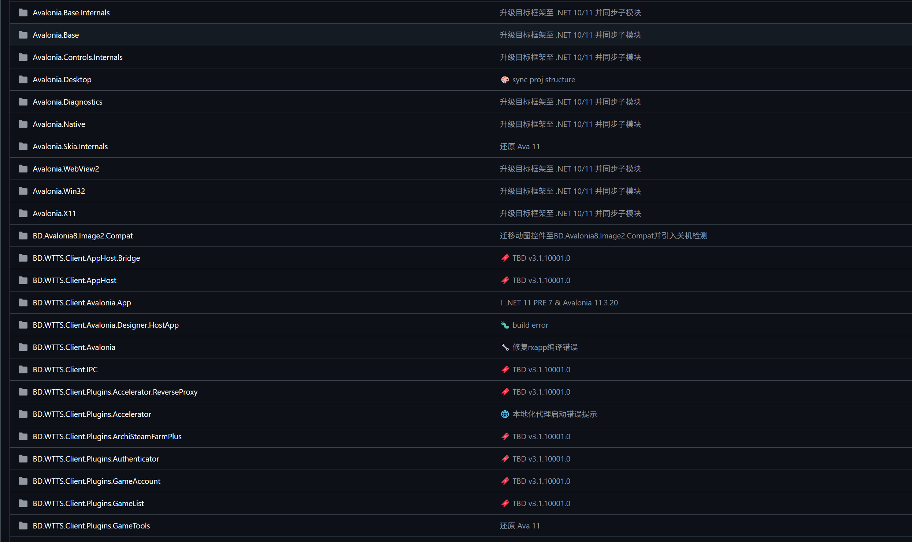
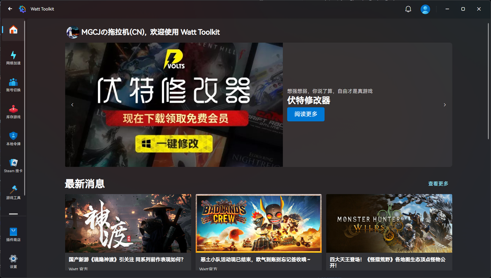
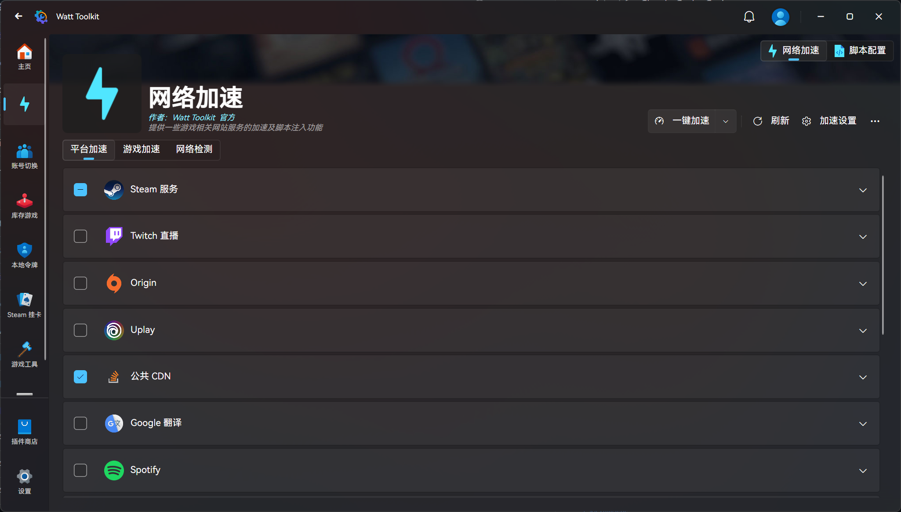
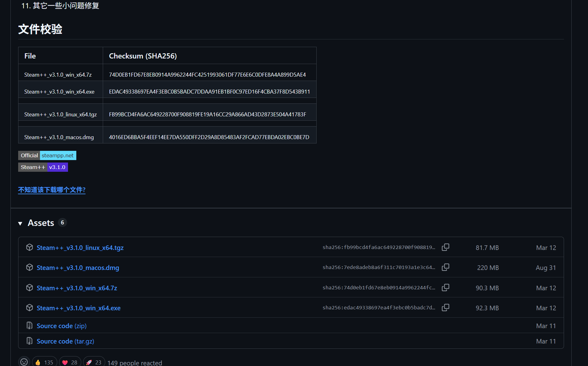

# TractorTool 产品需求说明

更新日期：2026-10-07。

本文定义软件整体目标、宿主行为和首版范围。各插件的业务细节分别维护在插件文档；这里只保留范围索引。设计不代表已实现，当前代码与验收状态只见开发文档。

文档职责与入口见 [文档导航](README.md)。相关文档：[软件架构](ARCHITECTURE.md)、[插件开发规范](PLUGIN_DEVELOPMENT.md)、[开发与验收](DEVELOPMENT.md)、[Agent 工作约定](../AGENTS.md)。

## 1. 产品目标

TractorTool 是以插件为主要功能载体的桌面工具箱。软件由宿主框架和工具插件组成，首版面向 Windows，架构保留后续支持 Linux、macOS 的空间。

宿主提供窗口、导航、插件管理、日志、设置入口、数据目录、外部依赖管理和后台任务管理。具体工具的业务逻辑、操作页面和专属设置由插件实现。

框架必须保持精干，公共能力围绕实际插件的连接、管理与交互需求演进。未来本地 AI 等场景可复用依赖和进程基础；模型选择、推理协议、硬件使用策略及业务流程仍归插件，不把工具箱宿主发展成包揽业务的平台。

核心验收目标：新增一个符合协议的普通工具插件时，只需要编译和安装该插件，不需要修改或重新编译宿主。新增宿主级能力仍允许通过接口版本升级实现，不承诺框架永远不变。

开发基础为 .NET 10、Avalonia、MVVM。优先使用框架和成熟库已有能力，按实际复用需要抽取公共代码。

## 2. 已确认的首版范围

| 编号 | 确认项 | 要求 |
| --- | --- | --- |
| R01 | 平台 | 先完成 Windows，预留跨平台边界 |
| R02 | 插件来源 | 面向自己和可信开发者，支持独立开发与本地安装 |
| R03 | 插件变更 | 拖入或选择本地 ZIP 安装/更新，以滑块开关启停；安装、更新、禁用、卸载允许重启后生效 |
| R04 | 后台任务 | 切换插件页面不终止任务 |
| R05 | 关闭窗口 | 隐藏到系统托盘，后台任务和常驻服务继续运行 |
| R06 | 插件与数据目录 | 插件代码位于软件目录的 `Plugins`；数据默认 `%LOCALAPPDATA%\TractorTool`，用户可在设置中自定义数据根目录 |
| R07 | 界面 | 全软件统一风格，支持浅色、深色、跟随系统和主题色 |
| R08 | 真实插件 | 首版实现剪贴板历史、视频多版本导出，用于测试框架 |
| R09 | 剪贴板 | 读取 Windows 自带历史；左侧历史、右侧预览，支持再次复制原内容；打开加载、系统事件刷新及手动刷新 |
| R10 | 视频输入 | 一次一个视频，至多一张封面，不支持多视频同时输入 |
| R11 | 导出预设 | 多张可保存、命名和复用的预设卡片，每张独立配置 |
| R12 | 执行方式 | 一次提交选中的多个预设，按顺序逐个导出 |
| R13 | 封面含义 | 加封面就是替换视频第一帧，不是写入独立媒体封面信息 |
| R14 | 封面适配 | 等比缩放后居中裁剪，铺满目标视频画面，不拉伸 |
| R15 | 编码 | 首版支持多种输出格式、码率和尺寸设置，以及 GPU 编码 |
| R16 | 媒体信息 | 读取源视频媒体信息，预估各版本输出文件大小 |
| R17 | 大小控制 | 用户设置码率并查看大小预估，不按目标文件大小反算码率 |

后续新增 [桌面状态 HUD](Plugins/SystemHud.md)：按用户确认分基础 HUD、方案与编辑、高级数据源三步推进，沿用 .NET 10 / Avalonia 12.1.2。业务全部在插件；事件优先，连续性能指标必要采样须按可见性停启并警告一次。需要权限时明确告知管理员要求，不新增导航 API，打开主界面沿用宿主托盘入口；不改变上表原首版范围。

## 3. 主程序与界面

### 3.1 布局

- 标题栏仅保留小图标和常规字重的软件名，作为轻量应用标识；“桌面工具箱”说明放在主页或关于页面，当前工具名称由内容区页面标题表达。保留原生窗口按钮、拖动和双击行为。
- 启动与数据迁移在同一个主窗口内容区显示居中状态和进度，完成后原位进入主页；不额外弹出临时启动窗口或强制最大化。普通启动不显示“正在迁移”；启动失败也在同窗提供原因和退出入口。迁移完成前不开放业务导航。
- 左侧顶部固定“主页”，启动后默认进入；其后为已启用插件的导航入口，列表支持滚动。
- 主页显示欢迎信息和已安装插件卡片，提供插件管理与设置入口。卡片展示真实插件信息，点击进入对应工具；不可用插件引导查看状态。没有插件时显示添加引导，不能用演示卡片冒充已安装功能。
- 插件数量只在主页与插件管理页的摘要中显示；不在其他页面底部重复计数或为其预留空白。宿主初始化失败、托盘不可用等必要提示仅在实际发生时显示。
- 中间为当前插件的操作页面，插件自行组织内部页签和功能区域。
- 宿主设置等整页滚动页面的滚动条靠内容区最右侧，正文在滚动容器内留白，保持与标题对齐。
- 左下角固定只提供“日志”“插件”“设置”三个宿主入口，不增加“退出”导航按钮。显式退出放在托盘菜单及“设置 → 通用设置 → 关于软件”；托盘不可用时仍可从设置退出。
- 插件可向宿主托盘右键菜单注册快捷操作，统一收在各自插件名称的子菜单中，支持文字、勾选及启用状态更新。宿主保留“显示 TractorTool”和“退出”，负责菜单与插件生命周期绑定；切页或隐藏窗口不移除菜单。悬浮球、参数显示等业务仍由插件实现，不进入宿主。
- 运行中的任务有稳定可达的状态入口，切换页面、隐藏窗口后重新打开，仍可查看进度和取消任务。
- 任务统一收在“日志 → 任务进度”，提供实时状态、单项/整批取消、结果和返回所属工具；标题栏不放任务按钮，不增加插件页脚。
- “日志 → 运行记录”仅记录重要运行信息：插件装载/生命周期、操作结果、任务阶段及进度。INFO 绿色、WARNING 黄色、ERROR 红色，可筛选、搜索、展开详情和暂停显示；日常导航、窗口隐藏/恢复不写日志。记录从上到下由旧到新，滚动到底部时跟随新记录，向上翻阅时不自动拉回。日志图标左上角以红色数字标记本次启动未读错误数；点击“已读”确认当时已收集的全部错误（包括暂停或筛选隐藏项），保留日志，之后的新错误重新提醒。暂停只暂停显示。
- 常规更新由事件驱动，避免轮询。现存进程树终止确认的有界轮询作为特例：实际使用时每次启动只记一条开发优化 WARNING，不掩盖真正的失败。
- 无插件、加载失败、依赖缺失、任务失败等情况有明确状态和可执行操作。

### 3.2 设置与主题

设置区分软件设置与插件设置。软件设置包括外观、数据目录、外部依赖管理和关于等内容；插件设置由插件注册，无需在宿主写入每个插件的专属页面。

设置采用有包含关系的分类导航。左侧分“软件设置”“插件设置”两组，默认展开，点击组标题或箭头可独立折叠；子项缩进，折叠不切换右侧页面或清除选择。软件设置包括“通用设置”“外部依赖”，插件设置按实际注册生成。通用设置右侧列出“外观、应用数据、关于软件”；外部依赖列出“Packages、依赖来源”。Packages 仅管理已安装依赖及其修复操作，点击进入包详情；依赖来源管理可用下载服务。面包屑可返回父级，进入子页时左侧仍选中所属大类；宽窗口分栏，窄窗口保留类别选择和面包屑，各页复用公共动画。

主题、主题色和界面动画在修改后立即生效并自动保存，不再要求点击“保存外观”，正常保存不显示常驻说明或成功提示。保存失败时区分当前已应用的效果与尚未持久化的状态，提供重试。深浅色切换采用短促柔和的颜色过渡，避免主要背景突然变白；遵循“界面动画”开关。数据迁移等涉及文件变更的操作仍使用明确的执行流程。

例如，视频插件在自己的设置页提供 GPU 加速开关，导出页面按格式和码率模式配置预设；宿主负责 FFmpeg 包的安装状态、版本、占用空间和使用路径。

所有页面使用统一的颜色、字体、间距、控件样式和交互反馈。插件可以提供自己的布局，但应复用公共资源和控件。共用外观集中维护，页面特有布局保留在各自 AXAML 中。首版不开发多套完全不同的控件外观。

深色模式参考提供的 Watt Toolkit 截图，使用有层次的深灰侧栏、内容背景和卡片，避免整窗纯黑及普通按钮堆叠。导航有明确的选中和悬停反馈；统一导航比例、图标、设置行、字体间距和控件状态，并提供适度的页面切换动画。

这些公共 UI 能力属于 M1，仅有页面入口与改色不能视为完成。优先复用成熟控件和图标资源；具体配色、控件选型与动效参数由工程方案落实，不将 RGB 值固化为需求。参考软件的账号、广告或商店内容不属于本项目范围。

## 4. 插件机制

插件包含稳定标识、显示名称、版本、兼容性声明、入口、页面与设置注册，以及可选的外部依赖和后台能力。

| 生命周期对象 | 例子 | 页面离开后 |
| --- | --- | --- |
| 页面 | 剪贴板历史查看页面 | 可以释放或缓存，不能误停其他任务 |
| 有限任务 | 导出一个视频版本 | 独立运行到成功、失败或取消 |
| 常驻服务 | 未来持续监听某种系统事件的插件 | 按插件启停策略运行，直到停用或退出 |

首版剪贴板插件用于找回、预览和再次复制系统历史；页面存续期间监听系统历史事件并重新读取，离页解绑，不自行常驻记录历史。框架保留常驻服务的生命周期接口，不能为了演示而把剪贴板功能改成自建历史数据库。

插件管理显示已安装版本、启用状态、兼容性或加载错误，以及待重启的变更。插件程序及其私有依赖安装到软件目录的 `Plugins/<PluginId>/<Version>`，插件设置和持久数据留在用户数据根目录。卸载插件默认保留用户数据。

首版支持可信插件，不建设公开插件商店，不承诺不可信插件的权限沙箱或运行时热卸载。

## 5. 外部依赖管理

插件声明所需工具及固定版本，并在清单中提供 GitHub 仓库、精确 Release 标签、平台 ZIP 附件、SHA256、工具相对路径与版本验证方式。宿主复用符合声明的已安装包；缺失时查询 GitHub Release，展示用途及来源，首次确认后下载、校验、解压并返回工具租约。用户拒绝安装正常返回，不由插件另建下载器。

不建设或维护 TractorTool 自有包源，不要求另行部署索引。软件默认提供 GitHub Releases；“设置 → 软件设置 → 外部依赖”分为 Packages 和依赖来源。Packages 展示已安装包的名称、版本、平台、来源、许可、占用和引用信息，提供详情、修复及安全清理；修复期间继续显示进度、取消和失败。依赖来源可添加或移除公开 GitHub Enterprise API 地址，默认 GitHub 保留。当前只支持公开 Release 的 ZIP 附件，不支持私有仓库认证、源码编译或任意脚本；pip 等类型在具备实际安装能力后开放，不展示不可用的来源配置。

首个实际接入对象是包含 FFmpeg、ffprobe 的工具包。插件通过宿主获得工具路径，不要求用户把工具加入系统 `PATH`，也不由插件各自重复实现下载器。

外部工具包由软件统一管理，存储于数据根目录 Packages，与插件代码分开；工程归属与事务设计见 [软件架构](ARCHITECTURE.md#packages)。

- 版本与平台明确，支持不同版本并存，避免插件之间互相覆盖依赖。
- 下载失败或校验失败可重试，不能把半成品标记为可用。
- 卸载插件不删除已经安装的外部依赖包；设置中的外部依赖页提供用户主动清理未引用包的入口。
- 区分插件的持久依赖引用与任务运行时占用，分别显示依赖它的插件和正在使用者；不能把“当前没有任务使用”当作“未引用”。运行中的任务使用的版本不能被删除或替换。
- 首版管理便携工具包，不实现类似 pip 的通用语言环境和任意安装脚本系统。
- 可提供本地工具路径作为工程扩展，使用前验证所需工具和能力，不改变统一管理入口。

已确认的后续计划：支持 Python 依赖，通过 PyPI 或兼容 pip 的安装源获取包。插件声明需求，宿主统一准备 Python 运行环境、安装依赖并提供调用入口，继续遵守首次确认、已有依赖复用、卸载插件保留依赖及主动清理规则。此计划尚未排期，不扩大首版交付范围；隔离环境、间接依赖和数据迁移的架构边界见 [Python 依赖扩展](ARCHITECTURE.md#python-dependencies)。

## 6. 首版插件

首版必须交付以下两个真实业务插件；测试夹具不能替代它们。插件与宿主通过同一公开 SDK 接入，通用要求见 [插件开发规范](PLUGIN_DEVELOPMENT.md)。

| 插件 | 需求编号与核心范围 | 完整业务文档 |
| --- | --- | --- |
| 剪贴板历史 | R08、R09：系统历史分栏预览、再次复制、事件刷新，不自建历史库 | [ClipboardHistory.md](Plugins/ClipboardHistory.md) |
| 视频多版本导出 | R08、R10–R17：单视频/单封面、多预设串行、首帧替换、多格式与真实 GPU、媒体信息和码率大小预估 | [VideoExport.md](Plugins/VideoExport.md) |

各插件文档拥有自己的交互、参数、模型、错误状态和验收方法；结果仍统一记录在开发验收台账。

## 7. 数据与持久化

软件目录与数据根目录分别管理：

| 内容 | 位置 |
| --- | --- |
| 插件 DLL、资源和私有依赖 | `<AppRoot>/Plugins/<PluginId>/<Version>` |
| 宿主配置 | `<DataRoot>/Config` |
| 插件配置、预设和持久数据 | `<DataRoot>/Data/Plugins/<PluginId>` |
| 公共任务摘要 | `<DataRoot>/Data/tasks.json` |
| 下载的 FFmpeg 等外部依赖 | `<DataRoot>/Packages/<PackageId>/<Version>/<RID>` |
| 缓存与日志 | `<DataRoot>/Cache`、`<DataRoot>/Logs` |

`AppRoot` 是实际运行的软件目录，不是源码仓库或终端当前目录。默认数据根目录 `DataRoot` 为 `%LOCALAPPDATA%\TractorTool`，用户可在设置中修改。该规则适用于首版所有发布包，不因便携包自动把数据改存程序目录。

插件数据使用稳定 `PluginId` 隔离，显示名称改变不导致数据丢失。各模块从宿主获取不同用途的路径，不把插件代码根目录与数据根目录混用。

日志文件自动滚动并按时间、数量和总大小保留，避免长期运行无限增长；应用数据页展示当前规则并可打开日志目录。仅清理软件生成的旧日志，不递归清理用户目录，不影响内存中的未读提醒。清理受阻明确警告；超长单条磁盘记录截短并标注，不声称被截短内容已完整保存到文件。

在“设置 → 通用设置 → 应用数据”选择本机空的专用目录，经确认后在显式退出后的下次启动迁移设置、预设、插件数据、依赖包和日志，显示进度。插件程序位置不变，缓存和未完成下载不复制。原数据始终保留；切换前失败可继续使用原目录，并在设置中重试或取消，已复制的部分文件也保留。切换后收尾中断时先恢复迁移再加载插件，避免新旧数据同时写入。首版不合并现有目录，不自动覆盖重试时不一致的文件；此时选择新空目录重新安排。具体步骤见[架构文档](ARCHITECTURE.md#storage)。导出视频仍保存到用户选择的输出目录，不随应用数据迁移。

## 8. 发布

首版交付 Windows 版本，支持本地发布用于测试，以及 GitHub Actions 构建和 GitHub Release 发布。参考现有软件提供压缩包、安装程序和校验信息的形式；Linux、macOS 发布留到后续平台阶段。

具体架构、压缩格式和安装器选型属于工程配置；版本号由 TractorTool 自己维护，不沿用参考软件的版本号。发布包应携带插件所需文件、许可信息和正确的依赖清单，不能要求用户安装开发用 SDK。

首版安装到当前用户可写的软件目录。初装附带正式插件；软件升级保留已有插件和插件管理状态，插件更新仍走插件管理。卸载软件保留插件、配置、下载依赖及自定义数据。安装和卸载前要求显式退出软件，不强制结束后台任务；不直接接管用户自行解压的非安装版目录。

## 9. 首版边界与工程默认

已确认需求以第 2 节及对应插件文档为准。以下为软件层面的工程默认；插件的失败策略、编码和输出规则维护在各自文档中：

- 首个发布目标采用 `win-x64` 自包含 ZIP 与 Inno Setup 用户级安装器；机器级安装及多平台安装器留到后续。实际媒体格式矩阵维护在视频插件文档中。
- 显式退出时，如有未完成任务，允许用户取消退出或停止任务后退出；隐藏窗口不触发退出流程。
- 已入队任务保存通用摘要，重启将未完成项标为中断并由用户重新提交，不自动恢复执行。摘要不保存插件业务参数，也不据此删除崩溃遗留输出。视频媒体读取、依赖申请和参数预检仍在插件页显示状态与取消，预检成功后才入队；这些准备操作不属于公共任务记录。
- 数据目录变更通过迁移和重启应用，默认保留旧目录供恢复，不自动删除旧数据。

首版不包括多源视频批量输入、多个版本并行编码、目标文件大小控制、自建剪贴板历史库、多套完全不同的视觉主题、公开插件市场、不可信插件沙箱、无重启热更新或崩溃后自动续转码。

## 10. 参考资料与截图

参考项目用于理解架构与交互，具体实现按 TractorTool 的需求选取。直接复用源码或分发第三方二进制前，确认对应版本的许可证和分发要求。

- [Watt Toolkit / SteamTools](https://github.com/BeyondDimension/SteamTools)：参考插件组织、软件布局与发布形式。仓库标注 GPL-3.0。
- [SteamTools 插件接口](https://github.com/BeyondDimension/SteamTools/blob/develop/src/BD.WTTS.Client/Plugins/Abstractions/IPlugin.cs)：参考菜单、配置和生命周期注册。
- [CC Switch](https://github.com/farion1231/cc-switch)：参考视觉与交互；其 [package.json](https://github.com/farion1231/cc-switch/blob/main/package.json) 和 [components.json](https://github.com/farion1231/cc-switch/blob/main/components.json) 表明它使用 Tauri、React、Tailwind 和 shadcn/ui，不能直接复用为 Avalonia 控件。
- [Apple 人机界面指南](https://developer.apple.com/design/human-interface-guidelines)：作为交互参考，具体行为符合 Windows 桌面使用习惯。

参考项目结构，不要求复制其工程数量或 Avalonia 内部工程：

参考导航和内容区布局：

参考发布资产展示方式，首版只落实 Windows：

